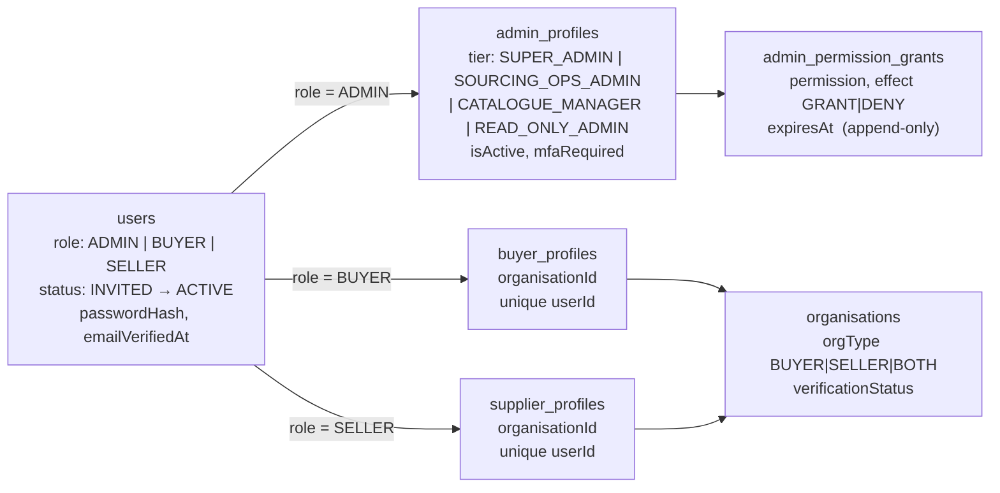
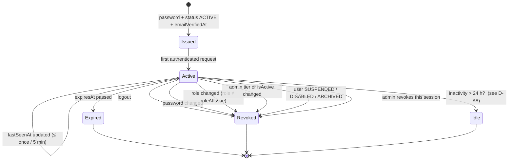
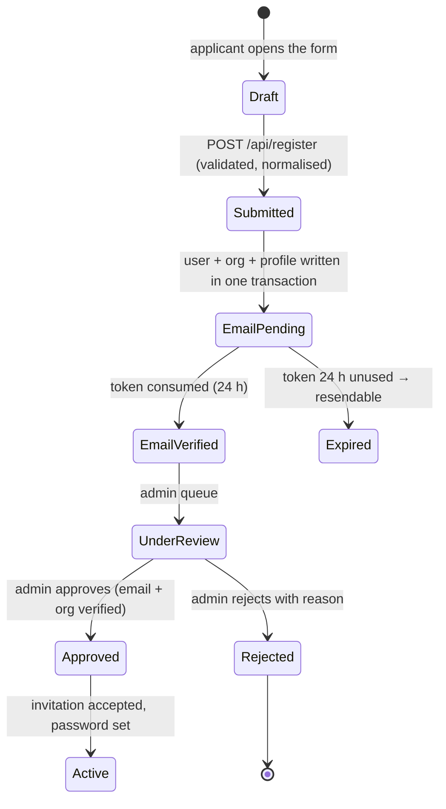

# PRIMEMET — M2 Authentication Foundation: Implementation Design

**Status:** DESIGN ONLY. No code, schema, validator, index, migration, credential or database was created,
changed or contacted in producing this document.
**Revision:** 1 — 2026-11-01
**Source of truth for facts:** the working tree as it stands, read directly (`db/collections/core.mjs`,
`db/enums.mjs`, `db/roles.mjs`, `db/define.mjs`, `db/migrations/index.mjs`, `src/lib/db.ts`,
`src/lib/env.ts`, `src/middleware.ts`, `prisma/schema.prisma`, `package.json`). Every count in this
document was measured, not estimated; where a claim could not be verified it is marked **[unverified]**.

---

## 0. How to read this document

| Marker | Meaning |
|---|---|
| **[existing]** | Already in the repository and verified this pass |
| **[proposed]** | New design proposed here; not implemented |
| **[owner decision]** | Needs the project owner; cannot be settled from the codebase |
| **[unverified]** | Could not be confirmed from the repository or from an official source in this pass |

**Two conventions that matter.** Section references to *this* document are written `§N`; references to
another document name it, e.g. `ARCH §15.5`. Estimates are given in *person-days of focused work*, not
calendar time.

---

## 1. What exists today, measured

### 1.1 The identity schema already exists — 45 collections, 7 append-only

| Collection | Model | Role in M2 | State |
|---|---|---|---|
| `users` | User | identity, credential, status | **[existing]** |
| `sessions` | Session | server-side session record | **[existing]** |
| `auth_events` | AuthEvent | append-only auth trail | **[existing]**, immutable |
| `admin_profiles` | AdminProfile | staff tier, approval limit | **[existing]** |
| `admin_permission_grants` | AdminPermissionGrant | 74-value permission grants | **[existing]**, immutable |
| `portal_invitations` | PortalInvitation | invitation + hashed token | **[existing]** |
| `organisations` | Organisation | legal entity, GSTIN/PAN | **[existing]** |
| `organisation_addresses` / `_contacts` / `_verifications` | … | addresses, contacts, verification evidence | **[existing]** |
| `buyer_profiles` / `supplier_profiles` | … | one profile per party, optional `userId` link | **[existing]** |
| `audit_logs` / `audit_log_failures` | … | business audit trail | **[existing]**, immutable |
| `document_access_logs` | DocumentAccessLog | download trail | **[existing]**, immutable |

Measured: `COLLECTIONS.length = 45`, `IMMUTABLE_COLLECTIONS.length = 7`
(`admin_permission_grants`, `audit_log_failures`, `audit_logs`, `auth_events`,
`document_access_logs`, `material_alias_equivalence_decisions`, `material_alias_verifications`).

**Consequence for M2: no new collection is required for any of the six roles.** The schema was designed
for this; M2 is the code that uses it. That is the single most important finding of this pass, because
it changes M2 from "build a foundation" to "activate an existing one" — a materially smaller and lower
risk job.

### 1.2 The enums M2 must respect — verified values

| Enum | Values | Count |
|---|---|---|
| `UserRole` | ADMIN, BUYER, SELLER | 3 |
| `UserStatus` | INVITED, ACTIVE, SUSPENDED, DISABLED, ARCHIVED | 5 |
| `AdminTier` | SUPER_ADMIN, SOURCING_OPS_ADMIN, CATALOGUE_MANAGER, READ_ONLY_ADMIN | 4 |
| `AdminPermission` | (74 values, enumerated in §2.3) | 74 |
| `OrgType` | BUYER, SELLER, BOTH | 3 |
| `VerificationStatus` | NOT_SUBMITTED, PENDING, UNDER_REVIEW, VERIFIED, REJECTED, EXPIRED | 6 |

Total enum set: **67**. The six roles in the brief map to `UserRole` × `AdminTier` as: BUYER and SELLER
are `UserRole`; the four admin roles are `AdminTier` values under `UserRole = ADMIN` (§2.1).

### 1.3 What does not exist

| Concern | State |
|---|---|
| Password hashing | **none** — no hashing library in `package.json` either (`dependencies`: `@prisma/client`, `mongodb`, `next`, `react`, `react-dom`, `sharp`, `zod`) |
| Login / logout / session code | **none** — `src/app/api/` contains exactly one file, `health/route.ts` |
| Cookie handling | **none** in `src/` |
| Middleware enforcement | **none** — `src/middleware.ts` calls `NextResponse.next()` and `void`s its route tables |
| Write handlers | **0** — no `POST`/`PUT`/`PATCH`/`DELETE` export anywhere in `src/` |
| Permission resolution | **none** — zero references to `admin_permission_grants` or `admin_profiles` in `src/` |
| Audit emission | **none** — the collections exist; nothing writes to them |
| Mail transport | **none** — `ZOHO_SMTP_*` declared optional in `src/lib/env.ts`, unused |
| Admin landing route | **none** — `/admin` 404s because there is no `src/app/admin/page.tsx` (measured: file absent) |
| Client bundle hygiene | **Measured:** 0 client components import `@/lib/db`; 1 `dangerouslySetInnerHTML` usage exists (the JSON-LD data island) |
| Hashing library | **Measured:** 0 matches for `argon2`/`bcrypt` in `package.json` |

### 1.4 The security consequence, stated plainly

Every `/admin`, `/buyer`, `/seller` route is publicly reachable today (the middleware matcher includes
them but enforces nothing). They are safe **only** because they contain no records. **The moment M2
writes the first real row, an unguarded portal becomes a data breach.** This is why §8 sequences the
guard *before* any data-bearing endpoint, rather than after it.

---

## 2. Authentication architecture (§1 of the brief)

### 2.1 Identity model — one identity, two faces



**Decisions.**

- **D-A1 [proposed]** One `users` row per human. `role` is a `UserRole`, never an `AdminTier`. A person
  who is both a buyer contact and a staff member gets **two accounts**, because the two carry different
  legal identities (privacy, audit attribution, conflict-of-interest rules in ARCH §17). Merging them
  would make "who approved this" ambiguous.
- **D-A2 [proposed]** An `ADMIN` user without an active `admin_profiles` row is a **misconfiguration, not
  a lesser admin**: authentication succeeds, authorisation resolves to zero permissions, and the
  session is refused with `ACCOUNT_NOT_PROVISIONED`. Fail closed.
- **D-A3 [existing]** `users.email` carries a validator invariant (`email === toLower(email)`) plus a
  unique index, so case-variant duplicates cannot exist at rest. Registration must still normalise
  before the insert, because the validator *rejects* rather than normalises.

### 2.2 Password hashing — Argon2id

**Library choice [proposed]:** `@node-rs/argon2` (Rust/NAPI prebuilt binaries, no node-gyp at install).

| Parameter | Value | Rationale |
|---|---|---|
| variant | Argon2id | OWASP-recommended first choice; hybrid side-channel/GPU resistance |
| memory | 19 456 KiB (19 MiB) | OWASP baseline |
| iterations | 2 | OWASP baseline for 19 MiB |
| parallelism | 1 | Vercel functions expose ~1 vCPU; higher values buy nothing and cost CPU-time |
| salt | 16 bytes, CSPRNG | encoded inside the PHC string |
| output | 32 bytes | encoded inside the PHC string |
| encoding | PHC (`$argon2id$v=19$m=19456,t=2,p=1$…`) | self-describing; lets parameters change without a schema change |

**Rules.**

1. **Rehash on successful login** when the stored PHC encodes different parameters — the only migration
   path for a parameter change, and it needs no schema field.
2. **`passwordHash` is optional in the schema** (`f.strOpt()`), deliberately: an invited user has no
   password until they accept. Login must treat `undefined` as *"cannot authenticate by password"*, never
   as *"authenticate with anything"* — the classic empty-hash bypass.
3. **Password policy [proposed]:** minimum 12 characters, maximum 256 (bounded to stop CPU exhaustion by
   password length), checked against a small denylist (`source` blocked, `primemet123`, …), **no**
   composition rules (they push users to predictable patterns). Length is measured in code points, not
   bytes, so a Devanagari or emoji password is not silently truncated.
4. **Never** log, echo, serialise or include a password or hash in an error, an audit row or a response.
5. `passwordChangedAt` is set on every change and compared against the session's `createdAt` (§2.5).

**Measured cost to expect:** Argon2id at 19 MiB / 2 iterations is on the order of tens of milliseconds
per verification on a modern serverless vCPU. **No figure is quoted as measured** — §5.6 T-PERF measures
it before any rate limit is tuned. A slow hash is a *feature* at the login endpoint and a *hazard* on a
hot path, which is one reason sessions are token lookups, not hash verifications (§2.4).

### 2.3 Session token — generation, hashing, storage

**D-A4 [proposed] Token shape.** 32 random bytes from a CSPRNG, base64url-encoded (43 characters).
Stored **only** as SHA-256 hex in `sessions.tokenHash`.

| Property | Decision | Reason |
|---|---|---|
| Hashing algorithm | SHA-256 (unkeyed) | The token is 256 bits of uniform entropy, so a fast hash is sufficient; Argon2 here would cost a verification per request for no gain. This is the one place a fast hash is correct, and the brief specifies it. |
| Where the raw token lives | the cookie only | Never in the database, never in a log, never in an audit row |
| Lookup | `findOne({ tokenHash })` on the unique index | O(1); the index already exists |
| Comparison | constant-time on the hash | Not strictly necessary (the hash is the lookup key), but cheap and removes an argument |
| Token rotation trigger | privilege change, password change, re-authentication | §2.5 |

**D-A5 [proposed] Session record fields actually used:** `userId`, `tokenHash`, `roleAtIssue`,
`ipHash`, `userAgentHash`, `createdAt`, `lastSeenAt`, `expiresAt`, `revokedAt`, `revokedReason` — all
`[existing]` fields. `roleAtIssue` is what makes role-change invalidation deterministic rather than
heuristic.

### 2.4 Cookies

**D-A6 [proposed] Cookie contract.**

| Attribute | Value | Reason |
|---|---|---|
| name | `__Host-primemet_session` | The `__Host-` prefix is **enforced by the browser**: it refuses the cookie unless `Secure`, `Path=/`, and *no* `Domain` attribute. That makes domain-scoping mistakes impossible rather than merely discouraged. |
| `HttpOnly` | yes | Keeps the token out of reach of any script, including a future XSS |
| `Secure` | yes | `__Host-` requires it |
| `SameSite` | `Lax` | Baseline CSRF protection for top-level navigation; the mutating endpoints add a token check (§4.5) |
| `Path` | `/` | `__Host-` requires it |
| `Domain` | **absent** | `__Host-` forbids it |
| `Max-Age` | 60 × 60 × 8 (8 h, absolute session lifetime) | Short enough to limit a stolen cookie, long enough for a working day |
| Local development | same name, over `http://localhost` | The `__Host-` prefix requires `Secure`, so locally the cookie is set **without** the prefix only when `NODE_ENV !== "production"`. The name is a build-time constant, not a runtime toggle, so production can never fall back. |

**Two cookies are not used** (no separate CSRF cookie) — see §4.5, which uses a header echo of a
double-submit token bound to the session, not a second cookie that could drift.

**D-A7 [proposed] No token in URLs.** Password-reset and verification links carry a token in the path,
which is unavoidable for email; but that token is **single-use, short-lived, and separate** from the
session token (§2.6), so a leaked link cannot become a session.

### 2.5 Session lifecycle and invalidation



| Rule | Mechanic |
|---|---|
| **Absolute expiry** | `expiresAt` set at issue (8 h). Checked on every request. |
| **Idle expiry [owner decision D-A8]** | `lastSeenAt` is already a field. Proposal: 24 h idle with the 8 h absolute cap dominating — i.e. effectively "no idle rule beyond the absolute cap" until sessions get longer. **Recommendation: keep it simple now (absolute only), add idle when the working day pattern is known.** |
| **Role-change invalidation** | On every session read: if `user.role !== session.roleAtIssue` → revoke with `revokedReason = "role_changed"`, fail the request. Deterministic, because the role is copied at issue. |
| **Password-change invalidation** | If `session.createdAt < user.passwordChangedAt` → revoke with `password_changed`. |
| **Status-change invalidation** | `user.status !== ACTIVE` → revoke with `status_changed`. |
| **Admin deactivation** | `admin_profiles.isActive === false` or tier changed → revoke with `admin_profile_changed`. |
| **Logout** | Sets `revokedAt` + `revokedReason = "logout"`; clears the cookie. **The row is never deleted** — the schema note says history survives. |
| **Revocation is checked before permissions** | A revoked session must never reach an authorisation decision, so it cannot be "briefly valid". |
| **`lastSeenAt` write throttling** | Updated at most once per 5 minutes per session, to keep a read-heavy request path from writing on every call. |

**D-A9 [proposed] Session lookup is one indexed read plus one user read, then cached per request** in a
React `cache()` scope — not a cross-request cache, which would defeat revocation.

### 2.6 Email verification

**D-A10 [proposed]** A separate single-use token, **stored hashed in a new field on `users`**, because
neither existing collection expresses "a verification token issued to a user who has no session":

| Field [proposed] | Type | Note |
|---|---|---|
| `users.emailVerificationTokenHash` | `strOpt` | SHA-256 of a 32-byte token |
| `users.emailVerificationExpiresAt` | `dateOpt` | 24 h |
| `users.emailVerificationSentAt` | `dateOpt` | for resend throttling |

Rejected alternatives: `portal_invitations` (semantically an invitation to join, not proof of an
address, and it carries `role` and `organisationId` that do not apply), and a new collection (seven new
collections were priced in `PRIMEMET_P1_*`; adding an eighth for three fields is disproportionate).

**Flow:** `POST /api/auth/verify-email` consumes the token → sets `emailVerifiedAt`, clears the three
fields → appends an `auth_events` row → the user may log in (if the admin has also approved).

### 2.7 Password reset

**D-A11 [proposed]** Same shape as §2.6, same reasoning:

| Field [proposed] | Type |
|---|---|
| `users.passwordResetTokenHash` | `strOpt` |
| `users.passwordResetExpiresAt` | `dateOpt` |
| `users.passwordResetRequestedAt` | `dateOpt` |

**Rules.** Single use; 1 h expiry; requesting a reset appends `auth_events` and **revokes nothing**; a
successful reset sets `passwordChangedAt` (which invalidates every session by §2.5), clears the reset
fields, and appends an `auth_events` row. The request endpoint returns **202 with an identical body**
whether or not the address exists (§5.4).

### 2.8 Where the raw password is never trusted

The password arrives in a JSON body on `POST /api/auth/login`, is hashed immediately, and is never held
in a session, a cookie, a log line or a form-state object. The login page is a client component that
`POST`s and then **replaces the form value with an empty string** before any state update, so a React
devtools snapshot after submit does not contain it.

---

## 3. Authorization (§2 of the brief)

### 3.1 The two-layer model

```mermaid
flowchart TB
  R[Request] --> M{1. session valid?<br/>revocation, expiry, roleAtIssue, status}
  M -- no --> X1[401 / redirect to login]
  M -- yes --> G{2. role matches area?<br/>ADMIN|BUYER|SELLER}
  G -- no --> X2[redirect to own dashboard]
  G -- yes --> P{3. permission held?<br/>latest-event-wins, expiry-aware}
  P -- no --> X3[403]
  P -- yes --> S{4. resource in scope?<br/>organisation / own-record}
  S -- no --> X4[404 — not 403]
  S -- yes --> H[Handler]
  H --> A[append audit_logs]
```

**D-B1 [proposed] Four gates, in this order, all server-side.** The client is treated as untrusted
throughout; hiding a button is never a control.

**D-B2 [proposed] Step 4 returns 404, not 403.** A buyer asking for another buyer's order should not
learn that the order exists. This is the single cheapest anti-enumeration measure and it costs nothing.

### 3.2 Admin tier → default permission grants (measured)

Tiers are a **default grant set**, not a second authorisation path: the resolver reads grants only. The
bootstrap writes the defaults; a later explicit `DENY` overrides them (§3.3).

| Tier | Default permissions | Count |
|---|---|---|
| `SUPER_ADMIN` | all 74 | **74** |
| `SOURCING_OPS_ADMIN` | enquiry, quote, lot, rejection, party, order, contact, document, pricing/tax **view** | **45** |
| `CATALOGUE_MANAGER` | catalogue, composition, SEO, content, redirect, document, report, party **view** | **14** |
| `READ_ONLY_ADMIN` | every read permission: `*_VIEW` plus `CONTACT_VIEW_RESTRICTED`, `PRICING_VIEW_INTERNAL`, `TAX_VIEW_SNAPSHOT`, `DOCUMENT_VIEW_INTERNAL` and the four `DATABASE_VIEW_*`; **not** `CONTENT_REVIEW` (a decision, not a read) | **20** |

**Measured with a script against the live enum, not counted by hand:** union of the three non-super tiers
= **62**. **Twelve permissions are never granted to any tier except `SUPER_ADMIN`**:

`PRICING_EDIT`, `PRICING_APPROVE`, `TAX_EDIT`, `TAX_APPROVE`, `INVOICE_ISSUE`, `AUDIT_EXPORT`, `USER_INVITE`,
`USER_SUSPEND`, `ACCESS_ASSIGN_ROLE`, `ACCESS_GRANT_PERMISSION`, `NOTIFICATION_RETRY`,
`DATABASE_APPLY_MIGRATION`.

That list is the **privilege-escalation surface**: every one of them can change what someone else may do,
move money, or alter history. §4.3 constrains them specifically.

> **Correction (tier matrix reconciliation, 2026-11-01).** This list previously held fifteen entries, adding
> `LOT_OVERRIDE_GATE`, `PARTY_SUSPEND` and `ORDER_CANCEL`. Those three are `SOURCING_OPS_ADMIN` defaults in
> `src/lib/permissions/tiers.ts`, and removing them would make that tier 42 rather than the contractual 45 —
> so the fifteen-entry list contradicted the table immediately above it. The counts are now 62/12, generated
> in `docs/PRIMEMET_TIER_MATRIX.md`. Whether the three *should* be super-only is a separate policy question,
> recorded there as **D-TIER-1** and left **open**; this document does not decide it.

### 3.3 Permission resolution — SUPERSEDED by D-ARCH-12

> **SUPERSEDED 2026-11-01 by owner decision D-ARCH-12.** This section described **deny-wins** resolution,
> including the rule "DENY is absolute, regardless of tier default or grant order". The owner approved
> **latest-event-wins** instead. The authoritative semantics are `PRIMEMET_PHASE_1A_CONTRACTS.md` §1.3a and
> §2.2–§2.7, implemented in `src/lib/permissions/resolve.ts` and proven by `npm run check:permissions`.
> **Do not implement the pseudocode below.** It is retained only so that a reviewer reading an older
> change can recognise it as the superseded design rather than a second, competing specification.

**What changed, rule by rule.** The two designs agree on gates, on append-only history and on evaluating
expiry at authorisation time. They disagree on what a DENY and a REVOKE mean, and that disagreement was the
whole of D-ARCH-12:

| Superseded rule (deny-wins) | Approved rule (latest-event-wins) | Why it mattered |
|---|---|---|
| DENY is absolute, regardless of grant order | the **newest applicable** event decides | deny-wins makes two admins' actions order-independent but not cumulative: the second GRANT could never reinstate what the first DENY removed except by deleting history |
| A revoked permission is a `DENY` row | revocation is a `REVOKE` row that **restores the tier default** | under deny-wins a revoked permission stayed denied forever, so "remove the exception I added" and "forbid this permanently" were the same act |
| `effect` is restricted to `GRANT`/`DENY` | `effect` is `GRANT`/`DENY`/`REVOKE` | the validator had to accept REVOKE, or the resolver's contract and the database's rules would disagree — the defect D-ARCH-12 exists to close |
| an expired row is skipped | an expired row is **inert**: resolution falls through to the newest still-valid row | §2.4 of the contracts shows the case that decides it: a temporary GRANT must not become a permanent revocation, and a temporary DENY must not become a permanent one |
| an unknown `effect` is ignored rather than treated as a GRANT | unchanged — and now also **reported** (`ignoredEvents`) | an invented effect must never authorise anything, and hiding that it happened makes a forged row invisible |

**Retained from this section, unchanged:** expiry is evaluated against the **request clock**, never the
write clock; the event log is **append-only** and is its own audit history; the resolved set is cached
**per request only**, never across requests, because a new DENY must take effect on the next request.

<details>
<summary>Historical text — the superseded deny-wins pseudocode, kept for recognition only</summary>

```
resolvePermissions(user, profile, grants, now) -> Set<Permission>
  if user.role != ADMIN            -> empty            // business users have no admin permission
  if !profile?.isActive            -> empty            // fail closed
  granted = {}
  for g in grants where g.adminId == profile._id:
      if g.expiresAt != null and g.expiresAt <= now: continue    // expired grant is inert
      if g.effect == "DENY": denied.add(g.permission)
      if g.effect == "GRANT": granted.add(g.permission)
  return granted - denied
```

The "DENY is absolute" rule above is the sentence D-ARCH-12 replaced.

</details>

### 3.4 Organisation-level restrictions and party isolation

**D-B4 [proposed] Every party query is scoped by the session's own organisation.** The scope is derived
from the session (via `buyer_profiles.organisationId` / `supplier_profiles.organisationId`), never from a
request parameter. A request that names an organisation id is checked against the derived scope and
answered 404 on mismatch.

| Actor | May read | May write |
|---|---|---|
| BUYER | own org's enquiries, quotes, orders, documents with `visibility ∈ {BUYER_VISIBLE}` **and** `ownerOrgId = own org` | own profile, own contact details, own enquiries |
| SELLER | own org's listings, quote requests addressed to it, its own documents | own listings (once an approval path exists), own quote responses |
| ADMIN | per permission, plus `CONTACT_VIEW_RESTRICTED` for contact data, plus `DOCUMENT_VIEW_INTERNAL` for internal documents | per permission |
| **Buyer ↔ Seller** | **nothing** | **nothing** — see §3.5 |

**D-B5 [existing] Contact privacy is a data-side default, not a view-side filter.**
`organisation_contacts.shareable` defaults to `false`, and the schema note states it is the data half of
the admin-controlled contact-sharing rule (D2). M2 adds the enforcement half: a contact is returned to a
counterparty only when a **sharing approval** exists (approver, timestamp), and never by a public page,
search result or listing.

### 3.5 Self-approval and privilege escalation — seven rules

| # | Rule | Failure it prevents |
|---|---|---|
| **E-1** | A user may not hold two admin identities; `admin_profiles.userId` is unique `[existing]` | one person acting as two approvers |
| **E-2** | **Self-approval ban:** `actor.userId !== record.createdById` on every approval, and for listings also `!== listing.supplierProfile.userId` (ARCH §20.1, rule A) | approving your own work |
| **E-3** | **No self-grant:** `ACCESS_GRANT_PERMISSION` and `ACCESS_ASSIGN_ROLE` refuse when `target.adminId === actor.adminProfile._id`, and refuse granting a permission the actor does not itself hold | escalation by granting yourself or by granting beyond your own ceiling |
| **E-4** | **No tier self-change:** changing `AdminTier` requires `SUPER_ADMIN` **and** a different user | self-promotion to SUPER_ADMIN |
| **E-5** | **No escalation via profile fields:** `approvalLimit` changes are audited and require `SUPER_ADMIN` | raising one's own monetary ceiling |
| **E-6** | **The last SUPER_ADMIN cannot be demoted, suspended or deactivated**; the operation fails with `LAST_SUPER_ADMIN` | locking everyone out of administration |
| **E-7** | **No password set on behalf of another user**; `SUPER_ADMIN` may issue a reset link, never a password | admin impersonation with a known credential |

**D-B6 [proposed] The ceiling on grants (E-3) is the important one.** Without it, a `CATALOGUE_MANAGER`
who has somehow acquired `ACCESS_GRANT_PERMISSION` becomes `SUPER_ADMIN` in two steps. With it, the
ceiling is transitive: you may only pass on what you hold.

### 3.6 Server-side route and API protection

**D-B7 [proposed] Enforcement lives in a single helper, called by every handler; the middleware is a
fast pre-filter, not the control.**

```
requireSession(request)            -> session | throws
requireRole(session, "ADMIN")     -> void
requirePermission(session, P)     -> void      // latest-event-wins resolver (D-ARCH-12)
requireOrgScope(session, orgId)   -> void      // 404 on mismatch
```

**Why not rely on `middleware.ts` alone:** middleware runs before the handler and cannot see the body,
cannot run a database lookup cheaply for every static asset, and — critically — a matcher change
silently removes protection. The middleware's job is to *redirect unauthenticated browsers* so humans
get a login page instead of a 401; the handler's `requireSession` is what actually stops data leaving.

> **Known constraint [existing]:** `middleware.ts` runs on the **Edge runtime** and the application uses
> the native `mongodb` driver, which cannot run there. So the session check inside middleware must be a
> **signature/expiry check on an opaque cookie that needs no database read**, with the authoritative
> revocation check in the handler. That splits the contract: the cookie must be self-describing enough
> for an offline expiry check but must **not** be the authority. Concrete design: the cookie carries
> `<token>`; middleware cannot validate it without a DB read, so middleware performs **only the
> presence + route-class check** and redirects; everything else is in the handler. This is stated as a
> limitation, not solved: an attacker who knows a revoked token still gets past middleware and is then
> stopped by `requireSession`. Since the handler is the data gate, that is acceptable — but it must be
> documented so nobody later "optimises" the handler check away.

---

## 4. Registration (§3 of the brief)

### 4.1 Two flows, one shape

**D-C1 [proposed]** Buyer and supplier share a wizard shell and a state machine, and differ in which
profile and which verification evidence they collect. Duplicating the flow would duplicate its bugs; the
fields differ, the machine does not.



**D-C2 [proposed] The applicant chooses a password at registration (§4.4) but cannot log in until
`Approved`.** The alternatives are worse: setting it at acceptance means an unauthenticated
account-setup endpoint (a second intake), and emailing a password is disqualifying.

### 4.2 What is written, and in what order

**D-C3 [proposed] One transaction, four documents:**

1. `organisations` — `legalName`, `orgType ∈ {BUYER, SELLER}`, `accountStatus = "PENDING"`,
   `verificationStatus = PENDING`, `isListable = false`, `countryCode`; GSTIN/PAN optional at this step
   (**unique-when-present** `[existing partial indexes]`).
2. `users` — `email` normalised, `role`, `status = INVITED`, `passwordHash` (Argon2id),
   `emailVerificationTokenHash` + expiry.
3. `buyer_profiles` or `supplier_profiles` — `organisationId`, `userId`, `verification = PENDING`.
4. `organisation_contacts` — primary contact, **`shareable = false`** `[existing default]`.

Then, **outside** the transaction: `auth_events` append (a failed audit write is recorded in
`audit_log_failures` `[existing]`, never silently dropped) and the verification email.

**D-C4 [proposed] The organisation is created in `PENDING`, never `ACTIVE`.** `accountStatus` is a
string field today, not an enum; M2 must define its allowed values before writing any. **[owner decision]**
Proposed values: `PENDING | ACTIVE | SUSPENDED | REJECTED`.

### 4.3 Registration-specific failure handling

| Failure | Response |
|---|---|
| Email already registered | **202 with the same body as success** (§5.4), plus an out-of-band "someone tried to register with your address" mail |
| GSTIN/PAN duplicated on an existing org | 409 with a field-level message — this is *not* an enumeration risk, because it is only reachable after a unique index rejects, and the field is public registry data |
| Concurrent duplicate registration | winner-takes-all via the unique index; the loser follows the "email registered" path |
| Mail transport fails | registration still succeeds; `auth_events` records `verification_email_failed`; a resend endpoint exists |

### 4.4 Public registration must never create an administrator

**D-C5 [proposed] Four independent refusals, because one is a bug away from being zero:**

1. **Whitelist at the edge:** the request schema accepts `accountType` of exactly `"BUYER"` or
   `"SELLER"`; any other value (including `"ADMIN"`, `"SUPER_ADMIN"`, `null`) is a 400.
2. **Server-side constant:** the handler writes `role` from that whitelist, **never** from the body.
3. **Validator refusal:** `not required` — the MongoDB validator cannot express "no admin rows for this
   path". Instead the *write path* owns it, and the test T-REG-1 in §5.3 asserts a request carrying
   `role: "ADMIN"`, `adminProfile`, `tier`, or `isAdmin` creates a `UserRole.BUYER` at most and no
   `admin_profiles` row.
4. **Admin creation is a separate, permissioned path** (`USER_INVITE` + `ACCESS_ASSIGN_ROLE`), reachable
   only from an authenticated `SUPER_ADMIN` session in the admin console.

**There is no admin self-registration and no first-admin-via-web route.** The first `SUPER_ADMIN` is
created by an operator script with a one-time secret (§7.4).

### 4.5 CSRF and session fixation

| Threat | Control [proposed] |
|---|---|
| **CSRF** | `SameSite=Lax` + **origin check** (`Origin`/`Sec-Fetch-Site`) on every mutating request + a **double-submit token** in a custom header (`X-PRIMEMET-CSRF`) whose value is bound to the session and compared server-side. A custom header already defeats form-based CSRF (cross-origin JS cannot set it without CORS preflight), so the header echo matters for the browser-fetch edge cases. |
| **Session fixation** | The session token is generated **server-side after successful authentication** and is never accepted from the client. There is no pre-authentication cookie to fixate. |
| **Login CSRF** | The login endpoint also requires the origin check, so an attacker cannot log a victim into the attacker's account. |

---

## 5. Security and testing (§5 of the brief)

### 5.1 Threat model

| # | Threat | Vector | Control | Residual |
|---|---|---|---|---|
| T1 | Credential stuffing | leaked password lists | rate limit per IP+account, Argon2id cost, `auth_events` | shared IPs get noise; accepted |
| T2 | Enumeration | login/reset/register timing and bodies | uniform bodies, constant response time, no "user not found" text | timing over the network is noisy, not silent |
| T3 | Session theft | XSS, stolen cookie | `HttpOnly`, `__Host-`, short absolute life, revocation | XSS anywhere in the app defeats cookie flags — hence no `dangerouslySetInnerHTML` policy |
| T4 | Privilege escalation | self-grant, tier change | E-1…E-7, ceiling rule, audit | a compromised `SUPER_ADMIN` is game over by design |
| T5 | Cross-tenant read | guessed ids | org scope derived from session, 404 on mismatch | — |
| T6 | Unauthenticated portal access | direct URL | handler gate (§3.6) | middleware alone is insufficient (documented) |
| T7 | Open registration abuse | automated signups | email verification + admin approval, rate limiting | manual review is the real cap |
| T8 | Admin account creation by the public | crafted register body | §4.4 four refusals | — |
| T9 | Audit tampering | rewrite history | `audit_logs`/`auth_events` are immutable; `primemet_app` has insert+find only `[existing]` | `primemet_owner` still holds database-wide update — **owner decision O-1 in ARCH §20.5, still open** |
| T10 | Credential leakage into bundles | client import of `lib/db` | server-only modules; no `NEXT_PUBLIC_` secret; build-time grep (§5.5) | — |

### 5.2 Test layers

| Layer | Tool [proposed] | Isolation |
|---|---|---|
| Unit | **Node's built-in `node:test`** — no new dependency | none needed; pure functions (`resolvePermissions`, password policy, token hashing, CSRF compare) |
| Integration | `node:test` + **`mongodb-memory-server` `^10.4.3`** `[existing devDependency]`, applying the real `db:init` definitions | one throwaway replica set per file, torn down; `withTransaction` needs a replica set, which is exactly what it provides |
| Bypass/abuse | same harness, adversarial assertions | as above |

**D-T1 [proposed] No new test framework.** The repository's suites are dependency-free `.mjs` scripts;
`node:test` keeps that property and runs under the existing `node --test`.

### 5.3 The test catalogue

| ID | Requirement | Assertion |
|---|---|---|
| T-AUTH-1 | correct password ⇒ session issued | cookie present, `sessions` row exists, `tokenHash ≠ raw token` |
| T-AUTH-2 | wrong password ⇒ 401, no session | no row inserted |
| T-AUTH-3 | **empty `passwordHash` cannot authenticate** | an invited user with no hash is refused for *any* password |
| T-AUTH-4 | `status ≠ ACTIVE` ⇒ refused | INVITED, SUSPENDED, DISABLED, ARCHIVED each refused |
| T-AUTH-5 | unverified email ⇒ refused | `emailVerifiedAt` null |
| T-AUTH-6 | **Argon2 parameters rehashed on login** | old-cost PHC is replaced once |
| T-AUTH-7 | logout revokes; cookie cleared | `revokedAt` set, row retained |
| T-AUTH-8 | **password change revokes all sessions** | every pre-existing session refused |
| T-AUTH-9 | **role change revokes deterministically** | `roleAtIssue` mismatch → revoked |
| T-AUTH-10 | absolute expiry enforced | clock advanced past `expiresAt` |
| T-AUTH-11 | reset token single-use, 1 h | second use refused; expired refused |
| T-AUTH-12 | verification token single-use, 24 h | as above |
| T-AUTH-13 | last SUPER_ADMIN cannot be removed | `LAST_SUPER_ADMIN` |
| **T-BYPASS-1** | no cookie ⇒ 401 on every `/api/admin/**`, `/api/buyer/**`, `/api/seller/**` | enumerates routes from the app router |
| **T-BYPASS-2** | forged cookie value ⇒ 401 | random 43-char token |
| **T-BYPASS-3** | **revoked token still presented ⇒ 401** | the middleware gap of §3.6 made explicit |
| **T-BYPASS-4** | expired token ⇒ 401 | — |
| **T-BYPASS-5** | role ≠ area ⇒ redirect, no data in body | buyer token on `/admin` |
| **T-ESC-1** | self-grant refused | E-3 |
| **T-ESC-2** | grant beyond own ceiling refused | E-3 |
| **T-ESC-3** | DENY overrides tier default | §3.3 |
| **T-ESC-4** | expired GRANT is inert | §3.3 |
| **T-ESC-5** | tier change by non-SUPER refused; by self refused | E-4 |
| **T-ESC-6** | self-approval refused on approval records and listings | E-2 |
| **T-ISO-1** | buyer A cannot read buyer B's record (404) | §3.4 |
| **T-ISO-2** | seller cannot read buyer records | — |
| **T-ISO-3** | contact details hidden without a sharing approval | D-B5 |
| **T-CSRF-1** | mutating request without the token ⇒ 403 | §4.5 |
| **T-CSRF-2** | wrong-origin request ⇒ 403 | — |
| **T-FIX-1** | attacker-supplied session cookie pre-login is ignored and replaced | §4.5 |
| **T-ENUM-1** | login/reset/register bodies identical for existing and non-existing addresses | byte comparison |
| **T-REG-1** | register body with `role: "ADMIN"`/`tier` creates no admin | §4.4 |
| **T-REG-2** | duplicate email ⇒ 202, no second org | §4.3 |
| **T-RATE-1** | Nth failed attempt within the window ⇒ 429 | after N is fixed by T-PERF |
| **T-AUD-1** | login, logout, grant, revoke, approve each append exactly one audit row | — |
| **T-AUD-2** | a failed audit write lands in `audit_log_failures` | — |

### 5.4 Enumeration and rate limiting

| Control [proposed] | Detail |
|---|---|
| Uniform login outcomes | 401 `{"error":"INVALID_CREDENTIALS"}` for wrong password, unknown user **and** unverified email |
| Uniform reset | 202 with an identical body always |
| Uniform register | 202 identical; the "address in use" mail is the only difference |
| Timing | verify a **dummy hash** when the user does not exist, so the unknown-user path costs the same as the wrong-password path |
| Rate limit | per **IP hash** and per **account**, sliding window; **limit values are [owner decision D-R1]** — proposed 10 login attempts / 15 min / IP, 5 / 15 min / account, 3 reset mails / hour / account |
| Counter storage | `users.failedLoginCount` and `users.lockedUntil` **already exist** `[existing]` — reuse them; no new collection |
| Lockout | temporary (`lockedUntil`), never permanent; a successful login resets the counter |

### 5.5 Build and bundle checks

| Check | Method |
|---|---|
| No secret in the browser bundle | grep `.next/static` for `AUTH_SECRET`, `MONGODB_URI`, hash prefixes — extends the existing `verify-phase3` pattern |
| `lib/db` not imported by a client component | grep `"use client"` files for `@/lib/db` |
| `dangerouslySetInnerHTML` allow-list | **Measured today: exactly 1 usage**, `src/components/seo/json-ld.tsx:12` (`JSON.stringify` of an object into a `ld+json` data island). T-PERF-style grep must keep the allow-list at that one entry; a second entry fails the check. |

### 5.6 Performance measurement

**T-PERF** measures Argon2id verification wall time and session-lookup latency on the target runtime
before any rate limit is tuned, and records p50/p95. **No latency figure is claimed in this document.**

---

## 6. API contract (§4 of the brief)

All endpoints are `POST` unless stated; all responses are JSON; all mutating endpoints require the origin
check (§4.5). Nothing here is implemented.

### 6.1 Authentication

| Endpoint | Body | Success | Failure |
|---|---|---|---|
| `POST /api/auth/login` | `{email, password}` | 200, `Set-Cookie: __Host-primemet_session`, `{role, redirectTo}` | 401 uniform; 429 rate-limited; 403 `ACCOUNT_NOT_ACTIVE` **only after** correct credentials (so it is not an enumeration oracle) |
| `POST /api/auth/logout` | — | 204, cookie cleared, session revoked | 401 |
| `GET /api/auth/session` | — | 200 `{userId, role, tier?, permissions?}` (permissions only for ADMIN) | 401 |
| `POST /api/auth/verify-email` | `{token}` | 200 | 400 invalid/expired |
| `POST /api/auth/password/reset-request` | `{email}` | **202 always** | 429 only |
| `POST /api/auth/password/reset` | `{token, password}` | 200, all sessions revoked | 400 |

### 6.2 Registration

| Endpoint | Body | Success | Failure |
|---|---|---|---|
| `POST /api/register` | `{accountType: "BUYER"\|"SELLER", company, contactName, email, phone?, password, passwordConfirm, country, …profile fields}` | **202 identical body** | 400 field errors; 409 duplicate GSTIN/PAN; 429 |
| `POST /api/register/resend-verification` | `{email}` | 202 always | 429 |

### 6.3 Admin identity (all require `ADMIN` + a specific permission)

| Endpoint | Permission | Notes |
|---|---|---|
| `GET /api/admin/users` | `USER_VIEW` | paginated, no password material ever |
| `POST /api/admin/invitations` | `USER_INVITE` | creates `portal_invitations`; **never** a password |
| `POST /api/admin/users/{id}/suspend` | `USER_SUSPEND` | E-6 guard |
| `POST /api/admin/users/{id}/role` | `ACCESS_ASSIGN_ROLE` | E-3, E-4 |
| `POST /api/admin/users/{id}/grants` | `ACCESS_GRANT_PERMISSION` | E-3 ceiling; appends a GRANT/DENY row |
| `GET /api/admin/sessions/{userId}` | `USER_VIEW` | lists live sessions (hashes never returned) |
| `POST /api/admin/sessions/{id}/revoke` | `USER_SUSPEND` | — |

### 6.4 Reserved paths, not implemented in M2

`/api/admin/organisations/{id}/decision` (approve/reject a registration) and
`/api/admin/organisations/{id}/contact-sharing` — both belong to the approval workflow that M2c
introduces; their shape is fixed here so the console does not need re-design later.

---

## 7. Schema changes (§4 of the brief)

### 7.1 The `grantedById` mismatch — resolved

| Store | Current | Verdict |
|---|---|---|
| MongoDB `admin_permission_grants.grantedById` | `refOpt("users")` | **correct** — the seed/anchor is a person |
| PostgreSQL `AdminPermissionGrant.grantedById` | `AdminProfile` relation, `onDelete: SetNull` | the historical variant |

**D-D1 [proposed] MongoDB is authoritative; PostgreSQL is a frozen historical record and is not edited.**
Reason: a *revocation* may be performed by an administrator whose profile was deactivated afterwards —
the actor is a **user**, not a live profile; and under PostgreSQL's relation a `SUPER_ADMIN` seeding a
first grant before their own `admin_profiles` exists cannot be represented at all, which is precisely the
bootstrap case (§7.4). The mismatch is therefore **not harmful** to M2 — it is a difference between a
live store and an archived one. It is documented, and `prisma/schema.prisma` gains a comment marking it
historical rather than being rewritten.

### 7.2 Required schema changes

| # | Change | Collection | Why |
|---|---|---|---|
| S1 | `emailVerificationTokenHash`, `emailVerificationExpiresAt`, `emailVerificationSentAt` | `users` | §2.6 |
| S2 | `passwordResetTokenHash`, `passwordResetExpiresAt`, `passwordResetRequestedAt` | `users` | §2.7 |
| S3 | Index `{ status: 1, createdAt: -1 }` | `users` | admin review queue |
| S4 | Index `{ organisationId: 1, role: 1 }` | `portal_invitations` | invite list per org |
| S5 | Define allowed `accountStatus` values | `organisations` | §4.2 D-C4 — currently a free string |
| S6 | Optional: index `{ userId: 1, revokedAt: 1 }` | `sessions` | §6.3 session listing |

### 7.3 Migration strategy

**D-D2 [proposed] One new MongoDB migration `v002`; no PostgreSQL migration.** Per the F-1 remediation,
a migration's identity is its own file, so `v002` converges the new fields and indexes without touching
`v001`'s checksum (`58f130c4cc3c…`, measured unchanged this pass). The new `users` fields are **optional**
(`strOpt`/`dateOpt`), so every existing document stays valid and no back-fill is needed.

**D-D3 [proposed] Verification, not hope.** `db:verify` compares validator content, so a hand-edited
`collMod` is visible (§F-1 history); T-DB-1 asserts the four sensitive token fields are absent from
`accountStatus`-style free input, and the offline checker gains a rule that any `*TokenHash` field has a
`pattern: ^[0-9a-f]{64}$` so a malformed hash cannot be stored.

---

## 8. Phased implementation plan

| Phase | Deliverable | Depends on | Exit criterion | Est. |
|---|---|---|---|---|
| **M2a** | password hashing, session issue/verify/revoke, cookies, `/api/auth/login`, `/logout`, `/session`; `requireSession` | a reachable dev database | T-AUTH-1…10, T-BYPASS-1…5, T-CSRF-1…2, T-FIX-1 pass | 6–8 d |
| **M2b** | `requirePermission`, latest-event-wins resolver (D-ARCH-12), tier defaults, audit emission | M2a | T-ESC-1…6, T-AUD-1…2 | 4–5 d |
| **M2c** | registration (buyer + seller), verification, admin review queue, approval/rejection, activation | M2a, S1–S5 | T-REG-1…2, T-ENUM-1, workflow states exercised | 5–6 d |
| **M2d** | admin console identity screens, invitations, grants, revocation, last-admin guard | M2b | T-AUTH-13, E-1…E-7 | 4–5 d |
| **M2e** | rate limiting, lockout, enumeration hardening, bundle checks | M2a | T-RATE-1, T-PERF recorded | 2 d |
| **M2f** | middleware redirect for humans; the `admin_permission_grants`/`admin_profiles` reads wired to every portal layout | M2b | every portal route 401s without a session | 2 d |

**Gating order (non-negotiable):** M2a **before** any endpoint that returns a persisted row. M2f can run
last precisely because the handler gate, not the middleware, is the control.

**Also delivered in M2, because it is currently a 404:** `src/app/admin/page.tsx` — a redirect to
`/admin/dashboard` guarded like every other admin route.

---

## 9. Deployment (§6 of the brief)

### 9.1 Environment variables

| Variable | Stage | Required? | Where it comes from |
|---|---|---|---|
| `MONGODB_URI` | M2a | **yes** | Atlas → cluster → Database Users (the `primemet_app` user) |
| `MONGODB_DB` | M2a | yes (`primemet`) | chosen at provisioning |
| `NEXT_PUBLIC_APP_URL` | M2a | **yes** — the build gate already enforces it | the production origin |
| `AUTH_SECRET` | M2a | **yes, new requirement** — currently declared but unused | generated by the operator: 32+ random bytes, base64 |
| `ZOHO_SMTP_*`, `MAIL_FROM` | M2c | yes, for verification/reset mail | Zoho Mail → Security → App Passwords |

**D-E1 [proposed] `AUTH_SECRET` is used as a key derivation salt for the CSRF token binding and the IP/UA
hashes** — not as a session-token secret (tokens are already 256-bit random). That keeps the blast radius
of a leaked `AUTH_SECRET` small: it cannot forge a session.

### 9.2 Vercel

Production and Preview environments both need the four mandatory variables. Preview **must not** point at
the production cluster — **[owner decision D-E2]: a separate Atlas database for preview, or previews run
with no database and show the `not_configured` state.** Recommendation: **no preview database** until M2c
is stable; a preview that can write production data is a liability.

### 9.3 Atlas

Unchanged from the existing runbook: `primemet_app` for runtime, `primemet_owner` for migrations only,
Mumbai `ap-south-1`. M2 adds **no privilege**: authentication needs `find` on `users`/`sessions`/
`admin_profiles`/`admin_permission_grants` and `insert` on `sessions`/`auth_events` — all already in the
app role's grants `[existing]`. **The one gap:** updating `users.failedLoginCount`/`lastLoginAt` /
`passwordHash` is `update`, already granted. No role change is required for M2 — a good sign the roles
were drawn correctly.

### 9.4 Admin bootstrap — first SUPER_ADMIN

**D-E3 [proposed] An operator script, never a web route and never a default password.**

```
1. Operator generates a one-time secret (32 bytes) and sets BOOTSTRAP_ADMIN_EMAIL as a *shell* variable
   — not in Vercel, not in the repo.
2. npm run admin:bootstrap -- --email <addr> --staff-code <code>
   · refuses if any admin_profiles row exists (idempotent refusal, not an overwrite)
   · creates users(role=ADMIN, status=ACTIVE, emailVerifiedAt=now, passwordHash=null)
   · creates admin_profiles(tier=SUPER_ADMIN, isActive=true)
   · appends admin_permission_grants for all 74 with grantedById = the new user
   · prints a single-use set-password link and appends an auth_events row
3. The operator follows the link once and sets the password.
4. The link expires in 1 h; the script can be re-run to re-issue it while no admin exists.
```

**No password is generated, printed or defaulted by the tool.** This satisfies the brief's prohibition
literally: there is no default admin password to leak.

### 9.5 Recovery and revocation

| Scenario | Procedure |
|---|---|
| Lost SUPER_ADMIN access | operator re-runs the bootstrap script's **re-issue** mode (only when no *active* SUPER_ADMIN can log in; it appends an audit row and a `CRITICAL` auth event) |
| Compromised admin session | `POST /api/admin/sessions/{id}/revoke`, or revoke all sessions for that user |
| Compromised admin account | `USER_SUSPEND` → `status = SUSPENDED`; every session fails at §2.5 |
| Compromised password | reset flow revokes all sessions; `passwordChangedAt` invalidates the rest |
| Leaked `AUTH_SECRET` | rotate in Vercel; sessions survive (they are not derived from it); CSRF bindings rotate on next login |
| Locked out entirely | the operator path in §9.4 is the documented break-glass; it requires cluster access, by design |

---

## 10. What remains unresolved

| ID | Decision | Recommendation | Blocks |
|---|---|---|---|
| **D-A8** | idle session expiry | absolute 8 h only, for now | M2a (a one-line change later) |
| **D-C4** | `organisations.accountStatus` allowed values | `PENDING \| ACTIVE \| SUSPENDED \| REJECTED` | M2c |
| **D-R1** | rate-limit values | 10/15 min/IP, 5/15 min/account, 3 resets/h | M2e |
| **D-E2** | preview database | none | deployment only |
| **O-1 (ARCH §20.5)** | `primemet_owner` holds database-wide `update`, so append-only history is not owner-proof | scope the owner's writes | not M2, but T9 |
| **D-A12** | MFA: `users.mfaEnabled`/`mfaSecretCiphertext` and `admin_profiles.mfaRequired` exist `[existing]` but are out of scope | defer; decide before the first real admin goes live | hardens M2d |
| **FU-KDF** | Argon2id library choice (`@node-rs/argon2` proposed) — needs an install, so it is a dependency decision | approve before M2a | M2a |

**Not verified in this pass:** Argon2id wall-time on the target runtime (T-PERF); the `__Host-` behaviour
on Vercel's edge; Zoho SMTP deliverability; and whether `@node-rs/argon2` ships a prebuilt for the exact
deployment target. None of these is asserted above.

**Nothing in this document has been implemented, staged, committed or pushed. No database was contacted
and no credential was created.**
