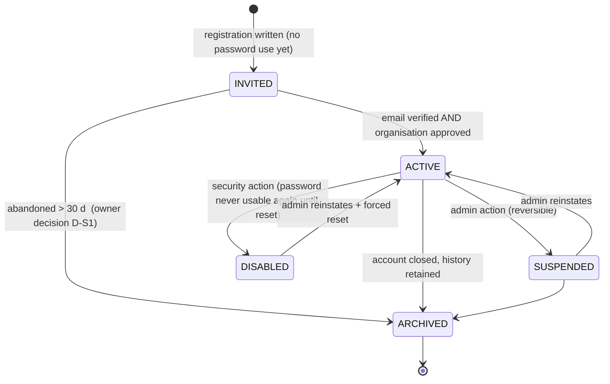
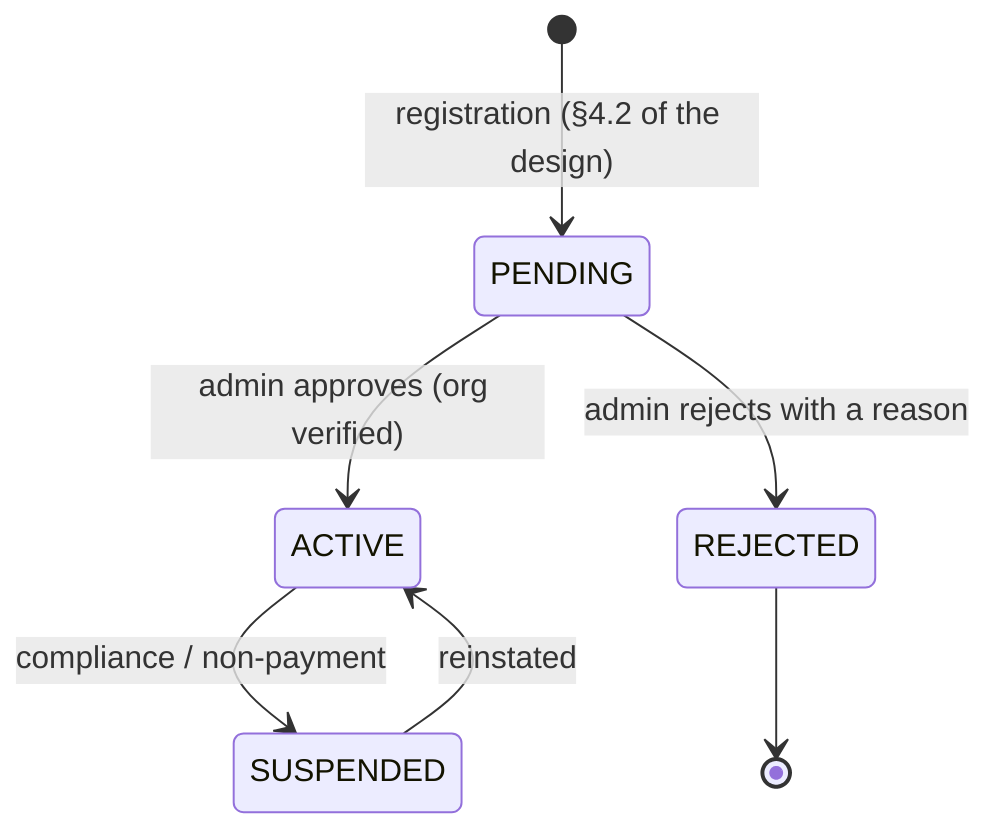

# PRIMEMET — M2 Implementation Readiness

**Status:** DESIGN ONLY. No code, schema, validator, index, migration, dependency, credential, user or
database was created, changed or contacted in producing this document. Nothing was staged or committed.
**Revision:** 1 — 2026-11-01
**Inputs:** `docs/PRIMEMET_M2_AUTH_DESIGN.md` (revision 1, read in full), and the working tree, read
directly. Every count below was **measured this pass** with the command or script named beside it.
Claims that could not be established are marked **[unverified]**; nothing is asserted from memory.

**Session clock:** 2026-11-01T12:39Z. Source retrieval timestamps are recorded separately per source in
§2.

---

## 0. How to read this document

| Marker | Meaning |
|---|---|
| **[verified]** | Established this pass by running something or reading the file named |
| **[proposed]** | New design; not implemented |
| **[owner decision]** | Cannot be settled from the codebase; the owner must choose |
| **[unverified]** | Could not be confirmed; the reason is given |

**Headline.** M2 is **ready to start**, but **not ready to start with the design as written**. Five
prerequisites are resolved below, and in doing so three defects in the existing implementation and one
gap hidden by an existing test were found. None of them is fatal; two of them would have produced a
security regression if implemented literally.

| Question | Answer |
|---|---|
| Can M2a begin today? | **No** — blocked by **D-M2-1** (hashing library) only. |
| Is the design internally consistent? | **Mostly.** Three corrections are required (§1.5). |
| Are the prerequisites reproducible? | **Yes** — a local replica set with real transactions, proven in §1.2. |
| Is T9 a blocker for M2? | **No, but it must be fixed before M3 or any history-bearing workflow.** §1.6. |

---

## 1. Technical prerequisites (§1 of the brief)

### 1.1 `@node-rs/argon2` on the Vercel runtime — **[verified], with one gap**

**What was measured.**

| Fact | Evidence |
|---|---|
| Latest published version | **2.2.2** (`registry.npmjs.org/@node-rs/argon2/latest`) |
| Ships prebuilt binaries (no node-gyp) | `napi.targets` lists 14 triples including `x86_64-unknown-linux-gnu` |
| glibc Linux x64 build exists and is published | `@node-rs/argon2-linux-x64-gnu@2.2.2`, `os: ["linux"]`, `cpu: ["x64"]`, `libc: ["glibc"]`, 728 614 bytes |
| musl Linux x64 build exists | listed in `napi.targets` as `x86_64-unknown-linux-musl` |
| Windows x64 build exists | `@node-rs/argon2-win32-x64-msvc@2.2.2` — **the development machine is Windows**, so local M2 work is possible |
| Declared Node requirement | `engines: { node: ">= 10" }` |
| Provenance | SLSA attestation present (`dist.attestations`) |
| Vercel supported Node majors | **26, 24, 22** — the docs' mapping table shows `26.x`/`^26.0.0`/`>=22.0.0` → latest 26.x, `24.x`/`^24.0.0` → latest 24.x, `22.x`/`^22.0.0` → latest 22.x (retrieved 2026-11-01T12:43Z) |

**Conclusion [proposed]:** the library is compatible with a Vercel Node runtime at the package level: it
is a prebuilt N-API addon for glibc x64 Linux, which is what the Vercel function image provides, and it
needs no build step. `@node-rs/argon2` is also the reference implementation used by `node-rs`, which is
widely deployed on serverless platforms.

**The gap, stated plainly [unverified]:**

1. **N-API ABI compatibility with Node 26 is not documented by the package.** `engines: ">= 10"` is a
   floor, not a tested ceiling. N-API is ABI-stable by design, so a Node 26 runtime *should* load a
   prebuilt N-API addon — but "should" is not measurement.
2. **No Vercel deployment was performed** (the brief forbids it), so the addon has never been loaded on
   the target. This must be settled by **T-KDF-1** in §5 before M2a merges.
3. **`mongodb` must be added to `serverExternalPackages`** if the auth routes are ever bundled for the
   Edge runtime — see §1.5 correction C3, which is the related risk.

**Mitigation if T-KDF-1 fails:** fall back to **Node's built-in `crypto.scrypt`** (no dependency, no
native addon, `N=2^15, r=8, p=1`), which OWASP lists as an acceptable second choice. This is a design
decision, not a code change, and it keeps M2a unblocked: **D-M2-1 offers both.**

### 1.2 Reproducible isolated replica-set MongoDB test environment — **[verified]**

**What exists [verified].** `mongodb-memory-server@10.4.3` is already a devDependency, and three suites
already run real replica sets: `scripts/check-mongodb.mjs:70`, `scripts/check-migration-architecture.mjs:99`,
`scripts/verify-tax-rule-index.mjs:17`, each with `replSet: { count: 1, storageEngine: "wiredTiger" }`.

**What I measured.** I started a throwaway replica set from a script outside the repository and read
`hello` from it:

```
replset=testset  isWritablePrimary=true  version=7.0.24
```

So the harness gives a **single-node replica set** — the minimum topology that supports multi-document
transactions — with a real `wiredTiger` engine.

**The reproducibility gap, and the fix [proposed].** `mongodb-memory-server` downloads a `mongod` binary
on first use and caches it. Two versions are already cached on this machine
(`mongod-x64-win32-7.0.14.exe`, `mongod-x64-win32-7.0.24.exe`), which means **two different servers have
been used across this project's history** — a silent source of "passes here, fails there". `MONGOMS_VERSION`
is currently unset, so the version is whatever the package resolution happens to pick.

| Requirement | Mechanism |
|---|---|
| R-1 Pinned server version | `MONGOMS_VERSION=7.0.24` in a committed `.mjs` harness constant (not an env var, so it cannot be forgotten) |
| R-2 Offline operation | `MONGOMS_DOWNLOAD_DIR` inside the OS temp directory; the binary is reused, and a CI job caches it |
| R-3 One set per test file | `before`/`after` hooks create and stop it; no shared global state |
| R-4 Deterministic database name | `primemet_test_<suite>`; dropped at teardown |
| R-5 Real validators | the suite applies the **real** `db/` definitions through `db:init`, never a hand-rolled subset |
| R-6 Transaction-precondition assertion | each suite asserts `hello.setName` and `isWritablePrimary` before its first `withTransaction`, so a standalone server fails loudly instead of silently degrading |
| R-7 No production contact | the URI is always the in-process one; `MONGODB_URI` is **unset** for the suite process |

**Constraint that must be recorded [verified]:** a single-node replica set cannot test **role
enforcement**, because role-based access control needs authentication and users, which
`mongodb-memory-server` does not configure by default. Every privilege claim in this project is therefore
**configuration-level**, not behaviour-level, until an authenticated cluster exists. This is the same
limitation already recorded in the Atlas runbook and it is not new — but it now has a name: **R-8**.

### 1.3 Transaction support and failure rollback — **[verified by execution]**

Run against the replica set above, not inferred from documentation.

| Test | Result |
|---|---|
| Commit succeeds and is visible | `after COMMIT ids = [1,2]` ✔ |
| A thrown error inside `withTransaction` **rolls back a write already issued in the same transaction** | document 1 stayed `state: "before"` (the update inside the transaction did **not** persist); the inserted `_id: 3` is absent ✔ |
| Rollback spans **two collections** | after a failure that touched `a` and `b`: `a.n=0`, `b.count=0` ✔ |
| `withTransaction` surfaces the application error rather than swallowing it | `abort threw = deliberate failure` ✔ |

**So the report's key claim — "one transaction, four documents" (§4.2 D-C3 of the design) — is
mechanically sound on this topology.** Three caveats:

1. **`withTransaction` retries transient errors automatically.** A callback that is not idempotent will
   run twice. Registration's inserts use generated UUIDs, so a retry would produce a duplicate-key error
   rather than a duplicate row — safe, but it must be tested (**T-TX-1**).
2. **A failed audit write must never roll back the business transaction.** The design already says the
   audit append happens *outside* the transaction (§4.2), which is correct.
3. **Node's `mongodb` driver version is `^7.8.0` [verified from `package.json`]** — a caret range, so a
   minor release can change driver behaviour between installs. The lockfile pins it, but CI must use
   `npm ci`, not `npm install`.

### 1.4 Session and cookie behaviour — **resolved, with two corrections**

The design's §2.3–§2.5 contract is sound. Two points needed to be settled against the actual runtime:

| Point | Finding | Resolution |
|---|---|---|
| Middleware runs on the **Edge** runtime and cannot use the native `mongodb` driver | **Confirmed by the design itself (§3.6) and consistent with `src/middleware.ts`, which imports nothing but `next/server` [verified]** | Keep the design: middleware does **presence + route-class** only; the handler is the authority. Cheap to state, expensive to forget. |
| The cookie name changes between development and production (`__Host-` prefix) | The `__Host-` prefix requires `Secure`, which `http://localhost` cannot satisfy | **[proposed] One name in production, one in development, chosen by a build-time constant** — never by a runtime branch on a request. Concretely: `SESSION_COOKIE = process.env.NODE_ENV === "production" ? "__Host-primemet_session" : "primemet_session"`, evaluated once at module load. A runtime toggle would let a mis-set `NODE_ENV` silently drop the prefix. |
| Absolute lifetime 8 h, idle 24 h | The design asks for an owner decision (**D-A8**) | **Recommend absolute 8 h, no separate idle rule** — the idle window is longer than the absolute cap, so it can never fire first; adding it now is dead code with a maintenance cost. Revisit only if lifetimes grow. |
| `lastSeenAt` write throttle (≤ once per 5 min) | Correct, and it matters: without it every authenticated request writes to `sessions` | Keep. Implement as "update only if `lastSeenAt < now − 5 min`", which is one conditional update. |
| Session row is never deleted | Matches the schema note in `db/collections/core.mjs` (`a revoked session is never deleted`) | Keep. Revocation is `revokedAt` + `revokedReason`. |
| `__Host-` behaviour on Vercel's edge | **[unverified]** — not tested, no deployment permitted | Low risk: the prefix is enforced by the *browser*, not by Vercel. The only Vercel-side requirement is HTTPS, which is automatic. |

**One addition the design does not have and M2a needs [proposed]:** `sessions` has no field recording
**which authentication factor** issued it. When MFA arrives (D-A12) a session issued before enrolment
would outlive the weaker credential. Add `sessions.mfaSatisfied: bool` (default `false`) in the same
`v002`; it costs one field now and avoids a second migration later.

### 1.5 Corrections to the design that M2a must absorb

Found while resolving the prerequisites. **These are corrections to the design document, not changes to
it** — the design is left as written and this section supersedes the named clauses.

| # | Design says | Problem | Correction |
|---|---|---|---|
| **C1** | §2.3: token is "32 random bytes … base64url (43 characters)"; `sessions.tokenHash` is `maxLength: 128` `[verified]` | Consistent — a SHA-256 hex digest is 64 characters, inside the limit | None needed. Recorded because it was checked rather than assumed. |
| **C2** | §2.4: the development cookie drops the `__Host-` prefix | If implemented as a runtime `if`, a production deploy with `NODE_ENV` unset silently loses the prefix | Evaluate at module load, as in §1.4. |
| **C3** | §3.6: middleware does a presence check only | Correct, **but** nothing prevents a future auth route from being bundled for Edge, where `mongodb` cannot load | Add `serverExternalPackages: ["mongodb", "@node-rs/argon2"]` to `next.config.ts` in M2a. **[verified]** `serverExternalPackages` exists in this Next version (`node_modules/next/dist/server/config-schema.js`, `config-shared.d.ts`). **[verified]** no built route currently targets Edge. |
| **C4** | §7.2 S1–S6 lists six schema changes | It omits `sessions.mfaSatisfied` (§1.4) and the `*TokenHash` pattern rule (§1.7) | `v002` gains one field and one validator rule |

### 1.6 T9 — `primemet_owner` holds database-wide `update`

**Investigated by computing the effective privilege set, not by reading the definition.** MongoDB
privileges are additive, so the correct question is "what does each collection end up with?", not "is any
single privilege bad?".

| Measurement | Result |
|---|---|
| The **current** audit's verdict | `[]` — **clean** |
| The **effective** violations | **7 of 7** append-only collections receive `update` from the owner's database-wide grant: `auth_events`, `admin_permission_grants`, `document_access_logs`, `audit_logs`, `audit_log_failures`, `material_alias_verifications`, `material_alias_equivalence_decisions` |
| Why the audit misses it | `db/roles.mjs:auditRoleDefinitions()` does `if (!collection) continue;` **before** the append-only test, so a wildcard grant (`collection: ""`) is discarded unexamined |
| Do the same collections receive `delete`? | **No** — the owner grants `find, insert, update, createCollection, collMod, createIndex, listCollections, listIndexes`; `delete` is granted to no role |
| Does `dropIndex` appear? | **No** — consistent with the earlier OD-16 rejection |

**Proposed least-privilege correction [proposed], verified by re-running the same computation:**

```
primemet_owner:
  { db: "", collection: "" }            find, insert, createCollection, collMod, createIndex,
                                        listCollections, listIndexes        <- no update
  { db: "", collection: <each of 38> }  update                              <- one entry per mutable collection
  { db: "", collection: "_schema_migrations" }  find, insert, update
  { db: "", collection: "system.js" }   find
```

| Property | Measured |
|---|---|
| Effective violations after correction | **`[]`  (0 of 7)** |
| `update` still available where needed | **38 mutable collections** — unchanged capability for initialisation |
| `delete` granted | **none** |
| `dropIndex` granted | **none** |
| `dropCollection`, `dropDatabase` granted | **none** |

**Two consequences that must be scheduled, not hand-waved:**

1. **The current owner definition would fail the corrected audit**, and `db:provision` refuses to run on a
   non-empty audit result. So **the audit fix and the role change must ship together** — exactly as the
   earlier revision-7 plan noted. Shipping the audit alone bricks provisioning.
2. **`db:verify` must gain an independent check**, because the audit is code and can regress. Proposed
   check: for every append-only collection, assert that no role's *effective* set contains `update` or
   `delete`.

**Does it block M2?** **No.** M2 creates no append-only rows outside `auth_events` — which the **app**
role already restricts to `find, insert`, and the app role is unchanged by this correction. The owner role
is used only by the migration workflow. It **must** be fixed before the first history-bearing workflow
(M3+), i.e. before any audit row matters.

### 1.7 Database-level and application-level protection for append-only collections

**The layers, as they stand and as proposed.** This is the "defence in depth" the brief asks for, stated
as four independent layers because any one of them can be bypassed.

| # | Layer | Mechanism | State |
|---|---|---|---|
| **L1** | **Server privilege** | `primemet_app` gets `find, insert` only on the 7 append-only collections — a bug or a compromised app cannot rewrite history because MongoDB refuses | **[existing]**, and **verified** as an effective set (0 violations) |
| **L2** | **DAO guard** | `assertAppendOnly(name, op)` in `db/refs.mjs` throws for `update`/`delete` | **[existing]** — **but only 2 of 7 collections are tested** (§below) |
| **L3** | **Validator** | `$jsonSchema` with `additionalProperties`/required fields; some collections carry `$expr` invariants | **[existing]** |
| **L4** | **Independent verification** | `db/verify.mjs` re-reads the live database and reports drift | **[existing]** |
| **L5** | **Owner scope** | T9 correction above removes the owner's blanket `update` | **[proposed]** |

**The gap I found [verified].** `scripts/check-mongodb.mjs:754` loops over a **hardcoded literal of two
names**:

```js
for (const name of ["material_alias_verifications", "material_alias_equivalence_decisions"]) {
```

So **5 of the 7** append-only collections (`audit_logs`, `audit_log_failures`, `auth_events`,
`document_access_logs`, `admin_permission_grants`) have **no DAO test at all**. The guard exists in
`db/refs.mjs`; nothing proves it is wired for those five. **Fix:** iterate
`IMMUTABLE_COLLECTIONS` directly. That is a one-line change to a test, and it is the difference between
"we have a guard" and "we have a guard we have checked".

**What is genuinely weaker than PostgreSQL, and must be said:** MongoDB validators see **one document at
a time** and cannot compare old against new. So a validator can enforce shape but never "this field may
not change". Append-only is therefore enforced by **privilege (L1)** and **code (L2)**, and the two
PostgreSQL mechanisms that did it structurally (`BEFORE UPDATE` trigger, and
`pm_require_approved_equivalence`) have **no MongoDB equivalent**. The compensating control is L4:
`db/verify` reports anything that looks wrong, and a bypass is *visible* even though it is not
*impossible*.

### 1.8 Server-side authorisation on every protected page and API — **the inventory M2 must cover**

**Measured [verified].**

| Surface | Count | Current state |
|---|---|---|
| Protected **pages** | **35** — 20 `/admin/*`, 7 `/buyer/*`, 8 `/seller/*` | publicly reachable; middleware enforces nothing |
| `/admin` landing page | **absent** (`src/app/admin/page.tsx` does not exist) → 404 | must be added in M2 |
| API routes | **1** (`/api/health`) | needs no authorisation (read-only, reports configuration) |
| Write handlers anywhere in `src/` | **0** | nothing to protect yet |
| Auth pages | 4 (`/login`, `/admin/login`, `/register/buyer`, `/register/seller`) | previews |

**Requirement [proposed]: every one of the 35 pages gets a server-side check, and the check lives in the
layout, not the page.** A page-level check is omitted by the next page someone adds; a layout-level check
covers children automatically. Concretely: `src/app/admin/layout.tsx`, `buyer/layout.tsx` and
`seller/layout.tsx` each call `requireRole(...)` and — for admin — `requireAdmin(...)` before rendering
`<PortalShell>`. Handlers call `requireSession` themselves; **the layout check is not a substitute for the
handler check**, because a route handler does not render a layout.

**The four gates, restated as a testable contract:**

| Gate | Where | Failure | Test |
|---|---|---|---|
| G1 session valid | handler **and** layout | 401 (API) / redirect to login (page) | T-BYPASS-1, T-BYPASS-2 |
| G2 role matches area | layout | redirect to own dashboard | T-BYPASS-5 |
| G3 permission held | handler, per endpoint | 403 | T-ESC-3 |
| G4 resource in org scope | repo layer, from the **session**, never the request | **404** | T-ISO-1, T-ISO-2 |

**One thing that will bite:** the design's G4 says "404 on mismatch". A 404 is right for a *guessed id*,
but a buyer who mistypes their own order number also gets 404 — which is fine — while an admin debugging
a tenant gets the same. That is acceptable and should be documented, not worked around.

### 1.9 Organisation-level data isolation tests — **defined**

| Test | Setup | Assertion |
|---|---|---|
| **T-ISO-1** | buyer A and buyer B, each with one record | A reading B's record by id → **404**, body identical to a nonexistent id |
| **T-ISO-2** | seller S, buyer A | S cannot read A's enquiries, quotes or documents → 404 |
| **T-ISO-3** | buyer A, seller S with contact `shareable: false` | S's view of A contains no contact email/phone |
| **T-ISO-4** | the same, with an approved sharing record | contact **is** visible, and an `audit_logs` row names approver and timestamp |
| **T-ISO-5** | buyer A, own record, **id supplied in a query string as another org** | scope is taken from the session; the query parameter is ignored |
| **T-ISO-6** | admin without `CONTACT_VIEW_RESTRICTED` | contact fields are **absent** from the response, not masked blanks |
| **T-ISO-7** | two orgs, identical record ids by collision | the compound scope predicate still separates them |
| **T-ISO-8** | a seller's listing read by another seller | 404 |

**T-ISO-5 is the one that catches real bugs:** scoping derived from a *request parameter* rather than the
session is the classic tenant-isolation failure, and it is invisible to a test that only uses ids the
caller is entitled to.

---

## 2. Sources

| # | Source | URL | Retrieved (UTC) |
|---|---|---|---|
| S1 | npm registry — `@node-rs/argon2@2.2.2` metadata (`napi.targets`, `engines`, `dist.attestations`) | `https://registry.npmjs.org/@node-rs/argon2/latest` | 2026-11-01T12:43:12Z |
| S2 | Vercel — Supported Node.js versions (docs last updated February 27, 2026) | `https://vercel.com/docs/functions/runtimes/node-js/node-js-versions` | 2026-11-01T12:43:23Z |

Repository evidence is cited inline as `file:line`. **No latency, cost or throughput figure is quoted
anywhere in this document.**

---

## 3. Implementation contracts (§3 of the brief)

These are the exact shapes M2a/M2b will be written against. They are contracts, not suggestions: the
tests in §5 are derived from them.

### 3.1 Final `UserRole` and `AdminTier` mapping

**Measured values [verified]** (`db/enums.mjs`): `UserRole = [ADMIN, BUYER, SELLER]`,
`AdminTier = [SUPER_ADMIN, SOURCING_OPS_ADMIN, CATALOGUE_MANAGER, READ_ONLY_ADMIN]`,
`UserStatus = [INVITED, ACTIVE, SUSPENDED, DISABLED, ARCHIVED]`.

**The six business roles in the brief map two-to-one onto these enums:**

| Brief role | `UserRole` | `AdminTier` | Landing route after login |
|---|---|---|---|
| Administrator / Super Admin | `ADMIN` | `SUPER_ADMIN` | `/admin/dashboard` |
| Operations administrator | `ADMIN` | `SOURCING_OPS_ADMIN` | `/admin/dashboard` |
| Catalogue manager | `ADMIN` | `CATALOGUE_MANAGER` | `/admin/catalogue` |
| Read-only administrator | `ADMIN` | `READ_ONLY_ADMIN` | `/admin/dashboard` |
| Buyer | `BUYER` | — (must be `null`) | `/buyer/dashboard` |
| Seller / supplier | `SELLER` | — (must be `null`) | `/seller/dashboard` |

**Invariants [proposed]:**

| # | Invariant | Enforcement |
|---|---|---|
| I-1 | `role = ADMIN` ⇔ exactly one `admin_profiles` row | layout gate returns `ACCOUNT_NOT_PROVISIONED` when absent (D-A2) |
| I-2 | `role ≠ ADMIN` ⇔ **no** `admin_profiles` row | registration flow cannot create one (§4.4 of the design, T-REG-1) |
| I-3 | `admin_profiles.tier` is never `null` for an active admin | validator |
| I-4 | A person has exactly one `users` row and therefore one role | existing unique email index |
| I-5 | One person cannot be both staff and a party contact on the *same* email | a staff member who is also a buyer contact gets a **separate** account (D-A1); the separation is asserted by T-ROLE-1 |

**Tier → default grants (measured last pass, unchanged):** SUPER_ADMIN 74, SOURCING_OPS_ADMIN 45,
CATALOGUE_MANAGER 14, READ_ONLY_ADMIN 20.

> **Corrected 2026-11-01, with the resolver now implemented.** The union of the three non-super tiers is
> **62**, so **12** permissions are `SUPER_ADMIN`-only: `PRICING_EDIT`, `PRICING_APPROVE`, `TAX_EDIT`,
> `TAX_APPROVE`, `INVOICE_ISSUE`, `AUDIT_EXPORT`, `USER_INVITE`, `USER_SUSPEND`, `ACCESS_ASSIGN_ROLE`,
> `ACCESS_GRANT_PERMISSION`, `NOTIFICATION_RETRY`, `DATABASE_APPLY_MIGRATION`. The earlier figure (59 / 15)
> treated `LOT_OVERRIDE_GATE`, `PARTY_SUSPEND` and `ORDER_CANCEL` as super-only, which is inconsistent with
> the 45-value `SOURCING_OPS_ADMIN` default: those three sit inside the `lot`, `party` and `order` groups the
> contracts assign to that tier, and the arithmetic only reaches 45 with them included. The matrices in
> `src/lib/permissions/tiers.ts` are asserted against these counts by `npm run check:permissions`.

### 3.2 Permission resolver interface

```ts
// src/lib/auth/permissions.ts            [proposed]
export type Permission = AdminPermission;          // the 74-value union, generated from the enum

export interface ResolveInput {
  user:      Pick<User,   "role" | "status">;
  profile:   Pick<AdminProfile, "isActive" | "tier"> | null;
  grants:    readonly Pick<AdminPermissionGrant, "permission" | "effect" | "expiresAt">[];
  now:       Date;                                  // injected: the clock is a dependency, not an ambient
}

export interface ResolvedAccess {
  permissions: ReadonlySet<Permission>;
  /** why the set is what it is — for the 403 response and the audit row, never for the client UI */
  reason: "OK" | "NOT_ADMIN" | "NO_PROFILE" | "PROFILE_INACTIVE";
}

export function resolveAccess(input: ResolveInput): ResolvedAccess;
export function hasPermission(a: ResolvedAccess, p: Permission): boolean;
```

**Five properties the tests pin, in order of how easily they break:**

| # | Property |
|---|---|
| P-1 | `now` is a parameter. A resolver that reads `Date.now()` internally cannot be tested for expiry, and expiry is a security boundary. |
| P-2 | DENY beats GRANT regardless of array order. The function sorts nothing and takes no precedence from position. |
| P-3 | An expired GRANT is inert (`expiresAt <= now`), an expired DENY is **also** inert — the rule applies symmetrically, otherwise a stale DENY freezes a permission forever. |
| P-4 | `role ≠ ADMIN` returns an empty set **and** a `reason`, never a partial set. |
| P-5 | The returned set is frozen/copy-on-write; a caller mutating it cannot affect a cached value. |

**Deliberately not in the interface:** the database, the request and the session. `resolveAccess` is a pure
function over data the caller already has; fetching is a separate function so the rule can be unit-tested
without a database, which is what makes T-ESC-1…6 cheap to run.

### 3.3 Account status lifecycle

Two lifecycles, deliberately separate, because they answer different questions.

**User (`UserStatus`, 5 measured values):**



| Transition | Who | Side effect |
|---|---|---|
| `INVITED → ACTIVE` | automatic (email verified + org approved) | `emailVerifiedAt` set |
| `ACTIVE → SUSPENDED` | `USER_SUSPEND` | **all sessions revoked** (`status_changed`) |
| `ACTIVE → DISABLED` | `USER_SUSPEND` | all sessions revoked; `passwordChangedAt` set |
| `→ ARCHIVED` | `SUPER_ADMIN` | all sessions revoked; row retained forever |
| any → `ARCHIVED` for the **last** SUPER_ADMIN | refused (`LAST_SUPER_ADMIN`, E-6) | — |

**Organisation (`organisations.accountStatus` — currently a free string, no enum) [proposed values
`PENDING | ACTIVE | SUSPENDED | REJECTED`], [owner decision D-C4]:**



**Critical rule [proposed]:** *effective* access requires **`user.status = ACTIVE` AND
`organisation.accountStatus = ACTIVE`**. A user whose organisation is suspended keeps an `ACTIVE` user row
but every request fails with `ORG_NOT_ACTIVE`. Without this rule, suspending a company would leave its ten
employees fully working — the most likely real-world failure of a party model.

### 3.4 Session lifecycle

As designed (§2.5 of the design), with the corrections of §1.4 and §1.5:

| Event | Mechanism | Revocation reason |
|---|---|---|
| Issued | after password verification, `status = ACTIVE`, email verified, org active | — |
| Absolute expiry | `expiresAt = issuedAt + 8 h` | (expired, not revoked) |
| Logout | `revokedAt = now` | `logout` |
| Password change | `session.createdAt < user.passwordChangedAt` | `password_changed` |
| Role change | `user.role ≠ session.roleAtIssue` | `role_changed` |
| Status change | `user.status ≠ ACTIVE` | `status_changed` |
| Org suspended | `organisation.accountStatus ≠ ACTIVE` | `org_changed` |
| Admin profile changed | `isActive = false` or tier ≠ tier-at-issue | `admin_profile_changed` |
| Admin revokes | explicit action | `admin_revoked` |
| `lastSeenAt` | updated only if older than 5 min | — |

**One field added [proposed]:** `sessions.mfaSatisfied` (§1.4). Every other field already exists [verified].

### 3.5 Registration lifecycle

As designed (D-C1…C5), with one addition the design implies but does not state:

| Step | Written | Rollback |
|---|---|---|
| 1. Validate | nothing | — |
| 2. Normalise email | nothing | — |
| 3. **Transaction:** organisation (`PENDING`) | `organisations` | whole transaction |
| 4. **Transaction:** user (`INVITED`, hash, verification token) | `users` | whole transaction |
| 5. **Transaction:** profile | `buyer_profiles` / `supplier_profiles` | whole transaction |
| 6. **Transaction:** primary contact (`shareable: false`) | `organisation_contacts` | whole transaction |
| 7. Outside: `auth_events` append | `auth_events` | recorded in `audit_log_failures` on failure |
| 8. Outside: verification mail | — | `verification_email_failed` event; resend endpoint |

**Verified mechanics (§1.3):** a failure at any of steps 3–6 leaves **none** of them applied. That was
measured across two collections, not assumed.

**The addition [proposed]:** step 2 must reject an email already present **before** opening the
transaction, *and* the unique index must still be the authority, because a pre-check is racy. The response
is the uniform 202 either way (§5.4), so the pre-check is a performance measure, not a security one.

### 3.6 Admin bootstrap — first SUPER_ADMIN

As designed (§9.4), with the guarantees made explicit:

| Guarantee | Mechanism |
|---|---|
| No default password exists anywhere | the script creates `passwordHash: null`; it prints a single-use link, not a password |
| Not reachable over HTTP | it is a CLI script; no route exists, and T-BYPASS-1 enumerates routes to prove it |
| Refuses to overwrite | if **any** `admin_profiles` row exists, exit non-zero without writing |
| Auditable | appends `auth_events` (`ADMIN_BOOTSTRAP`, severity CRITICAL) with the operator's host user and the target email |
| Re-issuable when locked out | a `--reissue` mode that runs only when **no active SUPER_ADMIN can log in**, and which itself appends an audit row |
| Single use | the set-password token lives in the same `users.passwordResetTokenHash` field with a 1 h expiry |

**The one risk this carries [proposed mitigation]:** the script needs cluster credentials, so running it
on a laptop exposes them. Mitigation: it reads `MONGODB_URI` from the environment (never an argument, so
it does not land in shell history) and refuses to run with a URI whose host is not loopback unless
`--force-remote` is passed.

### 3.7 Audit event format

Two collections, deliberately separate: `auth_events` for authentication, `audit_logs` for business.

**`auth_events` — existing fields [verified], no schema change needed:**

| Field | Type | Rule |
|---|---|---|
| `_id` | uuid | generated |
| `userId` | ref `users` optional | absent for a failed login of an unknown address |
| `emailAttempted` | string optional | **normalised lower-case**; this is the only place an unregistered address is recorded |
| `eventType` | string ≤ 60 | from a fixed vocabulary (§below) |
| `success` | bool | — |
| `ipHash`, `userAgentHash` | string optional | **hashed with `AUTH_SECRET`**, never raw — a raw IP in an append-only collection is personal data that cannot be deleted |
| `detail` | json optional | never a password, hash, token or full cookie |
| `occurredAt`, `createdAt` | date | both set |

**`eventType` vocabulary [proposed], 18 values, all ≤ 60 chars:**
`LOGIN_SUCCESS`, `LOGIN_FAILED`, `LOGIN_BLOCKED_RATE`, `LOGIN_BLOCKED_LOCKOUT`, `LOGOUT`,
`SESSION_REVOKED`, `SESSION_EXPIRED`, `PASSWORD_CHANGED`, `PASSWORD_RESET_REQUESTED`,
`PASSWORD_RESET_COMPLETED`, `EMAIL_VERIFICATION_SENT`, `EMAIL_VERIFIED`, `REGISTER_SUBMITTED`,
`ACCOUNT_APPROVED`, `ACCOUNT_REJECTED`, `ADMIN_BOOTSTRAP`, `ADMIN_TIER_CHANGED`, `PERMISSION_CHANGED`.

**`audit_logs` — existing fields [verified]; severity from `AuditSeverity` [verified enum exists]:**

| Field | Rule |
|---|---|
| `actorUserId`, `actorRole` | the actor; `actorRole` is `UserRole` |
| `action` | `<ENTITY>.<VERB>`, e.g. `USER.SUSPEND`, `ORG.APPROVE` |
| `entityType`, `entityId` | the subject |
| `beforeState`, `afterState` | JSON, secrets stripped by a single serialiser |
| `requestId` | correlation id, generated per request |
| `severity` | enum |

**The rule that matters more than the shape [proposed]:** `beforeState`/`afterState` pass through **one**
redaction function that removes `passwordHash`, `*TokenHash`, `mfaSecretCiphertext`, and anything matching
`/secret|password|token|key/i`. A per-call-site decision to redact will be forgotten exactly once, and that
once is enough.

---

## 4. Owner decisions (§4 of the brief)

**None of these is approved.** Each is presented with a recommendation and its consequences, and the
"blocks" column says exactly what stops if it is unanswered.

| ID | Exact question | Recommended value | Security consequence if ignored | Operational consequence if ignored | Blocks |
|---|---|---|---|---|---|
| **D-M2-1** | Which password hashing library? `@node-rs/argon2` (native prebuilt) or Node built-in `scrypt`? | **`@node-rs/argon2@2.2.2`**, with `scrypt` as the tested fallback | scrypt is acceptable but weaker against GPU attack at equal memory | native addon adds a platform-compatibility dependency (§1.1) | **M2a — the only true blocker** |
| **D-M2-2** | Session absolute lifetime, and is there a separate idle timeout? | **8 h absolute; no separate idle rule** | shorter lifetime limits stolen-cookie damage | a working day must not be interrupted | M2a (one constant) |
| **D-M2-3** | `organisations.accountStatus` allowed values | **`PENDING, ACTIVE, SUSPENDED, REJECTED`** | without a closed set, a suspended org can be written as `active` by typo | approval workflow cannot be automated | M2c |
| **D-M2-4** | Do suspended organisations block their users' access? | **Yes — `user.status = ACTIVE` AND `org.accountStatus = ACTIVE`** | otherwise suspending a company leaves all its employees working | support load when a real suspension happens | M2c |
| **D-M2-5** | Rate-limit thresholds | **10 logins / 15 min / IP, 5 / 15 min / account, 3 resets / h / account**, tuned after T-PERF | too loose permits stuffing; too tight permits denial of service against a known account | support tickets on legitimate lockout | M2e |
| **D-M2-6** | Preview deployments: separate Atlas database, or no database? | **No database** until M2c is stable | a preview pointed at production is a write path into live data | previews show `not_configured` | deployment only |
| **D-M2-7** | Fix T9 now (scoped owner `update`) or defer? | **Fix before M3**; ship audit fix + role change together (§1.6) | owner can rewrite append-only history | provisioning must be re-run once | not M2 |
| **D-M2-8** | MFA scope (`mfaEnabled`, `mfaRequired` exist but are unused) | **Defer past M2d**, decide before the first real admin goes live | a stolen SUPER_ADMIN password is total compromise | enrolment UI is additional work | M2d hardening |
| **D-M2-9** | Should `AUTH_SECRET` be required at M2a, and what does it protect? | **Required from M2a**; it keys the CSRF binding and the IP/UA hashes, **not** session tokens | rotating it must not log everyone out — which is why it must not sign tokens | one more production secret to manage | M2a |
| **D-M2-10** | Abandoned registration: archive after how long? | **30 days**, then `ARCHIVED` | abandoned accounts are identity data kept without need | purge job needed | M2c/M2e |

**Two decisions are pre-existing and untouched here:** **O-27.7** (hosting region — Atlas Mumbai proposed,
not approved) and **O-27.5** (document retention). Neither blocks M2, but O-27.7 blocks any *real*
database.

---

## 5. Implementation plan (§5 of the brief)

Milestone granularity is unchanged from the design (§8) because it was correctly sequenced. What is added
here is **exact files**, **security tests**, and a **rollback strategy**, which the design did not carry.

### 5.1 M2a — session core

| Item | Detail |
|---|---|
| **Files added** | `src/lib/auth/password.ts` (hash/verify/rehash) · `src/lib/auth/token.ts` (generate, SHA-256, constant-time compare) · `src/lib/auth/session.ts` (issue, verify, revoke, `lastSeenAt` throttle) · `src/lib/auth/cookies.ts` (build-time name, attributes) · `src/lib/auth/require.ts` (`requireSession`) · `src/lib/auth/rate-limit.ts` (reuses `failedLoginCount`/`lockedUntil`) · `src/app/api/auth/login/route.ts` · `src/app/api/auth/logout/route.ts` · `src/app/api/auth/session/route.ts` · `scripts/check-auth.mjs` |
| **Files changed** | `package.json` (+`@node-rs/argon2`) · `next.config.ts` (`serverExternalPackages`) · `src/lib/env.ts` (`AUTH_SECRET` → required when auth is used, via `assertEnv`) · `db/collections/core.mjs` (`sessions.mfaSatisfied`) · `db/migrations/v002-*.mjs` (new) · `prisma/schema.prisma` — **not** changed (historical) |
| **Depends on** | D-M2-1, D-M2-2, D-M2-9; a database for integration tests (local replica set is enough) |
| **Acceptance** | T-AUTH-1…10, T-BYPASS-1…5, T-CSRF-1…2, T-FIX-1, T-TX-1, T-KDF-1, plus `npm run typecheck && lint && build && check:mongodb && check:migrations` all green |
| **Rollback** | remove the routes and `src/lib/auth/*`; revert `v002` by a **forward** `v003` (values are optional, so `v002` itself is inert once unused). **No production data exists**, so this is safe today — it will not be after M2c |

### 5.2 M2b — authorisation core

| Item | Detail |
|---|---|
| **Files added** | `src/lib/auth/permissions.ts` (the pure resolver) · `src/lib/auth/audit.ts` (the single redactor + emitters) · `src/config/permissions.ts` (tier defaults) · `scripts/check-permissions.mjs` |
| **Files changed** | `src/app/admin/layout.tsx`, `buyer/layout.tsx`, `seller/layout.tsx` (+`requireRole`) · `src/app/admin/page.tsx` (**new** — the missing landing redirect) · `db/verify.mjs` (+ effective append-only check, §1.6) |
| **Depends on** | M2a |
| **Acceptance** | T-ESC-1…6, T-AUD-1…2, T-ROLE-1, T-ISO-5; and **all 35 portal pages 401/redirect without a session** |
| **Rollback** | layouts revert to ungated — which is the current state, so no data is exposed by the revert itself |

### 5.3 M2c — registration and approval

| Item | Detail |
|---|---|
| **Files added** | `src/app/api/register/route.ts` · `.../resend-verification/route.ts` · `.../auth/verify-email/route.ts` · `.../admin/organisations/[id]/decision/route.ts` · `src/lib/mail/` (Zoho SMTP, behind an interface) · `scripts/check-registration.mjs` |
| **Files changed** | register pages (previews → live), admin review queue, `db/collections/core.mjs` (`accountStatus` invariant) |
| **Depends on** | M2a, D-M2-3, D-M2-4, D-M2-10, Zoho credentials |
| **Acceptance** | T-REG-1…2, T-ENUM-1, T-TX-1, T-ISO-1…4, workflow states exercised end to end |
| **Rollback** | registration is the first path that writes real personal data; rollback = disable the route, keep the rows (never delete personal data to roll back code) |

### 5.4 M2d — admin identity console

| Item | Detail |
|---|---|
| **Files added** | `src/app/api/admin/users/*` · `.../invitations/route.ts` · `.../sessions/[id]/revoke/route.ts` · `src/app/admin/users/[id]/page.tsx` · `scripts/admin-bootstrap.mjs` |
| **Depends on** | M2b, and T9 (**D-M2-7**) if grants are to be auditable |
| **Acceptance** | T-AUTH-13, E-1…E-7 as tests, bootstrap run twice (second refuses) |
| **Rollback** | console routes removed; grants already written are append-only facts and **must not** be deleted — a corrective DENY is the rollback |

### 5.5 M2e — hardening

| Item | Detail |
|---|---|
| **Files changed** | `src/lib/auth/rate-limit.ts`, `src/lib/env.ts`, `scripts/verify-phase3.mjs` (+ secret-in-bundle grep), `scripts/check-permissions.mjs` (+ `dangerouslySetInnerHTML` allow-list = 1) |
| **Depends on** | M2a, D-M2-5 |
| **Acceptance** | T-RATE-1, T-PERF recorded (p50/p95 for hash and session lookup), bundle greps pass |
| **Rollback** | limits are constants; revert = no schema change |

### 5.6 M2f — middleware redirect and page gates

| Item | Detail |
|---|---|
| **Files changed** | `src/middleware.ts` (presence + route-class redirect, no DB) · the three layouts wired to the same helper |
| **Depends on** | M2b |
| **Acceptance** | browser: unauthenticated `/admin/dashboard` → `/admin/login?next=…`; buyer on `/admin` → `/buyer/dashboard`; **and T-BYPASS-1 still passes**, proving the handler gate did not move |
| **Rollback** | middleware reverts to pass-through; the handler gate is untouched, so no data becomes reachable |

### 5.7 Execution order and the one non-negotiable rule

```
M2a → M2b → M2c → M2d
       └──── M2e ────┘
       └──── M2f ────┘   (last is fine: the handler gate is the control)
```

**The rule:** **no endpoint that returns a persisted row may ship before M2b.** M2a alone creates a login
that issues sessions but protects nothing; shipping it to production would be harmless (no data exists)
but shipping M2c without M2b would expose the first real personal data to the public portal.

---

## 6. Verification performed for this report

| Check | Result |
|---|---|
| `npm run typecheck` | **PASS** — 0 errors |
| `npm run lint` | **PASS** — 0 problems |
| `node scripts/db-verify.mjs --validate-only` | **PASS** — 539 passed, 0 failed, 45 collections / 94 indexes; "No database was contacted" |
| Transactions + rollback on a local replica set | **PASS** — commit, same-transaction rollback, cross-collection rollback, error propagation (§1.3) |
| T9 effective-privilege computation | **7 violations on the owner; 0 after the proposed correction; 0 on the app role** (§1.6) |
| Enum values | re-read from `db/enums.mjs`, not from the design document |
| Protected surface inventory | **35 pages** (20 admin, 7 buyer, 8 seller), 1 API route, 0 write handlers (§1.8) |
| Document structure | headings, fences, tables and cross-references checked after writing |

**Not run, deliberately:** no dependency installed, no migration written, no credential or user created, no
production or hosted database contacted, nothing staged or committed. The replica set was in-process and
has been stopped; `mongod` processes remaining: **0**.

---

## 7. What is not verified

| Item | Why | What would settle it |
|---|---|---|
| `@node-rs/argon2` loading on Node 26 at Vercel | no deployment permitted; package documents only `engines: ">= 10"` | **T-KDF-1**: hash+verify inside a deployed preview function, then remove the preview |
| `__Host-` cookie behaviour through Vercel's edge | same | the same preview |
| Zoho SMTP deliverability, SPF/DKIM alignment for `primemet.in` | credentials not available, sending not permitted | send one message from staging |
| Role enforcement on a real cluster (R-8) | `mongodb-memory-server` runs without auth, so privileges cannot be exercised | the Atlas dry-run in the setup runbook |
| Argon2id wall time | deliberately not measured — T-PERF exists so no figure is invented | T-PERF on the target runtime |
| Whether `primemet.in` is owned by the project | **verified** only that five source files assume it; ownership is external evidence | owner confirmation |
| Mermaid rendering | no renderer installed | visual check in any Markdown preview |

**This report is not independent acceptance.** It is a design and readiness assessment written by the same
work it describes; every "PASS" above is a self-authored check.
