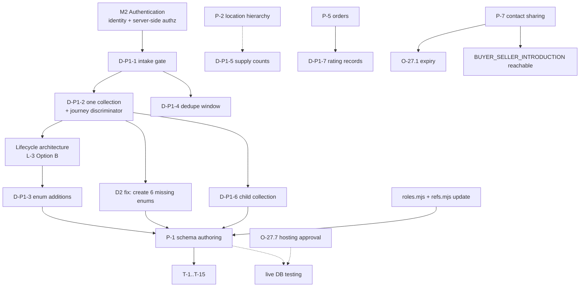

# PRIMEMET — P-1 Architecture Review and Decision Record

**Purpose:** complete the decision review of the nine open items in `docs/PRIMEMET_P1_ENQUIRY_ARCHITECTURE.md` §12, validate the lifecycle, security/intake, and relationship proposals against the actual repository, and state whether P-1 may begin.

**Status: REVIEW COMPLETE — P-1 IS NOT READY TO IMPLEMENT.** Fourteen defects were found, six of them blockers. Nothing here is approved; approval is requested in §9.

**Revision 2 (same day).** The owner sent a decision instruction covering eight items. It is recorded as **proposed**, not implemented, in **§11**; Tasks 1–5 designs are in **§12–§16**. Two findings from that verification materially change the earlier text and are corrected rather than silently overwritten: **D5 was wrong** (§16), and **array references are implementable with one small helper** (§13.4).

| Field | Value |
|---|---|
| Document date | 2026-11-01 |
| Branch / HEAD at review | `main` / `aec0f1b77879b9145d4197032c27bd1729a79e97` |
| Changed paths (start → end) | 105 → 106 (rev 1); **106** at revision 2, measured — this file only |
| Staged / committed / pushed | 0 / 0 / 0 |
| Implementation performed | **none** — no collection, validator, index, enum, migration, role or source change |
| Database touched | none. No Atlas connection, no initialization, no live write. Inspection was by reading definitions and evaluating existing modules in-process. |

### Method

Every claim below cites a file that was read this turn, or a value produced by executing an existing module (`db/enums.mjs`, `db/collections/index.mjs`, `db/define.mjs`, `db/roles.mjs`, `scripts/db-verify.mjs`). The proposal document's own `[existing]` markers were **re-verified rather than trusted**; where it was wrong, that is recorded as a defect rather than quietly corrected.

The brief's instruction "do not assume frontend hiding is access control" was applied to my own review too: no finding rests on what a page displays, only on what the data layer and roles permit.

---

## 1. Summary of verdicts

| Area | Verdict | Blockers |
|---|---|---|
| Nine decisions (§12) | Reviewed; **5 recommend as written, 4 need amendment, 2 cannot be decided until D-P1-1 changes shape** | D-P1-1, D-P1-3 |
| Lifecycle validation (§2) | **Option C rejected as written**; Option B recommended | D-P1-3 |
| Security and intake (§3) | **Structurally unsound as proposed** — the discriminator makes journey inference impossible | G-A, G-B, G-C, G-D, G-E |
| Relationships and integrity (§4) | Sound in intent, **six undefined targets**, one unimplementable invariant | D1, D2, D5, D6 |
| P-1 readiness | **NOT READY** | see §8 |

Defect IDs used below: **G-a…** = gaps in the security/intake analysis, **D-n…** = defects in the proposal's factual claims, **L-n…** = lifecycle findings.

---

## 2. The nine decisions

Each entry gives the exact question, the evidence actually found in the repository, the recommendation, alternatives with trade-offs, dependencies, workflow impact, and whether business-owner approval is required.

### D-P1-1 — Ship P-1 writes behind M2, or ship unauthenticated public intake?

**Question.** Can enquiry persistence go live before authentication exists?

**Evidence.**
- `src/middleware.ts` — `middleware()` calls `void request` and returns `NextResponse.next()`. It authenticates nothing. Its own header comment says so.
- `grep -rln "export async function POST" src/` → **no matches**. There is no write endpoint anywhere in the application today.
- `db/roles.mjs` grants `primemet_app` `find, insert, update, delete` on all 38 mutable collections. Once a database is initialized, any process holding `MONGODB_URI` can write any business row directly.
- `users` has `passwordHash`, `sessions` has `tokenHash`, and `admin_permission_grants` exists **[existing]** — the *schema* for auth is present; the *implementation* is absent.
- Architecture §22 already specifies the intended controls: `POST /api/v1/public/enquiries` with "full enquiry schema, honeypot, rate limit" (line 4062) and `POST /api/v1/public/contact` with "rate limit" (line 4063). Neither is implemented.

**Recommendation (amended from the proposal).** Keep the proposal's conclusion — **gate writes behind M2** — but strengthen the reason and close a hole in it. The proposal justifies this by spam risk. The stronger justification is that **an unauthenticated write path cannot honour D-P1-2**: with no session there is no verified organisation, so `submitterOrgId` and `buyerOrgId` would be client-supplied strings pointing at rows the caller does not own. That makes every downstream control in §7.1 of the proposal vacuous — a cross-tenant leak needs no bypass, only a typed id. So the correct statement is: *unauthenticated intake is not merely risky, it cannot enforce the model.* Until M2 lands, wizard stays preview-only (its current behaviour: forms have no `action`, submit disabled, copy states nothing is sent).

**Alternatives.**
| Option | Trade-off |
|---|---|
| A. Behind M2 (**recommended**) | Delays P-1 by one milestone; zero fabricated data; identity trustworthy |
| B. Unauthenticated intake, org fields left null | Honest, but then I1–I3 must be rewritten (§3.1 of this review) and reporting loses attribution |
| C. Unauthenticated intake with client-declared org ids | **Rejected** — enables cross-tenant reads and forged seller supply |
| D. Anonymous intake + email verification token before the record becomes visible | Viable middle path, but requires mail infrastructure (Zoho SMTP, not configured) — defer |

**Dependencies.** Blocks D-P1-2 resolution shape, D-P1-4 relevance, and the whole of §3 below. Depends on M2 (auth), which depends on O-27.7 (hosting) only for testing, not for design.
**Workflow impact.** Buyer/seller portals remain read-only previews; admin screens stay example layouts. No desk can act on a real lead yet.
**Owner approval required?** **Yes** — it sets the sequence of two milestones.

### D-P1-2 — One `enquiries` collection with a `journey` discriminator?

**Question.** One collection for three journeys, or three collections?

**Evidence.**
- `EnquirySource` = `["WEB_FORM","PHONE","EMAIL","REFERRAL","EXISTING_CUSTOMER","ADMIN_ENTRY"]` **[existing, db/enums.mjs:35]**.
- `UserRole` = `["ADMIN","BUYER","SELLER"]`; `OrgType` = `["BUYER","SELLER","BOTH"]` **[existing, db/enums.mjs:49,73]**.
- The discriminator pattern is genuinely proven in this schema: `material_product_types` expands one material into five product forms rather than five materials **[existing]**, and `supplier_listings` carries one `status` enum over five values instead of separate active/expired collections.
- MongoDB validators are per-collection with `additionalProperties: false` **[existing, db/define.mjs:151]**, so splitting the collection duplicates every shared field declaration.

**Recommendation.** **Yes — one collection with a mandatory `journey` discriminator.** The proposal's reasoning holds and the reuse argument is sound. But adopt it **with the amendment from §3.1**: the discriminator must be explicit on the document, because it is not derivable from the other fields.

**Alternatives.** Three collections (rejected: three status vocabularies that drift — the failure mode D4 had to untangle); base+extension (rejected: MongoDB has no FK to guarantee the extension row exists, and every read costs a join).

**Dependencies.** D-P1-1 (who can submit determines which fields are trustworthy), D-P1-3 (one vocabulary across journeys), D-P1-6 (collection count).
**Workflow impact.** Admin sees one queue with a filter; buyer and seller see their own subset; reporting counts once. If split later, every index and read path is rewritten.
**Owner approval required?** **Yes** — it is the schema's central choice and is expensive to reverse after data exists.

### D-P1-3 — Approve three `EnquiryStatus` additions and the `SUPPLIER_MATCHED` fold?

**Question.** Append `QUALIFIED`, `ON_HOLD`, `UNFULFILLABLE` to the existing 13-value enum and fold `SUPPLIER_MATCHED` into `MATCHING_SUPPLIERS → QUOTES_REQUESTED`?

**Evidence.**
- `prisma/schema.prisma:189-205` defines exactly the thirteen values the proposal lists; `db/enums.mjs:36` mirrors them. Verified by reading both.
- `grep -rn "QUALIFIED\|ON_HOLD\|UNFULFILLABLE\|SUPPLIER_MATCHED"` across `prisma/schema.prisma`, `src/`, `db/`: the only hits are `organisations.account_status`'s doc comment `ACTIVE | ON_HOLD | CLOSED` (schema line 939, architecture line 453) — a **different field's** value set, unrelated to enquiries. So the three additions do not collide with anything.
- Append-only rule **[C]** confirmed at architecture §5.1; `TransactionModel` is already `["PRINCIPAL","AGENCY","MANAGED_SUPPLY"]` with no `INTERMEDIARY` **[existing]**, which shows append-only was honoured when D4 was applied.

**Recommendation.** **Append-only is correct; do not rename or remove anything.** However the *consequence* of appending is underweighted in the proposal: adding `QUALIFIED` to a thirteen-value pipeline enum creates a second, competing axis inside the same field — qualification mixed with sourcing and commercial stages. That is the substance of finding **L-1/L-2** in §4, and it is why I recommend deciding the lifecycle architecture (Option B there) **before** approving enum additions. Approving three values now commits the single-axis design implicitly.

**Alternatives.** Adopt the brief's twelve-state vocabulary verbatim (rejected: renames break the architecture's transition tables and any copy already using these names); add zero values and express qualification separately (viable — it is Option B's position, and cheaper).
**Dependencies.** Lifecycle choice (§4), D-P1-2.
**Workflow impact.** Determines whether "how far is this lead?" is one answer or three.
**Owner approval required?** **Yes.**

### D-P1-4 — Dedupe window length (proposed 7 days)?

**Question.** How wide is the rolling window for the `dedupeKey` fingerprint?

**Evidence.**
- `reference_sequences` exists with `_id` pattern `^[A-Z]{2,8}:[0-9]{4}$` and a unique `{prefix, year}` index **[existing, core.mjs]** — reference minting is available.
- No dedupe or idempotency mechanism exists in any collection today; `grep` for `idempotency` in `db/` returns nothing.
- Without M2 there is no authenticated submitter, so the natural key `(submitterOrgId, idempotencyToken)` degenerates to `(null, token)` — anonymous retries become indistinguishable across tenants.

**Recommendation.** **Defer the numeric decision.** Fixing k = 7 days now optimises a mechanism that cannot run until D-P1-1 is resolved. When it is implemented, derive the window from observed resubmission intervals rather than choosing it a priori; make it configuration, not a constant, since changing it must not require a migration.

**Alternatives.** 24 h (catches double-clicks only); 7 d (proposal); calendar-month (aligns with monthly quantity semantics). Trade-off is recall vs false-positive noise on the desk queue.
**Dependencies.** D-P1-1, and the existence of a write path.
**Workflow impact.** Desk sees fewer duplicate cards; a legitimate repeat must still pass.
**Owner approval required?** **No** — technical parameter, deferrable. Recommend recording it as "to be set at implementation".

### D-P1-5 — Supply-count threshold k (proposed 3 distinct suppliers)?

**Question.** May a public page publish aggregate supply figures, and above what threshold?

**Evidence.**
- `supplier_listings` carries `supplierId`, `status` (`ListingStatus`: `DRAFT, ACTIVE, PAUSED, EXPIRED, WITHDRAWN`), `gradeId`, `productId`, `quantityKg`, `locationCityId`, `availableFrom`, `availableTo` **[existing, core.mjs:334-357]** — enough to compute counts without any new entity, exactly as the proposal claims.
- `supplier_profiles.ratingInternal` is internal-only **[existing]**; `organisation_contacts.shareable` defaults false and is documented as "the data-side half of the admin-controlled contact-sharing rule (D2)" **[existing, core.mjs]**.
- `contact_share_requests` / `contact_share_events`: **absent** from the 45 collections (verified by loading `COLLECTION_NAMES`). Only the enums `ContactShareStatus` and `ContactShareScope` exist **[existing]**. So the disclosure machinery is designed but unbuilt — audit gap G-4, scheduled P-7, confirmed.

**Recommendation.** **Approve the policy direction (threshold-gated, basis-labelled, no new collection) but reject the specific figure as unfounded.** k = 3 is presented as a recommendation; it is a guess. With three suppliers, publishing "3 suppliers, 42 t of 6063 chips near Pune" plus any second facet narrows to one party quickly. Two concrete amendments: (i) cap the **combination of facets**, not just the count — grade × city × quantity band must never appear together on one screen, which the proposal already warns about but does not encode; (ii) label the basis as *declared*, never *available*, consistent with §3.7 of the proposal and with `supplier_listings`' own note that its `quantityKg` "is the only availability quantity in the schema" while lots/inspections (verification) are out of scope **[existing]**.

**Alternatives.** Publish nothing (safest, loses marketing proof); cached materialised view (defer until load demands); exact counts (rejected — deanonymises suppliers and breaches the confidentiality implied to sellers).
**Dependencies.** P-2 location hierarchy (city-level aggregation is currently free text), P-7 contact sharing.
**Workflow impact.** Marketing pages gain proof; seller trust depends on getting it right.
**Owner approval required?** **Yes** — it is a commercial disclosure decision, not a technical one.

### D-P1-6 — Serviceable states: child collection or array field?

**Question.** Store multi-valued state references as rows or as an array?

**Evidence — this is where the proposal is factually wrong.**
- The proposal uses `f.arrayOfRef("location_states")` (§3.2) and asserts in §3.6 that "`refs.mjs` validates singular references inside a transaction **[existing]**… adding … to its reference vocabulary is data, not new machinery."
- `db/define.mjs` has **no `arrayOfRef` helper**. The full array-capable vocabulary is `f.strArray()` (`bsonType: "array", items: {bsonType:"string"}`, line 112) and `f.json()`/`f.jsonOpt()` (`bsonType: ["object","array"]`, lines 84-86). Verified by grepping `define.mjs` for `arrayOf`.
- `db/refs.mjs:28-40` `referenceFields()` detects a reference only when `spec.ref` is a string on a top-level field, and `assertReferences()` (lines 43-64) compares `doc[field]` with `findOne({_id: value})`. An array value would be passed to `findOne({_id: [ … ]})` and simply **fail to match**, so an array of ids is either silently unvalidated or wrongly rejected.
- Existing precedent for multi-valued facts uses plain string arrays with **no** referential enforcement: `buyer_profiles.deliveryStates`, `.industries`, `.preferredGrades` are all `f.strArray()` **[existing, core.mjs]**.

**Recommendation.** **Child collection — and for a stronger reason than the proposal gives.** Not because arrays are awkward, but because an array of ids is *unenforceable by construction*: `refs.mjs` cannot validate it without new machinery, contradicting the proposal's claim that none is needed. One row per `(enquiryId, stateId)` keeps every reference singular and therefore checkable by the existing guard. This also means the totals in the proposal's §9.1 (45 → 52, immutable 7 → 9) stand as written.

**Alternatives.** Array + accept weaker enforcement (rejected — reintroduces exactly the dangling-reference class the audit flagged in `supplier_listings.locationCityId`); extend `refs.mjs` to iterate arrays (real code change, contradicts "data not machinery", and deferred work with no payoff while volumes are trivial).
**Dependencies.** D-P1-2; P-2 (when `location_cities` exists, the same child-collection shape extends).
**Workflow impact.** Destination-sourcing queries become a join on a small table instead of an array scan.
**Owner approval required?** **No** — technical, and the evidence decides it.

### D-P1-7 — Rating model sequencing?

**Question.** Keep the scalar, or move to records with derived summary and admin publication, built later?

**Evidence.**
- `supplier_profiles.ratingInternal` is a decimal, internal **[existing]**. No rating collection exists among the 45 (verified).
- Append-only precedent is real and privilege-backed: `IMMUTABLE_COLLECTIONS` = `admin_permission_grants, audit_log_failures, audit_logs, auth_events, document_access_logs, material_alias_equivalence_decisions, material_alias_verifications` — **7 collections** **[existing, measured by loading the module]** — and `roles.mjs` grants `primemet_app` only `find, insert` on each **[existing]**.
- Ratings depend on transactions; `OrderStatus`, `InvoiceStatus`, `SettlementStatus` enums exist **[existing]** but no order/invoice collections (verified absent).

**Recommendation.** **Approve the sequencing (design now, build after P-5).** Add one correction: the proposal's §2.4 cites `contact_share_events` as an existing insert-only collection. It is **not** in the 45 and is not in `IMMUTABLE_COLLECTIONS`. The claim should name `audit_logs` and `material_alias_verifications`, which are real. Minor, but it is a factual error in a document that marks itself `[existing]`.

**Alternatives.** Keep the scalar permanently (rejected: unauditable, and it quietly steers matching); build records now (rejected: nothing to rate, invites fabricated ratings).
**Dependencies.** P-5 orders; O-27.4 equivalent-part liability for any published rating; legal review.
**Workflow impact.** Admin gains explainable supplier assessment; counterparties gain nothing until publication is approved.
**Owner approval required?** **Not for sequencing** (technical). **Yes for external publication** later.

### O-27.1 — Contact-share expiry duration

**Question.** How long may an approved introduction remain valid?

**Evidence.** Enums `ContactShareStatus` (`REQUESTED/APPROVED/DENIED/REVOKED/EXPIRED`) and `ContactShareScope` (`PARTY_NAME/CONTACT_PERSON/EMAIL/PHONE/ADDRESS/ALL_CONTACT`) exist **[existing, db/enums.mjs]**; `EXPIRED` is therefore already part of the vocabulary, which presupposes a duration. The backing collections do not exist (verified absent). `organisation_contacts.shareable` is the current boolean gate **[existing]**.

**Recommendation.** **Cannot be responsibly fixed now, and should not be attempted in P-1.** The proposal correctly places it outside P-1 (P-7). What *can* be decided cheaply: expiry is stored per share, defaulting to a bounded period with explicit renewal, and `EXPIRED` is computed at read time from that stored timestamp rather than by a sweeper job — otherwise a missed job silently leaves contacts exposed beyond consent. Record the duration as an owner decision at P-7 design time.

**Alternatives.** Indefinite until revoked (rejected: consent drift); 30/90/180-day tiers by scope (plausible, needs owner input).
**Dependencies.** P-7, D-P1-5 (both are disclosure policies), D2 in the architecture register.
**Workflow impact.** Sellers/buyers can lose contact rights mid-deal if expiry is aggressive; too lax and consent is stale.
**Owner approval required?** **Yes**, at P-7 — not blocking P-1.

### O-14.1 — Dispatch override policy

**Question.** May a dispatch gate check be overridden, by whom, and for how long?

**Evidence.** Permission `LOT_OVERRIDE_GATE` exists in `AdminPermission` **[existing, db/enums.mjs:12]**; `DispatchState`, `LotStage`, `RejectionReason`, `DisputeStatus`, `ResolutionOption`, `BuyerApprovalState` enums all exist **[existing]**; no lot/inspection/dispatch collections exist (verified absent). `AdminTier` includes `SUPER_ADMIN, SOURCING_OPS_ADMIN, CATALOGUE_MANAGER, READ_ONLY_ADMIN` and `admin_profiles.approvalLimit` exists **[existing]** — so a value-based dual-control boundary is representable today.

**Recommendation.** **Out of P-1 scope; leave unresolved.** Do not let P-1 borrow the override concept for enquiry transitions. Note for the eventual decision: the mechanism already exists (`approvalLimit` + `AdminTier` + append-only `admin_permission_grants`), so an override can be modelled as a scoped, expiring grant rather than a bespoke flag — which is the shape that keeps it auditable.

**Dependencies.** Part A §13–§14 (lots, dispatch), M2 roles.
**Workflow impact.** Ops pressure versus quality assurance; a silent override erodes the inspection programme.
**Owner approval required?** **Yes**, at P-5+ — not blocking P-1.

---

## 3. Security and intake validation

The brief asked six questions. Answered against mechanisms, with frontend display treated as irrelevant.

### 3.1 Which roles can submit enquiries?

**Today: none.** No write endpoint exists (verified: zero `POST` handlers in `src/`), middleware enforces nothing, and no database is initialized. Submission capability is entirely prospective.

**Prospectively, the proposal's model is not implementable as written.** Inference of journey from party fields fails:

```
BUYER_REQUIREMENT        needs buyerOrgId,   may have submitterOrgId (their own org)
DIRECT_SOURCING_REQUEST  needs neither       source = ADMIN_ENTRY
                         ↑ collision: a BUYER_REQUIREMENT entered by staff
                           (source = ADMIN_ENTRY, buyerOrgId set) is indistinguishable
SELLER_SUPPLY_SUBMISSION needs submitterOrgId, forbids buyerOrgId
```

So `journey` must be an explicit stored field — which the proposal does declare (§3.2 `journey f.enumOf("EnquiryJourney")`) — but then its invariants **I1–I3** (§4.1) are written as implications from `journey`, which is fine, **except** that I3 ("submitterOrgId OR buyerOrgId OR source = 'ADMIN_ENTRY'") permits a document with no organisation at all whenever staff enter it, while T-1 claims "each missing-party case is refused per I1–I3". Those two statements disagree: I3 does not refuse a party-less `BUYER_REQUIREMENT` entered via `ADMIN_ENTRY`. **Finding G-A.** Resolution: make I1/I2 keyed on `journey` alone (as they already are) and drop I3, or state precisely which party-less shapes are legal.

**Gap G-B — `EnquiryJourney` does not exist.** `db/enums.mjs` exports 67 enums; `EnquiryJourney` is not among them, nor is it in `prisma/schema.prisma`. The proposal marks it `[proposal]`, which is honest, but §10 step 5 ("append the enum values in Prisma first") covers only the three status values and never mentions creating this enum. Under `f.enumOf(name, ENUMS)` a missing name yields `{bsonType: "string"}` with **no enum constraint** — i.e. the field would silently accept any string. `f.enumOpt` throws instead. **This is a real trap**, and it is why D-P1-2's schema cannot be written until the enum is added.

### 3.2 How can public intake be safely enabled?

Only after M2 supplies a verified identity, or with a deliberately party-less record. Required before any public write path, all specified in architecture §22 but implemented nowhere: rate limiting, honeypot, bounded work per request, generic acknowledgement. None exists in code today (verified: `grep` finds those terms only in docs and TODO comments).

**Gap G-C — the CSRF/session surface is undesigned.** `sessions.tokenHash` exists **[existing]** but no cookie flags, SameSite policy, token rotation or revocation path is specified for the enquiry flow. Out of P-1 scope, but it must not be discovered during M2 after P-1 is built.

### 3.3 Spam, duplicate submissions, fabricated seller inventory

- **Spam:** no mechanism exists. Cannot be enabled without M2 + rate limiting.
- **Duplicates:** proposal's two-mechanism split (unique partial index for idempotency, non-unique advisory `dedupeKey`) is **architecturally correct** — a unique index on a content fingerprint would reject legitimate repeats with a database error. Well reasoned. Caveat: partial unique on `(submitterOrgId, idempotencyToken)` degrades to `(null, token)` anonymously, so tokens must be globally unique in practice.
- **Fabricated seller inventory:** partially addressed by naming (`declaredQuantityKg`, no `available`/`stock` fields). **Gap G-D — insufficient.** Naming convention is not enforcement. `supplier_listings` accepts `quantityKg` with `status: ACTIVE` and no approval field **[existing]**, and the app role can `insert` into it directly **[existing, roles.mjs]**. So a seller could inject fake stock regardless of how enquiry fields are named. Enforcement requires: listings created only from an approved supply submission, a `VerificationStatus` gate (enum exists **[existing]**), and admin activation. Recorded as blocker for any seller-facing write path.
- **Gap G-E — no uniqueness on a party-less submitter.** Without M2, anonymous flood inserts are unconstrained.

### 3.4 Organisation identity verification

`organisations.verificationStatus` + `VerificationStatus` (`NOT_SUBMITTED/PENDING/UNDER_REVIEW/VERIFIED/REJECTED/EXPIRED`) + `organisation_verifications` with `type` ∈ `GST/PAN/CIN/TRADE_LICENCE/ISO/IEC/OTHER`, `documentId`, `verifiedById` **[existing]**. `users.emailVerifiedAt` **[existing]**. Portal onboarding via `portal_invitations` **[existing]**.

Sound and reusable. One caution: `orgType` has no `PRIMEMET` member, yet a partial unique index filters `orgType: "PRIMEMET"` **[existing, core.mjs:187]** — that index can never match, so the "exactly one live PRIMEMET organisation" invariant the collection's own notes promise is **not enforced**. Carried forward as **D5** below; it matters to invoice issuer checks later.

### 3.5 Supplier contact privacy

`organisation_contacts.shareable` default false **[existing]**; DTO allow-lists designed at architecture §18.1–§18.2 **[existing design, unimplemented]**; `documents.visibility` ∈ `INTERNAL/BUYER_VISIBLE/SUPPLIER_VISIBLE` **[existing]**. The proposal's §7.4 correctly refuses to expose `buyerOrgId` to sellers "just for matching". **Verdict: adequate as a plan; zero of it is enforced in code today.**

### 3.6 Server-side enforcement of admin operations

`AdminPermission` enumerates 74 permissions including `ENQUIRY_VIEW/CREATE/EDIT/CANCEL/ASSIGN/CLOSE` **[existing]** — confirming the proposal's citations. `admin_permission_grants` is append-only with `effect ∈ GRANT|DENY` and `expiresAt` **[existing]**, which is a workable deny-capable model. **But nothing reads these tables at runtime**: no permission-check function exists in `src/` (no API routes besides health). Frontend hiding is currently the only barrier, which the brief rightly forbids relying on. **Blocker for P-1: server-side authorisation must exist before any enquiry write path.**

---

## 4. Lifecycle validation

### L-1 The thirteen values mix four different questions

`EnquiryStatus` currently encodes: **(a)** processing stage — `NEW, UNDER_REVIEW, MATCHING_SUPPLIERS`; **(b)** sourcing sub-stage — `QUOTES_REQUESTED, QUOTES_RECEIVED, COMPARING_QUOTES, QUOTE_DRAFTED`; **(c)** commercial posture — `QUOTE_SENT, NEGOTIATION, BUYER_SELLER_INTRODUCTION`; **(d)** outcome — `WON, LOST, CANCELLED`. Adding `QUALIFIED` inserts a fifth concern (intake quality) into (a), and `ON_HOLD` is orthogonal to all four — it is a *pause*, not a stage.

Consequences of one field: a paused enquiry loses its stage unless you invent `ON_HOLD_FROM_X`; "is this won or just stalled?" becomes a query over history; SLA clocks cannot distinguish waiting-on-customer from working; and per-journey restrictions (§6.2 of the proposal) grow combinatorially because each journey needs its own allowed subset of a mixed vocabulary.

### L-2 Assessment of the three architectures

| Model | Fit |
|---|---|
| **A. One status field** | Simplest queries, one index. Fails pause/resume, fails per-journey restriction without a large transition matrix, conflates stage with outcome. |
| **B. Multiple independent dimensions** | `stage` (pipeline position) + `outcome` (open/WON/LOST/CANCELLED/UNFULFILLABLE) + `paused` (boolean or hold record) + `readiness` (already computed **[existing, architecture §5.5.9]**). Queries like "all open high-priority not-paused in sourcing" become compound indexes. Cost: more fields, and a naive UI can show contradictory combinations. |
| **C. Status + immutable event history** | Most faithful, and the event-log half is idiomatic here (`audit_logs`, `material_alias_verifications` are append-only **[existing]**). But deriving current state from events forces a read of the whole log for every list query — wrong for a desk worklist sorted by `{status, priority, createdAt}`. Also: **MongoDB validators cannot compare old and new document values** (the proposal admits this, §4.4), so legality of a transition can never be validator-enforced; it lives in the write path regardless. |

### L-3 Recommendation

**Option B — multiple independent status dimensions — with the append-only event log retained as history, not as the source of current state.**

Concretely: keep `status` as the *stage* axis (13 existing values, appended to only if needed), add a separate `outcome` axis, and represent hold as a fact rather than a stage. `readinessState` stays computed, never hand-set **[existing rule]**. `enquiry_status_events` remains, answering "what happened and when" while the axes answer "where is it now".

Why not A: it cannot express pause without duplicating stages, and the per-journey restriction table becomes the de-facto state machine anyway. Why not pure C: the desk queue needs current state indexed directly, and re-deriving it on every list read trades a correctness guarantee for a scalability problem the project does not need.

**Relationship to D-P1-3:** under Option B, `QUALIFIED` and `ON_HOLD` may not need to enter `EnquiryStatus` at all — `UNFULFILLABLE` belongs to `outcome`. That is why D-P1-3 should be decided *after* this choice, not before. The append-only constraint is respected either way: nothing is renamed or removed.

### L-4 Journey-specific restrictions are sound but incomplete

The proposal's per-journey prohibitions (§6.2) are well-reasoned, especially refusing `WON` structurally (architecture line 3089 rule **[C]**: "an enquiry may be `WON` only when an order exists"). Since no order collection exists (verified), `WON` is unreachable in P-1 — a genuine safety property, not a convenience. One addition needed: `BUYER_SELLER_INTRODUCTION` must be blocked for **all** journeys until P-7 ships `contact_share_requests`, since introducing parties is exactly what that feature authorises.

---

## 5. Defects found in the proposal's factual claims

These are corrections, not opinions. Each was verified by reading or executing.

| ID | Claim in `PRIMEMET_P1_ENQUIRY_ARCHITECTURE.md` | Reality | Severity |
|---|---|---|---|
| **D1** | §3.2 uses `f.arrayOfRef("location_states")`; §3.6 calls array refs "not enforceable" only softly and says extending `refs.mjs` is "data, not new machinery" | **No `arrayOfRef` helper exists** in `db/define.mjs`; `refs.mjs` handles only singular top-level refs | High — unimplementable as written |
| **D2** | §3.2 declares `requirementKind f.enumOf("EnquiryKind")`, `serviceLine f.enumOpt("ServiceLine")`, `taxPreference f.enumOpt("TaxPreference")`, `requirementFrequency f.enumOpt("RequirementFrequency")`, `targetPriceUom f.enumOpt("QuantityUom")`, `readinessState f.enumOf("EnquiryReadiness")` | **None of these six enums exists** in `db/enums.mjs` (67 total, verified) nor in `prisma/schema.prisma`. Worse: `f.enumOf` on a missing name returns `{bsonType:"string"}` with **no constraint** — silent acceptance of arbitrary strings | **Critical** — the schema would compile and validate while enforcing nothing |
| **D3** | §2.4 cites `contact_share_events` as an existing insert-only collection | Absent from the 45 and from `IMMUTABLE_COLLECTIONS` (7, listed in §2.4 above) | Low — but it is marked `[existing]` |
| **D4** | §3.2 `assignedToAdminId refOpt("admin_profiles")` | `admin_profiles._id` is a UUID; assignment semantically targets an **admin user**. Every other actor field uses `refOpt("users")`. Storing the profile id forces a join for "my queue" and diverges from `qualifiedById`/`answeredById`/`authorUserId`, all of which use `users` | Medium — inconsistency with a real query cost |
| **D5** | Proposal inherits architecture's "exactly one live PRIMEMET organisation" invariant | `OrgType = ["BUYER","SELLER","BOTH"]` has **no `PRIMEMET` member**, yet the partial unique index filters `orgType: "PRIMEMET"` **[existing]** — it can never match, so the invariant is unenforced | Medium — pre-existing, affects invoice issuer logic later |
| **D6** | §4.2 index table lists `{canonicalMaterialId:1}` and `{productFamilyId:1}` on `enquiry_lines` | Valid targets (`materials`, `product_families` exist **[existing]**), but the proposal never states whether a line may hold both a material and a product, nor forbid it | Low — clarify invariant |
| **D7** | §9 "indexes grow by the count in §4.2" | Not a number; unverifiable as written | Low — quantify at implementation |

D2 is the most consequential: it converts a type-checked design into an unenforced one without any error surfacing. It is also trivially preventable — `check:enums` and `db:validate:offline` currently assert that *present* enums are consistent (verified: `scripts/db-verify.mjs:163-168` skips any field whose `enum` is not an array), so a missing enum passes silently. **Recommended hardening: make `f.enumOf` throw when the name is absent from `ENUMS`, matching `f.enumOpt`'s behaviour.** That is a one-line change to `db/define.mjs`, explicitly **not performed** in this review turn.

---

## 6. Dependency graph



Solid edges are ordering constraints; dotted edges mark "improves but does not block". The critical chain is **M2 → D-P1-1 → D-P1-2 → lifecycle → D-P1-3 → schema**, with D2 (missing enums) as a hard prerequisite of schema authoring.

---

## 7. Approved recommendations vs unresolved decisions

**Ready to approve on the evidence (technical, no business judgement):**

| Item | Position | Evidence |
|---|---|---|
| D-P1-6 | Child collection, not array | D1 — `arrayOfRef` does not exist; `refs.mjs` is singular-only |
| D2 remediation | Create the six enums before any schema authoring; make `f.enumOf` throw on unknown names | D2, executed probe showing silent degradation |
| D4 remediation | Use `refOpt("users")` for assignment, consistent with all other actor fields | core.mjs `admin_profiles` |
| Won-unreachable guarantee | Keep: `WON` precondition + no order collection | architecture line 3089 **[C]**; collections verified |
| Dedupe/idempotency split | Keep: unique partial for retry, non-unique advisory for duplicates | §3.3 analysis |
| Declared ≠ verified naming | Keep, but insufficient alone | G-D |

**Unresolved — requires the owner:**

| Item | Why it is not mine to decide |
|---|---|
| D-P1-1 | Sets milestone sequence and delays revenue-visible functionality |
| D-P1-2 | Central schema choice, expensive to reverse once data exists |
| D-P1-3 + lifecycle (L-3) | Vocabulary that will appear in desk tooling and reports |
| D-P1-5 | Commercial disclosure policy; k=3 is unsupported |
| D-P1-7 publication | Legal exposure, ties to O-27.4 |
| O-27.1 | Consent duration — business/legal |
| O-14.1 | Operational authority — business |
| D5 | Whether PRIMEMET's own org identity should be enforced |

**Deferred with agreement:** D-P1-4 (window length) — parameterise at implementation.

---

## 8. P-1 implementation readiness assessment

**Verdict: NOT READY.** Seven conditions must be met first.

| # | Condition | Type | Blocking? |
|---|---|---|---|
| R-1 | Resolve D-P1-1 (writes gated behind M2) | Owner decision | **Yes** |
| R-2 | Implement M2: session, role resolution, **server-side permission checks** (nothing reads `admin_permission_grants` today) | Technical prerequisite | **Yes** |
| R-3 | Choose lifecycle architecture (L-3) before touching the enum | Design decision | **Yes** |
| R-4 | Create the six missing enums; harden `f.enumOf` to throw | Schema prerequisite | **Yes** |
| R-5 | Amend invariants I1–I3 so T-1's claim is true (G-A) | Design correction | **Yes** |
| R-6 | Define anti-fabrication enforcement for `supplier_listings` (G-D), not just naming | Security design | **Yes**, for any seller-facing write |
| R-7 | Approve D-P1-2, D-P1-6, D-P1-3 as amended | Owner decision | **Yes** |
| R-8 | Hosting decision O-27.7 | Infrastructure | No — blocks live testing only |
| R-9 | P-2 location hierarchy | Later milestone | No |
| R-10 | P-7 contact sharing before `BUYER_SELLER_INTRODUCTION` | Later milestone | No |

What is **already sound** and should be preserved: reuse of the canonical catalogue chain for line resolution; `documents` references with signed-URL access discipline; append-only history backed by privileges (7 collections, independently re-verified last phase); the DTO audience model; refusal to create orders; the migration strategy in §10, which follows the F-1 remediation correctly.

---

## 9. Decisions requiring your approval

Numbered for a one-line reply each.

1. **D-P1-1** — Confirm P-1 writes are gated behind M2, and that the wizard remains preview-only until then. *(Recommend: yes.)*
2. **Lifecycle architecture** — Approve **Option B** (independent stage / outcome / hold / computed-readiness axes) over a single status field. *(Recommend: B.)*
3. **D-P1-3** — Conditional on (2): approve appending `UNFULFILLABLE` to `EnquiryStatus`, and confirm whether `QUALIFIED`/`ON_HOLD` are needed in that enum at all under Option B. **No renames, no removals.** *(Recommend: append one, defer two.)*
4. **D-P1-2** — Approve one `enquiries` collection with an explicit `journey` discriminator. *(Recommend: yes.)*
5. **D-P1-6** — Approve the child collection for serviceable states. *(Recommend: yes; forced by D1.)*
6. **D2 hardening** — Approve making `f.enumOf` throw on an unknown enum name, and creating the six missing enums before schema authoring. *(Recommend: yes.)*
7. **D-P1-5** — Set the supply-count disclosure rule: threshold, permitted facet combinations, and the word used for basis. **k = 3 is not supported by any evidence in the repository.** *(Recommend: publish nothing until P-2 and a supported threshold.)*
8. **D-P1-7** — Approve designing rating records now, building after P-5, and publishing nothing externally until O-27.4 resolves. *(Recommend: yes.)*
9. **G-D** — Approve the principle that `supplier_listings` rows may only be created from an approved supply submission with an explicit verification gate. *(Recommend: yes.)*
10. **D5** — Decide whether "exactly one live PRIMEMET organisation" should be enforced; today its index can never match. *(Recommend: add `PRIMEMET` to `OrgType` in a future additive migration.)*
11. **D-P1-4** — No action; parameter deferred to implementation. *(Confirm deferral.)*
12. **O-27.1 / O-14.1** — Acknowledge as out of P-1 scope, decided at P-7 / P-5+. *(Confirm.)*

---

## 10. Repository state and validation results

### Validation performed this turn

| Check | Command | Result |
|---|---|---|
| TypeScript | `npm run typecheck` | **PASS** — exit 0, 0 errors |
| ESLint | `npm run lint` | **PASS** — exit 0, 0 problems |
| Offline definition validation | `node scripts/db-verify.mjs --validate-only` | **PASS** — 539 passed, 0 failed (45 collections, 94 indexes); no database contacted |
| Collection inventory | loaded `db/collections/index.mjs` | 45 collections, 7 immutable (names listed in §2.4) |
| Enum inventory | loaded `db/enums.mjs` | 67 enums; absence of the six cited names confirmed programmatically |
| Reference-guard behaviour | evaluated `db/define.mjs` helpers directly | `f.enumOf` on a missing name → `{bsonType:"string"}`, no constraint; `f.enumOpt` → throws |

Not re-run this turn (unchanged inputs, previously green): `check:mongodb` 81/0 · `check:migrations` 74/0 · `check:schema` 61/0 · `check:routes` 58 routes · `check:seo` 654/0 · `check:content` 105/0 · `check:wizard` 100/0 · production build 81/81 pages. This review modified no file those checks read except by adding this document, which none of them parse.

### Git

| Field | Value |
|---|---|
| Branch | `main` |
| HEAD | `aec0f1b77879b9145d4197032c27bd1729a79e97` — unchanged |
| Staged | **0** |
| Changed paths | **106** (33 modified, 73 untracked, 0 deleted) — 105 at start plus this file |
| Commits created | **0** |
| Pushes | **0** |
| Deployment | none |

### PostgreSQL migration checksums — byte-identical before and after

```
14b112ac1c37  20261031000000_m1_initial_schema
666529830086  20261031000100_m1_constraints
535763a2867c  20261031000200_m1_reference_seeds
715b04559595  20261031130000_m1_phase1_canonical_catalogue
9be041e60ba0  20261031130100_m1_phase1_constraints
61efe699f6f1  20261031140000_d1_equivalence_governance
3d6cf4762925  20261031140100_d2_constraints_and_immutability
```

### Explicit confirmations

- **No implementation.** No collection, validator, index, enum, migration, role or reference-vocabulary change.
- **No migration registration.** `db/migrations/` untouched; still one version (`v001`).
- **No Atlas setup, no database initialization, no live write.** No connection string exists in the repository and none was used.
- **No commit, no push, no deployment.**
- **All pre-existing uncommitted work preserved** — 33 modified and 72 untracked paths are byte-unchanged; the only addition is this document.

### Unverified / limitations of this review

- The proposal's Mermaid diagrams were not rendered (no renderer installed); the diagram in §6 is likewise unrendered.
- Findings about runtime behaviour rest on static reading plus in-process evaluation of existing modules, not on an authenticated running system — there is no authentication to test against.
- `supplier_listings` fabrication risk (G-D) is argued from role grants and absent gates, not demonstrated by an attack, because no database is initialized.
- Counts of 45 collections / 7 immutable / 67 enums are measured from the current definitions; they will change when P-1 is implemented and must be re-measured then.

**Stop point.** Awaiting answers to §9 before any P-1 implementation begins.

---

## 11. Proposed decision record (revision 2)

**Instruction received:** the owner supplied eight resolutions and directed that they be recorded **as proposed decisions, not as already implemented**. That is exactly what this section does. Nothing in §11 has been applied to `db/`, `prisma/` or `src/`; §1–§10 above remain the review evidence.

| # | Item | Owner's instruction | Status | Where designed |
|---|---|---|---|---|
| 1 | D-P1-1 | P-1 writes depend on M2 authentication | **Proposed — approved in principle by owner** | §14 |
| 2 | Lifecycle | Option B: independent stage / outcome / hold; readiness derived | **Proposed — approved in principle by owner** | §12 |
| 3 | D-P1-5 | Reject k=3; jointly bounded combination strategy | **Proposed — approved in principle by owner** | §11.3 |
| 4 | D-P1-6 | Child collection where array references are required, unless a justified alternative is presented | **Proposed — with the alternative now presented (§13.4)** | §13 |
| 5 | D-P1-4 | Keep the relevant threshold configurable | **Proposed — approved in principle by owner** | §11.5 |
| 6 | Enum hardening | Unknown enum names must fail closed | **Proposed — design in §13.1, not implemented** | §13 |
| 7 | G-D | Seller inventory requires server-side admin approval before activation | **Proposed — design in §15, not implemented** | §15 |
| 8 | G-A | Explicitly support authenticated admin-entered enquiries without a registered party, with actor, reason and audit history | **Proposed — design in §14.2** | §14 |
| — | D-P1-2 | **Not decided by the owner.** Original question and alternatives preserved verbatim below | **OPEN — awaiting clarification** | §11.2 |
| — | D-P1-3 | **Not decided by the owner.** Original question and alternatives preserved verbatim below | **OPEN — awaiting clarification** | §11.2 |

No approval is inferred for D-P1-2 or D-P1-3 from the instruction's silence. The instruction explicitly says "Do not infer approval from this instruction", so both stay open even though item 2 (Option B) narrows what D-P1-3 can sensibly choose.

### 11.1 What each proposed decision commits to, and what it does not

| Item | Commits | Does NOT commit |
|---|---|---|
| 1 (D-P1-1) | No enquiry write path ships before M2; wizard stays preview-only | Any M2 design detail (session shape, cookie policy) |
| 2 (Lifecycle) | Three independent axes + derived readiness; no renames/removals | Which values land in which axis — that is D-P1-3 |
| 3 (D-P1-5) | No numeric threshold; facet combinations jointly capped | Any public count at all (still gated on P-2) |
| 4 (D-P1-6) | Multi-valued refs get rows, not arrays — **unless §13.4's helper is adopted instead** | Collection count (51 vs 52 turns on §13.4) |
| 5 (D-P1-4) | Threshold/dedupe window held in configuration, not constants | The value itself |
| 6 (Enum hardening) | `f.enumOf`/`f.enumOpt` throw on unknown names; validator build fails closed | Editing any existing definition (none changes behaviour today) |
| 7 (G-D) | `supplier_listings` cannot reach `ACTIVE` without an admin approval event | New enum values or collections until the design is approved |
| 8 (G-A) | Party-less `ADMIN_ENTRY` becomes an explicit, audited shape rather than an accident of I3 | Public anonymous intake (item 1 forbids it) |

### 11.2 D-P1-2 and D-P1-3 — original text preserved, still requiring the owner's answer

> **ANSWERED at revision 3 (2026-11-01).** The owner resolved both: D-P1-2 by OD-2 (§18.1) and D-P1-3 by OD-4 (§18.1), which appends **zero** values to `EnquiryStatus`. The question text and alternatives below are kept verbatim for auditability as instructed; they are no longer open. Where this section says "Owner answer required", read "answered in §18.1".

**D-P1-2 — Question (verbatim from the proposal §2.1):** "Whether `BUYER_REQUIREMENT`, `SELLER_SUPPLY_SUBMISSION` and `DIRECT_SOURCING_REQUEST` live in one collection with a journey discriminator, or in three collections."

Alternatives as originally stated:
- **A. One collection + discriminator** — single `enquiries` collection; `journey` field selects the shape; shared columns for everything common.
- **B. Three collections** — `buyer_enquiries`, `supply_submissions`, `sourcing_requests`, each with its own validator.
- **C. Base + extensions** — shared `enquiries` header plus per-journey extension collections joined by `_id`.

Recommendation remains A (with `journey` stored explicitly, never inferred). **Owner answer required.** → **Answered: option A approved (OD-2).**

**D-P1-3 — Question (verbatim from the proposal §12 row):** "Approve the three `EnquiryStatus` additions and the `SUPPLIER_MATCHED` fold?" Expanded in §6.1: append `QUALIFIED`, `ON_HOLD`, `UNFULFILLABLE` to the existing 13-value enum and fold `SUPPLIER_MATCHED` into `MATCHING_SUPPLIERS → QUOTES_REQUESTED`.

Alternatives as originally stated:
- Adopt the brief's twelve-state vocabulary verbatim (rejected earlier: renames break transition tables and existing copy).
- Add zero values and express qualification separately (this is Option B's position, and it is cheaper).
- Append the three values as proposed.

**Consequence of item 2 that the owner should weigh when answering:** under Option B, `ON_HOLD` belongs to the *hold* axis and `UNFULFILLABLE` to the *outcome* axis, so neither needs to enter `EnquiryStatus`. Only `QUALIFIED` is arguably a stage. The earlier recommendation therefore becomes "append at most one value, defer two". **Owner answer required.** → **Answered: append none (OD-4). This supersedes rev-2's "at most one" recommendation.**

### 11.3 D-P1-5 as instructed — jointly bounded combination strategy

Recorded exactly as proposed: reject `k = 3` as an unsupported number; publish nothing unless the disclosure passes a **joint** bound. Concretely, a public figure is permitted only when all of these hold simultaneously: distinct suppliers ≥ a configured floor **and** the displayed facet combination is on an allow-list of safe shapes **and** no second facet could narrow the set toward one listing. Grade × city × quantity band may never co-appear. Basis wording is always "declared supply from active listings", never "available". The floor is configuration (item 5), so changing it is a deploy, not a migration. Still gated behind P-2 because city-level aggregation is free text today (`supplier_listings.locationCityId` is `f.strOpt()` [existing]).

### 11.4 What remains unresolved after this instruction

| Item | Why still open |
|---|---|
| **D-P1-2** | Owner did not answer; central schema choice |
| **D-P1-3** | Owner did not answer; depends on how D-P1-2 and the axis assignment are settled |
| **D5 / org identity** | My rev-1 claim was **wrong** (§16). Corrected fact: PostgreSQL enforces it; MongoDB's index is dead. Whether MongoDB must mirror it is an owner call |
| **D-P1-6 final form** | Item 4 permits a justified alternative; §13.4 presents one. Owner must pick child-collection vs array-guard |
| **O-27.1 / O-14.1** | Out of P-1 scope; unchanged |
| **Ratings publication** | Legal exposure (O-27.4); unchanged |

### 11.5 Configuration principle (item 5)

"Keep the relevant threshold configurable" is recorded as a general rule for P-1, covering: the dedupe window (D-P1-4), the supply-count floor (D-P1-5), and any future rate-limit ceiling for intake. Each lives in application configuration read at runtime, never as a constant compiled into a validator, because a validator change is a migration while a config change is not. This matches how `pricing_rule_sets` already versions business parameters as data [existing].

---

## 12. Task 2 — Lifecycle design (Option B)

Owner item 2 directs Option B: independent **stage**, **outcome** and **hold** dimensions, with readiness derived. This section is the complete mapping of all thirteen existing `EnquiryStatus` values plus the transition rules, audit events and migration handling. **No value is renamed or removed.**

### 12.1 The four axes

| Axis | Field (proposed) | Question it answers | Cardinality |
|---|---|---|---|
| Stage | `status` (**existing** `EnquiryStatus`, unchanged) | Where is the desk working on this? | exactly one, always set |
| Outcome | `outcome` (proposed new enum `EnquiryOutcome`) | How did/will it end? | zero or one; absent = still open |
| Hold | `holdState` (proposed new enum `EnquiryHoldState`) + `holdReason` + `heldAt`/`resumedAt` | Is work paused, and why? | one; default `NOT_HELD` |
| Readiness | `readinessState` — **derived, never stored as truth** | Can pricing start? | computed per §12.5 |

The axes are orthogonal by construction: pausing does not erase the stage, closing does not erase the stage at which work stopped, and readiness cannot be hand-set to make a blocked enquiry look ready.

### 12.2 Complete mapping of all 13 existing `EnquiryStatus` values

Source verified: `db/enums.mjs:36` and `prisma/schema.prisma:189-203` agree exactly. "Axis home" says where each concern properly belongs under Option B; "Stage role" says what the value remains inside `status`.

| # | Value | Stage role | Axis home / note |
|---|---|---|---|
| 1 | `NEW` | Intake, untouched | Stage. Entry point for every journey |
| 2 | `UNDER_REVIEW` | Desk is assessing specification/feasibility | Stage |
| 3 | `MATCHING_SUPPLIERS` | Counterparty search in progress | Stage (P-3 evidence) |
| 4 | `QUOTES_REQUESTED` | RFQs issued to suppliers | Stage (P-3) |
| 5 | `QUOTES_RECEIVED` | Supplier replies in hand | Stage (P-3) |
| 6 | `COMPARING_QUOTES` | Desk evaluating landed cost | Stage (P-3) |
| 7 | `QUOTE_DRAFTED` | Buyer-facing draft prepared | Stage (P-4) |
| 8 | `QUOTE_SENT` | Offer out to buyer | Stage (P-4) |
| 9 | `NEGOTIATION` | Terms being revised | Stage (P-4/P-5) |
| 10 | `BUYER_SELLER_INTRODUCTION` | Parties introduced | Stage — **unreachable until P-7** (contact-sharing collections do not exist) |
| 11 | `WON` | Deal closed | **Outcome**, not stage. Also structurally unreachable in P-1: no order collection exists, and architecture rule [C] requires an accepted quote version + order |
| 12 | `LOST` | Buyer chose otherwise / withdrew | **Outcome** |
| 13 | `CANCELLED` | Entered in error, withdrawn, unworkable | **Outcome** |

Consequences worth stating plainly:

- Values 1–10 are genuine stages and stay put. Nothing about them needs changing.
- Values 11–13 are outcomes that today occupy the stage field. Under Option B they are **dual-homed**: they remain valid `status` values (append-only honoured, old documents keep reading correctly), but new writes set `outcome` and leave `status` at the last true stage. A reader that only understands `status` keeps working; a reader that understands both gets pause/close information that a single-axis model throws away.
- The proposal's three candidate additions map as follows: `UNFULFILLABLE` → **outcome**; `ON_HOLD` → **hold axis** (not a stage at all); `QUALIFIED` → arguably a stage between `UNDER_REVIEW` and `MATCHING_SUPPLIERS`. Only this third one is a real question for D-P1-3, which is why §11.2 narrows the recommendation to "append at most one value".

### 12.3 Proposed outcome and hold vocabularies

Both are **new enums**, additive to the enum set, so nothing existing changes meaning:

```
EnquiryOutcome   OPEN | WON | LOST | CANCELLED | UNFULFILLABLE
EnquiryHoldState NOT_HELD | HELD_WAITING_BUYER | HELD_WAITING_SUPPLIER | HELD_INTERNAL | HELD_LEGAL
```

`OPEN` is explicit rather than "absent" so a query can name it; the other four mirror the three legacy outcome values plus the new `UNFULFILLABLE`. Five hold reasons are proposed so SLA clocks can exclude waiting-on-customer time from working time — the concrete capability gap that made Option B necessary (§4 L-1).

### 12.4 Transition rules (stage × hold × outcome)

Legal moves are declared per axis, not as one flat matrix:

| From → To | Axis | Permission [existing enum] | Mandatory before the move | Audit event |
|---|---|---|---|---|
| `NEW → UNDER_REVIEW` | stage | `ENQUIRY_EDIT` | assignee set | `ENQUIRY_OPENED` |
| `UNDER_REVIEW → MATCHING_SUPPLIERS` | stage | `ENQUIRY_ASSIGN` | readiness derived = `QUOTATION_READY`; ≥1 line with quantity+uom; delivery state known; tax preference and frequency answered | `ENQUIRY_SOURCING_STARTED` |
| any stage → same stage, `NOT_HELD → HELD_*` | hold | `ENQUIRY_EDIT` | `holdReason` non-blank + note in `enquiry_notes` | `ENQUIRY_HELD` |
| `HELD_* → NOT_HELD` | hold | `ENQUIRY_EDIT` | resume note | `ENQUIRY_RESUMED` |
| open → `WON` | outcome | `ENQUIRY_CLOSE` | accepted buyer quote version + order reference (**P-4/P-5**; unreachable in P-1) | `ENQUIRY_WON` |
| open → `LOST` | outcome | `ENQUIRY_CLOSE` | loss reason category | `ENQUIRY_LOST` |
| open → `CANCELLED` | outcome | `ENQUIRY_CANCEL` | `closedReason` non-blank | `ENQUIRY_CANCELLED` |
| open → `UNFULFILLABLE` | outcome | `ENQUIRY_CLOSE` | reason non-blank | `ENQUIRY_UNFULFILLABLE` |

Rules that hold across axes:
1. An outcome is **terminal**; stage transitions after an outcome is set are refused except an admin correction, which itself is audited.
2. While `holdState ≠ NOT_HELD`, forward stage movement is refused — the pause must be released first, which is why a pause cannot be expressed as a stage.
3. Any move not listed is refused, and **refusals are themselves audited**, so repeated illegal attempts are visible rather than silently absorbed.
4. Per-journey restrictions from the proposal §6.2 carry over unchanged, plus the addition from §4 L-4: `BUYER_SELLER_INTRODUCTION` is blocked for **all** journeys until P-7 ships contact sharing.

MongoDB cannot compare old and new document values in a validator, so legality lives in the write path regardless (the proposal admits this). What a validator *can* enforce is same-document consistency: `holdState ≠ NOT_HELD ⇒ holdReason non-blank`; `outcome ≠ OPEN ⇒ closedAt present`; `status ∈ {WON, LOST, CANCELLED} ⇒ outcome mirrors it` (so the dual-homing cannot drift apart).

### 12.5 Derived readiness — reuse what already exists

Readiness is **already implemented as a pure function**: `evaluateReadiness(unknownFields)` in `src/lib/content/enquiry-fields.ts:241`, returning `BLOCKED | NEEDS_CLARIFICATION | QUOTATION_READY` (`ReadinessState`, line 235), driven by `READINESS_BLOCKERS` (line 217) and `CLARIFICATION_FLAGS` (line 227). Note the actual names differ from the proposal's text, which cites §5.5.9 and calls the states `READY`/`NOT_READY`: the shipped vocabulary is `QUOTATION_READY`/`BLOCKED`/`NEEDS_CLARIFICATION`. That is a naming correction, not a design change.

Under Option B: readiness is recomputed from stored fields on read, never persisted as authority. Storing it would create two copies of one truth — the same failure mode that removed `issuer_is_primemet` (correction 3 of D5 in the architecture register). A stored cache is permitted only as a derived read-model refreshed transactionally, and must be labelled as such.

### 12.6 Audit events vs status events

Two records per transition, deliberately:
- `enquiry_status_events` (proposed, append-only) — "what happened to this lead": from/to per axis, actor, timestamp, reason.
- `audit_logs` **[existing]** — "who did what to the system": actor, permission used, target, severity.

They answer different questions and have different retention owners. Merging them would either bloat the audit trail with business chatter or lose the ability to reconstruct the desk timeline.

### 12.7 How old values are handled during migration

This is the part that decides whether Option B is safe.

1. **Nothing is renamed or removed.** `EnquiryStatus` keeps all 13 values; every historical document stays valid.
2. **Additive columns only:** `outcome` (default `OPEN`), `holdState` (default `NOT_HELD`), `holdReason`, `heldAt`, `resumedAt` — all nullable-or-defaulted, matching how `scrap_grades.materialId` was added without touching existing rows.
3. **Back-fill is deterministic and reversible-in-principle:** for each existing document whose `status ∈ {WON, LOST, CANCELLED}`, set `outcome` to that same value and leave `status` unchanged. Documents with a stage-valued `status` get `outcome = OPEN`. No judgement is required, so no fabricated history is created.
4. **Today there is no data to migrate** — no database has been initialized and no `enquiries` collection exists among the 45 [verified]. So steps 2–3 are written now for the case where P-1 lands after some records exist, and cost nothing if it doesn't.
5. **Rollout order:** Prisma enum additions → `npm run db:enums` → `npm run check:enums` → definitions → v002 → roles → tests. Never hand-edit `db/enums.mjs` (its header forbids it).
6. **Read compatibility:** any query that filters `status = 'WON'` keeps working. New queries should use `outcome`. Deprecating the stage-side reading is a documentation act; deleting it is not planned.

### 12.8 Tests specific to the lifecycle (additions to T-5/T-6)

| # | Test | Proves |
|---|---|---|
| T-5a | Setting `outcome = WON` while `status = NEW` is refused by the write path | terminal-outcome rule 1 |
| T-5b | A forward stage move while `holdState = HELD_WAITING_BUYER` is refused; allowed after resume | pause is not cosmetic |
| T-5c | `status = WON` with `outcome = LOST` is refused by the validator | dual-homing cannot disagree |
| T-5d | Every refusal writes exactly one audit row naming the attempted transition | refusals are visible |
| T-6a | Readiness recomputes to `BLOCKED` when an `isBlocker=true, status='OPEN'` clarification exists, and to `QUOTATION_READY` once answered | gate is real, not UI |
| T-6b | A stored `readinessState` that disagrees with the computed value is reported by verification | derived-truth discipline |

---

## 13. Task 1 — Enum safety design (fail closed)

**Owner item 6:** unknown enum names must fail closed. This is the design; **no code was changed.**

### 13.1 The defect, re-verified from source

`db/define.mjs:89`:
```js
enumOf:  (name, ENUMS, o = {}) => ({ bsonType: "string",             enum: ENUMS[name],              ...o }),
enumOpt: (name, ENUMS, o = {}) => ({ bsonType: ["string","null"],    enum: [...ENUMS[name], null],   ...OPTIONAL, ...o }),
```

| Call | Behaviour when `name` is absent from `ENUMS` | Why |
|---|---|---|
| `f.enumOf("Nope", ENUMS)` | Returns `{ bsonType: "string" }` — **no constraint at all**. Any string validates. | `ENUMS[name]` is `undefined`; JSON Schema treats an absent `enum` as no restriction |
| `f.enumOpt("Nope", ENUMS)` | Throws `TypeError: ENUMS[name] is not iterable` | `[...undefined]` |

So a typo in a *required* enum field silently deletes the rule, while the same typo in an *optional* field crashes loudly. That inversion is the bug: the more important field fails open.

**Current blast radius: zero.** All 54 call sites across `db/collections/*.mjs` reference names that exist in `ENUMS` (verified by grep of every `f.enumOf`/`f.enumOpt` call against `db/enums.mjs`). This is a latent trap, not a live defect — which is exactly why it should be fixed before P-1 authoring adds six new enum references.

**Second gap:** `scripts/db-verify.mjs:163` reads `if (!spec || !Array.isArray(spec.enum)) continue;`. An unconstrained field has `enum === undefined`, so the checker skips it and reports success. Offline validation therefore cannot see the hole today — five of the proposal's fields (`EnquiryKind`, `ServiceLine`, `TaxPreference`, `RequirementFrequency`, `QuantityUom`, `EnquiryReadiness`) would pass `db:validate:offline` while enforcing nothing.

### 13.2 Smallest safe change

One helper plus two one-line edits in `db/define.mjs`:

```js
/** Resolve an enum by Prisma name or throw. Fail closed: an unresolvable name is a build error. */
function enumValues(name, ENUMS) {
  const values = Object.prototype.hasOwnProperty.call(ENUMS, name) ? ENUMS[name] : undefined;
  if (!Array.isArray(values) || values.length === 0) {
    throw new Error(
      `Unknown or empty enum "${name}". Add it to prisma/schema.prisma and run \`npm run db:enums\`; ` +
      `never hand-edit db/enums.mjs.`);
  }
  return values;
}

enumOf:  (name, ENUMS, o = {}) => ({ bsonType: "string",          enum: enumValues(name, ENUMS),        ...o }),
enumOpt: (name, ENUMS, o = {}) => ({ bsonType: ["string","null"], enum: [...enumValues(name, ENUMS), null], ...OPTIONAL, ...o }),
```

Why this is the smallest sufficient form:
- **Both helpers now fail identically**, removing the required/optional inversion.
- **Empty arrays are rejected too** — `enum: []` matches nothing and would make a collection unusable; treating "declared but empty" as a failure is the same fail-closed principle.
- **The message names the remedy**, because the only correct fix is upstream in Prisma (`db/enums.mjs` header forbids hand-editing).
- **No signature change, no call-site change.** All 54 existing calls keep working unchanged.
- **It fails at module evaluation time**, i.e. during import, before any database is contacted — so `next build`, `db:validate:offline` and `check:mongodb` all surface it immediately.

Rejected alternatives:
- *Validate only in `db-verify`*: leaves the silent path intact for anyone importing `define.mjs` directly (v001 does exactly that via `plansFor`). Keep the offline check as defence in depth, not the primary control.
- *Return a sentinel like `enum: [""]`*: creates a schema that rejects everything — a different silent failure.
- *Throw inside `validatorFor()` instead*: still evaluates the whole definitions module first, so the error lands later and names a collection rather than the field. Worse diagnostics for the same cost.

### 13.3 Schema validation must fail on unresolved enums — second layer

Add to `scripts/db-verify.mjs` section 4 (which currently skips non-array enums):

```js
// A field declared via f.enumOf/f.enumOpt MUST arrive with an array. If it does not, the enum name
// resolved to nothing — which after §13.2 is impossible, but the checker guards the guard.
if (spec && spec.__enumName && !Array.isArray(spec.enum)) {
  fail(`enum ${def.name}.${field} resolves`, `enum name "${spec.__enumName}" produced no values`);
}
```

This needs `enumOf`/`enumOpt` to attach a non-schema marker `__enumName` alongside the values, stripped by `stripInternal()` exactly as `optional` and `ref` already are **[existing pattern]**. That keeps the assertion possible without duplicating the name list, and it means the offline suite proves *every* enum-bearing field actually carries its set.

Note `stripInternal()` already deletes `optional` and `ref` before the fragment reaches `$jsonSchema`, so adding one more key there is consistent with how the DSL already carries metadata that MongoDB never sees.

### 13.4 Consequence for D-P1-6 (owner item 4 permits a justified alternative)

Rev-1 finding D1 said array references were unimplementable, forcing a child collection. Re-reading `db/refs.mjs:28-37` shows the truth is narrower: `referenceFields()` records `target` whenever `typeof spec.ref === "string"`, regardless of `bsonType`; only `assertReferences()` (line 56) assumes a scalar and calls `findOne({_id: value})`. So an array of refs is detected correctly and then checked wrongly.

That makes a genuine third option available — presented here because owner item 4 explicitly allows "a properly justified alternative":

```js
/** Array of references — e.g. serviceable states on one enquiry. */
export function arrayOfRef(target, o = {}) {
  return { bsonType: "array", items: { bsonType: "string", pattern: UUID_PATTERN }, ref: target, ...o };
}
```

plus ~6 lines in `assertReferences()` to iterate when `Array.isArray(value)`, requiring every element to resolve. Cost: small, contained, and covered by one test. Benefit: fewer collections, no join for a read that always wants all states together.

**Recommendation stands with the child collection anyway**, for reasons unrelated to enforceability: rows give per-state audit (when was a state added/removed), per-state indexing, and the same shape P-2 will need for cities/districts. The array route is now technically sound, so the choice is a modelling preference rather than a hard constraint — and the owner should decide it as such (§11.4).

### 13.5 Regression tests (design only)

| # | Test | Expectation |
|---|---|---|
| E-1 | `f.enumOf("DefinitelyNotAnEnum", ENUMS)` | throws, message names the enum and `npm run db:enums` |
| E-2 | `f.enumOpt("DefinitelyNotAnEnum", ENUMS)` | throws with the same message (today: a raw `TypeError`) |
| E-3 | `ENUMS["EmptyTest"] = []` → `f.enumOf` | throws — empty sets are refused |
| E-4 | Every existing `f.enumOf`/`f.enumOpt` call site | still resolves; `db:validate:offline` count unchanged (539 passed, 0 failed) |
| E-5 | Importing `db/collections/index.mjs` with a deliberately broken name | fails at import, before any client connects |
| E-6 | `db-verify` section 4 | reports each enum field's value count; a field with `__enumName` but no array is a failure |
| E-7 | `check:enums` | still compares `db/enums.mjs` against `prisma/schema.prisma` byte-for-byte |
| E-8 | Live insert (in disposable `mongod`) | a valid value inserts; an out-of-set value is refused with error 121 |

E-4 matters most: the change must be provably behaviour-preserving for all current call sites (measured at revision 3: **50** — 46 `f.enumOf` + 4 `f.enumOpt` across `db/collections/*.mjs`; the "54" written earlier was an unverified recount), otherwise a safety fix becomes a schema migration.

---

## 14. Task 4 — Admin-entry exception and M2 intake security

**Owner item 8:** explicitly support authenticated admin-entered enquiries without a registered party, with actor, reason and audit history. **Owner item 1:** P-1 writes depend on M2. Both are honoured: nothing here enables a public write.

### 14.1 The contradiction being resolved (G-A)

Rev-1 §3.1 found that invariant I3 (`submitterOrgId OR buyerOrgId OR source = 'ADMIN_ENTRY'`) permits a document with no organisation at all whenever staff enter it, while test T-1 claims "each missing-party case is refused per I1–I3". Those two statements cannot both be true.

Resolution: stop treating party-less as an accident of an `OR` clause and make it a **declared shape**, then rewrite T-1 to assert exactly what the invariants enforce.

### 14.2 Party-less admin entry — the rules

| Rule | Statement |
|---|---|
| A-1 | A party-less enquiry requires `source = ADMIN_ENTRY` **and** an authenticated admin actor. No other source may omit parties. |
| A-2 | `enteredById` (FK → `users`, required when party-less) records **who**. Not optional, not inferred from a session at read time. |
| A-3 | `entryReason` (non-blank text, required when party-less) records **why** — e.g. "walk-in at yard, no contact captured yet". A blank reason is refused. |
| A-4 | Every create/hold/close transition on a party-less record writes `audit_logs` **[existing]** with actor, permission used (`ENQUIRY_CREATE`), target id and severity. |
| A-5 | Party-less records are **never** eligible for supply-count publication, SEO exposure or any counterparty projection — there is no consent basis to disclose anything about them. |
| A-6 | Attaching a party later is a first-class audited action (`ENQUIRY_EDIT` + event row), not an unremarked field update, because it changes the record's disclosure class. |

Validator-expressible part (same-document, so MongoDB *can* enforce it):
```js
{ rule: "a party-less enquiry names its entering admin and why",
  query: { $or: [
    { $and: [{ submitterOrgId: { $type: "string" } }, { buyerOrgId: { $type: "string" } }] },
    { $and: [{ source: "ADMIN_ENTRY" }, { enteredById: { $type: "string" } }, { entryReason: { $type: "string", minLength: 1 } }] },
  ] } }
```
The `$or` shape matches the pattern already used by five existing collections' invariants [existing], e.g. `organisation_verifications`' "a VERIFIED organisation check names the verifier and the date" (`db/collections/core.mjs:250-257`).

What the validator **cannot** do is verify that `enteredById` is really an admin, or that the request was authenticated. That stays in the write path plus M2 — stated rather than glossed.

### 14.3 Revised I-invariants

| Old | New | Effect |
|---|---|---|
| I1 keyed on journey + party fields | `journey = BUYER_REQUIREMENT ⇒ buyerOrgId present` **unless** `source = ADMIN_ENTRY` with A-2/A-3 satisfied | admin-entered buyer leads become legal and explicit |
| I2 keyed on journey | `journey = SELLER_SUPPLY_SUBMISSION ⇒ submitterOrgId present` — **no admin exception**: a supply submission without a supplier has no provenance and G-D forbids fabricated inventory | keeps the anti-fabrication line firm |
| I3 (the disjunction) | **deleted**; replaced by A-1…A-3 above | removes the accidental hole T-1 contradicted |
| new I4 | `source ≠ ADMIN_ENTRY ⇒ enteredById absent` | prevents a fake admin attribution on a web-submitted lead |

T-1 is rewritten accordingly: "three journeys insert valid documents; each party-less shape is refused except the declared admin-entry shape, which must carry actor and reason." That makes the test claim and the invariants agree.

### 14.4 Intake security required before any public write (M2 scope, recorded now so P-1 does not discover it late)

Architecture §22 already specifies rate limiting, honeypot, bounded work and generic acknowledgement; **none exists in code** (rev-1 verified). Required controls, each with the failure it prevents:

| Control | Requirement | Prevents |
|---|---|---|
| Session integrity | HttpOnly + Secure + SameSite=Lax cookies; opaque token stored only as a hash (`sessions.tokenHash` **[existing]**); rotation on privilege change; revocation on logout | token theft/replay; G-B gap |
| Authorisation | server-side check reading `admin_permission_grants` **[existing]** — nothing reads it today; **latest-event-wins** ordering (D-ARCH-12, `src/lib/permissions/resolve.ts`); expiry honoured | horizontal and vertical privilege escalation |
| Ownership scoping | every buyer/seller query filtered by the authenticated org id, never by a client-supplied id | cross-tenant reads (§3.1 rev-1) |
| CSRF | same-site cookies **plus** a per-session token on every state-changing POST | forged submissions from another origin |
| Rate limiting | per-account and per-IP budgets, configurable (item 5), enforced server-side | flooding; G-E |
| Honeypot + bounded work | hidden field, payload size caps, line-count caps, per-request transaction limit | cheap bots and resource exhaustion |
| Idempotency | client-generated token, partial unique index `(submitterOrgId, idempotencyToken)`; tokens globally unique in practice since anonymous rows collapse to `(null, token)` | duplicate records on retry |
| Duplicate detection | advisory `dedupeKey` fingerprint within a configurable window; flags and links, never blocks | legitimate repeats being rejected by a DB error |
| Acknowledgement | generic response; never reveal whether an email/org exists | user enumeration |
| Audit | one `audit_logs` row per intake attempt including refusals | invisible abuse |

**Explicitly not enabled by this design:** no public write endpoint, no rate limiter, no session code. P-1 ships definitions, guards and tests; the wizard remains preview-only until M2 lands (owner item 1).

### 14.5 Tests

| # | Test | Proves |
|---|---|---|
| S-1 | Party-less `ADMIN_ENTRY` with actor + reason inserts | A-1..A-3 work |
| S-2 | Party-less `WEB_FORM` is refused by the validator | A-1 has teeth |
| S-3 | `ADMIN_ENTRY` with blank `entryReason` is refused | reason is mandatory, not decorative |
| S-4 | Party-less supply submission is refused | I2 has no admin exception |
| S-5 | `enteredById` set on a `WEB_FORM` record is refused | I4 |
| S-6 | Unauthenticated POST to any future intake route returns 401 before touching the database | authorisation precedes persistence |
| S-7 | Same idempotency token twice → one row; different tokens → two rows | retry-safe intake |
| S-8 | A party-less record never appears in any counterparty or public projection | A-5 |

---

## 15. Task 3 — Inventory approval design (G-D)

**Owner item 7:** seller inventory requires server-side admin approval before activation. Rev-1 §3.3 found naming alone insufficient; this is the enforcement design.

### 15.1 What exists today — traced, not assumed

| Fact | Source | Consequence |
|---|---|---|
| `supplier_listings` fields: `_id`, `supplierId` (required ref), `status` (`ListingStatus`), `gradeId?`, `productId?`, `quantityKg?`, `locationCityId?`, `availableFrom?/To?`, `notes?`, timestamps | `db/collections/core.mjs:333-357` | no approval field, no verifier, no source-of-record link |
| Indexes: `{supplierId,status}`, `{gradeId}`, `{productId}` | same | a supplier's ACTIVE set is already queryable |
| **No invariants at all** on this collection | grep: it is not among the five collections carrying `invariants:` | nothing constrains *how* `status` may be set |
| `ListingStatus = [DRAFT, ACTIVE, PAUSED, EXPIRED, WITHDRAWN]` | `db/enums.mjs:44` | five states exist; none means "approved" |
| Prisma default is `status ListingStatus @default(DRAFT)` | `prisma/schema.prisma:1386` | the intended posture is already draft-first |
| `primemet_app` holds `find, insert, update, delete` on `supplier_listings` | `db/roles.mjs` MUTABLE branch | the runtime identity can activate a listing with one `updateOne` |
| Write paths that could touch it: **none in application code** | rev-1 verified zero POST handlers; `/api/health` is read-only | exposure is prospective, not live |
| Structural writes possible only via owner credentials | `db/provision-roles.mjs`, `db/ledger.mjs`; app role lacks `collMod`/`createIndex` | validators/indexes are safe from the app |
| `documents` carries `visibility`, `sensitivity`, `scanStatus`, `ownerOrgId`, `uploadedById`, `checksumSha256`, `legalHold` | `db/collections/core.mjs:518-547` | document verification evidence is already modelled |
| `VerificationStatus = [NOT_SUBMITTED, PENDING, UNDER_REVIEW, VERIFIED, REJECTED, EXPIRED]` | `db/enums.mjs:66` | the gate vocabulary exists |
| `InspectionMethod` includes `VISUAL, XRF, LABORATORY, CHEMICAL_ASSAY, WEIGHT_VERIFICATION` | `db/enums.mjs:39` | inspection vs lab distinction is nameable today |
| Append-only precedent: 7 immutable collections, app role limited to `find, insert` | `db/collections/index.mjs:24`, `auditRoleDefinitions()` | an approval *event* log fits existing machinery |
| Lots/inspections/approvals belong to Part A §11–§14, **not** in the 45 | verified absent | physical/lab verification has no home yet in MongoDB |

**The gap in one sentence:** a seller-controlled row can reach `ACTIVE` with no evidence, no approver and no history, because neither the validator nor the roles forbid it.

### 15.2 The five distinct states the brief names

These must not collapse into one boolean — each answers a different question and has a different author.

| State | Meaning | Who asserts it | Evidence required today |
|---|---|---|---|
| **Seller declared** | "I have X kg of grade Y near Z" | supplier | none — self-reported by definition |
| **Document verified** | GST/licence/test report seen and matched | admin (or automated scan) | `documents` + `organisation_verifications` **[existing]** |
| **Physically inspected** | seen/weighed/sampled at a site | inspector | **no lot/inspection collection exists** → Part A §11–§12 |
| **Laboratory/test verified** | assay/XRF result recorded | lab / admin | `InspectionMethod` enum exists; results table does not |
| **Admin approved for listing** | PRIMEMET will offer it | admin | new — the approval event below |

Critical property: the first four are **facts about evidence**, the fifth is a **decision**. Only the fifth activates a listing, and it must never be inferred from the others.

### 15.3 Proposed lifecycle (design only — nothing changed)

```
DRAFT ──(seller submits)──▶ DECLARED ──(admin reviews)──┬─▶ APPROVED ──▶ ACTIVE
                                                        │      ▲              │
                                                   rejected│      │re-approve   │pause
                                                        ▼      │              ▼
                                                      REJECTED ┘          PAUSED
                                                     (terminal)        (resume → ACTIVE)
```

Two ways to implement that, and the choice matters:

**Option I-α — extend `ListingStatus`.** Add `DECLARED`, `PENDING_APPROVAL`, `APPROVED`, `REJECTED`. Cheapest; but `ListingStatus` is a generated mirror of a Prisma enum, so both schemas change together, and "approved" sits beside "paused" in one axis again — the exact mixing Option B was chosen to avoid (§12).

**Option I-β — keep `status`, add an orthogonal `approvalState`.** Recommended, consistent with the lifecycle decision the owner already made:
```
listing_approval_state = NOT_SUBMITTED | DECLARED | PENDING_APPROVAL | APPROVED | REJECTED | RESCINDED
```
Activation then needs **both** axes: `status = ACTIVE ⇒ approvalState = APPROVED`. Pausing, expiring and withdrawing stay availability concerns and cannot smuggle an unapproved row into view.

### 15.4 Enforcement layers

**L1 — Validator invariant (MongoDB-enforced, same-document).** Not expressible as "only admins may set ACTIVE", because MongoDB has no notion of caller identity. What *is* enforceable:
```js
{ rule: "an ACTIVE listing names an admin approver and date",
  query: { $or: [
    { status: { $ne: "ACTIVE" } },
    { $and: [{ approvedById: { $type: "string" } }, { approvedAt: { $type: "date" } }] },
  ] } }
```
This mirrors the existing `organisation_verifications` pattern exactly **[existing]**. It means a bypassing writer cannot even store an ACTIVE row without naming an approver — though it can name a fake one, which L2/L3 address.

**L2 — Server-side authorisation (write path).** Required checks before any transition:
- actor authenticated **and** holds `CATALOGUE_PUBLISH` or a new `LISTING_APPROVE` permission — note `AdminPermission` currently has `CATALOGUE_APPROVE_COMPOSITION` and `PARTY_VERIFY` but **nothing for listing approval** [verified]; one value must be appended.
- actor's org ≠ listing's supplier org (**self-approval forbidden**) — the sharpest current hole, since the app role could flip `status` with no actor at all.
- transition legal per §15.3; refusal audited.

**L3 — Append-only approval events.** New collection `listing_approvals` marked `immutable: true`, joining the existing seven; `IMMUTABLE_COLLECTIONS` is derived automatically from the `immutable` flag [existing], so `roles.mjs` grants follow without hand-editing. Fields: `listingId`, `decision ∈ {APPROVE, REJECT, RESCIND}`, `evidenceSummary`, `documentIds` (array), `approverUserId`, `decidedAt`, `reason`. This is what makes "approved" reconstructible after the fact.

**L4 — Read-path filter.** Every buyer/admin/public query must include `status: 'ACTIVE', approvalState: 'APPROVED'`. Stated explicitly because forgetting it re-opens G-D even with all three write controls in place.

### 15.5 Relationship to the enquiry journey

A `SELLER_SUPPLY_SUBMISSION` enquiry (§11.2, D-P1-2) is the *request*; the listing is the *record*. Rule: **a listing may only be created from an accepted supply submission or an admin entry** — never inserted freehand. That gives `sourceEnquiryId` provenance and closes the "fake stock typed straight into `supplier_listings`" path. Combined with §12's rule that a supply submission always needs `submitterOrgId` (I2, no admin exception), provenance is total: every ACTIVE row traces to a named supplier and a named approver.

### 15.6 Declared vs verified wording

Rev-1 recommended basis wording "declared supply from active listings". Reinforced here: until physical/labary verification exists (Part A lots), **no public string may imply verification**. Counts, cards and quotes say "declared"; only an approved-and-inspected lot may say "verified", and that word belongs to P-5+, not P-1.

### 15.7 Tests

| # | Test | Proves |
|---|---|---|
| V-1 | Insert `status: ACTIVE` without `approvedById`/`approvedAt` → refused (error 121) | L1 |
| V-2 | Update DRAFT→ACTIVE through the service without an approver → refused, audit written | L2 |
| V-3 | Approve your own listing → refused | self-approval closed |
| V-4 | Actor lacking the approval permission → refused before any DB write | L2 ordering |
| V-5 | `updateOne` on `listing_approvals` under the app role → refused | L3 immutability |
| V-6 | Rescind approval → listing leaves ACTIVE immediately, event appended | revocation works |
| V-7 | Buyer/public projection excludes `approvalState ≠ APPROVED` | L4 |
| V-8 | Freehand insert with no `sourceEnquiryId` and no admin actor → refused | §15.5 provenance |
| V-9 | Existing rows (none today) upgrade with `approvalState = NOT_SUBMITTED` and remain non-ACTIVE | migration safety |
| V-10 | No public copy contains "verified" for a declared-only listing | §15.6 honesty |

---

## 16. Task 5 — PRIMEMET organisation invariant (rev-1 finding D5 corrected)

Rev-1 §3.4 and defect table D5 claimed the "exactly one live PRIMEMET organisation" invariant was unenforced because `OrgType = [BUYER, SELLER, BOTH]` has no `PRIMEMET` member while a partial unique index filters `orgType: "PRIMEMET"`. **That claim is only half right, and the half that is wrong matters.** Re-verification:

### 16.1 PostgreSQL — the invariant IS enforced

| Evidence | Source |
|---|---|
| `orgKind String @default("OTHER") @map("org_kind")` with doc comment "PRIMEMET \| BUYER \| SELLER \| PARTNER \| OTHER. A partial unique index in the constraints migration guarantees exactly one non-deleted PRIMEMET row (§18.3)" | `prisma/schema.prisma:944-947` |
| `CREATE UNIQUE INDEX "ix_orgs_one_primemet_org" ON organisations (org_kind) WHERE org_kind = 'PRIMEMET' AND deleted_at IS NULL;` | `prisma/migrations/20261031000100_m1_constraints/migration.sql:161-163` |
| `CHECK (org_kind IN ('PRIMEMET','BUYER','SELLER','PARTNER','OTHER'))` | same file, lines 186-187 |
| Design intent: derived view uses `o.org_kind = 'PRIMEMET'`; `organisations.org_kind` is additive and existing `org_type` still classifies counterparties | architecture §8.6 lines 2344-2366 |

So D5's premise — that adding `PRIMEMET` to `OrgType` was needed — is **wrong**, and the architecture already answers it correctly: `orgType` classifies *counterparties*, `orgKind` identifies *who we are*. Conflating them would have made PRIMEMET a fourth counterparty type.

### 16.2 MongoDB — here the gap is real

| Evidence | Source |
|---|---|
| `organisations` fields include `orgType`, `verificationStatus`, `accountStatus`, `isListable`, `internalNotes` … **no `orgKind`** | `db/collections/core.mjs:156-190` (grep for `orgKind`: no matches) |
| `{ keys: { orgType: 1 }, unique: true, partialFilterExpression: { orgType: "PRIMEMET", deletedAt: null } }` | same file, line 187 |
| Collection note promises: "Exactly one live PRIMEMET organisation may exist — the partial unique index on orgType with a NULL deletedAt is what makes PRIMEMET's own identity single-valued for invoice issuer checks." | same file, lines 160-164 |
| `OrgType = ["BUYER","SELLER","BOTH"]` | `db/enums.mjs:49`, mirroring `prisma/schema.prisma:150-154` |

The filter can never match, so the index is inert and the note overpromises. Additionally `scripts/db-verify.mjs` validates enum references and index names but **does not check whether a `partialFilterExpression` value is reachable from its field's enum** — which is why this survived every green suite. Rev-1's recommendation ("add `PRIMEMET` to `OrgType`") is therefore **withdrawn**: it would fix MongoDB by breaking alignment with PostgreSQL.

### 16.3 Smallest safe correction

Mirror the PostgreSQL design rather than distort it — add the second axis, don't overload the first:

1. **Prisma:** nothing. `orgKind` already exists and is already constrained and indexed there.
2. **MongoDB `organisations` fields:** add `orgKind: f.enumOf("OrgKind", ENUMS)` with the generator emitting `OrgKind = [PRIMEMET, BUYER, SELLER, PARTNER, OTHER]` — either as a Prisma enum replacing the free-text `String` (cleaner, keeps `check:enums` authoritative) or as a documented constant list. Recommend the Prisma enum: it preserves the rule that `db/enums.mjs` is generated, not hand-written.
3. **Index:** change the partial filter to `{ orgKind: "PRIMEMET", deletedAt: null }` and rename to `ix_organisations_one_primemet_p`.
4. **Invariant:** `orgKind` required on insert; default `'OTHER'` in Prisma means new rows are non-PRIMEMET unless an admin says otherwise.
5. **Note text:** correct it to describe the two axes instead of claiming `orgType` does the job.
6. **Migration:** this alters an applied collection's validator and indexes → definitions edit **+ v002**, per `db/README.md` and the F-1 rules. Not an edit to v001.

All five are additive except step 3, which replaces an index that provably matches zero documents today — so no data depends on it and no duplicate can be orphaned by the swap.

### 16.4 New checker rule (prevents recurrence)

Add to `scripts/db-verify.mjs`: for every index whose `partialFilterExpression` equates a field to a literal, if that field carries an `enum`, the literal must be a member. This catches the whole class — dead partial indexes caused by enum drift — not just this instance. It costs ~10 lines and would have failed loudly before any of this was noticed.

### 16.5 Does it block P-1?

**No.** Reasoning, stated so it can be challenged:
- P-1 stores enquiries referencing `organisations`, `users` and catalogue entities. Nothing in §3–§7 of the proposal reads or writes `orgKind`.
- The invariant earns its keep at **invoice issuance**, where `issuer_org_id` must resolve to exactly one self-entity (architecture §8.6, D5 correction 3). Invoices arrive at **P-5**.
- Today no database exists, so there cannot be two PRIMEMET rows; the risk is latent, not active.

**Schedule it before invoicing (P-5), not inside P-1.** If P-1 grows to include party creation for admin-entered enquiries (§14.2), then bundle steps 2–5 into the same v002 — one migration carrying both is cheaper than two. That is the only condition under which it moves earlier, and it should be decided when D-P1-2 is answered.

---

## 17. Revision 2 — dependencies, order, risks and state

### 17.1 Evidence sources actually read this revision

| File | What was taken from it |
|---|---|
| `db/define.mjs` | full text; `enumOf`/`enumOpt` bodies at lines 89-91; `stripInternal()` at 114-121; absence of any array-reference helper |
| `db/enums.mjs` | all 67 enum value lists; `EnquiryStatus`, `ListingStatus`, `VerificationStatus`, `OrgType`, `InspectionMethod`, `AdminPermission` |
| `db/collections/core.mjs` | `organisations` fields + indexes + notes (156-190); `supplier_listings` (333-357); `reference_sequences` (263-276); `documents` (518-547); the five collections that carry `invariants:` |
| `db/collections/catalogue.mjs` | the two `immutable: true` declarations (487, 522) and an existing `$expr` invariant pattern (205-217) |
| `db/collections/index.mjs` | how `IMMUTABLE_COLLECTIONS` is derived from the flag |
| `db/roles.mjs` | full privilege sets for `primemet_app`, `primemet_owner`, `primemet_readonly`; `auditRoleDefinitions()` |
| `db/refs.mjs` | `referenceFields()` (28-37) and `assertReferences()` (43-67) — the basis for §13.4 |
| `db/ledger.mjs`, `db/migrations/index.mjs`, `db/migrations/v001-initial-collections.mjs`, `db/README.md` | F-1 identity rules, idempotent `up()`, registration requirements |
| `scripts/db-verify.mjs` | section 4 enum check (159-171) and what it skips; index checks (174-195) |
| `prisma/schema.prisma` | `OrgType` (150-154), `EnquiryStatus` (189-203), `SupplierListing` (1373-1398), `orgKind` (944-947) |
| `prisma/migrations/20261031000100_m1_constraints/migration.sql` | the live `ix_orgs_one_primemet_org` partial index and the `org_kind` CHECK |
| `src/lib/content/enquiry-fields.ts` | `ReadinessState`, `evaluateReadiness()`, blocker/clarification tables |
| `docs/PRIMEMET_P1_ENQUIRY_ARCHITECTURE.md` | verbatim D-P1-2/D-P1-3 questions, I-invariants, T-tests, §6 lifecycle, §10 migration strategy |
| `docs/PRIMEMET_STAGE_2_ARCHITECTURE.md` | §8.6 derived-view design, `org_kind` intent, invoice issuer rules |

No claim in §11–§16 rests on memory or inference; each cites a line that was opened.

### 17.2 Implementation order once approvals land

Strictly ordered; nothing later depends on something unapproved.

1. **Owner answers** D-P1-2 and D-P1-3 (§11.2). Blocks everything after.
2. **Enum hardening** (§13.2) + offline checker rule (§13.3) + tests E-1…E-8. Independent of P-1 and safe to do first — provably behaviour-preserving.
3. **Dead-partial-index checker rule** (§16.4). Also independent; pure test addition.
4. **Prisma enum additions**: `EnquiryOutcome`, `EnquiryHoldState`, `ListingApprovalState`, `OrgKind`, plus at most one appended `EnquiryStatus` value → `npm run db:enums` → `npm run check:enums`.
5. **Definition edits**: new fields/invariants on `supplier_listings` and `organisations`; seven enquiry collections (§13.4 decides child-collection vs array).
6. **v002** registered in `db/migrations/index.mjs`; idempotent `up()`.
7. **Roles/refs**: `listing_approvals` joins immutable set automatically; `arrayOfRef` if option B chosen.
8. **Write-path guards**: transition legality, self-approval ban, permission checks.
9. **Tests** T-1…T-15 (with T-1 rewritten per §14.3), V-1…V-10, S-1…S-8, L-series §12.8, E-series §13.5.
10. **Standing gate**, then stop. M2 remains a prerequisite for any actual write endpoint (§14.4).

### 17.3 Remaining security risks after all of the above

| Risk | Status after these designs |
|---|---|
| Unauthenticated access to `/admin/**` | **unchanged** — middleware still passes through; fixed only by M2 |
| App role can `update` business rows directly with cluster credentials | **reduced, not removed** — validators make self-contradictory states impossible; identity-aware rules stay in the write path |
| Direct console/Data Explorer writes bypassing guards | **mitigated by detection** (`db/verify.mjs` reconciliation pattern), as with D-1 |
| Fabricated seller inventory | **closed by design** (§15.4 L1-L4) once implemented |
| Cross-tenant reads via client-supplied ids | **closed only by M2 ownership scoping** (§14.4) |
| CSRF / session fixation on intake | **specified, not built** (§14.4) |
| Spam flooding | **specified, not built**; party-less intake stays disabled |
| Internal cost/margin leakage | **unverified** — no serialiser exists; T-10/T-11 are the first real test |

### 17.4 Repository state at revision 2

| Field | Value |
|---|---|
| Branch | `main` |
| HEAD | `aec0f1b77879b9145d4197032c27bd1729a79e97` — unchanged |
| Staged | **0** |
| Changed paths | **106** (33 modified, 73 untracked, 0 deleted) — measured |
| Files changed by this revision | **one** — `docs/PRIMEMET_P1_DECISION_RECORD.md` |
| Commits / pushes / deployments | **0 / 0 / none** |
| Atlas connection or initialization | **none** |
| Enum, validator, index, collection, permission or application change | **none** |
| Migration registration | **none** — `db/migrations/` still holds only `v001` |

PostgreSQL migration checksums remain byte-identical: `14b112ac1c37 · 666529830086 · 535763a2867c · 715b04559595 · 9be041e60ba0 · 61efe699f6f1 · 3d6cf4762925`.

### 17.4a A disclosure correction

Mid-turn I wrote in §17.4a that a scratch helper (`scripts/tmp-count.mjs`) had been created and deleted during this revision. **That was wrong.** Measured at the end of the turn: `git status --porcelain -uall` returns **106** paths, no `tmp-count` entry exists, and `ls scripts/` shows no such file. The enum call-site counts quoted in §13.1 came from the ordinary `grep` output reproduced there, not from any temporary script. The path count also never reached 107 — 106 is the correct figure for both revisions, since this file existed before revision 2 and only its contents changed. The paragraph was removed rather than left as an inaccurate admission.

### 17.5 Corrections made to rev-1 text

| Rev-1 statement | Corrected position | Where |
|---|---|---|
| D5: "add `PRIMEMET` to `OrgType`" | Withdrawn. PostgreSQL already enforces it via `orgKind`; MongoDB needs the same second axis | §16 |
| D1: "array refs unimplementable" | Narrowed: detection works, checking assumes scalars; ~6-line alternative presented | §13.4 |
| Readiness cited as `READY`/`NOT_READY` | Shipped names are `QUOTATION_READY`/`BLOCKED`/`NEEDS_CLARIFICATION` | §12.5 |
| D-P1-3 recommendation | Reduced from three appends to "at most one, defer two" under Option B | §11.2, §12.2 |

---

## 18. Owner-approved decisions (revision 3) — **APPROVED DIRECTION, NOT EXECUTED**

The owner issued thirteen decisions on 2026-11-01. They approve the **design direction**. They do not authorise implementation: the instruction is explicit that this pass updates the record and prepares a plan, and that no business feature is implemented here.

Status vocabulary for this section:

| Status | Meaning |
|---|---|
| **APPROVED — design only** | The owner has chosen the direction. Nothing in `db/`, `prisma/` or `src/` has been changed to match it yet. |
| **APPROVED — already true in code** | The decision matches the shipped state; no work follows. |
| **CORRECTED PREMISE** | The decision's stated rationale does not match the repository; recorded as approved with the correction noted so nobody implements the wrong thing. |

### 18.1 The thirteen decisions

| # | Decision (owner's words, condensed) | Maps to | Status | What it commits to |
|---|---|---|---|---|
| OD-1 | P-1 enquiry writes depend on M2 auth/authz; until then all wizards stay preview-only | D-P1-1 | **APPROVED — already true in code** | No POST handler may be added for enquiries before M2. Wizards keep disabled submits and "nothing is sent" copy. |
| OD-2 | One `enquiries` collection with mandatory `journey`: `BUYER_REQUIREMENT` / `SELLER_SUPPLY_SUBMISSION` / `DIRECT_SOURCING_REQUEST` | D-P1-2 | **APPROVED — design only** | A new enum of exactly those three values; `journey` required on every enquiry document. |
| OD-3 | Lifecycle Option B: independent stage / outcome / hold axes; readiness derived from existing logic; preserve all 13 `EnquiryStatus` values | L-3 | **APPROVED — design only** | §12 becomes the specification. No rename, no removal, no re-purposing of any existing value. |
| OD-4 | Do **not** append `QUALIFIED`, `ON_HOLD` or `UNFULFILLABLE` to `EnquiryStatus`. Qualification → qualification metadata; hold → `EnquiryHoldState`; unfulfillable → `EnquiryOutcome` | D-P1-3 | **APPROVED — design only** | Closes D-P1-3. **Zero additions to `EnquiryStatus`.** This supersedes rev-2's "at most one appended value". |
| OD-5 | Deduplication windows and disclosure thresholds remain configurable | D-P1-4, D-P1-5, §11.5 | **APPROVED — design only** | No constant hard-coded into a validator or component; both live in configuration read at runtime. |
| OD-6 | Publish **no** aggregate supply counts until P-2 and a defensible privacy policy exist | D-P1-5 | **APPROVED — design only** | No public count endpoint, no public count field, no page renders a supplier-aggregate number. Threshold k stays undecided and unneeded. |
| OD-7 | Serviceable states use a **child collection**, not an array of references | D-P1-6 | **APPROVED — design only** | Settles the open alternative. §13.4's ~6-line array guard is **not** built. |
| OD-8 | Harden `f.enumOf` **and** `f.enumOpt` to fail closed on unknown or empty definitions; add the offline marker and regression tests | Task 1 (§13) | **APPROVED — design only** | Both helpers validated by one shared resolver; `__enumName` marker; E-1…E-8 become required. |
| OD-9 | Design rating records and admin publication now; implement after P-5 and applicable legal review | D-P1-7 | **APPROVED — design only** | Design artefact only. No `ratings` collection, no publication UI in P-1. |
| OD-10 | Seller listings require server-side admin approval before activation; immutable approval history; self-approval prohibited | Task 3 (§15), G-D | **APPROVED — design only** | `listing_approvals` joins the append-only set; the self-approval ban is enforced server-side, not in the UI. |
| OD-11 | Party-less admin-entered enquiries allowed **only** when `source = ADMIN_ENTRY`, with authenticated actor, non-blank reason and audit history | Task 4 (§14), G-A | **APPROVED — design only** | Resolves G-A. Rules A-1…A-6 are the specification; supply submissions get no admin exception. |
| OD-12 | Correct the PRIMEMET identity invariant with a separate `orgKind` dimension mirroring PostgreSQL; do **not** add `PRIMEMET` to counterparty `OrgType`; schedule before invoicing/P-5 | Task 5 (§16), D5 | **CORRECTED PREMISE** — see §18.2 | MongoDB gains `orgKind`; `OrgType` stays `BUYER/SELLER/BOTH`. Blocking milestone corrected to P-5. |
| OD-13 | O-27.1 and O-14.1 stay outside P-1 | §2 of rev-1 | **APPROVED — no action** | Both remain open against their original milestones (M4, M7). |

### 18.2 Two premises in the instruction that do not match the repository

Both were found by reading the files named, not by reasoning about them. Neither changes what the owner decided; both change *what must be built*, which is why they are recorded here rather than silently applied.

**(a) OD-12 says the correction "mirrors PostgreSQL". It does — but the Prisma side is weaker than assumed.**

Measured directly:

| Claim | Reality | Evidence |
|---|---|---|
| PostgreSQL enforces exactly one live PRIMEMET org | **True** | `prisma/migrations/20261031000100_m1_constraints/migration.sql:161-163` — partial unique index `ix_orgs_one_primemet_org` on `org_kind` WHERE `= 'PRIMEMET' AND deleted_at IS NULL`; plus CHECK `orgs_org_kind_known` at :186-187 |
| `orgKind` is a proper enum | **False — it is a `String`** | `prisma/schema.prisma:947` reads `orgKind String @default("OTHER") @map("org_kind")`. There is **no `enum OrgKind`** anywhere in `prisma/schema.prisma` (`grep -rn 'OrgKind' prisma/` → no match) |
| So MongoDB can mirror it as an enum | **Would diverge** | Mirroring faithfully means a string + a CHECK-equivalent. Introducing a MongoDB `OrgKind` enum while Prisma holds a free string creates two different rules for one column, and `npm run db:enums` regenerates from Prisma — so the enum would be **deleted on the next regeneration** |

**Consequence for the plan:** either (i) MongoDB mirrors Prisma exactly (string + validator pattern restricting the five known values, no new Prisma enum), or (ii) Prisma is upgraded to a real `enum OrgKind` first and the generated file follows. Option (ii) is a schema change to an **already-applied** PostgreSQL migration path and needs its own additive migration; option (i) is smaller and keeps one source of truth. The plan takes **(i)** and flags (ii) as a recommended follow-up. Rev-2 §16.3 wrote "mirror Postgres's second axis" without noticing that the second axis is untyped there — corrected here.

**(b) OD-4 assumes qualification has somewhere to go. The MongoDB collections have no qualification fields.**

`db/collections/core.mjs:334-356` (`supplier_listings`) carries `status`, `gradeId`, `productId`, `quantityKg`, `locationCityId`, `availableFrom/To`, `notes` — and nothing resembling qualification. The architecture's `isListable` concept exists in **Prisma** (`schema.prisma:942`) but has no MongoDB counterpart. So "qualification uses qualification metadata" is approved but currently **has no home in the MongoDB model**; the plan must either add explicit qualification fields to the enquiry definition or record that qualification remains PostgreSQL-only until P-2. The plan chooses: define `qualification` sub-fields inside the new enquiry collection (design), because inventing a lifecycle without a place to store its evidence would just move the gap.

### 18.3 What revision 3 does not change

- **D-P1-2 and D-P1-3 are no longer open** — OD-2 and OD-4 answer them. Their original question text and alternatives remain in §11.2 untouched, as instructed, for auditability.
- **§11.2's caveat is retired**: rev-2 preserved those two as OPEN pending an answer. The answer arrived. The text above them still reads OPEN; §18.1 is the authoritative later statement and the table in §11.2 is annotated accordingly below.
- **Nothing else in this document is rewritten.** Rev-1 and rev-2 findings stay as written, including the ones OD-3/OD-4 confirm (L-1 through L-4) and the ones they supersede (the "at most one append" recommendation).


---

## 19. Q-1 … Q-5 resolved (revision 4) — **RECOMMENDED, NOT IMPLEMENTED**

The five questions left open in `PRIMEMET_P1_IMPLEMENTATION_PLAN.md` §7 are resolved here from
repository evidence. Nothing in `db/`, `prisma/`, `src/`, `scripts/` or `package.json` was changed to
match these recommendations, and no database was contacted.

Status vocabulary for this section:

| Status | Meaning |
|---|---|
| **DECIDED — recommendation** | The evidence points one way and there is no reasonable alternative worth the owner's time. Implementation still awaits the owner's go-ahead. |
| **OWNER DECISION REQUIRED** | Two or more options are defensible on the evidence and the choice carries business or legal weight. |
| **CORRECTED** | An earlier statement in this record did not match the repository. |

None of the five is marked `IMPLEMENTED`. §18's thirteen decisions (OD-1…OD-13) are unchanged and
remain **APPROVED DIRECTION, NOT EXECUTED**.

### 19.1 Resolution table

| ID | Question (verbatim from plan §7) | Recommendation | Status |
|---|---|---|---|
| **Q-1** | "Append `LISTING_APPROVE` to `AdminPermission`, or reuse an existing value?" | **Append `LISTING_APPROVE`.** One new value, granted to `SUPER_ADMIN` and `SOURCING_OPS_ADMIN` only — never to `CATALOGUE_MANAGER` or `READ_ONLY_ADMIN`. | DECIDED — recommendation |
| **Q-2** | "Where does qualification metadata live, given MongoDB has none today (§18.2b)?" | **A new append-only collection `supplier_qualifications`**, separate from both `enquiries` and `supplier_listings`. Evidence itself stays in the existing `organisation_verifications` + `documents`. | DECIDED — recommendation |
| **Q-3** | "Should `orgKind` become a real Prisma enum (FU-1) in P-1 or after?" | **After P-1.** Mirror it as a pattern-constrained string now; FU-1 gets its own additive migration. | DECIDED — recommendation |
| **Q-4** | "Does `sourcing_cases` need city text until location collections exist?" | **Yes** — free-text `destinationCity` alongside a real `destinationStateId` reference. Never named as a reference. | DECIDED — recommendation |
| **Q-5** | "Which milestone owns the M2 intake controls (§14.4 list)?" | **M2 owns all ten.** P-1 declares the two data-shaped ones (idempotency token, dedupe key) so M2 needs no migration. | DECIDED — recommendation |

No item required `OWNER DECISION REQUIRED`. One consequence of Q-1 does: **adding a value to a
PostgreSQL enum needs a migration** (see §19.2.4), so the owner is being asked to authorise a schema
act, not just a label.

### 19.2 Q-1 — listing approval permission

**Question (verbatim):** "Append `LISTING_APPROVE` to `AdminPermission`, or reuse an existing value?"

**Decision: append a dedicated `LISTING_APPROVE`.**

#### 19.2.1 What the repository actually contains

| Check | Measured result |
|---|---|
| `AdminPermission` size | **74** values (`db/enums.mjs:12`, `prisma/schema.prisma:71-147`, `@@map("admin_permission")`) |
| Any `LISTING_*` permission | **None.** `grep -rn "LISTING_"` across `db/`, `scripts/`, `src/`, `prisma/`, `docs/` returns zero permission hits |
| Runtime permission enforcement in `src/` | **None.** `grep -rn "ENQUIRY_VIEW\|CATALOGUE_PUBLISH\|PARTY_VERIFY\|hasPermission\|requirePermission" src/` returns nothing |
| Tier vocabulary | `AdminTier = SUPER_ADMIN, SOURCING_OPS_ADMIN, CATALOGUE_MANAGER, READ_ONLY_ADMIN` (`schema.prisma:60-68`); a fifth tier `DB_ADMIN` is designed but **not in the enum** (D8 is documentation-only) |
| Per-user grants | `admin_permission_grants` — **immutable** in MongoDB (`db/collections/core.mjs:116-132`), invariant `effect ∈ {GRANT, DENY}` |
| Approval-limit field | `AdminProfile.approvalLimit Decimal? @db.Decimal(18,2)` (`schema.prisma:873`) — the dual-control input already exists |
| Audit convention | `AuditLog` (`schema.prisma:1604-1628`): `action` is free text, `entityType`/`entityId` name the target, plus `beforeState`/`afterState`, `severity`, `requestId`. §17.4 requires a row per state transition |
| Existing domain-analysis evidence | §15 of this same document (`## 15. Task 3 — Inventory approval design`, line 823; evidence table at line 831) already established `supplier_listings` has no approval field, no invariant, and full CRUD for `primemet_app` |

#### 19.2.2 Why a dedicated value, not reuse

The three plausible reuse candidates all belong to different domains, and reusing any of them would
grant authority as a side effect of a tier default that §17.3 deliberately withheld:

| Candidate | Domain it already governs | Why reuse is wrong here |
|---|---|---|
| `CATALOGUE_PUBLISH` | Whether catalogue *content* is visible on the public site | A listing is third-party inventory with `quantityKg` and a supplier's commercial offer, not catalogue content. Tier default: `CATALOGUE_MANAGER` ✅ — so reuse would hand inventory control to a tier §17.3 defines as "no commercial figures" |
| `CATALOGUE_APPROVE_COMPOSITION` | Whether declared composition is acceptable | Composition evidence (grades, XRF/lab reports) is a different question from "may PRIMEMET offer this stock at all" |
| `PARTY_VERIFY` | Whether an organisation's KYC documents are valid | Verified KYC says the supplier is real, not that this lot exists. §15.2 keeps these five states distinct for exactly this reason |

§17.4's governing rule is that a tier "cannot be quietly widened by a single grant". Recycling an
existing value to carry a new decision is precisely a quiet widening.

#### 19.2.3 Approval contract (the eight requirements)

| # | Requirement | Mechanism | Enforceable where |
|---|---|---|---|
| 1 | Authenticated administrator | Session check before the service call | M2 (no session code exists yet) |
| 2 | Permission check | Actor holds `LISTING_APPROVE` | Write path; nothing reads grants today |
| 3 | Self-approval prohibited | Actor's organisation ≠ listing's supplier organisation, **and** actor ≠ `supplierProfile.userId` | Write path — a validator cannot see the caller |
| 4 | Required approval evidence | `approvedById` + `approvedAt` + non-blank `reason` when `status = ACTIVE` | **Validator** `$expr` invariant, mirroring `organisation_verifications` (`core.mjs:245-257`) |
| 5 | Append-only approval history | `listing_approvals`, `immutable: true`; `APPEND_ONLY` gains the name; app role gets `find,insert` only | MongoDB privileges + `assertAppendOnly` |
| 6 | Audit event | One `audit_logs` row per decision and per refusal, `entityType: "supplier_listing"` | Write path |
| 7 | Rejection and re-review | `REJECTED` is not terminal: a resubmission is a **new** approval row; the old one is never edited | Append-only by construction |
| 8 | Read-path filter | Every counterparty/public query includes `status: ACTIVE` **and** `approvalState: APPROVED` | Every query — stated because forgetting it re-opens G-D |

#### 19.2.4 Compatibility and migration implication — the part that needs authorising

`AdminPermission` is not a MongoDB-only list. It is a **PostgreSQL enum** (`@@map("admin_permission")`,
created in **migration 1**, `prisma/migrations/20261031000000_m1_initial_schema/migration.sql` —
**corrected at the final review** from "migration 4", which this record asserted without checking
(`grep -c 'CREATE TYPE "public"."admin_permission"'` across all seven files returns 1, in the initial
schema). Appending a value therefore requires:

```sql
ALTER TYPE "public"."admin_permission" ADD VALUE 'LISTING_APPROVE';
```

That is additive and legal, and on PostgreSQL **12 and later** it may run inside a transaction: the
only restriction is that the new value cannot be **used** until that transaction commits. The earlier
wording here ("cannot run inside a transaction block on older servers", therefore "its own migration
step") was accurate only for PostgreSQL 11 and below, and is corrected — verification and sources are
in `PRIMEMET_P1_IMPLEMENTATION_PLAN.md` §7.4. Consequences (numbering corrected — this record said "migration 8" as though P-1 added one
PostgreSQL file; it adds **two**, so the value goes in **8 of nine**, the engine-generated additive
migration, and 9 of nine is the hand-written constraints file):

- a new PostgreSQL migration is required (the seven existing ones stay byte-frozen);
- **MongoDB `v002` is a different system** with its own ledger; it has no numbering relationship with
  PostgreSQL 8 and its success proves nothing about it (`PRIMEMET_P1_IMPLEMENTATION_PLAN.md` §7.4.5);
- `npm run db:enums` must be re-run so the MongoDB mirror gains the value — the count goes **74 → 75**;
- `npm run check:enums` asserts the mirror matches Prisma, so a hand-edit would fail the gate;
- no existing grant row is affected; no default tier assignment happens automatically.

#### 19.2.5 Tests and acceptance (proposed)

| ID | Test | Expectation |
|---|---|---|
| P-1 | `AdminPermission` contains `LISTING_APPROVE` exactly once; count is 75 | mirror matches Prisma |
| P-2 | Actor without `LISTING_APPROVE` is refused **before** any write | ordering provable by a write counter |
| P-3 | Actor approving own listing is refused, and an audit row names the refusal | requirement 3 |
| P-4 | `status = ACTIVE` without `approvedById`/`approvedAt` rejected (error 121) | requirement 4 |
| P-5 | `updateOne`/`deleteOne` on `listing_approvals` under the app role is refused | requirement 5 |
| P-6 | A rescinded approval moves the listing out of `ACTIVE` and appends a new row; the original is unchanged | requirements 5 + 7 |
| P-7 | A `REJECTED` listing can be resubmitted, producing a second row and no edit to the first | requirement 7 |

Dependency: **M2** for requirements 1, 2, 6. Requirements 3–5, 7 are testable in P-1 with a throwaway
`mongod`.

### 19.3 Q-2 — qualification metadata

**Question (verbatim):** "Where does qualification metadata live, given MongoDB has none today (§18.2b)?"

**Decision: a new append-only collection `supplier_qualifications`, with evidence in the existing
`organisation_verifications` + `documents`.**

#### 19.3.1 Correction to §18.2(b) — and what survives it

§18.2(b) said `isListable` "exists in Prisma but has no MongoDB counterpart". **That is wrong.**
`isListable: f.bool()` is present in the MongoDB `organisations` definition
(`db/collections/core.mjs:177`, inside the block starting at `:157`).

What survives, and is the actual reason Q-2 is open: `supplier_listings`
(`db/collections/core.mjs:333-353`) has **no** qualification, approval, verifier or provenance field,
and **no invariants at all** — measured directly: of 45 collections, **14** carry invariants and
`supplier_listings` and `organisations` are both among the 31 that do not. (An earlier draft said
"five collections"; the measured figure is 14.)

`isListable` is an organisation-level "may be matched to enquiries" flag, which is a *different*
question from "what has this supplier demonstrated, against which specification, on what evidence".
It cannot carry qualification.

#### 19.3.2 Why not enquiry sub-fields (the rev-2 plan's own proposal)

Attaching qualification to `enquiries` would:
- duplicate one supplier's qualification across every enquiry that supplier touches, so the copies
  drift and "is this supplier qualified?" becomes a scan rather than a lookup;
- bind a fact about an *organisation* to a fact about a *deal*, which is the modelling mistake §15.2
  exists to prevent;
- make requalification history unrepresentable, because each enquiry would hold its own snapshot.

Nothing was written to `db/` to match that proposal, so it is withdrawn here rather than migrated.

#### 19.3.3 Recommended structure

Reuse first. What already exists and is **not** duplicated:

| Need | Existing home |
|---|---|
| GST / PAN / CIN / trade licence / ISO evidence | `organisation_verifications` — `VerificationType` already has `GST, PAN, CIN, TRADE_LICENCE, ISO, IEC, OTHER` |
| The document itself | `documents` — has `visibility`, `sensitivity`, `scanStatus`, `ownerOrgId`, `uploadedById`, `checksumSha256`, `legalHold`, plus its own invariants |
| Who verified it and when | `organisation_verifications.verifiedById` / `verifiedAt`, with a VERIFIED invariant already enforced |
| Expiry | `organisation_verifications.expiresAt` |
| Actor trail | `audit_logs` |

What is genuinely missing — the capability judgement — goes in one new collection:

```
supplier_qualifications — append-only; immutable: true
  _id                    uuid
  supplierProfileId      ref("supplier_profiles")   NN
  scopeKind              enum  GRADE | PRODUCT_TYPE | SERVICE | GENERAL      NN
  scopeId                uuid?            -- grade or product-type id; null for GENERAL
  method                 enum  DESK_REVIEW | SITE_VISIT | SAMPLE_ASSAY | TRIAL_LOT | REFERENCE_CALL
  declaredByOrganisationId ref("organisations")  NN   -- who SUPPLIED the information
  assessedByUserId       ref("users")     NN          -- who VERIFIED it (never the declarer)
  assessedAt             date              NN
  validFrom              date              NN
  validUntil             date?             -- drives EXPIRING/EXPIRED display, never auto-revokes
  evidenceDocumentIds    array of refs → documents   -- see §19.3.5
  verificationIds        array of refs → organisation_verifications
  outcome                enum  QUALIFIED | QUALIFIED_WITH_CONDITIONS | NOT_QUALIFIED
  conditions             string?
  notes                  string?
  supersedesId           ref("supplier_qualifications")?   -- the row this replaces
  createdAt / updatedAt
  IDX (supplierProfileId, scopeKind, scopeId, assessedAt DESC) · IDX (validUntil)
  IDX (supersedesId) · immutability ⇒ no update/delete grant
```

#### 19.3.4 Lifecycle, and why it is append-only

| Event | Representation | Never |
|---|---|---|
| First assessment | one row | — |
| Evidence changes after approval | a **new** row `supersedesId`-linked, `assessedAt` later | editing the old row |
| Requalification due | computed from `validUntil`; a review flag is raised | silent auto-revocation |
| Supplier circumstances change (new licence, lost permit) | new row with `outcome = NOT_QUALIFIED` superseding the old | deleting the old qualification |
| Correcting a clerical error | new row, note naming the correction | rewriting history |

Because the row is immutable, "when did this supplier stop being qualified?" is answerable: the
superseding row's `assessedAt`.

#### 19.3.5 One implementation constraint this design inherits

`supplier_qualifications` holds **arrays of references**, and `db/define.mjs` has no array-capable
reference helper — measured: the vocabulary is `f.strArray()` (`define.mjs:112`) and
`f.json()`/`f.jsonOpt()`; `ref`/`refKey`/`refOpt` (`:193`, `:202`, `:207`) are all scalar-only.
`db/refs.mjs:28-37` records a `target` whenever `typeof spec.ref === "string"` regardless of
`bsonType`, but `assertReferences` (`:45-70`) calls `findOne({_id: value})` at `:59`, assuming a
scalar.

OD-7 chose a **child collection** over arrays for serviceable states, so the project has already
decided against building array support for that case. Two consistent options:

- **(a) Child collection `supplier_qualification_documents`** — one row per (qualification, document)
  link. Consistent with OD-7; no new DSL machinery; costs one collection and one join.
- **(b) Build scalar-to-array support** in `assertReferences` (~6 lines) and use `f.strArray` + a
  `ref` marker.

**Recommendation: (a)**, matching OD-7. This means the sketch above is realised as one extra
collection rather than two array fields, and the field list becomes
`supplier_qualification_documents(qualificationId, documentId, verificationId?, kind)`.

#### 19.3.6 Evidence wording — the rule that matters most

A listing is **never** "verified" because it is approved, and a supplier is **never** "verified"
because it is qualified on documents. Permitted public strings:

| State | Permitted wording |
|---|---|
| Listing approved, no inspection | "declared supply, approved by PRIMEMET" |
| Supplier qualified on documents | "documents checked" |
| Physical inspection or lab assay exists (P-5+) | "inspected" / "tested" — and only with a lot record |

"Verified" stays reserved for the Part A lots workflow. This is enforced at review, not by a
validator; recorded here so the constraint is not lost when copy is written.

#### 19.3.7 Tests and acceptance (proposed)

| ID | Test | Expectation |
|---|---|---|
| Q2-1 | Insert a qualification; `findOne` returns it | shape valid |
| Q2-2 | `updateOne`/`deleteOne` on `supplier_qualifications` under the app role → refused | append-only |
| Q2-3 | A superseding row exists and the superseded row still reads as it did | history preserved |
| Q2-4 | `validUntil` in the past yields `EXPIRED` display state and does **not** clear the listing's `approvalState` | no silent revocation |
| Q2-5 | `assessedByUserId` equals `declaredByOrganisationId`'s owning user → refused at the write path | declarer ≠ assessor |
| Q2-6 | No public projection contains "verified" for a document-only qualification | §19.3.6 |

Dependency: **M2** for the assessor identity; **P-5** for anything "verified".

### 19.4 Q-3 — `orgKind` as a real Prisma enum (FU-1)

**Question (verbatim):** "Should `orgKind` become a real Prisma enum (FU-1) in P-1 or after?"

**Decision: after P-1. P-1 mirrors it as a pattern-constrained string.**

Measured facts:

| Claim | Reality | Anchor |
|---|---|---|
| Prisma types `orgKind` as a string | `orgKind String @default("OTHER") @map("org_kind")` | `prisma/schema.prisma:947` |
| There is an `enum OrgKind` | **No** — `grep -rn "OrgKind" prisma/` returns nothing | — |
| PostgreSQL nevertheless constrains it | `CHECK ("org_kind" IN ('PRIMEMET','BUYER','SELLER','PARTNER','OTHER'))` | `prisma/migrations/20261031000100_m1_constraints/migration.sql:186-187` |
| PostgreSQL enforces single-valued identity | partial unique index `ix_orgs_one_primemet_org` | same file `:161-163` |
| MongoDB has no `orgKind` at all | absent from the field list | `db/collections/core.mjs:157-190` |
| MongoDB's PRIMEMET index is therefore dead | filters `orgType: "PRIMEMET"` while `OrgType = [BUYER, SELLER, BOTH]` | `core.mjs:187`, `db/enums.mjs:49` |

Why defer:

1. **It is a type change on an applied table.** `String → enum OrgKind` needs `CREATE TYPE` plus
   `ALTER COLUMN … TYPE … USING`, which is exactly the class of change the project has avoided since
   M1 (no `SET NOT NULL`, no type change in any migration).
2. **Regeneration coupling.** `db/enums.mjs` is generated from Prisma. A MongoDB `OrgKind` enum cannot
   exist before the Prisma enum does, or the next `npm run db:enums` erases it.
3. **Blast radius.** P-1 already adds three or four enums. Adding a fifth that touches a table with
   an existing CHECK and partial index multiplies what a failed migration can damage, for no gain
   while no database exists.
4. **No safety gap is created by waiting.** PostgreSQL already refuses an out-of-set value; MongoDB
   will refuse it via the pattern in P-1.

What P-1 does instead:

```
orgKind: f.str({ pattern: "^(PRIMEMET|BUYER|SELLER|PARTNER|OTHER)$" })
```

and repoints the partial index from `orgType` to `orgKind`. Two consequences recorded honestly:
a `pattern` is invisible to `check:enums`, so this one field is verified by the new dead-partial-index
rule rather than by enum comparison; and the pattern must be kept in step with the PostgreSQL CHECK
by hand until FU-1 lands.

### 19.5 Q-4 — city text on `sourcing_cases`

**Question (verbatim):** "Does `sourcing_cases` need city text until location collections exist?"

**Decision: yes — free-text `destinationCity` plus a real `destinationStateId` reference.**

Measured facts:

| Fact | Anchor |
|---|---|
| `location_states` exists | one of the 45 collections |
| `location_cities`, `location_districts`, `location_industrial_areas` | **do not exist** — `grep` across `db/` and `prisma/schema.prisma` finds no definition |
| City is already free text elsewhere | `organisations.city: f.strOpt()` (`core.mjs`, `organisations` block) |
| `supplier_listings.locationCityId` is a dangling free-text field despite the `Id` suffix | `f.strOpt()` (`core.mjs:346`); Prisma comment says the FK arrives "with migration 17 (M8)" (`schema.prisma:1379-1381`) |

Rationale: the most common sourcing request names a destination city, so P-1 cannot wait for P-2
without making intake unusable. State is a genuine reference today, so it is FK-guarded; city is not,
so it must **not** be marked `ref()` — `refs.mjs` would then claim to validate something it cannot,
and `assertReferences` would throw on a legitimate free-text value.

Bindings recorded so P-2 can upgrade additively:

- `destinationCity` carries **no** `ref` marker and is never a grouping key for any aggregate
  (reinforces OD-6's no-counts rule); a free-text city is not stable enough to count by.
- P-2 adds `location_cities` and repoints `destinationCityId` as a **new** nullable field; the text
  stays as the recorded original, exactly as `ocr`/`declared` values are kept beside measured ones in
  the composition model.

### 19.6 Q-5 — ownership of the M2 intake controls

**Question (verbatim):** "Which milestone owns the M2 intake controls (§14.4 list)?"

**Decision: M2 owns all ten controls. P-1 ships none of them but declares the two that are
data-shaped.**

The ten from §14.4: session integrity, authorisation, ownership scoping, CSRF, rate limiting,
honeypot + bounded work, idempotency, duplicate detection, generic acknowledgement, audit.

Why M2 rather than P-1: a control that cannot bind to a session is untestable, and OD-1 already
forbids any enquiry write endpoint before M2. Writing a rate limiter with no caller would be untested
code in a security-sensitive path.

Why P-1 still declares two of them: **idempotency** needs a partial unique index
(`(submitterOrgId, idempotencyToken)`) and **duplicate detection** needs a `dedupeKey` field. Both are
schema facts. Declaring them in P-1 means M2 needs no second migration for the same collections —
which matters because F-1 forbids editing an applied migration version, so a later addition would cost
a whole extra version. This is the same reasoning that put `equipment`-style optional columns in M1
rather than deferring them.

Dependency: M2's authentication package choice (not installed; the architecture records the decision pending)
determines cookie and token *mechanics*, not these two fields.

### 19.7 Repository facts that corrected earlier statements

| Earlier statement | Where | Corrected fact | Anchor |
|---|---|---|---|
| "All 54 call sites" / "All 54 existing calls" | §13.1, §13.2 | **50** — 46 `f.enumOf` + 4 `f.enumOpt`, measured by grep this revision | `db/collections/*.mjs` |
| "five collections carrying `invariants:`" | §14.2, §17.1 | **14** collections carry invariants; `supplier_listings` and `organisations` are not among them | measured from `COLLECTIONS` |
| "`isListable` … has no MongoDB counterpart" | §18.2(b) | **Present** at `isListable: f.bool()` | `db/collections/core.mjs:177` |
| "`assertReferences()` (line 56)" | §13.4 | The `findOne` call is at `:59`; the function starts at `:45` | `db/refs.mjs:45,59` |
| "`stripInternal()` at 114-121" | §17.1 | Function definition is at `:116` | `db/define.mjs:116` |
| "`enumOf` at `:89`, `enumOpt` at `:91`" | §13.1 | **Correct as written** | `db/define.mjs:89,91` |
| "`orgType` partial index at `:187`" | §17.1 | **Correct as written** | `db/collections/core.mjs:187` |

Two further facts worth recording because they affect future work and were not previously stated:

- **`admin_permission_grants` disagrees between the two schemas.** MongoDB's invariant allows
  `effect ∈ {GRANT, DENY}` (`core.mjs:131`), while the Prisma field documents "GRANT | REVOKE"
  (`schema.prisma:886`). MongoDB's `grantedById` references **`users`** (`core.mjs:125`) while Prisma
  relates it to **`admin_profiles`** (`schema.prisma:892-893`). Neither is exercised today because
  nothing reads grants; both must be reconciled before M2 writes a grant.
- **`scripts/check-enums.mjs:224` already matches `enumArray`**, a helper that does not exist in
  `db/define.mjs`. Harmless today (zero matches), but it shows the checker's vocabulary is broader
  than the DSL's — worth knowing before anyone adds a helper with that name.

---

## 20. Final readiness gaps closed (revision 5) — **DESIGN ONLY, NOT IMPLEMENTED**

Written 2026-11-01 against `main` @ `aec0f1b`. Closes the three gaps the final review left open: the
M2 identity dependency for listing approval (§20.1), the provenance of the frozen Prisma baseline
(§20.2, gap G-1) and immutability acceptance for approval history (§20.3, gap G-3). **No decision
changes.** OD-1…OD-13 (§18) and Q-1…Q-5 (§19) stand exactly as recorded.

Four statements the brief requires, recorded here once and cross-referenced rather than repeated:

1. **PostgreSQL migrations 8 and 9 are a different system from MongoDB `v002`** — different ledger,
   different executor, different identity rule, different failure mode (§20.4.1).
2. **M2 identity is a prerequisite for operational listing approval.** Nothing in P-1 can approve a
   listing, by construction (§20.1.5).
3. **No production database setup or initialisation is authorised** by anything in this record
   (§20.4.3).
4. **Independent acceptance remains mandatory**; nothing below is acceptance (§20.4.4).

Every repository fact in this section was measured this pass, with the command stated.

### 20.1 The M2 identity dependency for listing approval

OD-10 and §19.2.3 require that a listing cannot be activated without a recorded administrator
approval, that approval history is immutable, and that **an administrator cannot approve their own
listing**. The last of those needs an actor identity. There is none today, so this subsection states
exactly what M2 must supply and how P-1 is arranged so the gap cannot be exploited.

#### 20.1.1 What P-1 delivers, and what it cannot

| Control | Where it lives | Enforceable in P-1? |
|---|---|---|
| APPROVED requires `approvedById` + `approvedAt` + non-blank `reason` | MongoDB validator `$expr` invariant on `supplier_listings` | **Yes** — the validator sees the document, not the caller |
| Append-only approval history | `listing_approvals` + `APPEND_ONLY` + `primemet_app` granted `find,insert` only | **Yes** |
| Authenticated actor exists | Session/token layer | **No — M2** |
| Actor holds `LISTING_APPROVE` | Grant lookup | **No — M2** (measured: `grep -rn 'admin_permission_grants\|AdminPermissionGrant' src/` → **0** hits; nothing reads grants today) |
| Self-approval prohibited | Comparison of actor against the supplier party | **No — M2**, and the rule as worded is not computable even then (§20.1.4) |
| One `audit_logs` row per decision and per refusal | Write path | **No** — there is no write path to instrument |

Measured for the "no write path" claim: `grep -rnE 'export (async )?function (POST|PUT|PATCH|DELETE)' src/`
→ **0**, and `grep -rn '"use server"' src/` → **0**. The application exposes the health route and
prerendered pages; it cannot reach a listing at all.

#### 20.1.2 The minimum authenticated actor

An approval actor must be resolvable to **three** facts, in this order. All three are needed; any one
missing means "not an approver".

1. A live **`users` row**: `role = ADMIN`, `status = ACTIVE`, `deletedAt = null`, not `lockedUntil`
   in the future. This is the authenticating subject — the only identity the session may carry.
2. A live **`admin_profiles` row** referencing that user (`userId`, unique), with `isActive = true`
   and a `tier`. Without it the subject is a user, not a staff member, and `AdminTier` — the source of
   default permissions — does not apply.
3. The **`LISTING_APPROVE` permission** (Q-1, §19.2), resolved from `admin_permission_grants`.

Nothing weaker is sufficient. A `role = ADMIN` user with no `admin_profiles` row is a misconfiguration,
not an approver; an inactive profile is a suspended staff member. Both must be refused, which is why
the order matters: identity, then staff status, then permission.

#### 20.1.3 The permission and authorisation checks

| Check | Rule | Data | Failure |
|---|---|---|---|
| P1 | Actor authenticated | Session issued by M2 | 401 |
| P2 | `users.role = ADMIN`, `status = ACTIVE`, `deletedAt = null` | `users` | 403, no detail |
| P3 | Active `admin_profiles` row | `admin_profiles` | 403 |
| P4 | `LISTING_APPROVE` granted and unexpired, **deny wins** | `admin_permission_grants` | 403 |
| P5 | Tier is not `READ_ONLY_ADMIN` | `admin_profiles.tier` | 403 |
| P6 | Actor is not the supplier party (§20.1.4) | listing + `supplier_profiles` | 403 + audit row |
| P7 | Decision recorded before state changes | `listing_approvals` insert, then `supplier_listings.approvalState` | Transaction or insert-first ordering |

Two notes that are easy to get wrong:

- **Deny wins, and it is the only safe reading of the current data.** `admin_permission_grants.effect`
  exists so a grant can be withdrawn without deleting history (the collection is append-only). A
  resolution algorithm that took "any GRANT" would make a later REVOKE/REVOKE-effect row meaningless.
  Latest row per `(adminId, permission)` wins, with DENY/REVOKE beating GRANT at equal timestamps.
- **The schema disagreement must be settled before P4 is written.** PostgreSQL's `AdminPermissionGrant`
  documents `effect` as `GRANT | REVOKE` (`schema.prisma:886-887`) while the MongoDB collection and
  `AdminPermission` handling elsewhere use `GRANT | DENY`, and `grantedById` points at `admin_profiles`
  in one store and `users` in the other. Nothing reads these rows today, so the defect is latent; it
  becomes a live authorisation bug the moment P4 exists. Recorded as an M2 prerequisite, not a P-1 task.

#### 20.1.4 How self-approval is detected — and the rule as written cannot be

§19.2.3 requirement 3 says the ban has two conjuncts: "actor's organisation ≠ listing's supplier
organisation, **and** actor ≠ `supplierProfile.userId`". The second conjunct is computable. **The first
is not, in either store.** Measured:

```
awk '/^model /{m=$2} /organisationId/{print m}' prisma/schema.prisma | sort -u
→ BuyerProfile, OrganisationAddress, OrganisationContact, OrganisationVerification,
  PortalInvitation, SupplierProfile
```

`User` has no `organisationId`; `AdminProfile` has none either (`schema.prisma:858-880` — `userId`,
`staffCode`, `tier`, `jobTitle`, `desk`, `mfaRequired`, `approvalLimit`, `isActive`). MongoDB mirrors
the same shape (`db/collections/core.mjs`, both collections). **There is no link from an administrator
to an organisation, so "the actor's organisation" does not exist as a fact.**

Three detection rules follow, and they are not equivalent:

| Rule | Test | Computable now | Covers |
|---|---|---|---|
| **A — same person** | `actor.userId ≠ supplierProfile.userId` | **Yes** (`supplier_profiles.userId` exists, nullable) | The administrator holding the supplier's own portal login |
| **B — same organisation** | `actor.organisationId ≠ supplierProfile.organisationId` | **No** — no such column | A colleague at the same firm approving on its behalf |
| **C — same submitter** | `actor.userId ≠ listing.submittedByUserId` | **No** today — `supplier_listings` has no submitter field | Both of the above, *if* every listing records who submitted it |

The sharpest hole in rule A alone: `supplier_profiles.userId` is **optional**, and a supplier
organisation may have several contacts. An administrator who is employed by that firm but is not the
profile's `userId` passes rule A. Rule B would catch them and cannot run; rule C would catch them and
needs one field.

**Recommendation.**

1. Implement **rule A** in the P-1 guard — it is computable, cheap, and closes the literal wording's
   second conjunct.
2. Add a nullable **`submittedByUserId`** to `supplier_listings` at M2 intake and implement **rule C**
   on top of A. This is one nullable field with no backfill, and it is the only rule that works for a
   supplier organisation with no linked user.
3. Treat **rule B** as blocked on an explicit data-model decision: either `admin_profiles` gains an
   optional `organisationId` (meaning "this staff member belongs to this counterparty — a conflict of
   interest record") or the rule is dropped and C carries the weight. **OWNER DECISION REQUIRED — see
   §20.5.2.** Creating the column is not something this pass may do, and adding it without a
   documented purpose would invite a second, unowned org link.

Until C exists, the honest statement is: *the ban covers the supplier's linked portal user; it does not
cover every employee of the supplier's organisation.* That sentence belongs in the M2 acceptance
criteria, not in a UI label.

#### 20.1.5 Why approval cannot become operational before M2

The gate is **structural, not procedural** — it does not rely on anyone remembering a rule:

1. **No surface.** P-1 adds no route, no server action, no `POST` handler (measured: 0 of each). There
   is nothing to call.
2. **No actor to forge.** With no session layer, no request can present an administrator identity that
   the guard would accept; the guard's first parameter is an actor object that only M2 code can
   produce.
3. **No silently-active listing.** The validator refuses `status = ACTIVE` without
   `approvalState = APPROVED`, `approvedById`, `approvedAt` and a non-blank `reason`. A field-level
   write that skips the guard still has to name an administrator, a time and a reason, and it must
   still be accompanied by an `listing_approvals` row to survive reconciliation.
4. **Reconciliation.** Because `primemet_app` retains `update` on `supplier_listings` (it is a mutable
   collection — §19.2 correctly notes the guard cannot stop a raw write), the guarantee is completed by
   a check rather than by a privilege: **G-4 (new) — an `ACTIVE` listing with no `APPROVED`
   `listing_approvals` row is a verification failure.** This mirrors the D-1 pattern already shipped
   for forged `VERIFIED` aliases: prevention where possible, detection everywhere else. G-4 is
   specified here, written in P-1 step 7 alongside the role audit.

Stated as a limitation rather than a guarantee: **P-1 makes unauthorised approval impossible to reach
and detectable if forced, but it cannot make it impossible to perform** while the runtime role holds
`update` on `supplier_listings`. Only M2 closes that, by putting the write behind the guard.

#### 20.1.6 Acceptance tests (proposed, not written)

IDs continue the plan's V-series; the plan carries the same list at §5.7.

| ID | Test | Expected | Depends on |
|---|---|---|---|
| T-M2-1 | Enumerate every route and handler under `src/app` | zero non-GET handlers; no approval endpoint exists | P-1 (testable now) |
| T-M2-2 | `approveListing(null)` / `(undefined)` / `({})` | throws, no write | P-1 (guard callable in test) |
| T-M2-3 | Actor is a `users` row with `role != ADMIN` | 403, no write | M2 |
| T-M2-4 | Actor `ADMIN` but `status != ACTIVE` / `deletedAt` set / locked | 403 | M2 |
| T-M2-5 | Actor has no `admin_profiles` row, or `isActive = false` | 403 | M2 |
| T-M2-6 | Actor lacks `LISTING_APPROVE`, or the grant expired | 403 | M2 |
| T-M2-7 | Actor holds both GRANT and DENY for `LISTING_APPROVE` | 403 (deny wins) | M2 |
| T-M2-8 | Actor tier is `READ_ONLY_ADMIN` | 403 | M2 |
| T-M2-9 | Actor `userId` equals `supplier_profiles.userId` for the listing's supplier | 403 + audit row, no `listing_approvals` insert | M2 (identity needed to build the actor) |
| T-M2-10 | Actor equals `submittedByUserId` but not the supplier's `userId` | 403 (rule C) | M2 + the new field |
| T-M2-11 | `status = ACTIVE` written with no `approvedById` / `approvedAt` / `reason` | validator refuses | P-1 (testable now) |
| T-M2-12 | Reconciliation over an `ACTIVE` listing with no `APPROVED` approval row | reported as a failure naming the listing (G-4) | P-1 (testable now) |

Nine of the twelve need M2. The three that do not (T-M2-1, T-M2-11, T-M2-12) are P-1 deliverables and
are the reason P-1 can claim *any* control here.

#### 20.1.7 What was deliberately **not** moved into P-1

| Not done in P-1 | Why | Where it belongs |
|---|---|---|
| Session, cookie, token or password handling | No auth provider is installed (`package.json` dependencies: `@prisma/client`, `mongodb`, `next`, `react`, `react-dom`, `sharp`, `zod`); building one now would be a second, unowned auth design | M2 — O-… of the M2 brief |
| Grant resolution reading `admin_permission_grants` | Depends on the DENY/REVOKE disagreement above | M2, after that disagreement is settled |
| `submittedByUserId` intake capture | Needs the submission path that M2 creates | M2 (field added with it) |
| An org link for administrators (rule B) | A data-model decision with no current owner purpose | §20.5.2 |

### 20.2 G-1 resolved — the frozen baseline is proven byte-for-byte

G-1 asked whether `scripts/m1-baseline/schema-d1.prisma` equals the pre-P-1 datamodel, on the
reasonable suspicion that it might be a reconstruction (as `schema-phase1.prisma` once was). It is not
built yet, so the question resolved in a better way than expected: **the pre-P-1 file still exists,
unmodified, as the working `prisma/schema.prisma`.** P-1 has not started, and this is measurable:

```
grep -nic 'listing_approvals\|ListingApproval\|supplier_qualifications\|EnquiryOutcome\|EnquiryHoldState\|LISTING_APPROVE\|enum OrgKind\|sourcing_cases' prisma/schema.prisma
→ 0
```

#### 20.2.1 Measured hashes

| File | SHA-256 | Lines | Bytes |
|---|---|---|---|
| `prisma/schema.prisma` (live, pre-P-1) | `1594429609c57e567c52ac152746cdf15ea4a6a3df9222b2471889e00d4acf31` | 2,082 | 81,308 |
| `scripts/m1-baseline/schema.prisma` (frozen M1) | `58a1bbd7e6ee00f7a11291bf8a296b86aabf9b8c7c5ed330d801de0aa225d977` | 1,670 | 58,286 |
| `scripts/m1-baseline/schema-phase1.prisma` (frozen post-Phase-1) | `c918a92632302b0728827bd2b7e321fa173b56e581f84d08b21e20fd9cafe0aa` | 2,003 | 76,010 |

`scripts/m1-baseline/schema-d1.prisma` does not exist yet; step 3 of the plan creates it by copying the
live file **before** the first P-1 edit. The copy must hash to
`1594429609c5…4acf31` — that equality is the whole of G-1's first half, and it is a byte comparison,
not a claim.

#### 20.2.2 Why "copy now" is genuinely a baseline and not a reconstruction

A copy is only a baseline if it is the state the migrations produced. That was measured, not argued:
take a byte copy of the live file as the *target* of the D-1 boundary and regenerate the D-1 migration
from it:

```
cp prisma/schema.prisma /tmp/schema-d1-candidate.prisma
sha256sum /tmp/schema-d1-candidate.prisma
→ 1594429609c57e567c52ac152746cdf15ea4a6a3df9222b2471889e00d4acf31   (identical)

node node_modules/prisma/build/index.js migrate diff \
  --from-schema-datamodel scripts/m1-baseline/schema-phase1.prisma \
  --to-schema-datamodel /tmp/schema-d1-candidate.prisma \
  --script  > /tmp/d1-delta.sql

diff <(grep -v '^--' prisma/migrations/20261031140000_d1_equivalence_governance/migration.sql | sed '/^$/d') \
     <(grep -v '^--' /tmp/d1-delta.sql | sed '/^$/d')
→ no output (IDENTICAL)
```

The frozen D-1 migration — a file whose SHA-256 is recorded and which is applied by the test suite —
regenerates **exactly** from `schema-phase1.prisma` to the candidate copy. So the candidate is the D-1
datamodel, and the copy is anchored by the same mechanism that already guards boundary 2 today. This is
reproducible by anyone with the repository and does not depend on my assertions.

#### 20.2.3 The reproducible command for the post-copy check

After step 3 creates `scripts/m1-baseline/schema-d1.prisma`, verification is one command:

```
node node_modules/prisma/build/index.js migrate diff \
  --from-schema-datamodel scripts/m1-baseline/schema-phase1.prisma \
  --to-schema-datamodel scripts/m1-baseline/schema-d1.prisma \
  --script
```

and its body must equal the committed D-1 migration's body (ignoring `--` comment lines and blank
lines) — which is precisely what `check:schema` step 3b asserts once boundary 2 is repointed at the
snapshot (§7.4.3 of the plan). **A wrong snapshot fails the gate; it does not pass silently.** That is
the property G-1 was really asking for.

#### 20.2.4 The limitation that does not go away

There is **no external authority** for any of this. `git cat-file -e HEAD:prisma/schema.prisma` →
`fatal: path 'prisma/schema.prisma' exists on disk, but not in 'HEAD'`. No schema file and no
migration file is version-controlled at `aec0f1b`; they are all untracked. So the chain that can be
verified is internal:

| Link | Proves | Status |
|---|---|---|
| migration 1 = from-empty render of `scripts/m1-baseline/schema.prisma` | the M1 snapshot and migration 1 agree | enforced by `check:schema` step 2 today |
| migration 4 = delta(`schema.prisma` → `schema-phase1.prisma`) | the Phase-1 snapshot is the post-migration-4 datamodel | enforced by step 3b, boundary 1 |
| migration 6 = delta(`schema-phase1.prisma` → `schema-d1.prisma`) | the D-1 snapshot is the post-migration-6 datamodel | measured this pass; enforced by 3b after the repoint |
| migrations 5 and 7 (hand-written) | constraints the datamodel cannot express | **not** covered by any datamodel diff; text is frozen by checksum only |

The one thing that cannot be shown is that the *working tree* is the state the last commit intended,
because there is no commit for these files. That is a repository-hygiene fact, not a P-1 defect, and it
is why the seven migration checksums are recorded in the plan and re-verified at every step.

### 20.3 G-3 — immutability acceptance, and a premise that was wrong

#### 20.3.1 `listing_approvals` has no PostgreSQL table

G-3 (plan §5.6) says "no PostgreSQL-side test of the `listing_approvals` immutability trigger", and plan
§1.2 has the hand-written PostgreSQL migration installing that trigger. Measured:

- `grep -nE '^model (SupplierListing|ListingApproval|Enquiry|SupplierQualification)' prisma/schema.prisma`
  → **`SupplierListing` only** (line 1,373). There is no `ListingApproval` model.
- `listing_approvals` appears in the plan only as a **MongoDB collection** (§2.2 action 3, §2.3, §4.1,
  `APPEND_ONLY`).

So a PostgreSQL trigger on `listing_approvals` would have no table to attach to. G-3's premise was
carried over from the pre-pivot design, where approvals lived in PostgreSQL. **This is a defect in the
plan, not a gap in the tests**, and it is corrected in plan revision 6 (§1.2, §5.6, §5.7).

**Where approval history actually lives: MongoDB.** `listing_approvals` is a collection, its guards are
MongoDB privileges plus `assertAppendOnly`, and the equivalent of the PostgreSQL trigger is the absence
of an `update`/`delete` privilege on it. The five cases the brief requires are specified against that
reality in §20.3.2, and against the existing PostgreSQL immutable tables — which *do* exist, and whose
trigger is genuinely untested — in §20.3.3.

#### 20.3.2 The five required cases, applied to where approvals live (MongoDB)

Roles under test come from `db/roles.mjs` (`primemet_app`, `primemet_owner`, `primemet_readonly`).

| # | Case | Expected | Today |
|---|---|---|---|
| MG-1 | INSERT under `primemet_app` | permitted | supported: `find, insert` on `IMMUTABLE_COLLECTIONS` |
| MG-2 | UPDATE under `primemet_app` | refused by the server (`Unauthorized`), and refused earlier by `assertAppendOnly` | supported |
| MG-3 | DELETE under `primemet_app` | refused by the server | supported |
| MG-4 | Application role cannot bypass | the role definition grants no `update`/`delete` on the collection, so no application path can escalate | supported **only if** the deployed Atlas user is bound to `primemet_app` — an owner step, still outstanding |
| MG-5 | Owner and maintenance role permissions consistent with the model | `primemet_owner` must not be able to rewrite approval history | **FAILS today — see §20.3.4** |

#### 20.3.3 The same five cases on PostgreSQL (the existing immutable tables)

These are the tables the D-2 trigger actually protects: `material_alias_verifications` and
`material_alias_equivalence_decisions` (`migration.sql` 194-200), both raising through
`pm_reject_history_mutation()` → the unfillable `pm_history_guard` table, whose `CHECK (false)` names
the rejection `pm_append_only_history_rejects_update_and_delete`.

| # | Case | Expected result | Notes |
|---|---|---|---|
| PG-1 | INSERT a valid row as the runtime role | succeeds; row present | distinguishes "immutable" from "unwritable" |
| PG-2 | `UPDATE` one inserted row | fails, SQLSTATE `23514`, constraint `pm_append_only_history_rejects_update_and_delete` | assert the **named constraint**, not merely "an error" |
| PG-3 | `DELETE` the same row | fails identically; the row still exists afterwards | |
| PG-4 | Multi-row `UPDATE` matching every row | fails; **zero** rows changed (statement-level atomicity) | a row trigger fires on the first row, the statement rolls back |
| PG-5 | Application/runtime role cannot bypass | same rejection for the role the application connects as; the trigger is `BEFORE`, row-level, and privilege-independent | |
| PG-6 | Owner / maintenance role consistency | **documented residual**: a table owner or superuser can `ALTER TABLE … DISABLE TRIGGER` / `DROP TRIGGER`. Not a bypass to be closed by SQL; it is closed by not deploying DDL rights to the runtime role (D8) | measured: `grep -rniE 'CREATE ROLE\|GRANT \|REVOKE ' prisma/migrations/` → **none**, so migrations define no roles and every role is subject to the triggers |

PG-2's constraint name matters because it is what makes the refusal *legible* in a log; PG-6 is stated
because "the application role cannot bypass" is true for DML and false for DDL, and pretending
otherwise would be the kind of claim this project has been careful to avoid.

#### 20.3.4 Finding: `primemet_owner` **can** rewrite append-only history

This is a genuine security finding, measured, and it answers "owner and maintenance role permissions
are consistent with the intended security model" with **no**:

```js
// db/roles.mjs — primemet_owner
{ resource: { db: "", collection: "" },
  actions: ["find", "insert", "update", "createCollection", "collMod", "createIndex", …] }
```

That privilege is **database-wide**, so it applies to the append-only collections as well as to mutable
ones. MongoDB privileges are additive and there is no deny, so `primemet_owner` can `update` an
`audit_logs` row or a `listing_approvals` row. It cannot **delete** (no role grants `delete` anywhere —
`primemet_app` gets `delete` only on mutable collections and the owner's list has none), but it can
rewrite.

Worse, the audit that is supposed to catch exactly this does not:

```js
// db/roles.mjs — auditRoleDefinitions()
for (const privilege of role.privileges) {
  const collection = privilege.resource?.collection;
  if (!collection) continue;            // ← the database-wide privilege is skipped
  if (!IMMUTABLE_COLLECTIONS.includes(collection)) continue;
  …
}
```

So `auditRoleDefinitions()` returns `[]` while the owner holds `update` over history. The stated intent
of the role split ("the runtime identity cannot rewrite history") is met; the *stronger* intent — that
nothing but a deliberate DDL act can rewrite history — is not.

**Recommendation (OWNER DECISION REQUIRED — §20.5.1).** Replace the owner's database-wide write
privilege with: `find, insert` on append-only collections, `find, insert, update` on mutable ones, plus
the structural actions scoped as they are now. Then extend `auditRoleDefinitions()` to expand a
database-wide privilege across `COLLECTIONS` before the append-only check, so the property is
machine-verified rather than assumed. Two consequences to accept knowingly: the owner loses the ability
to repair a corrupt document by hand (it must be superseded by an inserted correction — consistent with
the append-only design), and the checker change may reveal further grants that were invisible for the
same reason.

### 20.4 The four required clarifications

#### 20.4.1 PostgreSQL migrations 8 and 9 are a different system from MongoDB `v002`

| | PostgreSQL (migrations 8 and 9) | MongoDB (`v002`) |
|---|---|---|
| Ledger | `_prisma_migrations` | `_schema_migrations` (own collection, own `version`) |
| Identity | whole-file checksum of the initial migration + boundary snapshots | own file bytes only, plus `DEFINITIONS_DIGEST` (F-1 fix) |
| Executor | `scripts/check-schema.mjs` via PGlite (`db.exec`, one implicit transaction per file) | `scripts/db-init.mjs` via the driver, ledger-gated |
| Run by CI | **no** — `.github/workflows/db-init.yml` initialises MongoDB only | yes (owner credential, protected environment) |
| Failure mode | whole-file rollback; no retry ledger | retryable `failed` row, one row per version |
| Adds | `LISTING_APPROVE` (permission enum), CHECKs, partial unique indexes | collections, validators, immutable-set membership |
| Proves nothing about the other | ✔ | ✔ |

Two numbered series in two systems, sharing no counter and no ledger. A reader must not read "migration
8" as "v008".

#### 20.4.2 M2 identity is a prerequisite for operational listing approval

Restated from §20.1.5: P-1 creates the storage and the validator invariant and ships no callable
approval path; M2 supplies the actor. **Until M2, every listing stays `DRAFT`-equivalent and no buyer
or public surface may read one.** The consequence for scheduling is that P-1 cannot be "done" in a
business sense before M2, even though its schema work is complete.

#### 20.4.3 No production database setup or initialisation is authorised

Nothing in this record, the plan, or the thirteen owner decisions authorises: creating an Atlas
project, cluster, database user or custom role; running `db:init` against anything persistent; setting
`MONGODB_URI` anywhere; running migrations 8 or 9 against a managed server; or deploying. Every
verification described above is designed to run against a throwaway database. The manual steps remain
listed and unexecuted in `docs/PRIMEMET_ATLAS_SETUP.md`, and hosting/region (O-27.7) is still formally
**unapproved**.

#### 20.4.4 Independent acceptance remains mandatory

Nothing in this record is acceptance. The V-series, the T-M2-series, the MG-series, the PG-series and
the M-series are **specifications**. The distinction that has held throughout the project stands: tests
written by the implementer, passing, are regression evidence, not acceptance. The gate before P-1 is
declared complete remains an independent pass over the decisions, run by someone who did not write the
code.

### 20.5 Decisions this section raises

> **Both items below were answered after this section was written: see §21** (OD-14 for 20.5.1, OD-15
> for 20.5.2). The text is left in its original "OPEN" state on purpose, so the decision history stays
> readable — §21.4 is the authority on current status.

#### 20.5.1 Tighten `primemet_owner` so it cannot UPDATE append-only collections

- **Status:** OPEN — **OWNER DECISION REQUIRED**
- **Current documented position:** owner has database-wide `find, insert, update` plus structural
  actions (`db/roles.mjs`); the roles file states the owner exists for "initialization and structural
  change".
- **Recommended:** scope the owner's write privileges per collection (insert only on append-only), and
  fix `auditRoleDefinitions()` to expand database-wide privileges before the append-only check.
- **Alternatives:** accept the current behaviour and document that the owner is trusted; or remove
  `update` from the owner entirely (makes validator repair impossible).
- **Business impact:** a compromised owner credential could rewrite approval and audit history, which
  weakens the audit trail that OD-10 exists to protect.
- **Technical impact:** one privilege array and one loop in `db/roles.mjs`; the role must be re-applied
  on Atlas (an owner action, not authorised here).
- **Dependencies:** MG-5; the Atlas role-provisioning step (`docs/PRIMEMET_ATLAS_SETUP.md` §4).
- **Responsible role:** Technical Lead (recommendation), Project Owner (approval).
- **Latest milestone:** before the first production role is provisioned — i.e. before initialisation.
- **Blocks P-1:** **No** — P-1 does not provision roles. Blocks *initialisation*.

#### 20.5.2 How self-approval is defined for a supplier organisation

- **Status:** OPEN — **OWNER DECISION REQUIRED**
- **Current documented position:** §19.2.3 defines the ban as org-inequality **and** user-inequality.
  §20.1.4 measures that org-inequality is not computable.
- **Recommended:** rule A (user inequality) in P-1, rule C (`submittedByUserId`, one nullable field) at
  M2, and **drop** rule B unless an administrator-to-organisation link is wanted for a real purpose
  (conflict-of-interest register).
- **Alternatives:** add `admin_profiles.organisationId` now and implement rule B; or add a
  `staff_affiliations` child collection if a staff member may sit in several counterparties.
- **Business impact:** determines whether a supplier's *employee* who is also an administrator can
  approve that supplier's listings. Under rule A alone, they can.
- **Technical impact:** rule A is one comparison; rule C is one nullable field plus an intake change;
  rule B is a new column or collection plus backfill policy.
- **Dependencies:** M2 identity; the submission path; T-M2-9, T-M2-10.
- **Responsible role:** Project Owner (policy), Technical Lead (implementation).
- **Latest milestone:** M2 — before the first listing submission is accepted.
- **Blocks P-1:** **No** — P-1's guard takes an actor and implements rule A only.

### 20.6 Corrections made by this pass

| # | Correction | Evidence |
|---|---|---|
| 1 | Plan §5.6's suggested G-1 verification (`git show HEAD:prisma/schema.prisma`) is **impossible** — the file is not in `HEAD` | `git cat-file -e HEAD:prisma/schema.prisma` → fatal |
| 2 | Plan §1.2 had the PostgreSQL constraints migration installing a `listing_approvals` trigger; no such table or model exists | `grep -nE '^model (SupplierListing\|ListingApproval)' prisma/schema.prisma` → `SupplierListing` only |
| 3 | G-3's premise (PostgreSQL trigger for approvals) is void; the requirement is re-specified against MongoDB plus the real PostgreSQL immutable tables | §20.3.1–20.3.3 |
| 4 | §19.2.3's self-approval rule has a conjunct that cannot be evaluated | `awk … organisationId` → no `User`, no `AdminProfile` |
| 5 | `primemet_owner` can UPDATE append-only collections, and `auditRoleDefinitions()` skips database-wide privileges | `db/roles.mjs` privilege list and the `if (!collection) continue` branch |

---

## 21. Final security owner decisions (revision 6) — OD-14 and OD-15 **APPROVED DIRECTION, NOT EXECUTED**

The owner approved two further architectural directions on 2026-11-01, following §20.5. This section
records them. It continues the numbering of §18 (OD-1…OD-13) rather than renumbering anything.

### 21.1 What these decisions do and do not authorise

| # | Decision (owner's words, condensed) | Status | Section | What it commits to |
|---|---|---|---|---|
| OD-14 | Collection-scoped `primemet_owner` privileges; append-only collections refuse UPDATE and DELETE even for the owner; fix `auditRoleDefinitions()` to expand wildcard grants before auditing | **APPROVED — design only** | §21.2 | An explicit per-collection privilege set with **no wildcard write and no `delete` anywhere**; an audit that can actually fail; RG/MG-6…10 as negative tests; `listing_approvals` and `audit_logs` provably covered |
| OD-15 | Rule A now (no approving one's own supplier profile); rule C at M2 (no approving a listing one personally submitted); rule B deferred until an affiliation model exists | **APPROVED — design only** | §21.3 | Rule A in the P-1 guard; one nullable `submittedByUserId` at M2 intake; **organisation-level protection explicitly NOT claimed** (§21.3.5) |

Neither row adds to §18.1's thirteen decisions; the two registers are separate tables by design, so the
earlier approvals stay verifiable by count.

**Approved:** the *direction* of collection-scoped owner privileges (OD-14) and of the two-part
self-approval rule (OD-15).

**Explicitly NOT authorised by OD-14 or OD-15** — the owner's instruction is unambiguous on this:

| Not authorised | Consequence for this pass |
|---|---|
| Application implementation | no `src/` change |
| Schema or migration changes | no `prisma/`, no `db/collections/`, no `db/migrations/` change |
| Permission changes | `db/roles.mjs` is **not** edited; no grant added or removed |
| Database initialisation | no `db:init` against anything persistent |
| Atlas setup | no project, cluster, user, role or network entry |
| Credentials | none created, read or written |
| Production deployment | none |

So the scoped privilege set below is a **specification**, not a change. `db/roles.mjs` still contains
the database-wide owner grant described in §21.2.2 at the moment this document was written.

### 21.2 OD-14 — owner role and append-only protection

#### 21.2.1 The decision (owner's words, condensed)

Adopt collection-scoped permissions for `primemet_owner`: remove database-wide update/delete that
undermines append-only collections; define explicit permission per collection; append-only collections
must not permit UPDATE or DELETE; preserve only maintenance capabilities genuinely required; fix
`auditRoleDefinitions()` so database-wide grants are expanded before effective permissions are audited;
add proposed negative acceptance tests for update/delete on append-only records; verify `audit_logs`
and `listing_approvals` are covered. **Do not weaken append-only protection merely because the actor
is the owner.**

**Status: APPROVED — design only.** Nothing in `db/` has been changed.

#### 21.2.2 Current measured state — read from the source, not recalled

`db/roles.mjs`, `buildRoleDefinitions()`, `primemet_owner` privileges:

```js
{ resource: { db: "", collection: "" },
  actions: ["find","insert","update","createCollection","collMod","createIndex","listCollections","listIndexes"] },
{ resource: { db: "", collection: "_schema_migrations" }, actions: ["find","insert","update"] },
{ resource: { db: "", collection: "system.js" },          actions: ["find"] },
```

Three facts follow, each measured rather than assumed:

1. **The database-wide `update` covers all 45 collections**, including all **7** append-only ones
   (`admin_permission_grants`, `audit_log_failures`, `audit_logs`, `auth_events`,
   `document_access_logs`, `material_alias_equivalence_decisions`,
   `material_alias_verifications`). Every collection-scoped grant therefore outranks nothing: the
   broader grant wins. The owner can rewrite approval and audit history today.
2. **The audit cannot see it.** `auditRoleDefinitions()` contains, inside its privilege loop:

   ```js
   const collection = privilege.resource?.collection;
   if (!collection) continue;                              // <-- database-wide grants skipped here
   if (!IMMUTABLE_COLLECTIONS.includes(collection)) continue;
   ```

   A database-wide privilege has `collection === ""`, so it is discarded **before** the append-only
   test. The suite reports clean while the strongest possible violation is present. This is the exact
   failure mode OD-14 requirement 5 names.
3. **`primemet_app` is already correct** (38 mutable writable, 7 append-only insert-only, ledger
   `find`), which is why the earlier role audits read clean. The defect was confined to the owner and
   to the audit's blind spot — not to the application identity.

Counts used above are derived, not typed: `COLLECTIONS.length` = **45**,
`IMMUTABLE_COLLECTIONS.length` = **7** (`db/collections/index.mjs:24`, derived from each definition's
`immutable: true`), mutable = **38**.

#### 21.2.3 Requirement-by-requirement

| # | Requirement | What it means concretely | Status |
|---|---|---|---|
| 1 | Remove database-wide update/delete | the `{db:"",collection:""}` privilege loses `update`; no `delete` survives anywhere | specified |
| 2 | Explicit permission per collection | one privilege entry per collection resource, replacing the wildcard | specified |
| 3 | Append-only: no UPDATE/DELETE | the 7 collections carry `find, insert` **only**, for owner as for app | specified |
| 4 | Preserve genuinely required maintenance | `createCollection`, `collMod`, `createIndex`, `listCollections`, `listIndexes`, ledger write, seeding `insert` — nothing else | specified (see §21.2.5 for one live conflict) |
| 5 | Fix `auditRoleDefinitions()` expansion | expand wildcard privileges to per-collection before the append-only test | specified |
| 6 | Negative acceptance tests | owner UPDATE and DELETE on append-only must both be refused | specified (§21.2.6) |
| 7 | `audit_logs` and `listing_approvals` covered | `audit_logs` is **already** in the set; `listing_approvals` **does not exist yet** | `audit_logs` ✔ / `listing_approvals` dependent on v002 |

#### 21.2.4 Proposed scoped privilege set (specification only)

The intent is an **allow-list with no wildcard write**, so that "the owner cannot rewrite history" is a
statement about the privilege table rather than a statement about good behaviour.

| Resource | Actions | Why the owner needs it |
|---|---|---|
| each of the **38 mutable** collections | `find`, `insert`, `update` | seeding, validator repair, backfill |
| each of the **7 append-only** collections | `find`, `insert` | seeding reference/history rows; insert is the only legal mutation ([D-2]) |
| `_schema_migrations` | `find`, `insert`, `update` | the migration runner records and retries the ledger (§B retry design) |
| database-level structure | `createCollection`, `collMod`, `createIndex`, `listCollections`, `listIndexes` | migrations create collections, change validators, create indexes |

**`delete` is granted nowhere — including on mutable collections.** This is stricter than OD-14 asks.
Justification: `db/README.md:51` already forbids destructive operations in migration code, so no
maintenance task requires `delete`; and a privilege that no task needs is exactly what requirement 4
says to drop. If a genuine purge requirement appears later (retention policy, §31 of the architecture
document), it must arrive as its own decision with its own audit trail rather than as a standing grant.

`find` is retained on every collection because verification and reconcile read everything.

#### 21.2.5 The v002 index-drop contradiction this exposed

While checking requirement 4 ("preserve only maintenance capabilities genuinely required") against the
plan, one capability in the plan has **no privilege to perform it**:

- Plan §2.2 **action 6** drops the dead partial unique index on `organisations.orgType == "PRIMEMET"`.
- Dropping an index requires the `dropIndex` action.
- `primemet_owner` has **no** `dropIndex` — measured above; grep confirms `dropIndex` appears only in
  `db/roles.mjs:106` and `scripts/check-mongodb.mjs:1137` (both *audit* lists) and in a test
  (`scripts/check-migration-architecture.mjs:303`), never in a migration.

**So action 6 would fail on Atlas today, with or without OD-14.** This is a pre-existing defect in the
plan that OD-14 surfaced; it is not caused by the decision. Two resolutions, both in the plan (§8
step 4):

- **Preferred:** grant `dropIndex` **scoped to `organisations` only**, with a comment naming the one
  index it exists for. Narrow, auditable, and the privilege is visibly temporary.
- **Alternative:** replace action 6 by leaving the dead index in place and recording it as harmless
  (it can never match, since `OrgType = ["BUYER","SELLER","BOTH"]`). Simpler, but leaves a misleading
  index on a production collection.

Neither is performed here. **Recommendation: the scoped grant**, because a dead index that looks
meaningful is the kind of artefact that misleads the next reader, and the privilege is one collection.

#### 21.2.6 Acceptance criteria (proposed — none written)

Negative tests are the point of the requirement, so the owner cases are stated separately from the
existing MG-series, which tested only `primemet_app`.

| ID | Case | Expected | Note |
|---|---|---|---|
| RG-1 | static audit: owner has no wildcard write | no privilege with `collection: ""` carries `update`, `delete`, or any `drop*` | `auditRoleDefinitions()` must **expand** wildcards first (req 5) — the test is only meaningful after that fix |
| RG-2 | static audit: every append-only collection named explicitly | all 7 appear as explicit `find, insert` entries for the owner | guards against a future wildcard re-introduction |
| RG-3 | static audit: `delete` appears nowhere, for any role | `grep` over `buildRoleDefinitions()` | stricter than required; cheap to assert |
| MG-6 | owner **UPDATE** an `audit_logs` row | refused by the server (`Unauthorized`) | proves requirement 7 for audit logs — the collection that matters most |
| MG-7 | owner **DELETE** an `audit_logs` row | refused; row still present afterwards | the row is re-read, as in PG-3 |
| MG-8 | owner **UPDATE / DELETE** a `listing_approvals` row | refused | **only testable once v002 creates the collection** — see §21.2.7 |
| MG-9 | `assertAppendOnly()` refuses both | DAO layer refuses independently of the server | two layers, deliberately |
| MG-10 | app role still cannot (regression) | MG-2/MG-3 unchanged | prevents a fix that loosens the app identity |

MG-6/MG-7 require a cluster on which the owner credential is bound to the scoped role, which is an
owner provisioning step. Until then they are specified, not executable — the same limitation already
recorded for MG-4.

#### 21.2.7 A drift hazard the decision must also close

`IMMUTABLE_COLLECTIONS` (derived from each definition's `immutable: true`) and `APPEND_ONLY`
(`db/refs.mjs:99`, a **hand-written literal**) currently list the same 7 collections — verified by
comparison, `immutable === appendOnly` → `true`. They are nevertheless two independent sources of
truth for the same fact.

`listing_approvals` does not exist yet (grep over `db/` and `scripts/` → no match); v002 creates it.
When it does, it must be added in **three** places or protection silently fails:

1. the collection definition with `immutable: true` (feeds `IMMUTABLE_COLLECTIONS`, which feeds the
   owner/app privilege split), and
2. `APPEND_ONLY` in `db/refs.mjs` (feeds `assertAppendOnly()` at the DAO layer), and
3. the plan's role audit expectations.

Adding it to only one of (1)/(2) produces the worst outcome available: a collection that the roles
protect but the DAO will happily update, or the reverse. **Recommendation: derive `APPEND_ONLY` from
`IMMUTABLE_COLLECTIONS`** (one line) and assert equality in the offline checker, so requirement 7 is
structural rather than remembered.

#### 21.2.8 Dependencies, responsible roles and timing

| Item | Value |
|---|---|
| Depends on | the Atlas role-provisioning step (`docs/PRIMEMET_ATLAS_SETUP.md`); MG-5; plan §2.2 action 6 |
| Responsible | Technical Lead (implementation), Project Owner (approval — given), cluster administrator (re-applying the role) |
| Latest milestone | **before the first production role is provisioned**, i.e. before initialisation. A role applied before this fix must be re-applied afterwards. |
| Blocks P-1 | **No** — P-1 changes no role and provisions no cluster |
| Blocks initialisation | **Yes** — provisioning the owner role as currently written would embed the defect in the live cluster |

#### 21.2.9 Rollback and forward-fix

Role definitions are **data**, re-applied by `db/provision-roles.mjs`. So unlike a migration, this is
genuinely revertible: the previous privilege array can be re-applied. Three cautions:

- **Reverting reinstates the vulnerability**, so a rollback is a security regression, not a neutral
  undo. Forward-fix is preferred (D-2 posture).
- **Narrowing an existing role does not revoke an already-bound user's session immediately**; the
  Atlas user must be re-bound or its sessions dropped. Recorded as an acceptance step rather than
  assumed.
- **Do not "fix" a failed narrowing by re-granting the wildcard.** If the scoped set blocks a genuine
  maintenance task, the correct response is to add the missing action **for one collection** — which is
  exactly how action 6's `dropIndex` gap was found.

### 21.3 OD-15 — self-approval definition

#### 21.3.1 The decision (owner's words, condensed)

Rule A **now**: an administrator cannot approve a listing belonging to their own supplier profile.
Rule C **at M2**: an administrator cannot approve a listing they personally submitted, introducing the
required submitter identity at the appropriate M2 stage. **Defer** rule B (organisation affiliation)
until a proper affiliation model is designed.

**Status: APPROVED — design only.** No guard is implemented; `src/` is untouched.

#### 21.3.2 Rule A — implementable now

Comparison: `actor.userId !== supplierProfile.userId`, where the listing resolves to a
`supplier_profiles` row. This is the rule the plan's P-1 guard ships (§8 step 8), unwired until M2 —
consistent with OD-1 and the measured `0` non-GET handlers in `src/`.

#### 21.3.3 Rule C — needs one field, at M2

`submittedByUserId` — one nullable field on the listing at submission time. Nullable because historic
and admin-entered listings have no submitter; absent means "cannot be attributed", which must be
treated as **not** an automatic pass (see §21.3.5).

#### 21.3.4 Rule B — deferred, with the reason recorded

Org-level comparison requires "the actor's organisation", which **does not exist as a fact** in either
store: `organisationId` appears on `BuyerProfile`, `OrganisationAddress`, `OrganisationContact`,
`OrganisationVerification`, `PortalInvitation`, `SupplierProfile` — but **not** on `User` and **not**
on `AdminProfile` (§20.1.4, measured by `awk`). Rule B is therefore not unimplementable for lack of
will; it is unimplementable for lack of data model.

#### 21.3.5 The residual risk — stated plainly, because it must not be overclaimed

> **A + C do NOT provide organisation-level conflict-of-interest protection.**
>
> A supplier's employee who also holds administrator privileges can still approve that supplier's
> listings. Rule A compares users, not organisations. Rule C catches only a listing the same
> administrator *personally submitted*, so a colleague's submission passes both rules.
>
> This is a **known residual risk**, accepted deliberately by deferring rule B. It must not be
> described anywhere — in UI copy, admin documentation, audit reports or acceptance sign-off — as
> "self-approval is prevented" or "conflicts of interest are controlled". The accurate statement is:
> *"the approving administrator cannot approve their own supplier profile (rule A) and cannot approve
> a listing they personally submitted (rule C, from M2). Organisation-level affiliation is not
> currently modelled or enforced."*

Consequence for wording elsewhere: OD-10's "self-approval prohibited" is a shorthand that this section
**narrows**, not contradicts. Where precision matters, use the sentence above.

Two specific scenarios that remain possible under A + C:

| Scenario | Rule A | Rule C | Outcome |
|---|---|---|---|
| Administrator also owns the supplier profile | blocks | — | **prevented** |
| Administrator submits a listing, then approves it | — | blocks (M2) | **prevented** |
| Administrator's colleague at the same supplier submits; administrator approves | passes | passes | **NOT prevented** — residual |
| Administrator holds shares in / is director of the supplier, no profile link | passes | passes | **NOT prevented** — residual |

#### 21.3.6 Acceptance criteria (proposed — none written)

| ID | Case | Expected |
|---|---|---|
| SA-A1 | actor is the listing's supplier profile owner | refused |
| SA-A2 | actor is a different administrator | permitted |
| SA-C1 | actor `submittedByUserId` equals actor | refused (M2) |
| SA-C2 | `submittedByUserId` is null | **not** an automatic permit — the refusal rule is explicit in code and documented as unattributable |
| SA-C3 | submission path records `submittedByUserId` | present on every new submission (M2) |
| SA-D1 | **residual, expected to PASS (i.e. approval succeeds)** | colleague-at-same-supplier case above must be recorded as a *known pass*, so the gap is visible in the test output rather than only in prose |

SA-D1 is deliberately written as an expected-success, in the same spirit as MG-5: the residual gap
should appear in test output so it cannot be quietly forgotten.

#### 21.3.7 Rollback

Adding rule C is additive (one nullable field, one comparison); reverting means ceasing to enforce it,
not removing the field. Removing the field later would require a migration and would lose attribution
history, so it should be treated as one-way once populated — the same asymmetry recorded for the
PostgreSQL enum value in plan §7.4.

### 21.4 Register update — §20.5.1 and §20.5.2 are now resolved

| §20.5 item | Was | Now |
|---|---|---|
| 20.5.1 `primemet_owner` may UPDATE append-only | OPEN — owner decision required | **RESOLVED by OD-14** (direction approved; not implemented). Recorded in §21.2 |
| 20.5.2 self-approval definition | OPEN — owner decision required | **RESOLVED by OD-15**: A now, C at M2, B deferred. Recorded in §21.3 |

§20.5's original text is left intact rather than rewritten, so the decision history stays legible. The
resolutions above are the authority.

**OD-1 … OD-13 unchanged** (13 rows, same statuses). **Q-1 … Q-5 unchanged** (5 resolutions). Verified
by count and by diff after this edit.

### 21.5 Findings raised by this pass

| # | Finding | Evidence |
|---|---|---|
| 1 | The owner's database-wide `update` silently overrides every collection-scoped grant | `db/roles.mjs` privilege array |
| 2 | `auditRoleDefinitions()` discards wildcard grants before the append-only test, so the audit cannot fail | `if (!collection) continue;` in the privilege loop |
| 3 | **Plan §2.2 action 6 cannot execute**: dropping an index needs `dropIndex`, which the owner does not have | `grep dropIndex` → audit lists and one test only |
| 4 | `IMMUTABLE_COLLECTIONS` and `APPEND_ONLY` are two independent literals for the same fact, currently agreeing (7 = 7) | `db/collections/index.mjs:24`, `db/refs.mjs:99` |
| 5 | `listing_approvals` is not yet a collection, so requirement 7's second half cannot be verified until v002 | `grep listing_approvals db/ scripts/` → no match |

None of these were created by OD-14/OD-15. Findings 1–2 are the defects the decision exists to fix;
3–5 are adjacent hazards the decision surfaced.

### 21.6 What revision 6 does not change

- No file under `src/`, `prisma/`, `db/` or `scripts/` was modified.
- `db/roles.mjs` still contains the wildcard owner grant; the scoped set is a specification.
- No permission was added; `LISTING_APPROVE` remains an un-implemented recommendation (§19.2).
- No migration was authored, registered or applied; `db/migrations/` still holds `v001` only.
- The seven frozen PostgreSQL migrations are byte-identical (`14b112ac1c37 · 666529830086 ·
  535763a2867c · 715b04559595 · 9be041e60ba0 · 61efe699f6f1 · 3d6cf4762925`).
- No test was written; RG/MG-6…10 and SA-series are proposals.

---

## 22. OD-14 findings resolved — audit algorithm, `dropIndex` scope, one append-only source (revision 7)

**Status: DOCUMENTATION ONLY. Nothing in `db/`, `scripts/`, `prisma/` or any migration has been
changed.** `db/roles.mjs`, `db/refs.mjs`, `db/collections/index.mjs` and `scripts/check-mongodb.mjs`
are byte-identical to the start of this pass.

This section closes the three findings §21.5 raised. It does not re-open §21.2 or §21.3, which keep
their text and their status (`APPROVED DIRECTION, NOT EXECUTED`).

> **Superseded in part by §23 (OD-16).** §22.3 recommended granting a collection-scoped `dropIndex`,
> and §22.6 raised two owner items on the strength of it. On 2026-11-01 the owner **rejected** the
> grant and chose to retain the index. §22.3's and §22.6's text is preserved unchanged as the
> historical record; **§23 states what is now approved**. §22.2 (the audit algorithm) and §22.4 (the
> canonical append-only set) are unaffected and remain the specified design.

### 22.1 What was inspected, and what "measured" means here

Every claim below is anchored to a file and line read during this pass. No database was contacted —
neither MongoDB nor PostgreSQL — and neither was started, so nothing here is an execution result.
Where a behaviour comes from MongoDB's documented semantics rather than from running it, it says so
and names the error code the test must observe.

| Source | What was read |
|---|---|
| `db/roles.mjs` | `buildRoleDefinitions()`, `auditRoleDefinitions()`, the `structural` list |
| `db/refs.mjs` | `APPEND_ONLY`, `assertAppendOnly()`, every importer |
| `db/collections/index.mjs` | `IMMUTABLE_COLLECTIONS`, `COLLECTIONS`, `COLLECTIONS_BY_NAME` |
| `db/define.mjs` | `defaultIndexName()` — how index names are generated |
| `db/provision-roles.mjs` | `provisionPlan()` — the gate that consumes the audit |
| `db/ledger.mjs` | `reconcileMigrations()` — proof that `up()` is re-run |
| `scripts/check-mongodb.mjs` | the role section and the append-only DAO loop |
| `db/collections/core.mjs` | the four `organisations` indexes, by loading the module |

### 22.2 Finding 1 — the permission audit cannot see a database-wide grant

#### 22.2.1 What the audit does today

`auditRoleDefinitions()` (`db/roles.mjs:79-112`) loops over each privilege and tests it **in
isolation**:

```js
const collection = privilege.resource?.collection;
if (!collection) continue;                              // wildcard discarded here
if (!IMMUTABLE_COLLECTIONS.includes(collection)) continue;
const writable = privilege.actions.filter((a) => a !== "find" && a !== "insert");
if (writable.length > 0) problems.push(...);
```

Two structural weaknesses follow from that shape, and they are independent:

1. **A wildcard privilege is never evaluated.** `collection === ""` exits the loop before any test.
2. **There is no notion of an *effective* permission.** The function asks "is any single privilege
   bad?" rather than "does any collection end up with a privilege it must not have?". MongoDB grants
   are additive, so the question that matters is the union, and a union cannot be answered one
   privilege at a time.

#### 22.2.2 Why that is the exact failure OD-14 names

The owner's privilege set (`db/roles.mjs:55-68`) is:

| # | Resource | Actions |
|---|---|---|
| P1 | `{db:"", collection:""}` | `find, insert, update, createCollection, collMod, createIndex, listCollections, listIndexes` |
| P2 | `{db:"", collection:"_schema_migrations"}` | `find, insert, update` |
| P3 | `{db:"", collection:"system.js"}` | `find` |

Under the current audit, `audit_logs` is examined through P2 and P3 only — neither names it — and P1
is discarded unread. Result: **clean**. Under an effective-permission model, `audit_logs` resolves to
P1's action set, which contains `update`. Result: **violation**. The audit's answer is therefore not
merely incomplete; it is *inverted* on the collection that matters most.

#### 22.2.3 Required algorithm (the correction)

Six steps, in this order. Steps 1 and 2 are separate on purpose: a grant list and an effective set are
different objects, and conflating them is what produced the defect.

**A1 — Read collection-level grants.** Collect every privilege whose `resource.collection` names a
collection, for every role, keeping the role and the action list intact.

**A2 — Expand database-wide grants into effective collection-level permissions.** A privilege with
`collection: ""` applies to **every** collection in scope: the 45 in `COLLECTIONS`, the ledger
`_schema_migrations`, and `system.js`. Expansion is *derived* — it must not be written out as 45
literal entries in the definitions, because a literal list is the thing that goes stale.

**A3 — Evaluate the effective permission set against every collection.** For each role and each
collection in scope, `effective(role, collection) = ⋃ actions of every privilege whose resource
matches that collection`, where a match is either the same collection name or the wildcard. Grants are
additive (MongoDB has no deny); a narrower grant never overrides a broader one, which is why the union
— not the last match — is the correct semantics.

**A4 — Reject UPDATE and DELETE on append-only collections.** For every name in the canonical
append-only set (finding 3), the effective set must contain neither `update` nor `delete`, and must
contain no structural or destructive action either. `find` and `insert` are the only permitted
mutations; `insert` is legal because history is written forward ([D-2]).

**A5 — Check all existing collections and future collection registration.** For every collection in
scope, every role that is declared to write must have at least one applicable privilege. A collection
with **no** applicable policy is a problem, not a default-permit — this is what makes a newly
registered collection fail the audit until someone decides its grants.

**A6 — Fail closed on an unknown permission.** Any action string outside the declared allow-list is a
problem, not a warning. The allow-list is per role class (read-only / application / owner), because an
action that is legitimate for the owner (`collMod`) is a structural breach for the application role.

The corrected function must return the same shape it returns today — an array of problem strings —
because `provisionPlan()` (`db/provision-roles.mjs:35-39`) throws on a non-empty result. That makes
the audit a **hard gate on provisioning**, not a report.

#### 22.2.4 Worked example — the same definitions, before and after the correct algorithm

| Collection | Effective set today (audit says clean) | Effective set under A1–A6 | Verdict |
|---|---|---|---|
| `audit_logs` | `{find}` from P3? no — **unevaluated** | `{find, insert, update, createCollection, collMod, createIndex, listCollections, listIndexes}` | **violation** (A4: `update` present) |
| `material_alias_verifications` | unevaluated | same as above | **violation** |
| `orders` (mutable) | `{find, insert, update}` from P1 | `{find, insert, update, …structural}` | pass — but see note |
| `_schema_migrations` | P2 evaluated | `{find, insert, update}` | pass (the ledger is deliberately writable) |
| `system.js` | P3 evaluated | `{find}` | pass |

Note on mutable collections: the owner's wildcard also carries `createCollection`, `collMod` and
`createIndex` for *every* collection, which A4 only rejects on append-only ones. That is intentional —
`collMod` on a mutable collection is a genuine maintenance capability — but it means A4's rule cannot
be written as "no structural action anywhere"; it is "no write action at all on append-only, and no
unknown action anywhere".

#### 22.2.5 The near-misses the algorithm must not introduce

Two ways a stricter audit goes wrong, both guarded by a test:

- **False positive on `primemet_readonly`.** It holds one wildcard `find`. Under A5 as written naively
  ("every collection needs an explicit entry"), readonly fails. It must not: a wildcard `find` **is**
  a policy once expanded. A5 asks for *coverage*, not for literal entries.
- **False positive on the ledger.** `_schema_migrations` is outside `COLLECTIONS` and is legitimately
  writable by the owner. It must be in scope for A2 expansion but exempt from A4's append-only rule
  (it is not append-only) and exempt from the "no write" expectation.

#### 22.2.6 Consequence for sequencing — the audit fix and the role scoping are one step

`provisionPlan()` throws when the audit reports problems. So the moment the corrected audit is in
place, the **current** owner definition fails it, and `db:provision` refuses to run. That is
fail-closed and correct, but it has a scheduling consequence the plan must respect: **the audit fix
and the owner-scope change must land in the same step.** Shipping the audit alone leaves the
repository in a state where provisioning cannot run at all.

#### 22.2.7 Tests (proposed — none written)

| ID | Case the brief names | Expectation |
|---|---|---|
| AU-1 | Database-wide **UPDATE** on append-only collections | audit reports a problem naming the collection and the action |
| AU-2 | same, expressed as an effective-set assertion | `effective(owner, "audit_logs")` contains no `update` once fixed; contains `update` if the wildcard returns |
| AU-3 | Database-wide **DELETE** on append-only collections | audit reports a problem |
| AU-4 | Explicit collection-level **UPDATE** on a mutable collection | audit reports **no** problem (no false positive) |
| AU-5 | Explicit collection-level **INSERT** on an append-only collection | audit reports **no** problem |
| AU-6 | New collection missing a policy | audit reports a problem once a definition is added without a grant |
| AU-7 | Same collection after registration | audit clean — proves AU-6 is about the grant, not about the collection |
| AU-8 | Unknown or unsupported grant | audit reports a problem (e.g. `writeAnyDatabase`, `dbAdminAnyDatabase`, `dropDatabase`) |
| AU-9 | `primemet_readonly` wildcard `find` | audit clean — guards the A5 false positive |
| AU-10 | Owner ledger privilege | audit clean — guards the ledger exemption |
| AU-11 | `provisionPlan()` under the **current** definitions | throws, naming the append-only collections — the regression proof that the blind spot is closed |
| AU-12 | Wildcard expansion completeness | the expanded set equals `COLLECTIONS ∪ {_schema_migrations, system.js}` exactly — no collection missed, none invented |

AU-1…AU-10 are pure functions over `buildRoleDefinitions()` output and need no server. AU-11 needs no
server either; it is the assertion that makes the audit a gate rather than a report.

### 22.3 Finding 2 — the exact `dropIndex` requirement for v002 action 6

#### 22.3.1 Measured facts

The four `organisations` indexes were enumerated by loading `db/collections/index.mjs` and applying
`defaultIndexName()` (`db/define.mjs:179-186`, convention `ix_<collection>_<cols>` + `_u` if unique +
`_p` if partial):

| Name | Keys | Unique | Partial filter |
|---|---|---|---|
| `ix_organisations_gstin_u_p` | `{gstin:1}` | yes | `{gstin:{$type:"string"}}` |
| `ix_organisations_pan_u_p` | `{pan:1}` | yes | `{pan:{$type:"string"}}` |
| **`ix_organisations_orgType_u_p`** | `{orgType:1}` | yes | `{orgType:"PRIMEMET", deletedAt:null}` |
| `ix_organisations_orgType_accountStatus` | `{orgType:1, accountStatus:1}` | no | — |

So, for action 6:

- **Exact collection:** `organisations`.
- **Exact obsolete index name:** `ix_organisations_orgType_u_p`. (Note the camel-case key
  `orgType` — the name is generated from the key, not from a snake-case column.)
- **Exact replacement index:** `ix_organisations_orgKind_u_p` — `{orgKind:1}`, unique, partial filter
  `{orgKind:"PRIMEMET", deletedAt:null}`.
- **Not affected:** `ix_organisations_orgType_accountStatus`, a non-unique lookup index that keeps
  working and is **not** dropped. v002 must not touch it.

The two names differ, so the replacement cannot collide with the obsolete index on MongoDB's
name-uniqueness rule. This matters: had the generated name been the same, `createIndex` would have
failed with `IndexOptionsConflict` (code 85) or `IndexKeySpecsConflict` (code 86) and the sequence
would have been impossible without a drop first — i.e. the ordering question would have had no safe
answer at all.

#### 22.3.2 Does the obsolete index actually protect anything?

Measured: `OrgType = ["BUYER","SELLER","BOTH"]` (`db/enums.mjs:49`) and `orgType` is
`f.enumOf("OrgType", …)` (`core.mjs:179`). A partial index filtered on `orgType: "PRIMEMET"` can
therefore never match a valid document. **It protects nothing today** — which is why the plan may drop
it at all, and why the ordering argument below is about *avoiding a worse state*, not about preserving
an invariant that exists.

#### 22.3.3 Must the replacement exist before the obsolete index is dropped?

**Yes — and the reason is narrower than it first appears.** Because the old index protects nothing,
there is no window in which dropping first would lose a live guarantee. The argument for
create-then-drop is:

1. **Failure containment.** If `createIndex` fails (see 22.3.5), create-first leaves the collection
   exactly as it was: the dead index is still there and nothing is half-done. Drop-first leaves an
   index destroyed and no replacement — strictly worse, and the retry then has to re-create before it
   can drop again.
2. **Retry determinism.** `up()` is re-run by reconcile and by retry-after-failure (22.3.4). A fixed
   order with a conditional drop is idempotent; an order that depends on prior state is not.
3. **One clear invariant owner.** After the sequence, exactly one index carries the PRIMEMET
   uniqueness rule. If both exist transiently, that is harmless for a unique *partial* index — the
   second one simply never matches — but two indexes that appear to encode the same rule is exactly
   the misleading artefact §21.2.5 set out to remove.

**Conclusion: keep the plan's order (create in action 5, drop in action 6), and say why.** The
guarantee is preserved by creating first, not by dropping last.

#### 22.3.4 Idempotency — the defect in the current wording

This is a genuine gap in plan §2.2, and it is the same class of bug as defect B:

- `dropIndex` on a name that does not exist raises **`IndexNotFound`, error code 27** (documented
  MongoDB behaviour; not executed here).
- `reconcileMigrations()` re-runs `up()` for every applied migration (`db/ledger.mjs:311-353`), and a
  failed apply is retried on the same version.
- Therefore on the **second** execution of v002, action 6's plain `dropIndex` throws, reconcile fails,
  and a successful migration starts reporting as broken.

Action 6 must be written as a **conditional**: read `listIndexes("organisations")`, drop only if the
obsolete name is present, and treat absence as success. That is idempotent in both directions —
present → dropped, absent → no-op — and it needs no error-code catching, which is preferable because
a caught-and-ignored code 27 would also swallow a genuine name typo.

`createIndex` needs no such guard: re-issuing an identical spec is a no-op success.

#### 22.3.5 Can failure leave organisation uniqueness unprotected?

Analysed case by case, assuming create-then-drop and a conditional drop:

| Failure point | Resulting state | Is the PRIMEMET rule protected? |
|---|---|---|
| Action 5 `collMod` fails | old index intact, validator unchanged | yes — nothing changed; old index protects nothing but nothing was lost |
| Action 5 `createIndex` fails — **pre-existing duplicate `orgKind: "PRIMEMET"` rows** | old index intact, new index absent | **not protected** — and uniquely, not recoverable by retry until the data is fixed |
| Action 6 crash before drop | both indexes present | yes (new index is live) |
| Action 6 drop succeeds | only the new index | yes |
| Reconcile after success | no-op | yes |

The middle row is the one worth recording. MongoDB validates existing documents when a unique index is
built, so `createIndex` on a non-empty collection with two `orgKind:"PRIMEMET"` rows fails with
`DuplicateKey` (code 11000). With no database initialised anywhere, this is theoretical for P-1 — but
if it ever happens the ledger row is `failed` and the retry fails identically, forever, until a human
fixes the data. That is the same "single-shot failure" shape as defect B, so action 5 must carry a
**preflight duplicate check** that fails with an actionable message naming the offending `_id`s,
rather than leaving the operator with a duplicate-key error inside a DDL call.

#### 22.3.6 Is a scoped `dropIndex` grant justified?

**Yes, with one limitation that must be stated rather than glossed.**

The plan has three options, and only two are real:

| Option | Effect | Verdict |
|---|---|---|
| **A. Grant `dropIndex` scoped to `organisations`** | action 6 can run; the owner gains the ability to drop **any** index on that one collection | **Recommended** |
| **B. Grant `dropIndex` database-wide** | works, and lets the owner destroy any index in the database, including the partial unique indexes that enforce alias, tax and PRIMEMET uniqueness | **rejected** — it recreates the class of privilege OD-14 exists to remove |
| **C. Remove action 6; leave the dead index** | no privilege change; a permanently misleading index stays on a production collection | acceptable fallback |

**The limitation:** MongoDB privileges are granted per **collection**, not per index. There is no
`dropIndex` on a *named index*. So "scoped to `organisations`" is the narrowest grant that exists, and
it necessarily also permits dropping `ix_organisations_gstin_u_p`, `ix_organisations_pan_u_p`,
`ix_organisations_orgKind_u_p` and the lookup index. Scoping by name is not available.

What makes that acceptable, and it must be recorded as the mitigating control rather than assumed:

1. The grant is **not** on the 44 other collections or on the ledger — the blast radius is one
   collection, and `audit_logs` (the collection OD-14 cares about most) is untouched by it.
2. `dropIndex` is a **structural** action: it appears in the `structural` list the audit already
   checks for `primemet_app`, so the application role cannot acquire it without failing a test.
3. A wrongly dropped index is **detected and repaired**: `db:verify` compares declared indexes against
   `listIndexes`, and `--reconcile` re-creates them. This is the key asymmetry — index loss is
   recoverable, history loss is not, which is exactly why the narrow grant on one collection is a
   different risk class from the wildcard `update` OD-14 removes.
4. The comment on the privilege must name the one index it exists for and the version that will remove
   the need for it, so a future reader can retire the grant deliberately.

**Recommendation: Option A.** It is an exception to OD-14, narrowly scoped, time-boxed to the v002
drop, and justified by recoverability. It is **not** a precedent for structural grants elsewhere: any
future need follows the same test — one collection, one named reason, a detection mechanism, and a
retirement condition.

#### 22.3.7 Positive and negative acceptance tests (proposed — none written)

| ID | Kind | Case | Expectation |
|---|---|---|---|
| DX-1 | positive | `listIndexes("organisations")` before v002 | `ix_organisations_orgType_u_p` present with the documented filter |
| DX-2 | positive | after action 5 | `ix_organisations_orgKind_u_p` present, unique, partial filter `{orgKind:"PRIMEMET", deletedAt:null}` |
| DX-3 | positive | after action 6 | obsolete absent, replacement present, `ix_organisations_orgType_accountStatus` **still present** |
| DX-4 | positive | owner drops `ix_organisations_orgType_u_p` | succeeds |
| DX-5 | **negative** | owner drops an index on `audit_logs`, `enquiries`, `material_aliases`, `_schema_migrations` | refused (`Unauthorized`) — the grant is one collection, not the database |
| DX-6 | **negative** | owner runs `dropIndexes` (plural) on `organisations` | refused — the grant is `dropIndex`, not `dropIndexes`; assert the action names are distinct in the definition |
| DX-7 | positive | action 6 with the obsolete index already absent | no-op, no error — the conditional (22.3.4) |
| DX-8 | positive | apply → force `failed` at action 7 → retry | retry succeeds; action 6 does not raise `IndexNotFound` |
| DX-9 | positive | `--reconcile` on a fully converged database | succeeds; action 6 takes the no-op path |
| DX-10 | **negative** | two live `orgKind:"PRIMEMET"` rows present before action 5 | preflight fails with an actionable message naming the `_id`s; **no** index is dropped |
| DX-11 | static | `auditRoleDefinitions()` over the revised definitions | `dropIndex` appears for `organisations` and nowhere else; absent from `primemet_app` |
| DX-12 | static | grep over `buildRoleDefinitions()` | no privilege with `collection: ""` carries any `drop*` action (reinforces RG-1) |

DX-1…DX-3 and DX-7 are executable without a cluster (a throwaway `mongod` suffices when one may be
run). DX-4…DX-6 and DX-10 require the owner credential bound to the scoped role — the outstanding
provisioning step, unchanged from MG-6/MG-7.

#### 22.3.8 One thing that must be confirmed before provisioning

Atlas custom-role action names are a fixed vocabulary, and `db/roles.mjs` already assumes
`createCollection`, `collMod`, `createIndex`, `listCollections` and `listIndexes` are spelled as
written. **`dropIndex`'s exact spelling and availability for a scoped custom role was not verified
from Atlas documentation in this pass.** It must be confirmed in the Atlas role builder before the role
is applied; if the action is unavailable or differently named, the decision falls back to Option C
(leave the dead index) rather than to a broader grant. Recorded as an owner confirmation step, not as
an assumption.

### 22.4 Finding 3 — one canonical definition of "append-only"

#### 22.4.1 The four places the same fact is written down

| # | Source | Form | Consumers |
|---|---|---|---|
| 1 | `db/collections/index.mjs:24` `IMMUTABLE_COLLECTIONS` | **derived** from each definition's `immutable: true` | `db/roles.mjs:27,45,92,100`; `scripts/check-mongodb.mjs`; decision record §21.2.7 |
| 2 | `db/refs.mjs:99-107` `APPEND_ONLY` | **hand-written literal**, 7 names | `assertAppendOnly()` (`refs.mjs:109`) — and, measured, **no production caller**: `grep -rn assertAppendOnly` finds only `db/refs.mjs` and the test suite |
| 3 | `scripts/check-mongodb.mjs:751` | **hand-written subset of 2 names** (`material_alias_verifications`, `material_alias_equivalence_decisions`) drives the DAO refusal loop | the DAO test, which therefore covers 2 of 7 |
| 4 | prose in the decision record and plan | lists of 7 names | reviewers |

Measured: sets (1) and (2) are equal today — 7 = 7, same members, sorted-identical. The agreement is
coincidental: two literals that happen to match. And (3) is already wrong in scale: it tests 2 names,
not 7.

#### 22.4.2 What each drift combination produces

The dangerous property is that the two layers fail **invisibly and differently**:

| Divergence | Consequence |
|---|---|
| Definition has `immutable: true`; name missing from `APPEND_ONLY` | roles protect the collection (the server refuses update); the DAO happily attempts an update that then fails at the driver — a late, confusing error instead of a clear refusal, and any client that swallows driver errors proceeds believing it wrote |
| Name in `APPEND_ONLY`; no `immutable: true` definition | the DAO refuses; the **roles grant update/delete** — a bug or a compromised process with the app credential can rewrite history through the driver and succeed |
| Name in `APPEND_ONLY` but not a collection at all | `assertAppendOnly` guards a collection that cannot be written — silent no-op, and the real collection is unguarded |
| A test hardcodes a subset (current state) | 5 of 7 collections have no DAO-layer test at all; the suite reports green |

The second row is the serious one: it is the only combination in which the append-only guarantee is
absent at both layers while the code looks correct.

#### 22.4.3 Recommended canonical definition

**`IMMUTABLE_COLLECTIONS` — the derived set — is canonical.** Reasons, in order:

1. It is the only one that cannot go stale: it is computed from `immutable: true`, which is part of the
   collection definition the validator, the index list and the roles all already read.
2. It is already the input to the role split, i.e. to the layer whose enforcement is real (server-side).
   Making the DAO layer agree with the server layer is the direction that removes risk; the reverse
   would make the roles follow a literal.
3. Registration is a **one-file** act: a new collection is declared once, with `immutable: true`, and
   both layers follow. That is precisely the `listing_approvals` requirement.

Concretely, `db/refs.mjs` becomes:

```js
import { COLLECTIONS_BY_NAME } from "./collections/index.mjs";

/**
 * Canonical append-only set: DERIVED, never listed. `db/collections/index.mjs` owns the fact
 * (`immutable: true`); this module and db/roles.mjs are both consumers of it.
 */
export { IMMUTABLE_COLLECTIONS as APPEND_ONLY } from "./collections/index.mjs";
```

Keeping the name `APPEND_ONLY` exported means no call site changes and `assertAppendOnly()`'s
behaviour is preserved exactly — the only difference is where the list comes from. A pure re-export is
deliberate: a re-computed copy would let the two drift again in a way a reader could not see.

#### 22.4.4 The consistency assertion

Declaration alone is not enough — it must be *asserted*, because a future edit can reintroduce a
literal. Three assertions, in the offline checker so they run with no server:

| ID | Assertion |
|---|---|
| AP-1 | `APPEND_ONLY === IMMUTABLE_COLLECTIONS` (same members, order-insensitive) |
| AP-2 | every member exists in `COLLECTIONS_BY_NAME` |
| AP-3 | `APPEND_ONLY` is not a literal in source — `db/refs.mjs` contains no string array of collection names (pattern check), so a future hand-written list fails the check |

AP-3 is the meta-assertion that keeps the fix from being undone silently; it is crude by design and
cheap to satisfy.

#### 22.4.5 Tests (proposed — none written)

| ID | Case | Expectation |
|---|---|---|
| AP-4 | `assertAppendOnly` over **every** canonical member, update and delete | refuses, for all 7 — replaces the 2-name loop at `check-mongodb.mjs:751` |
| AP-5 | a mutable collection name | does not refuse (no over-blocking) |
| AP-6 | role definitions | `primemet_app` and `primemet_owner` both have an explicit `find, insert` entry for every canonical member |
| AP-7 | mutation test — add a name to one source only | AP-1 fails; the drift cannot be silent |
| AP-8 | new collection with `immutable: true` (in-memory fixture) | appears in `APPEND_ONLY` with no edit to `db/refs.mjs`; AP-1 stays green |
| AP-9 | `listing_approvals` registration (the real future case) | once declared with `immutable: true`, the DAO guard and both role grants follow from that one declaration |
| AP-10 | role audit after AP-8 | the new collection is rejected if it is missing an explicit owner grant — ties this finding to A5 |

#### 22.4.6 The adjacent duplicate this exposed (not part of the brief, recorded because it is the same bug)

The **structural action list** is also written twice: `db/roles.mjs:106` and
`scripts/check-mongodb.mjs:1137`, both as `["createCollection","collMod","createIndex",
"dropCollection","dropIndex"]`. Same shape of risk, smaller consequence (a test that stops testing what
it names). Recommendation, not applied: export one `STRUCTURAL_ACTIONS` constant from `db/roles.mjs`
and import it in the test. It is listed here so the next pass does not have to rediscover it.

### 22.5 Revision counters — independent, deliberately

The two documents number their revisions separately and have done since revision 3 of the plan. This is
recorded here so the divergence is not mistaken for an error:

| Document | Counter | Latest | Meaning |
|---|---|---|---|
| `PRIMEMET_P1_DECISION_RECORD.md` | sections `§18`, `§19`, `§20`, `§21`, `§22` = revisions 3–7 | **revision 7** (this section) | this file's own edit number |
| `PRIMEMET_P1_IMPLEMENTATION_PLAN.md` | header "Revision N" | **revision 8** (this pass) | that file's own edit number |

They are **not** synchronised and must not be renumbered retroactively: §21's heading says "revision 6"
because it was the sixth edit of that file, and §22 is the seventh. The plan reaches revision 8 because
it has been corrected twice since. Historical sections keep their own labels; nothing was renumbered
and no earlier section was rewritten.

### 22.6 Owner decisions raised by this section

> **ANSWERED 2026-11-01 — REJECTED (OD-16, §23).** The owner declined the scoped grant and chose
> retention instead. The original request is preserved below unchanged.
>
> **OWNER DECISION REQUIRED 3 — authorise the scoped `dropIndex` exception.** Grant `dropIndex` to
> `primemet_owner` on `organisations` only, as a time-boxed exception to OD-14, with the comment naming
> `ix_organisations_orgType_u_p` and retirement at the end of P-1. **Recommendation: approve (Option
> A).** Alternatives: Option C — remove action 6 and leave the dead index (no privilege change, keeps a
> misleading artefact); Option B — database-wide `dropIndex` (rejected, recreates the OD-14 problem).
> Note the limitation in 22.3.6: MongoDB cannot scope a privilege to a single index.

> **ANSWERED 2026-11-01 — WITHDRAWN (OD-16, §23).** No `dropIndex` privilege is proposed, so there is no
> action name to confirm. The original request is preserved below unchanged.
>
> **OWNER CONFIRMATION 4 — Atlas action-name spelling for `dropIndex`.** Confirm in the Atlas role
> builder before provisioning (22.3.8). If unavailable, fall back to Option C; do not widen the grant.

**No owner action remains open from §22.6.** Both items are closed in §23.6.

OD-14's own scope question is **not** reopened by this section: the audit algorithm (22.2),
the canonical set (22.4) and the plan edits are recorded as requirements, not as approvals.

### 22.7 What this revision does not change

- `db/roles.mjs`, `db/refs.mjs`, `db/collections/index.mjs`, `db/define.mjs`,
  `db/provision-roles.mjs`, `db/ledger.mjs`, `scripts/check-mongodb.mjs` — unmodified.
- OD-1…OD-15 — unmodified, including OD-14 and OD-15's `APPROVED DIRECTION, NOT EXECUTED` status.
- §20 and §21 — text preserved; §22 is additive and cross-references forward.
- No migration created or edited; `db/migrations/` still holds `v001` only.
- The seven PostgreSQL migration checksums are untouched.
- No test written or executed; every test in §22.2.7, §22.3.7 and §22.4.5 is a proposal.
- No database contacted; no `mongod` or PostgreSQL started.

## 23. OD-16 — `dropIndex` rejected, the obsolete index retained (revision 8)

**Status: DOCUMENTATION ONLY. Nothing in `db/`, `scripts/`, `prisma/`, `src/` or any migration was
changed by this section.** `db/roles.mjs`, `db/refs.mjs`, `db/collections/index.mjs` and
`scripts/check-mongodb.mjs` remain byte-identical to the start of this pass. No database was contacted,
neither MongoDB nor PostgreSQL was started, and nothing was staged, committed, pushed or deployed.

This section is the last word on the question §22.3 raised and §22.6 asked. It does not re-open §22.2
(the audit algorithm) or §22.4 (the canonical append-only set); both stand as specified.

### 23.1 Register entry

| Field | Value |
|---|---|
| ID | **OD-16** |
| Date | 2026-11-01 |
| Subject | whether `primemet_owner` should be granted `dropIndex`, scoped to `organisations`, so that v002 could remove the obsolete `orgType` partial unique index |
| Outcome | **REJECTED.** No `drop*` privilege is granted to any role, in any scope. The obsolete index is **retained** as documented technical debt |
| Approved alongside | the effective-permission audit (A1–A6), collection-scoped owner permissions, **no DELETE grants**, `IMMUTABLE_COLLECTIONS` as the single append-only source, and derivation of `APPEND_ONLY` and every consumer from it |
| Supersedes | the Option A recommendation in §22.3.6 and the two owner items in §22.6 |
| Implementation status | **not implemented.** Every consequence below is a requirement, not a description |

Register convention: OD-1…OD-13 are tabulated in §18, OD-14 and OD-15 in §21.1, **OD-16 here.** No
earlier register row was rewritten and no status was changed.

### 23.2 Why the rejection is right on the evidence

1. **The grant cannot be made narrow enough to be safe.** A MongoDB privilege names a *collection*, not
   an index (§22.3.6). "`dropIndex` on `organisations`" is therefore the entirety of that collection's
   index space — there is no narrower form to ask for.
2. **The thing it would cover now includes a live guard.** After P-1, `organisations` carries the new
   `ix_organisations_orgKind_u_p` — the index that makes "exactly one live PRIMEMET organisation"
   enforceable — beside `_id_`, the `accountStatus` lookup and the dead index itself. The grant that
   removes the dead one equally removes the invariant one.
3. **The benefit is cosmetic; the exposure is functional.** The dead index costs write amplification on
   one collection and misleads a reader of `listIndexes`. The exposure is the ability to silently
   remove a uniqueness constraint that no test notices until two PRIMEMET organisation rows exist.
4. **The dead index is provably inert.** Its filter is `{orgType:"PRIMEMET", deletedAt:null}` and
   `OrgType = ["BUYER","SELLER","BOTH"]` (`db/enums.mjs:49`, measured) — it can never match a document.
   Retention is therefore safe, not merely tolerable.
5. **Risk asymmetry decides it.** Removal benefit ≈ 0; exposure = one live invariant index. Trading a
   cosmetic gain for a functional loss is the wrong direction, which is why retention wins even though
   revision 8 recommended otherwise.

### 23.3 The eight required documentation changes, and where each landed

| # | Requirement | Where |
|---|---|---|
| 1 | Remove v002 action 6 (the `orgType` drop) | plan §2.2 — nine actions, 1..9, each once |
| 2 | Retain the obsolete index temporarily | plan §4.5; §23.5 below |
| 3 | Do not grant `dropIndex` to `primemet_owner` | plan §1.1 (`db/roles.mjs` row), §4.2, §4.5; DX-6/DX-7/DX-11 |
| 4 | Do not grant database-wide `dropIndex` | same rows; DX-11 asserts no wildcard privilege carries any `drop*` action |
| 5 | Renumber and re-order the remaining actions | plan §2.2, narrative after the table, §6 rollback rows, DX-9 |
| 6 | Verify the new `orgKind` unique index **independently** | plan §2.2 action 5, §5.10 DX-2 (structure), DX-3 (reported by name), DX-4 (behaviour) |
| 7 | Record the obsolete index as technical debt for a future separately authorised operation | plan §4.5; §23.5 below |
| 8 | Withdraw the Atlas action-name confirmation | plan §4.5 closing paragraph; §22.6 item 4 annotated **WITHDRAWN**; §23.6 |

### 23.4 What replacing the drop means for v002

- **Nine actions, not ten.** Action 6 (`collMod supplier_listings`) and the four that followed move up
  one place; nothing is reordered, and each action still appears exactly once.
- **Idempotency gets simpler, not harder.** The whole `IndexNotFound` (27) failure class exists only
  because a second `up()` run meets an already-dropped index. With no drop, `reconcile` cannot fail that
  way at all.
- **The creation obligation is unchanged and is what carries the invariant.** Action 5 still performs
  the read-only preflight (more than one live `orgKind:"PRIMEMET"` row → abort naming the `_id`s, create
  nothing), then `collMod`, then `createIndex` for `ix_organisations_orgKind_u_p`.
- **Verification of that index is independent of the obsolete one** — the point of OD-16 requirement 6.
  Three distinct proofs: it exists with key `{orgKind:1}`, `unique: true` and partial filter exactly
  `{orgKind:"PRIMEMET", deletedAt:null}` (DX-2); `db:verify` reports it **by name** as verified rather
  than inferring health from the surviving old index (DX-3); and a second live PRIMEMET row is refused
  with `DuplicateKey` (11000), proving the constraint behaviourally (DX-4).
- **The ordering hazard is gone.** Revision 8 had to sequence create-before-drop; there is no drop, so
  no sequencing can be got wrong.

### 23.5 Technical debt register entry (OD-16 requirement 7)

| Field | Value |
|---|---|
| Artefact | `ix_organisations_orgType_u_p` |
| Collection | `organisations` |
| Definition | key `{orgType:1}`, `unique: true`, `partialFilterExpression {orgType:"PRIMEMET", deletedAt:null}` |
| Present in | every environment initialised from v001 (the definition declared it; it is created there) |
| Status | **retained, deliberately, in perpetuity until separately authorised removal** |
| Why harmless | the filter cannot match: `OrgType` has three values, none of them `PRIMEMET` |
| Why it is debt | it costs write amplification on `organisations` and misleads anyone reading `listIndexes` into thinking `orgType` still governs the invariant |
| **Visibility to automated checks** | **none.** `db:verify` checks the indexes a definition *declares* (`db/verify.mjs:112-137`) and, for collections only, reports extras without failing (`:139-144`). Once step 5 stops declaring it, no check will ever mention it again — which is exactly why this record is the tracker, and why DX-13 asserts the tolerance explicitly |
| Removal conditions (all four) | 1. its own change record and explicit owner approval, separate from any schema migration · 2. a `dropIndex` grant issued **only** for the operation and revoked immediately afterwards · 3. before/after `listIndexes("organisations")` captures proving which index went and that `ix_organisations_orgKind_u_p` survived · 4. a test written **before** the change that fails if the `orgKind` index is absent afterwards |
| Review trigger | any maintenance window, or before any future structural change to `organisations` |
| Explicitly not a precedent | no standing structural grant exists to imitate; each future case faces the same analysis |

### 23.6 Owner items closed

| Item | Was | Now |
|---|---|---|
| §22.6 item **3** — authorise the scoped `dropIndex` exception | open, recommended approve | **CLOSED — REJECTED.** Retention chosen; no privilege granted |
| §22.6 item **4** — confirm the Atlas action-name spelling for `dropIndex` | open | **CLOSED — WITHDRAWN.** No privilege is proposed, so there is no action name to confirm |

**No owner action remains open from §22.** The texts of both items are preserved in §22.6 with an
answered marker above them, so the history of the question stays readable.

### 23.7 What did not change

- OD-1…OD-15 — unchanged in text and status; **nothing is marked implemented**.
- §20, §21, §22 — preserved. §22 carries a superseded-in-part banner naming §23; §22.3's analysis and
  §22.6's items keep their original wording.
- §22.2 (effective-permission audit) and §22.4 (`IMMUTABLE_COLLECTIONS` canonical, `APPEND_ONLY`
  derived, duplicated literals removed during implementation) — approved and unaffected.
- `db/roles.mjs`, `db/refs.mjs`, `db/collections/index.mjs`, `db/define.mjs`, `db/provision-roles.mjs`,
  `db/ledger.mjs`, `scripts/check-mongodb.mjs`, `prisma/schema.prisma` — unmodified.
- No migration created or edited; `db/migrations/` still holds `v001` only; the seven frozen PostgreSQL
  migration checksums are unchanged.
- No test written or executed: every test named in §23.4 and in plan §5.10 is a **proposal**.
- No database contacted; no `mongod` or PostgreSQL started; no Atlas resource, credential, commit, push
  or deployment.
