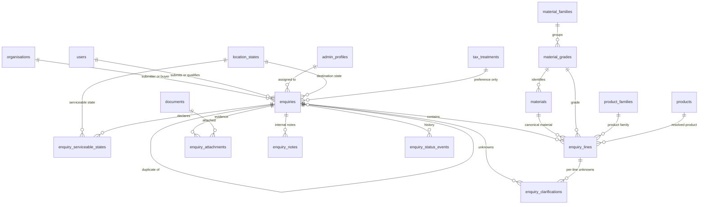
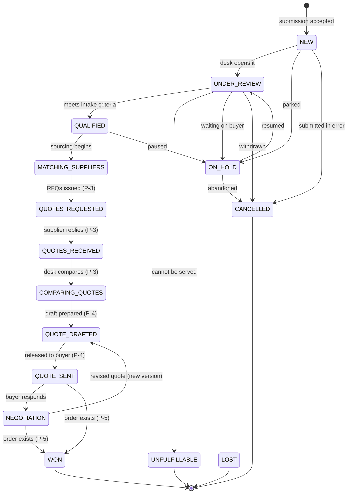

# PRIMEMET — P-1 Unified Enquiry Architecture (design proposal)

**Status: PROPOSAL — awaiting approval. Nothing in this document is implemented.**
Document date: 2026-11-01. Repository state at authoring: branch `main`, HEAD `aec0f1b77879b9145d4197032c27bd1729a79e97`, 104 changed paths, nothing staged, no Atlas resource, no database initialized.

This document prepares milestone **P-1** ("Enquiry / RFQ persistence", `docs/PRIMEMET_TASK_A_TASK_B_AUDIT.md` §6). It resolves the four outstanding design decisions recorded there, proposes a unified enquiry model for all three customer journeys, and specifies validators, indexes, API field boundaries, the admin lifecycle, tests, a migration strategy and the impact on the existing 45 collections.

It does not create a collection, edit a validator, add an enum value, connect to a database or touch application source. Every statement about the current system was read from the repository; every statement about what should be built is marked **[proposal]**.

---

## 0. How to read this document

| Marker | Meaning |
|---|---|
| **[existing]** | True of the repository today, verified by reading the file named. |
| **[proposal]** | Recommended design. Not approved, not implemented. |
| **[decision needed]** | A choice the project owner must make before implementation. |
| **[C] / [R] / [O]** | Inherited from the architecture document's register: confirmed / recommendation / open. |

**Reference convention.** A numbered reference is to **this** document when its number matches a section here (§2–§13). Otherwise it means `docs/PRIMEMET_STAGE_2_ARCHITECTURE.md`, which uses the same numbering for a different body of text — so architecture citations keep their number but appear inside brackets marked **[existing]** or after the word "architecture". This rule prevents ambiguity between the two documents.

Two rules were treated as binding while writing:

1. **Do not invent functionality.** Where the existing schema cannot support something the brief asks for, that is stated as a gap rather than papered over with a plausible-looking column.
2. **Do not create speculative collections.** The proposal adds the minimum set of collections that P-1 itself needs. Anything belonging to P-3, P-4 or P-5 is described as an interface, not created.

### Findings that changed the design

Three discoveries in the existing repository materially altered what the brief assumed. They are stated up front because they drive most of the recommendations below.

**F-A — the enquiry enums already exist, and their values differ from the brief's lifecycle.**
`db/enums.mjs` (generated from `prisma/schema.prisma`) already defines `EnquiryStatus` with thirteen values — `NEW, UNDER_REVIEW, MATCHING_SUPPLIERS, QUOTES_REQUESTED, QUOTES_RECEIVED, COMPARING_QUOTES, QUOTE_DRAFTED, QUOTE_SENT, NEGOTIATION, BUYER_SELLER_INTRODUCTION, WON, LOST, CANCELLED` — plus `EnquiryPriority` (`LOW/NORMAL/HIGH/URGENT`) and `EnquirySource` (`WEB_FORM/PHONE/EMAIL/REFERRAL/EXISTING_CUSTOMER/ADMIN_ENTRY`). The brief's §4 lists twelve states including `QUALIFIED`, `SUPPLIER_MATCHED`, `OFFER_SENT`, `ON_HOLD` and `UNFULFILLABLE`, which are absent. §4.2 reconciles the two instead of silently adopting either. This matters because an enum value is append-only by rule [C] (architecture §5.1), so choosing wrongly here is expensive to undo.

**F-B — the journeys are not buyer-only, so a single `kind` discriminator is insufficient.**
Architecture §5.5 describes `enquiries.kind = MATERIAL | PRODUCT | MIXED` and treats every enquiry as a buyer requirement ("the primary source of truth for the commercial requirement"). The brief asks for three journeys, one of which (`SELLER_SUPPLY_SUBMISSION`) has a seller as the submitting party and no buyer at all. `MATERIAL/PRODUCT/MIXED` describes *what is being asked for*; it cannot express *who is asking and why*. Both dimensions are needed. See §3.1.

**F-C — the location fields the brief requires do not exist yet, and one existing reference is already dangling.**
The brief asks for "supplier physical location and serviceable locations" and "buyer destination". Today `location_states` exists; cities, districts and industrial areas do not; and `supplier_listings.locationCityId` is a free-form `f.strOpt()` with no target collection — recorded as a known referential gap in the audit (row 18 and "Missing relationships" item 1). Any P-1 design that references a city would inherit that gap. §3.6 handles it explicitly rather than pretending the reference is sound.

---

## 1. Scope of P-1

### 1.1 In scope [proposal]

- One place to store a submitted commercial request from any of the three journeys.
- Structured line items for scrap material and spare parts, reusing the canonical catalogue identity chain.
- Clarification records for unknown technical facts.
- Status lifecycle with permitted transitions, assignment, priority and qualification.
- Internal notes and history, appended through the existing append-only audit machinery.
- Attachment references pointing at the existing `documents` collection.
- Duplicate detection and idempotent submission.
- Privacy-safe read projections for public/buyer/seller audiences.

### 1.2 Explicitly out of scope

| Excluded | Owned by |
|---|---|
| Supplier matching records and RFQ dispatch | P-3 |
| Supplier quotations, charges, taxes | P-3 (architecture §5.6–§5.7) |
| Buyer quotations and version snapshots | P-4 (architecture §5.8) |
| Orders, invoices, payments, settlement | P-5 (architecture §8.6) |
| Lots, inspections, approvals, dispatch gates | Part A §11–§14 |
| Location hierarchy (cities/districts/areas) | P-2 |
| SEO page storage | P-8 |
| Public read APIs generally | P-9 |
| Authentication and role guards | M2 |

P-1 stops at **"a qualified, understood request sitting with a desk"**. The moment an offer is priced, P-3/P-4 begin.

### 1.3 Dependency warning

The audit lists P-1 as depending on **M2 authentication**. There is no login, session or permission check in the application today: `src/middleware.ts` is a documented pass-through, and `/admin/**` is publicly reachable. Writing real enquiries therefore requires either M2 first, or an unauthenticated public write path — which is exactly the kind of endpoint that invites spam and fabricated records. **[decision needed] D-P1-1: does P-1 ship behind M2, or does it ship a rate-limited unauthenticated intake that stores submissions as `NEW` and never exposes them?** Recommendation: gate P-1 writes behind M2, and until then keep the wizard preview-only, as it is today.

---

## 2. The four outstanding design decisions

These are rows **8, 14, 17 and 21** of `docs/PRIMEMET_TASK_A_TASK_B_AUDIT.md` §5 — the four classified "Requires a design decision". Each is resolved with alternatives, implications, a recommendation and migration impact. None is presented as settled.

### 2.1 Decision 1 (audit row 14) — Do all three journeys share one enquiry collection?

**Decision required.** Whether `BUYER_REQUIREMENT`, `SELLER_SUPPLY_SUBMISSION` and `DIRECT_SOURCING_REQUEST` live in one collection with a journey discriminator, or in three collections.

**Alternatives.**

| Option | Description |
|---|---|
| **A. One collection + discriminator** | Single `enquiries` collection; `journey` field selects the shape; shared columns for everything common |
| **B. Three collections** | `buyer_enquiries`, `supply_submissions`, `sourcing_requests`, each with its own validator |
| **C. Base + extensions** | Shared `enquiries` header plus per-journey extension collections joined by `_id` |

**Business implications.** All three journeys end in the same private workflow: a desk reviews the request, seeks a counterparty, and either quotes or declines. Admin screens, SLAs, reporting and lead prioritization must show one queue, not three. With option B, "how many requests came in this week?" becomes three queries and three sets of status semantics that can drift apart; pricing and commission reporting gain the same problem. Option A makes cross-journey reporting the default and separation the special case.

Counter-consideration: a seller submitting supply is not a "lead". Mixing genuine sales leads with inventory offers in one queue could distort conversion metrics. That is solved by the discriminator being carried into every report, not by splitting the store.

**Technical implications.**
- MongoDB cannot enforce cross-document integrity, so a shared header means one validator and one index set rather than three copies of both. The audit already notes the catalogue proves the discriminator pattern (`material_product_types` expands one material into five forms instead of five materials).
- The two requirement *branches* (scrap vs parts) are already handled inside one line collection by `line_kind` in architecture §5.5.11. Adding a third branch type is a value addition, not a structural one.
- Journey-specific fields are genuinely few: a supply submission needs declared quantity/quality/location and lot references; a sourcing request needs a target description and reason. Both fit as nullable fields on the header or lines.
- Validators use `additionalProperties: false`, so a journey-specific field must be declared on the shared document regardless. Splitting the collection does not avoid declaring those fields; it only duplicates the shared ones.

**Recommended option: A — one `enquiries` collection with a mandatory `journey` discriminator**, plus per-journey `$expr` invariants that require the journey-specific fields when the journey demands them. Option C rejected: it buys isolation at the cost of a join on every read, and MongoDB has no FK to guarantee the extension row exists.

**Migration and backward-compatibility impact.** Low. No enquiry data exists anywhere (no database has been initialized), so there is nothing to migrate or back-fill. If option B were later chosen, the split is an additive migration (new collections + a copy) but every read path and index would need rewriting. Choosing A now is reversible; choosing B and collapsing later means merging three divergent status vocabularies — the failure mode that made `INTERMEDIARY`→`AGENCY` a rename exercise (D4).

### 2.2 Decision 2 (audit row 8) — Aggregate public supply counts

**Decision required.** Whether/how to publish "N suppliers / N tonnes available" figures, given that a count computed over a single supplier identifies that supplier.

**Alternatives.**

| Option | Description |
|---|---|
| **A. Publish nothing** | No counts anywhere |
| **B. Threshold-gated aggregate** | Publish only when distinct suppliers ≥ k (e.g. 3) and the period is stale enough not to identify a listing |
| **C. Cached materialised view** | Precomputed aggregates refreshed by a job, published under B's rules |
| **D. Exact counts always** | Simplest to build, unacceptable privacy risk |

**Business implications.** Counts are marketing proof ("deep supplier network in aluminium") and useful for buyers choosing where to source. But PRIMEMET's competitive position is its supplier relationships; publishing a number that lets a buyer deduce "there is exactly one 6063 chip supplier near Pune" hands away that relationship and breaches the confidentiality expectation implied to sellers. Audit row 8 flags precisely this: "a count over one supplier can identify them."

There is also an accuracy obligation: a published count implies availability PRIMEMET has not verified. §3.7 keeps seller-declared supply distinct from verified availability, and a count conflates them unless it names its basis.

**Technical implications.**
- `supplier_listings` holds `quantityKg`, `gradeId`, `productId`, `locationCityId`, `availableFrom/To`, `status` — enough to compute counts today **[existing]**. No new domain entity is needed; the audit says so explicitly.
- Option C introduces cache invalidation and staleness questions that P-1 should not absorb.
- The threshold rule belongs in the read projection, not in stored data, so it can change without a migration.
- Counting by `status: ACTIVE` within an availability window is the only defensible definition; anything else counts expired listings.

**Recommended option: B now, revisited at C only if load requires it.** Publish counts only above a minimum distinct-supplier threshold, always labelled with basis ("declared supply from active listings"), never below threshold (render "suppliers available on request" instead of a small number), and never broken down finely enough to isolate one listing (do not combine grade × city × quantity band on one screen).

**Migration and backward-compatibility impact.** **None.** No collection, index or field changes — this is a read-path policy. That is the point of marking it "needs a design decision, not a new collection". The threshold value itself becomes configuration, so raising or lowering it is a deploy, not a migration. **[decision needed] the numeric threshold k** — recommendation k = 3, owner to confirm.

### 2.3 Decision 3 (audit row 17) — Which endpoints are public versus authenticated?

**Decision required.** The boundary between public read APIs and authenticated ones, given that internal cost, margin and commission fields must never enter a public projection.

**Alternatives.**

| Option | Description |
|---|---|
| **A. Static-only public surface** | No public read API at all; public content stays prerendered (today's behaviour) |
| **B. Public catalogue reads only** | Read-only public endpoints for published grades/products; everything else authenticated |
| **C. Broad public reads with DTO filtering** | Many public endpoints, safety resting on serialiser allow-lists |

**Business implications.** Marketing and SEO benefit from machine-readable catalogue data; partners may want it. But every public endpoint is another place a leak can occur, and PRIMEMET's sensitive surface (rates, margins, commissions, supplier identities, inspection evidence) is large. A single leaked internal field is a commercial breach, not a bug.

**Technical implications.**
- Architecture §18.1 already fixes four audiences with four DTOs and §18.2 classifies every field `PUBLIC / BUYER / SUPPLIER / INTERNAL / RESTRICTED`, with allow-list serialisers that **exclude by default** — a new column is invisible to a public payload until deliberately added. That discipline is the reason option C is even discussable.
- §18.2 carries a **[C]** test requirement: a repository-level test asserting that serialising any lot, quote or order as `buyer` or `seller` never contains an `INTERNAL` or `RESTRICTED` key. That test cannot exist before those records exist, so it lands with P-1's first real record type.
- Today there is **no public read API** **[existing]**: the only API route is `/api/health`, and public pages are prerendered from static content modules. So option A describes the present, not a regression.
- Prerendered pages already expose nothing sensitive; adding an API adds no new *data* exposure provided it serves the same allow-listed projection.

**Recommended option: A for P-1, then B when a consumer actually needs it.** Keep the public surface prerendered. Introduce public read endpoints only for already-public catalogue facts (published grades and products), served by the same allow-list projection used by the pages, with no enquiry, party, price or document data ever entering that projection. Option C is rejected for P-1: breadth before the leak-test exists is how a `INTERNAL` field reaches a crawler.

**Migration and backward-compatibility impact.** **None to the database.** This is an API-surface and serialiser decision. Its cost is deferred work: when B arrives it needs the DTO layer, the §18.2 regression test, and rate limiting. Documenting that now prevents P-9 from discovering it late.

### 2.4 Decision 4 (audit row 21) — Rating model

**Decision required.** Whether ratings stay a hand-edited scalar or become records with an admin approval workflow.

**Current state [existing].** `supplier_profiles.ratingInternal` is a single decimal, internal only. There are no rating records, no approval workflow, no visibility control and no aggregation — audit row 21.

**Alternatives.**

| Option | Description |
|---|---|
| **A. Keep the scalar** | Admin edits a number |
| **B. Rating records + derived summary** | Append-only events (transaction outcome, quality, delivery); `ratingInternal` becomes a computed rollup |
| **C. Records + admin-published display rating** | B, plus an explicit publication decision controlling what a counterparty may see |

**Business implications.** A scalar with no provenance cannot survive a dispute: "why is this supplier rated 3.4?" has no answer, and the number is unauditable despite everything else in the system being append-only. Ratings also influence whom a desk matches with, so an unexplained rating quietly shapes commercial outcomes. Publishing ratings externally creates reciprocal pressure and legal exposure (defamation, competitive disparagement) and touches the equivalent-part liability question already open as O-27.4.

**Technical implications.**
- The audit's reuse guidance is explicit: `ratingInternal` "should become a derived summary over rating records rather than remaining a hand-edited scalar, and the records attach to existing `organisations`."
- Append-only records fit the existing pattern (`material_alias_verifications`, `audit_logs`, `contact_share_events` are all insert-only and privilege-protected) **[existing]**.
- A derived summary must be recomputed, not trusted as stored — otherwise the rollup and the events disagree, which is the same two-copies-of-one-truth failure the `issuer_is_primemet` flag was removed for (D5 correction 3).
- Ratings depend on transactions, which do not exist until P-5. A rating record with no order to reference has nothing to rate.

**Recommended option: C, but sequenced after P-5.** Design the record shape now so the schema does not have to be revisited; implement it when orders exist to generate evidence. Keep `ratingInternal` as an internal admin note in the interim and do not publish any rating externally until the owner decides visibility (option C's publication step) and the legal review behind O-27.4 is complete.

**Migration and backward-compatibility impact.** Additive: one new append-only collection plus a derived read path. `supplier_profiles.ratingInternal` can remain populated during transition and be deprecated once the rollup is trustworthy — deprecating a field is a documentation act, deleting it is a migration, and deletion is not recommended. Because ratings depend on P-5 data, **this decision does not block P-1**; it is recorded here so P-1 does not accidentally hard-code the scalar assumption into enquiry projections.

### 2.5 Summary of the four resolutions

| # | Audit row | Question | Recommendation | Blocks P-1? |
|---|---|---|---|---|
| 1 | 14 | One enquiry collection or three? | **One**, with a mandatory `journey` discriminator | Yes — it *is* P-1 |
| 2 | 8 | Public supply counts? | **Threshold-gated, basis-labelled, no new collection** | No — read-path policy |
| 3 | 17 | Public vs authenticated endpoints? | **No public read API in P-1**; catalogue-only later | No — but constrains P-1 projections |
| 4 | 21 | Rating model? | **Records + derived summary + admin publication**, built after P-5 | No |

Each remains **[decision needed]** until the owner approves it. Nothing above was assumed.

---

## 3. The unified enquiry model

### 3.1 Two orthogonal dimensions, not one

Because of F-B, the design separates *who is asking* from *what is being asked for*:

```
journey        BUYER_REQUIREMENT | SELLER_SUPPLY_SUBMISSION | DIRECT_SOURCING_REQUEST   [proposal]
requirementKind MATERIAL | PRODUCT | MIXED                                              [existing]
```

`requirementKind` is unchanged from architecture §5.5.1 **[existing]**; `journey` is new **[proposal]**. Keeping them separate means a `DIRECT_SOURCING_REQUEST` for copper turnings and a `BUYER_REQUIREMENT` for copper turnings share the same line branch, while still being distinguishable in reporting and in the lifecycle (§4.2).

| Journey | Submitting party | Counterparty sought | Typical entry |
|---|---|---|---|
| `BUYER_REQUIREMENT` | Buyer organisation | Suppliers who can sell | `/request-a-quote`, `/source-scrap`, `/buyer/enquiries/new` |
| `SELLER_SUPPLY_SUBMISSION` | Seller organisation | Buyers who can take it | `/sell-scrap`, `/become-a-supplier` |
| `DIRECT_SOURCING_REQUEST` | PrimEMET desk, on behalf of no external submitter | A specific material/part | `/admin/enquiries` entry (`ADMIN_ENTRY` source) |

`DIRECT_SOURCING_REQUEST` is the interesting one: it has no external submitter, so the submitter is an admin user and the "buyer" side may be empty until a requirement is matched. Modelling it as "an enquiry with a null buyer" is worse than modelling it explicitly, because a null buyer elsewhere means missing data.

### 3.2 Header: `enquiries` [proposal]

Fields marked [existing-shape] mirror architecture §5.5.11; the rest are additions P-1 needs. Types use the `db/define.mjs` vocabulary (`f.uuid`, `ref`, `refOpt`, `f.decimal`, `f.enumOf`, …).

```
_id                     f.uuid()                       -- UUID string is the primary key; no second id field [existing rule]
reference               f.str({maxLength: 24})         -- ENQ-2026-000123, minted from reference_sequences [existing]
journey                 f.enumOf("EnquiryJourney")     -- NEW ENUM VALUE SET [proposal], see §3.1
requirementKind         f.enumOf("EnquiryKind")        -- MATERIAL | PRODUCT | MIXED
status                  f.enumOf("EnquiryStatus")      -- existing 13-value enum, extended per §4.2
priority                f.enumOf("EnquiryPriority")    -- existing
source                  f.enumOf("EnquirySource")      -- existing
serviceLine             f.enumOpt("ServiceLine")       -- marketing/reporting only, no settlement behaviour [existing D4]
transactionModel        f.enumOpt("TransactionModel")  -- PRINCIPAL|AGENCY|MANAGED_SUPPLY, frozen before quoting (D4)

submitterOrgId          refOpt("organisations")        -- NULL for ADMIN_ENTRY journeys
submitterUserId         refOpt("users")
buyerOrgId              refOpt("organisations")        -- NULL for SELLER_SUPPLY_SUBMISSION
counterpartyHint        f.strOpt({maxLength: 400})     -- what the seller hopes to move / what the desk is chasing

description             f.str({maxLength: 4000})       -- REQUIRED for every journey
contactPersonSnapshot   f.strOpt({maxLength: 200})     -- as given at submission, not a live contact record
contactPhoneE164        f.strOpt({maxLength: 32})      -- RESTRICTED audience (§7.1)
contactEmail            f.strOpt({maxLength: 320})     -- RESTRICTED audience

deliveryCity            f.strOpt({maxLength: 120})     -- text, NOT a city FK: see F-C and §3.6
deliveryStateId         refOpt("location_states")      -- real target [existing]
deliveryPostalCode      f.strOpt({maxLength: 12})      -- leading zeros significant → string, never int
destinationNote         f.strOpt({maxLength: 500})

supplierLocationText    f.strOpt({maxLength: 200})     -- seller-declared origin, free text until P-2
serviceableStates       f.arrayOfRef("location_states")[proposal]  -- see §3.6 for the array-reference caveat

taxPreference           f.enumOpt("TaxPreference")     -- preference, never a rate [existing §5.5.6]
requirementFrequency    f.enumOpt("RequirementFrequency")
targetUnitPrice         f.decimalOpt()                 -- INTERNAL, never supplier-visible [existing §5.5.6]
targetPriceUom          f.enumOpt("QuantityUom")

readinessState          f.enumOf("EnquiryReadiness")   -- NOT_READY | CLARIFICATION_REQUIRED | READY [existing §5.5.9]
readinessCheckedAt      f.dateOpt()

assignedToAdminId       refOpt("admin_profiles")       -- admin assignment and follow-up
qualifiedAt             f.dateOpt()
qualifiedById           refOpt("users")
qualificationNote       f.strOpt({maxLength: 1000})

dedupeKey               f.str({maxLength: 128})        -- §3.5
idempotencyToken        f.strOpt({maxLength: 80})      -- §3.5
closedReason            f.strOpt({maxLength: 500})
closedAt                f.dateOpt()
createdAt / updatedAt   f.date()                       -- ts convention [existing]
```

**Deliberately absent.** No `order_id` (§3.8 forbids auto-order creation), no supplier identity list (matching is P-3), no prices beyond the buyer's own optional target, no margin or commission field (those belong to quotation records, P-4), no city FK (F-C).

### 3.3 Lines: `enquiry_lines` [proposal]

One collection, `lineKind` discriminator, both branches nullable — exactly the pattern architecture §5.5.11 already specifies **[existing-shape]**, restated here as MongoDB fields rather than PostgreSQL columns.

Scrap branch: `materialCategoryId`, `metalType`, `materialGradeId → material_grades`, `canonicalMaterialId → materials`, `gradeSpecification`, `scrapForm`, `condition`, `purityPct`, `contaminationPct`, `scrapSource`, `inspectionRequirement`, `sampleAvailable`, `monthlyQuantity`.
Parts branch: `productFamilyId`, `productName`, `manufacturer`, `partNumber`, `technicalSpec`, `partMaterial`, `compatibleMachine`, `equivalentAcceptable`, `productCondition`.
Common: `quantity`, `uom`, `lineNotes`, `sortOrder`.

Canonical resolution: a line may arrive with only a raw phrase (`"SS304 sheet"`). `rawDesignation` preserves what the submitter typed; `canonicalMaterialId` is filled **only** after alias resolution against `material_aliases` **[existing]**. Storing the raw text is what makes the record auditable when a resolution is later corrected.

Seller-declared supply fields on the same line (`declaredQuantityKg`, `declaredQualityNote`, `lotReferenceHint`) are **declarations**, named as such — see §3.7.

### 3.4 Clarifications: `enquiry_clarifications` [proposal]

Direct port of architecture §5.5.11 **[existing-shape]**: `enquiryId`, `lineId`, `fieldGroup` (A–F), `fieldKey`, `reason`, `isBlocker`, `status` (`OPEN|ANSWERED|WAIVED`), `answeredValue`, `answeredById`, `answeredAt`, `resolvedById`. Unique on `(enquiryId, fieldGroup, fieldKey)`.

This is what makes "unknown" a workflow state instead of a validation error, which §5.5.1 calls out as a design rule: rejecting a real lead on a fact the buyer cannot know loses business.

### 3.5 Duplicate detection and idempotent submission [proposal]

Two mechanisms, because they solve different problems.

**Idempotency (client retry).** An optional `idempotencyToken` supplied by the submitting client, with a **partial unique index** on `(submitterOrgId, idempotencyToken)` where the token is present. A retried POST returns the existing enquiry rather than creating a second one. Without the token, retries create duplicates — so the API contract should require it for authenticated submissions and permit it for anonymous ones.

**Dedupe (genuinely repeated requests).** A deterministic `dedupeKey` computed server-side from a normalised fingerprint: journey + canonical material or product id + rounded quantity bucket + delivery state + submitter org + rolling time window. A **non-unique index** supports lookup; the *application* decides whether a match is a duplicate, because "same buyer wants more 6063 next month" is a legitimate repeat, not an error.

That asymmetry is deliberate. A unique index on `dedupeKey` would reject a real second request with a database error, and the desk would never see it. Instead a match raises a clarification-style flag and links the records via `duplicateOfEnquiryId` (nullable self-reference). **[decision needed]: the time window** — recommendation 7 days, owner to confirm.

`reference` keeps a unique index **[existing pattern: `reference_sequences`]**, so human-visible identifiers cannot collide.

### 3.6 Locations, given F-C

The brief requires supplier physical location, serviceable locations and buyer destination. The honest answer is that **P-1 can store these as text plus state references, and cannot safely reference cities.**

| Need | What P-1 does | Why not better |
|---|---|---|
| Buyer destination | `deliveryStateId → location_states` **[existing target]** + `deliveryCity` as text | no `location_cities` collection exists (P-2) |
| Supplier physical location | `supplierLocationText` free text + `serviceableStates` | same |
| Serviceable locations | array of `location_states` ids | arrays of references are not enforceable in MongoDB |
| Existing dangling reference | left exactly as-is | repointing `supplier_listings.locationCityId` is P-2 work |

**Array-reference caveat, stated plainly:** `refs.mjs` validates singular references inside a transaction **[existing]**. A multi-valued `serviceableStates` array would need the guard extended to iterate arrays. Until then the safest representation is one row per state in a small child collection, or accepting weaker enforcement. **[proposal: a child collection `enquiry_serviceable_states(enquiryId, stateId)`]** — it costs one extra collection but keeps every reference singular and checkable, consistent with how the rest of the schema handles references.

Choosing free-text city storage is not a shortcut: it is the only option that does not create a reference to a collection that does not exist, which is precisely the defect the audit flagged in `supplier_listings.locationCityId`. When P-2 lands, migrating text → city id is additive.

### 3.7 Declared supply is not verified availability

The brief's instruction "do not confuse seller-declared supply with verified availability" maps onto an existing distinction in the schema: `supplier_listings.quantityKg` is described in its own collection note as "the only availability quantity in the schema… A material's identity never carries a quantity" **[existing]**, and lots/inspections (verification) are Part A §11–§13, outside P-1.

Therefore **[proposal]**:
- Every quantity arriving from a seller is stored in a field whose name contains `declared` (`declaredQuantityKg`, `declaredQualityNote`).
- No field named `available`, `stock`, `verifiedQuantity` or `inStock` is introduced by P-1.
- Any projection that surfaces a declared figure must label it as declared (mirroring the frontend's existing honesty discipline).
- Verification lives with lots and inspections (P-5+), and nothing in P-1 may imply it happened.

This also protects the fabrication rule: an enquiry record cannot become a fake stock feed by accident.

### 3.8 Submission never creates an order

**[proposal, rule]** The write path for an enquiry has no code path that inserts into an order-like collection, because none exists yet **[existing]**, and P-1 must not add one. The lifecycle's terminal positive state is `WON`, and architecture §13.4 already fixes the rule **[C]**: "an enquiry may be `WON` only when an order exists; an order may be created only from an `ACCEPTED` buyer quote version." So `WON` is *reachable only from P-4/P-5 artefacts*, meaning P-1 can define the state without being able to fabricate the transaction. Enforced as a transition precondition (§6.3), not merely as prose.

---

## 4. Validators, invariants and indexes [proposal]

MongoDB enforces types, required fields, enum membership, `$expr` predicates over one document, unique and partial-unique indexes — and nothing else. That mapping table is fixed in `db/define.mjs`'s header **[existing]**; this section applies it to the new collections and states honestly which rules fall outside it.

### 4.1 `enquiries` validator

Required (present on every document): `_id, reference, journey, requirementKind, status, priority, source, description, dedupeKey, readinessState, createdAt, updatedAt`. Everything party-related is optional precisely because a `DIRECT_SOURCING_REQUEST` legitimately has no external submitter and a `SELLER_SUPPLY_SUBMISSION` legitimately has no buyer.

Invariants (`$expr`, ANDed into the validator exactly like the existing `material_aliases` gate **[existing pattern]**):

| # | Rule | Predicate shape |
|---|---|---|
| I1 | A `BUYER_REQUIREMENT` must name a buyer org | `journey <> 'BUYER_REQUIREMENT' OR buyerOrgId IS present` |
| I2 | A `SELLER_SUPPLY_SUBMISSION` must name a submitter org | `journey <> 'SELLER_SUPPLY_SUBMISSION' OR submitterOrgId IS present` |
| I3 | Only admin entry may have neither org | `submitterOrgId OR buyerOrgId OR source = 'ADMIN_ENTRY'` |
| I4 | `MIXED` requires at least two lines | **not expressible** — see §4.4 |
| I5 | A closed enquiry carries a closure timestamp | `status NOT IN (WON, LOST, CANCELLED) OR closedAt IS present` |
| I6 | Qualified enquiries carry a qualifier | `qualifiedAt IS NULL OR qualifiedById IS present` |
| I7 | Target price is bounded and non-negative | `targetUnitPrice IS NULL OR targetUnitPrice >= 0` |
| I8 | Reference matches the minting format | regex on `reference` (`^(ENQ\|SRC\|SUP)-\d{4}-\d{6}$`) |
| I9 | Postal code is a string of digits, ≤ 12 chars | regex, not numeric type (leading zeros) |

Money discipline stays where it already is: `f.decimal()` refuses a BSON double at the server **[existing]**, and scale (2/3/4 dp) remains a write-path rule because a validator cannot inspect a decimal's exponent **[existing limitation, documented in `define.mjs`]**.

### 4.2 Indexes

Naming follows the established `ix_<collection>_<cols>` convention with `_u` / `_p` suffixes produced by `defaultIndexName` **[existing]**, keeping names under the length cap that PostgreSQL truncation exposed.

| Collection | Index | Purpose |
|---|---|---|
| `enquiries` | `{reference:1}` unique | human identifier cannot collide |
| | `{submitterOrgId:1, createdAt:-1}` | "my submissions" |
| | `{buyerOrgId:1, status:1}` | buyer queue |
| | `{status:1, priority:1, createdAt:1}` | desk worklist ordering |
| | `{assignedToAdminId:1, status:1}` | assignment view |
| | `{journey:1, status:1, createdAt:-1}` | per-journey reporting (Decision 1 pays for itself here) |
| | `{readinessState:1, createdAt:-1}` | mirrors the existing PG index on `(readiness_state, created_at DESC)` **[existing §5.5.11]** |
| | `{deliveryStateId:1}` | destination sourcing input |
| | `{dedupeKey:1}` non-unique | duplicate lookup, deliberately not enforced (§3.5) |
| | `{submitterOrgId:1, idempotencyToken:1}` unique + partial `{idempotencyToken: {$type:"string"}}` | retry safety; partial so absent tokens never collide |
| `enquiry_lines` | `{enquiryId:1, sortOrder:1}` | ordered retrieval |
| | `{canonicalMaterialId:1}` | catalogue analytics |
| | `{productFamilyId:1}` | parts analytics |
| | `{enquiryId:1, lineKind:1}` unique? **no** | an enquiry may hold several lines of one kind |
| `enquiry_clarifications` | `{enquiryId:1, fieldGroup:1, fieldKey:1}` unique | mirrors the PG `UQ` **[existing]** |
| | `{enquiryId:1, status:1}` | open-items count drives readiness |
| | `{status:1, isBlocker:1}` | desk blocker queue |
| `enquiry_attachments` | `{enquiryId:1, documentId:1}` unique | no double attachment |
| | `{documentId:1}` unique? **no** | a document may serve several records |
| `enquiry_notes` (append-only) | `{enquiryId:1, createdAt:-1}` | thread |
| `enquiry_status_events` (append-only) | `{enquiryId:1, createdAt:-1}` | history |
| | `{fromStatus:1, toStatus:1}` | transition analytics |
| `enquiry_serviceable_states` | `{enquiryId:1, stateId:1}` unique | one row per pair |
| | `{stateId:1}` | reverse lookup |

Every nullable-but-uniquely-indexed field uses a **partial filter**, following the outcome of the Task A audit (39 unique indexes, 0 defects; `organisations.gstin`/`pan` already partial) **[existing]**. MongoDB treats an absent field as a value for uniqueness, so an unfiltered unique index on `idempotencyToken` would reject every second anonymous submission — the exact hazard the audit verified empirically.

### 4.3 Append-only history: two new immutable collections

The brief asks for status transitions, history, internal notes and audit events. The system already answers "who changed what" with `audit_logs` **[existing]**, so the proposal does not invent a parallel audit trail:

- **`enquiry_status_events`** — append-only record of each lifecycle move (`fromStatus`, `toStatus`, `actorUserId`, `reason`, `at`). This is workflow history, specific to the enquiry aggregate, and belongs next to it.
- **`enquiry_notes`** — append-only internal notes (`body`, `authorUserId`, `visibility`, `at`). Marked `immutable: true` so the DAO exposes insert+find only and the deployment role grants no update/delete — the same mechanism protecting the seven existing immutable collections **[existing]**.

Editing a note is therefore impossible by construction; corrections are new notes, consistent with how alias decisions and contact-share events already behave **[existing]**.

Both join the `IMMUTABLE_COLLECTIONS` set, which grows from 7 to 9. **[impact: `roles.mjs` must grant `primemet_app` find+insert only on them — see §7.3.]**

### 4.4 What MongoDB cannot enforce here — stated, not hidden

| Rule | Why it fails | Where it lives instead |
|---|---|---|
| A `MIXED` enquiry has ≥ 2 lines | cross-document count | write path + a scheduled consistency check |
| Every `line.enquiryId` points at a real enquiry | no foreign keys | `refs.mjs` guard inside the transaction **[existing]** |
| At least one line exists | cross-document existence | write path: create header+lines in one transaction or not at all |
| `READY` implies no open blocker | cross-document predicate | readiness recomputation service, mirroring §5.5.9 "computed, not typed" **[existing rule]** |
| Status transitions follow §6.3 | validators cannot see the previous document value | write path + `enquiry_status_events`; a rejected transition writes an audit event |
| Decimal scale | validators cannot inspect exponent | write path **[existing documented limitation]** |

The `refs.mjs` extension needed here is small: it already validates singular references **[existing]**, so adding `enquiries`, `enquiry_lines`, `enquiry_clarifications`, `enquiry_attachments`, `enquiry_notes`, `enquiry_status_events`, `enquiry_serviceable_states` to its reference vocabulary is data, not new machinery.

---

## 5. Relationship diagram

Solid edges are references validated by `refs.mjs` **[existing mechanism]**; dashed edges point at collections that do not exist yet and are therefore **not** created by P-1.



Collections marked *(future)* elsewhere in this document — supplier matches, quotations, orders, lots — are deliberately **absent** from this diagram. Drawing an edge to a collection that does not exist would misrepresent the schema.

---

## 6. Admin lifecycle

### 6.1 Reconciling the brief's twelve states with the existing thirteen (F-A)

The brief's list and `EnquiryStatus` **[existing]** overlap but do not match. Mapping them before choosing:

| Brief state | Existing equivalent | Notes |
|---|---|---|
| `NEW` | `NEW` | exact |
| `REVIEWING` | `UNDER_REVIEW` | rename only |
| `QUALIFIED` | — | no equivalent; a genuine addition |
| `SOURCING` | `MATCHING_SUPPLIERS` | same intent |
| `SUPPLIER_MATCHED` | `QUOTES_REQUESTED` | different emphasis: matched ≠ asked |
| `OFFER_SENT` | `QUOTE_SENT` | synonym |
| `NEGOTIATION` | `NEGOTIATION` | exact |
| `WON` | `WON` | exact |
| `LOST` | `LOST` | exact |
| `ON_HOLD` | — | no equivalent; genuine addition |
| `UNFULFILLABLE` | — | no equivalent; distinct from `LOST` |
| `CANCELLED` | `CANCELLED` | exact |

And the existing enum holds five states the brief omits — `QUOTES_REQUESTED`, `QUOTES_RECEIVED`, `COMPARING_QUOTES`, `QUOTE_DRAFTED`, `BUYER_SELLER_INTRODUCTION` — which are the actual working steps between sourcing and offering. Dropping them would erase the quotation pipeline the architecture already specifies (§5.6–§5.8).

**Recommended resolution [proposal]: keep `EnquiryStatus` as written and add three values** — `QUALIFIED`, `ON_HOLD`, `UNFULFILLABLE` — rather than renaming anything. Reasons: an enum value is append-only by rule [C] and existing values may already appear in the frontend's copy and in the architecture's transition tables; renaming `UNDER_REVIEW`→`REVIEWING` would break both for no functional gain; and the five "missing" brief states are simply the brief compressing a pipeline it did not enumerate. `SUPPLIER_MATCHED` is folded into `MATCHING_SUPPLIERS → QUOTES_REQUESTED`, since matching is P-3 and P-1 must not own a state whose evidence it cannot store.

**[decision needed]: approve the three additions and the fold.** If instead the owner prefers the brief's vocabulary verbatim, that is a *different* migration touching the existing enum's meaning, and it should be made explicitly now rather than discovered later.

### 6.2 Per-journey lifecycles

One status vocabulary shared by three journeys produces meaningless states if every path is allowed everywhere (a seller supply submission cannot logically reach `QUOTE_SENT` to itself). So permitted transitions are declared **per journey**.



**Journey-specific restrictions [proposal]:**

| Journey | May not enter | Reason |
|---|---|---|
| `SELLER_SUPPLY_SUBMISSION` | `QUOTE_SENT`, `NEGOTIATION`, `WON`, `BUYER_SELLER_INTRODUCTION` | it is an offer, not a purchase request; its positive outcome is a *match*, owned by P-3 |
| `DIRECT_SOURCING_REQUEST` | `BUYER_SELLER_INTRODUCTION` until a buyer org is attached | there is no counterparty to introduce |
| all | `WON` | precondition: an accepted buyer quote version and an order exist (§3.8, rule [C]) |

Terminal states: `WON`, `LOST`, `CANCELLED`, `UNFULFILLABLE`. `ON_HOLD` is explicitly **not** terminal — resumption is expected.

### 6.3 Transition table: roles, mandatory fields, audit events

| From → To | Permission **[existing enum]** | Mandatory before the move | Audit event written |
|---|---|---|---|
| `NEW → UNDER_REVIEW` | `ENQUIRY_EDIT` | assignee set (`assignedToAdminId`) | `ENQUIRY_OPENED` |
| `UNDER_REVIEW → QUALIFIED` | `ENQUIRY_EDIT` | `qualifiedById`, `qualifiedAt`, `qualificationNote`; readiness ≠ `NOT_READY` | `ENQUIRY_QUALIFIED` |
| `UNDER_REVIEW → UNFULFILLABLE` | `ENQUIRY_CLOSE` | `closedReason` (non-blank), `closedAt` | `ENQUIRY_UNFULFILLABLE` |
| `UNDER_REVIEW → ON_HOLD` | `ENQUIRY_EDIT` | reason note in `enquiry_notes` | `ENQUIRY_HELD` |
| `ON_HOLD → UNDER_REVIEW` | `ENQUIRY_EDIT` | resume note | `ENQUIRY_RESUMED` |
| `ON_HOLD → CANCELLED` | `ENQUIRY_CANCEL` | `closedReason` | `ENQUIRY_CANCELLED` |
| `QUALIFIED → MATCHING_SUPPLIERS` | `ENQUIRY_ASSIGN` | zero open blockers (`isBlocker=true, status='OPEN'`); ≥ 1 line with quantity+uom; delivery state known; tax preference answered; frequency answered — i.e. `readinessState = READY` (§5.5.9 **[existing]**) | `ENQUIRY_SOURCING_STARTED` |
| `* → CANCELLED` | `ENQUIRY_CANCEL` | `closedReason` | `ENQUIRY_CANCELLED` |
| `* → LOST` | `ENQUIRY_CLOSE` | loss reason category | `ENQUIRY_LOST` |
| `* → WON` | `ENQUIRY_CLOSE` | accepted buyer quote version + order reference (**P-4/P-5**; unreachable in P-1) | `ENQUIRY_WON` |

Any transition not listed is **refused**. Refusals are themselves audited, so a desk repeatedly attempting an illegal move is visible rather than silently absorbed.

The mandatory-field sets are enforced in the write path (MongoDB cannot compare old and new document values, §4.4), and each successful transition writes one `enquiry_status_events` row plus one `audit_logs` row **[existing collection]**. Two records, not one, because they answer different questions: "what happened to this lead" versus "who did what to the system".

### 6.4 Readiness gates the pipeline, not the UI

Architecture §5.5.9 already fixes the rule **[existing]**: "the desk cannot move an enquiry to `QUOTES_REQUESTED` while any blocker is open — that rule is enforced in the state machine (§13), not only in the UI." (That inner `§13` refers to the architecture document's own section; in this document the equivalent enforcement is §6.3.) This proposal keeps it exactly there — the `QUALIFIED → MATCHING_SUPPLIERS` row above is that enforcement — and adds nothing to the readiness definition itself.

---

## 7. Privacy and security boundaries

The brief's five privacy requirements are answered against mechanisms that already exist, plus what P-1 must add.

| Requirement | Mechanism | Status |
|---|---|---|
| Supplier identities and contacts stay private | `documents.visibility/sensitivity`, `organisation_contacts` classified `RESTRICTED`, DTO allow-lists excluding by default (§18.2 **[existing]**) | policy exists; **no serialiser code exists yet** |
| Public APIs use explicit privacy-safe DTOs | §18.1 four audiences / four DTOs **[existing design]** | unimplemented; Decision 3 keeps public surface prerendered for now |
| No internal matching/commission/margin/sourcing notes leak | `INTERNAL` class + allow-list + the §18.2 regression test **[existing requirement]** | test cannot run until records exist → lands with P-1 (T-11) |
| Ratings remain admin-controlled | `supplier_profiles.ratingInternal` is internal-only **[existing]**; publication deferred (Decision 4) | satisfied today by omission |
| Submission must not create an order | no order collection exists **[existing]**; `WON` precondition blocks it structurally (§3.8) | satisfied |
| Declared supply ≠ verified availability | naming rule + no verification-shaped fields (§3.7) | satisfied by construction |

### 7.1 Field audience matrix [proposal]

Classified using the existing five classes (`PUBLIC / BUYER / SUPPLIER / INTERNAL / RESTRICTED`, §18.2 **[existing]**). The point of this table is that **every new column gets an audience at design time**, so no field is exposed by default.

| Field | public | buyer (own record) | seller (own record) | admin |
|---|---|---|---|---|
| `reference` | ✗ | ✓ | ✓ | ✓ |
| `journey` | ✗ | ✓ | ✓ | ✓ |
| `requirementKind` | ✗ | ✓ | ✓ | ✓ |
| `status` | ✗ | own only | own only | ✓ |
| `priority` | ✗ | ✗ | ✗ | ✓ |
| `source` | ✗ | ✗ | ✗ | ✓ |
| `serviceLine` | ✗ | ✓ | ✓ | ✓ |
| `transactionModel` | ✗ | after quote only | ✗ | ✓ |
| `description` | ✗ | own | own | ✓ |
| `contactPersonSnapshot` | ✗ | own | own | ✓ |
| `contactPhoneE164` | ✗ | **RESTRICTED** — only via approved share (D2) | same | ✓ |
| `contactEmail` | ✗ | **RESTRICTED** | same | ✓ |
| `submitterOrgId` / org name | ✗ | ✗ to other parties | ✗ | ✓ |
| `buyerOrgId` / org name | ✗ | ✓ | **RESTRICTED** until contact share approved | ✓ |
| line quantity / uom / grade / product refs | ✗ | own | own | ✓ |
| `declaredQuantityKg`, `declaredQualityNote` | ✗ (never aggregated below threshold — Decision 2) | n/a | own | ✓ |
| `lotReferenceHint` | ✗ | n/a | own | ✓ |
| `canonicalMaterialId` resolution | ✗ | own | own | ✓ |
| `targetUnitPrice`, `targetPriceUom` | ✗ | own (it is theirs) | **✗ never** | ✓ |
| `taxPreference` | ✗ | own | own | ✓ |
| `requirementFrequency`, `monthlyQuantity` | ✗ | own | own | ✓ |
| delivery city/state/postal/destination note | ✗ | own | own | ✓ |
| `supplierLocationText`, serviceable states | ✗ | **✗** | own | ✓ |
| `readinessState` | ✗ | ✗ | ✗ | ✓ |
| `assignedToAdminId`, assignment history | ✗ | ✗ | ✗ | ✓ |
| `qualifiedAt/By/Note` | ✗ | ✗ | ✗ | ✓ |
| clarification reasons/status | ✗ | questions addressed to them only | same | ✓ |
| `enquiry_notes.*` | ✗ | ✗ | ✗ | ✓ |
| `enquiry_status_events.*` | ✗ | own, redacted | own, redacted | ✓ |
| attachment existence/count | ✗ | own | own | ✓ |
| attachment **contents** | ✗ | only documents explicitly shared | only their own uploads | ✓ |
| `dedupeKey`, `idempotencyToken`, `duplicateOfEnquiryId` | ✗ | ✗ | ✗ | ✓ |
| margin / commission / supplier rate | **does not exist in P-1** | ✗ | ✗ | ✓ (P-4) |

Three rows deserve emphasis. `targetUnitPrice` is marked **"✗ never" to sellers** because architecture §5.5.6 already fixes it as internal and never serialised to a supplier **[existing]** — leaking a buyer's target price to a supplier destroys the desk's negotiating position. `assignedToAdminId` and qualification data are staff workflow and have no counterparty meaning. `dedupeKey` internals reveal nothing useful and invite gaming.

### 7.2 Attachment handling stays where it is

`documents` already carries `visibility`, `sensitivity`, `scanStatus`, `legalHold`, `retentionUntil` and every read is minted as a short-lived signed URL after an authorisation check, with access logged **[existing §18.4]**. P-1 therefore stores **references only**: `enquiry_attachments(enquiryId, documentId, kind, uploadedById, uploadedAt)`. Rule [C] from §18.4 applies unchanged — no document URL is ever stored in a column a public or buyer DTO can read; DTOs carry `document_id` and URLs are minted on demand.

The §5.5.7 limit (≤ 10 files per lead, 10 MB each, private) **[existing]** becomes a write-path check plus index discipline, not a validator, since it counts across documents (§4.4).

### 7.3 Role impact

Adding nine collections changes the privilege surface, and this is a deployment concern rather than a code one:

- `roles.mjs`: grant `primemet_app` find+insert+update+delete on the six mutable new collections and **find+insert only** on the two append-only ones (§4.3). The role audit currently proves all 45 collections have an explicit grant and all seven immutable ones are find+insert **[existing, independently re-verified last phase]**; adding collections without updating the role would silently widen privileges or break writes.
- `refs.mjs`: extend the reference vocabulary (§4.4).
- `IMMUTABLE_COLLECTIONS`: 7 → 9, which the offline validator asserts by count, so a mismatch fails loudly rather than quietly.

### 7.4 Contact sharing is *not* implemented here

D2 makes introductions admin-approved events with scope, expiry and disclosure logging, specified in §18.3 **[existing design]** but absent from the database (audit gap G-4, scheduled as P-7). P-1 must not shortcut it by exposing `buyerOrgId` to a seller "just for matching". Until P-7 lands, the desk is the only party that sees both sides — which is precisely the managed-sourcing model PRIMEMET sells.

---

## 8. Test and acceptance plan

Nine tests are mandatory before P-1 is called done. They are written as behaviour, not implementation.

| # | Test | Proves |
|---|---|---|
| T-1 | Three journeys insert valid documents; each missing-party case is refused per I1–I3 | discriminator model works |
| T-2 | `MIXED` enquiry with scrap + parts lines round-trips; single-line `MIXED` refused by the write path | branch coexistence (§4.4) |
| T-3 | Idempotent resubmit with the same token returns the original; different tokens create distinct records; two anonymous submissions without tokens both succeed | partial unique index behaves (§3.5) |
| T-4 | Duplicate detection flags a match and links `duplicateOfEnquiryId`; a legitimate repeat outside the window does not | dedupe is advisory, not blocking |
| T-5 | Every illegal transition is refused (`NEW → WON`, `QUALIFIED → CANCELLED` without reason, terminal → anything); each refusal writes an audit event | lifecycle integrity (§6.3) |
| T-6 | `QUALIFIED → MATCHING_SUPPLIERS` blocked while an `isBlocker=true, status='OPEN'` clarification exists; allowed once answered or waived | readiness gate is real (§6.4) |
| T-7 | Append-only enforcement: update/delete attempts on `enquiry_notes` and `enquiry_status_events` fail under the application role | immutability survives (§4.3) |
| T-8 | Alias resolution: `"SS304 sheet"` resolves to the canonical 304 material; an unapproved alias does not resolve; `rawDesignation` is preserved either way | catalogue integration (§3.3) |
| T-9 | Declared quantities are stored and projected as declared; no field named `available`/`stock` exists on any P-1 collection | §3.7 honesty rule |
| T-10 | DTO allow-list: serialising an enquiry for `public`, `buyer`, `seller` contains **no** key classified INTERNAL or RESTRICTED in §7.1 | §18.2 regression guard, first instance |
| T-11 | Cross-leak test: a buyer projection never contains another buyer's id, a seller projection never contains `targetUnitPrice` or buyer identity | §7.1 rows marked "never" |
| T-12 | Reference integrity: a line whose `enquiryId` is absent is refused inside the transaction; a dangling `documentId` is refused | `refs.mjs` extension (§4.4) |
| T-13 | Money: a BSON double into `targetUnitPrice` is refused by the server | decimal discipline [existing] |
| T-14 | Migration: fresh apply, then reconcile heals a damaged validator/index without touching ledger rows; retry after a simulated failure keeps one row | F-1/E/B guarantees [existing] |
| T-15 | Existing-data upgrade: apply the P-1 migration over a database holding pre-P-1 data; assert zero change to the other 45 collections' documents | §9 non-regression |

Plus the standing project checks, which must stay green: `typecheck`, `lint`, `build`, `db:validate:offline`, `check:mongodb`, `check:migrations`, `check:routes`, `check:seo`, `check:content`, `check:wizard`, and the seven PostgreSQL migration checksums remaining byte-identical.

**Acceptance criteria.** All fifteen pass; no new collection holds fabricated business data; the frontend wizard remains preview-only until M2 gates writes (D-P1-1); `/api/health` still reports honestly; no public page exposes an enquiry.

---

## 9. Impact on the existing 45 collections

**Nothing in the current 45 is modified by P-1 [proposal].** No field, validator, invariant, index or enum membership changes on any existing collection. Enum *values* are appended (§6.1), which is additive by rule [C].

| Existing collection | Relationship to P-1 | Change? |
|---|---|---|
| `organisations` | submitter / buyer side of an enquiry | none |
| `users` | submitter, qualifier, note author | none |
| `admin_profiles` | assignee | none |
| `location_states` | destination + serviceable states | none |
| `material_families` / `material_grades` / `materials` | grade and canonical resolution on lines | none |
| `material_aliases` | raw designation → canonical resolution (T-8) | none |
| `product_families` / `products` | parts resolution on lines | none |
| `spec_templates` / `spec_attributes` / `spec_template_attributes` | attribute capture on parts lines | none |
| `categories` / `scrap_grades` | legacy scrap shape, still referenced by `supplier_listings` | none |
| `documents` | attachment targets via `enquiry_attachments` | none |
| `audit_logs` / `audit_log_failures` | every transition audited | none |
| `reference_sequences` | mints `ENQ-/SRC-/SUP-` references | **new sequence keys only** (data, not schema) |
| `tax_treatments` / `tax_rules` / `tax_components_ref` | `taxPreference` is a preference, never a rate; rules bind at quotation time (P-4) | none |
| `pricing_rule_sets` | pricing binds at quotation time (P-4) | none |
| `supplier_profiles` / `buyer_profiles` | matching inputs, consumed by P-3 | none |
| `supplier_listings` | sibling concept (declared supply); `locationCityId` gap left for P-2 | none |
| `portal_invitations` | onboarding path for sellers/buyers who later submit | none |
| `organisation_contacts` / `_addresses` / `_verifications` | RESTRICTED sources behind D2 | none |
| `sessions` / `auth_events` | used by M2, not by P-1 | none |
| `search_intent_mappings` | SEO layer, P-8 | none |
| `_schema_migrations` | gains one applied version | ledger rows added by design |

Two deliberate non-changes worth stating: `supplier_listings.locationCityId` stays free-text (repointing it is P-2, and doing it half-way would leave two competing location models), and `supplier_profiles.ratingInternal` stays a scalar (Decision 4 sequences its replacement after P-5).

**Net effect:** 45 → **52** collections (+7, all named in §3–§4 and listed in §9.1), indexes grow by the count in §4.2, and immutable collections go **7 → 9**. Measured against the definitions rather than asserted: `COLLECTIONS.length` is 45 today, none of the seven proposed names exists yet, and `IMMUTABLE_COLLECTIONS.length` is 7.

### 9.1 New collection list (exactly seven)

| # | Collection | Mutable? |
|---|---|---|
| 1 | `enquiries` | mutable |
| 2 | `enquiry_lines` | mutable |
| 3 | `enquiry_clarifications` | mutable |
| 4 | `enquiry_attachments` | mutable |
| 5 | `enquiry_serviceable_states` | mutable |
| 6 | `enquiry_notes` | **append-only** |
| 7 | `enquiry_status_events` | **append-only** |

Seven new collections, of which two are append-only — hence 45 + 7 = 52 and 7 + 2 = 9 immutable. If the owner prefers array-based serviceable states over the child collection (§3.6, item D-P1-6), the totals become 51 and 7; the child collection is recommended because it keeps every reference singular and therefore checkable by `refs.mjs`.

---

## 10. Proposed MongoDB migration strategy

Following `db/README.md` rules **[existing]** and the F-1 remediation exactly.

1. **Never edit `v001`.** Its identity is its own file bytes; the drift check refuses an edited applied migration, and the seven PostgreSQL checksums are likewise frozen.
2. **Add `v002-p1-enquiries.mjs`** exporting `{version, name, description, up}` and register it in `db/migrations/index.mjs`. Its `source` comes from its own file only.
3. **Make `up()` idempotent**: create-if-absent collections, `collMod` validators, `createIndexes`. No drops, no renames, no destructive verbs (rule 2 of `db/README.md`).
4. **Edit the definitions too.** A schema change is a two-part act: definitions + a version carrying them. Changing definitions alone is refused with `DEFINITIONS_DRIFT` — that is intended, not an obstacle.
5. **Append enum values in `prisma/schema.prisma` first**, then regenerate `db/enums.mjs` with `npm run db:enums` and verify with `npm run check:enums`. Hand-editing the generated file is forbidden by its own header **[existing]**.
6. **Update `roles.mjs` in the same change** (§7.3), otherwise the new collections are either unwritable or over-privileged.
7. **Extend `refs.mjs`'s vocabulary** (§4.4).
8. **Sequence:** definitions → enums → v002 → roles → refs → tests T-1…T-15 → `db:validate:offline` → `check:mongodb` → `check:migrations` → full project gate.
9. **Rollout:** dry-run first (`--dry-run`), then apply, then `--verify-only`. On Atlas this follows the runbook's approval gates; **nothing here authorizes initialization**.
10. **No back-fill is needed** — no enquiry data exists anywhere **[existing fact]**. That makes P-1 the cheapest moment to choose the journey model, and the most expensive mistake would be choosing three collections.

**Downgrades are not supported** by this framework (no drop verbs permitted), consistent with how `v001` behaves: forward-fix only, with the ledger recording what happened **[existing]**.

---

## 11. Recommended P-1 implementation steps

Ordered so each step is verifiable before the next depends on it.

1. Resolve **D-P1-1** (M2 dependency) and the four decision recommendations in §2.5 — owner approval, before any code.
2. Approve or amend the lifecycle reconciliation in §6.1 (three enum additions vs the brief's vocabulary).
3. Append the enum values in Prisma; regenerate; `check:enums`.
4. Write the seven collection definitions mirroring §3 and §4; `db:validate:offline`.
5. Author `v002-p1-enquiries.mjs`; register it; `check:migrations`.
6. Extend `refs.mjs` and `roles.mjs`; re-run `check:mongodb`.
7. Implement the write path: submission transaction (header + lines + clarifications atomically), readiness recomputation, transition guard, note/event appends.
8. Implement DTO projections per §7.1 with allow-lists; add T-10/T-11 as repository tests.
9. Wire the existing wizard to the write path **only after M2** (D-P1-1); until then it stays preview-only.
10. Run T-1…T-15 plus the standing gate; report results.
11. Update `docs/PRIMEMET_STAGE_2_ARCHITECTURE.md` §5.5 with the journey dimension and the lifecycle reconciliation, and record the four decisions in §27's register.

Step 11 matters: the architecture document currently describes enquiries as buyer-only (§5.5 opening sentence). Leaving it stale after implementing three journeys would recreate exactly the documentation/code divergence flagged earlier in this project (the "INTERMEDIARY or PRINCIPAL" strings).

---

## 12. Open items requiring owner input

| ID | Question | Recommendation | Blocks |
|---|---|---|---|
| D-P1-1 | Ship P-1 writes behind M2, or unauthenticated intake? | Behind M2; wizard stays preview-only meanwhile | P-1 start |
| D-P1-2 | Approve one collection + `journey` discriminator? | Yes (§2.1) | P-1 schema |
| D-P1-3 | Approve the three `EnquiryStatus` additions and the `SUPPLIER_MATCHED` fold? | Yes (§6.1) | P-1 lifecycle |
| D-P1-4 | Dedupe window length | 7 days (§3.5) | T-4 |
| D-P1-5 | Supply-count threshold k | 3 distinct suppliers (§2.2) | read path, not P-1 |
| D-P1-6 | Serviceable states: child collection or array? | Child collection (§3.6) | collection count |
| D-P1-7 | Rating model sequencing | Design now, build after P-5 (§2.4) | no |
| O-27.1 | Contact-share expiry (needed before any introduction flow) | unresolved from the register | P-7, not P-1 |
| O-14.1 | Dispatch override policy | unresolved | P-5+, not P-1 |

---

## 13. Repository state at delivery

This document is the only file created by the P-1 design task. No collection definition, validator, index, enum, migration, role, script, source file or manifest was modified. No database was connected, initialized or written. No Atlas resource exists. Nothing was committed or pushed; the pre-existing uncommitted work is preserved.

Verification performed for this document: every `[existing]` claim was checked against the named file (`db/enums.mjs`, `db/define.mjs`, `db/collections/*.mjs`, `db/migrations/index.mjs`, `db/README.md`, `prisma/schema.prisma`, `docs/PRIMEMET_TASK_A_TASK_B_AUDIT.md`, `docs/PRIMEMET_STAGE_2_ARCHITECTURE.md` §5.5/§13/§18). Enum names cited (`EnquiryStatus`, `EnquiryPriority`, `EnquirySource`, `TransactionModel`, `ListingStatus`, `SupplierMatchStatus`, `BuyerQuoteStatus`, `OrderStatus`, `DocumentVisibility`, `ScanStatus`) were read from `db/enums.mjs`; permission names cited (`ENQUIRY_EDIT`, `ENQUIRY_ASSIGN`, `ENQUIRY_CLOSE`, `ENQUIRY_CANCEL`, `CONTACT_APPROVE_SHARE`) were read from `AdminPermission`.

**Not verified:** the proposed collections have never been created or validated — `db:validate:offline` cannot see them because they do not exist yet. The lifecycle diagram has not been rendered by a Mermaid renderer (none is installed in this project). Counts stated in §9 are derived by reading, not by executing a new script.
