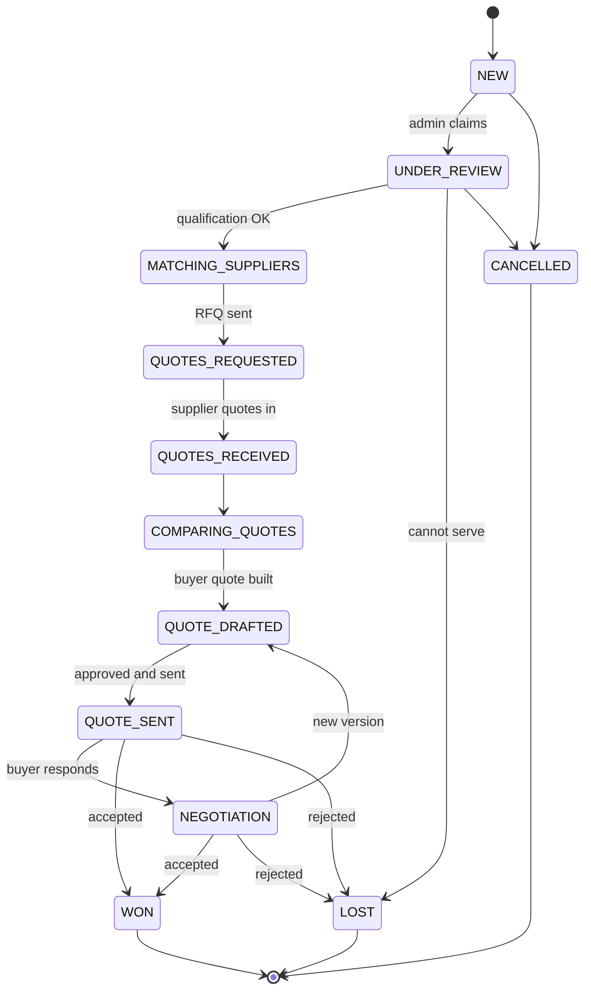

# PRIMEMET — Phase 1A: Architecture Decisions and Implementation Contracts

**Status:** specification for owner review. **One decision is owner-approved: D-ARCH-12 — latest-event-wins
permission resolution (§1.3a). Nothing else in this document is approved** — every other recommendation in §1
remains a proposal.
No source file, collection definition, validator, index, enum, migration, workflow, role or credential
was created or modified to produce it. No database was contacted. Nothing was staged, committed or pushed.

**Method.** Every `[measured]` claim below was read from the repository during preparation of this document
(`db/collections/*.mjs`, `db/enums.mjs`, `db/define.mjs`, `db/roles.mjs`, `prisma/schema.prisma`,
`src/**`). Every `[proposed]` item is a design. Where a claim could not be verified it is marked
`[unverified]` and the reason is given. Recommendations are **not** approvals — see §9.

**Inputs:** `PRIMEMET_ARCHITECTURE_CLOSURE.md`, `PRIMEMET_DOMAIN_ARCHITECTURE.md`,
`PRIMEMET_SECURITY_REMEDIATION.md`, `PRIMEMET_M2_AUTH_DESIGN.md`, `PRIMEMET_M2A_BOUNDARY.md`,
`PRIMEMET_M2A_DECISION_REGISTER.md`, `PRIMEMET_P1_DECISION_RECORD.md`.

---

## §0. Reading guide and the one thing to read first

### 0.1 Deliverables and where they are

| Brief deliverable | Section |
|---|---|
| 2. Resolve architecture decisions | §1 |
| 3. Permission system contract | §2 |
| 4. Listing approval contract | §3 |
| 5. Domain collection contracts | §4 |
| 6. Critical business journey | §5 |
| 7. Security contract | §6 |
| 8. Validation (acceptance criteria, not self-attested) | §8 |
| — Migration sequence | §7 |
| 9. Remaining blockers | §9 |

### 0.2 Two documents contradicted each other — resolved by owner decision D-ARCH-12

`[measured]` This is the single most important finding in this document, and it must be settled before
any permission code is written:

| Document | Line | States |
|---|---|---|
| `PRIMEMET_M2_AUTH_DESIGN.md` | §3.3, l.336 | "**DENY is absolute, regardless of tier default or grant order**" |
| `PRIMEMET_ARCHITECTURE_CLOSURE.md` | §1, l.83 | "**latest event wins**" |

They are not two phrasings of one rule. They are **incompatible resolvers** with different failure modes,
and both are recorded as proposed decisions (`D-B3` and `D-ARCH-1`) in different registers.

**Why it cannot be deferred.** The resolver is the function every protected screen calls. Choosing late means
writing the bootstrap, the tier seeds, the tests and the audit emission against the wrong semantics, then
rewriting them.

**The consequence that decides it.** Under deny-wins **plus** an append-only grant log, a `DENY` can never be
reversed: re-granting appends a `GRANT`, which deny-wins still discards, and the `DENY` row cannot be deleted
because the collection is `immutable: true` `[measured]`. A temporary suspension during an HR or fraud
investigation therefore becomes **permanent, with no supported recovery path**. That is not a security
property; it is an availability defect that will appear in month two of production.

Raised as **D-ARCH-12** (§1.3) with both options and a recommendation.

**RESOLVED — OWNER APPROVED, 2026-11-01.** The owner approved **latest-event-wins** for explicit `GRANT`/`DENY`
events, with `REVOKE` restoring the tier default. The decision, its mandatory semantics and its mandatory
safeguards are recorded in **§1.3a**. The option analysis below is retained unchanged as the record of *why*;
`PRIMEMET_M2_AUTH_DESIGN.md` §3.3 is **superseded** and must be corrected before any permission code is written.

### 0.3 Evidence classes used in §8

| Class | Meaning |
|---|---|
| **I** | Independent: written from the brief and the schema, not adapted from the implementation's own tests |
| **A** | Agent-authored: a project suite written alongside the code it checks; green means self-consistency |
| **M** | Manual/inspection: read and reasoned, not executed |

Phase 1A acceptance may be graded **I** or **M**. It may **not** be graded **A** — that is the brief's §8
constraint, and it is the reason §8 states which rows can only be filled by a second party.

---

## §1. Owner decision register

### 1.1 How to read this table

Each row carries the six facts the brief requires. **Owner approval: Y** means implementation may not start
on the dependent work without an explicit answer. A recommendation is present on every row and is never
itself an approval.

**Approved rows in this table: exactly one — `D-ARCH-12` (§1.3a).** Every other row, including the ones marked
*blocking*, is still a proposal awaiting an owner answer.

### 1.2 Register

| ID | Current design | Recommended choice | Data migration | Security implication | Blocks |
|---|---|---|---|---|---|
| **D-ARCH-1** | Mongo `effect: GRANT\|DENY` append-only `[measured]`; Prisma `GRANT\|REVOKE` with `@@unique(adminId,permission)` | **Approve `GRANT\|DENY`, append-only, Prisma frozen** | None — no production data; new `GrantEffect` enum declared in `db/enums.mjs` | Preserves access history; the mutable Prisma model erases it | Permission code, M2b |
| **D-ARCH-2** | No `orgKind` in Mongo `[measured]`; the `orgType:"PRIMEMET"` partial unique index can never match (`OrgType = BUYER\|SELLER\|BOTH`) | **Approve pattern-constrained `orgKind` string + new partial unique index; leave the dead index as recorded debt** | Additive; default `"OTHER"`, no backfill (no data) | Makes "exactly one PRIMEMET org" enforceable; invoice issuer ambiguity is an accounting-fraud vector | Invoicing, D-1 |
| **D-ARCH-3** | Listing approval absent in **both** stores `[measured]`: `supplier_listings` has no approval field and **no invariants at all** | **Approve a separate `approvalState` axis + append-only `listing_approvals`** | Additive; no existing listing becomes invalid | Prevents unverified stock being matchable — the core "managed sourcing" control | Phase 4 |
| **D-ARCH-4** | 45 collections exist; the 10 workflow collections do not | **Approve the phased D-1…D-10 order and "store the decision, not a copy"** | Additive, phased | Keeps supplier cost and margin in collections a buyer DTO never names | Phases 3–6 |
| **D-ARCH-5** | `location_states` only; `supplier_listings.locationCityId` is a free string with no `ref` | **Approve cities + districts now, industrial areas deferred, `NOT_SERVICED` explicit** | Additive; free-string values would need mapping (none exist) | Delivery feasibility cannot be validated today | Phase 3 intake |
| **D-ARCH-6** | No outbox in either store; `EmailStatus` (7) exists unused | **Approve collection now, worker and provider in Phase 7** | Additive | Without it, "persist before notify" is unachievable and a bounced quotation is unprovable | Phase 7 |
| **D-ARCH-7** | `documents` metadata complete and correct (`visibility`, `scanStatus`, `legalHold`, no URL) `[measured]`; no pipeline | **Approve private bucket, signed-URL-only, region matched to the database** | None | `visibility` is a label today; a label is not an access control | Phase 3 uploads |
| **D-ARCH-8** | Neither enum exists | **Two enums — `EnquiryJourney` and `RequirementKind`** (who submitted vs what is required) | Additive ×2 | Conflating them lets an admin-entered buyer requirement look like a seller supply offer | D-3 |
| **D-ARCH-9** | Neither exists | **`supplier_matches` immutable**, status appended as new rows | Additive | A shortlist is evidence in a dispute; rewriting it destroys the defence | D-4 |
| **D-ARCH-10** | Neither exists | **Owner input** — no defensible default | n/a | n/a — operational, not security | D-3 |
| **D-ARCH-11** | Neither exists | **Opt-in per report**, not visible by default | n/a | Drives whether commercial test data leaks by default | D-3, documents |
| **D-ARCH-12** | ~~Two resolvers specified (§0.2)~~ — **settled** | **OWNER APPROVED 2026-11-01 — latest-event-wins** with `(createdAt, seq)` ordering; `REVOKE` restores the tier default (§1.3a) | None | Determines whether a denial is reversible; deny-wins makes suspension permanent | ~~Permission code — blocking~~ **cleared**, subject to `REVOKE` existing in `effect` |
| **D-M2a-1** | No hashing library installed `[measured]`: 0 matches for `argon2\|bcrypt` | **`@node-rs/argon2@2.2.2`**, pinned exactly | None | Password storage has no implementation path today | **M2a — blocking** |
| **P-M2a-5** | 19 MiB / t=2 / p=1 asserted by the harness | **Approve as policy** | Rehash-on-login path exists | Password hashes are effectively unchangeable without it | M2a testing |
| **D-M2a-2** | Not set | **12 h absolute / 30 min idle**; `sessions.lastSeenAt` already exists `[measured]` — no schema change | None | Determines the window a stolen cookie is usable | M2a testing |
| **D-M2a-3** | `AUTH_SECRET` optional, unused by session tokens | **Required in production, CSRF scope only** | None | Signing sessions with it would make rotation a mass logout | M2a merge |
| **C-M2a-4** | Harness exists; Windows 19/19 pass | **No Linux execution has been claimed.** Gate must run before merge | None | A glibc/ABI mismatch at runtime is a total-auth outage | M2a merge |
| **D-C4** | `organisations.accountStatus` is a **free string**, `maxLength 40`, no enum `[measured]` | **`PENDING\|ACTIVE\|SUSPENDED\|REJECTED`** | None | Login must refuse a suspended org; an unconstrained string cannot be relied on | M2b |
| **OD-A** | No role holds `delete` `[measured]`; records retire via `deletedAt` | **Confirm** permanent | None | Removes a destructive capability no design needs | Role provisioning |
| **O-15.4a-P** | Structure settled (D5); rate/ITC treatment open | **CA decides; no assumption recorded** | n/a | Wrong tax treatment is a legal exposure, not a technical one | Phase 6 invoicing |
| **O-17.4** | `admin_profiles.approvalLimit` exists `[measured]`; no dual-control rule | **Dual approval above a value the owner sets** | n/a | Single-actor quote approval is the classic internal-fraud path | M5 |
| **O-27.1** | Not set | Contact-share expiry, a number | n/a | Shared contacts cannot be un-shared | Phase 4 |
| **O-27.2** | Not set | Buyer target price not disclosed | n/a | Reveals PRIMEMET's margin ceiling | Phase 5 |
| **O-27.3** | Not set | Clarification SLA (=D-ARCH-10) | n/a | Operational | Phase 3 |
| **O-27.4** | Not set | Fitment liability for "equivalent" parts | n/a | Legal exposure on a public claim | Phase 7 |
| **O-27.5** | Draft policy in `PRIMEMET_STAGE_2_ARCHITECTURE.md` §31; 11 statutory cells say "pending CA" | **Owner + CA sign the periods** | n/a | Retention drives deletion, which is irreversible | Before first real record |
| **O-27.6** | Not set | AI provider, residency, budget — Phase 8 only | n/a | Content residency and cost | Phase 8 |
| **O-27.7** | Not approved | **Hosting region — must be chosen with D-ARCH-7** | n/a | Determines data residency, backup region and document jurisdiction | **Before the cluster exists** |
| **O-27.8** | Not set | Serviced-city list is an owner input, never a default | n/a | Publishing an unserviced city is a false public claim | Phase 3–4 |

### 1.3 D-ARCH-12 in full — the resolver conflict

**Option A — deny-wins (as written in `M2_AUTH_DESIGN` §3.3).**

```
granted = GRANT rows valid at t     denied = DENY rows valid at t
result  = granted - denied
```

*Correct when:* a denial must be unforgeable regardless of who appends a grant afterwards.
*Fatal when:* someone must be un-denied. The `DENY` row is permanent (`immutable: true` `[measured]`), so a
temporary suspension is a permanent removal, and the only recovery is a manual database edit — the exact
practice `PRIMEMET_STAGE_2_ARCHITECTURE.md` §29 forbids.

**Option B — latest-event-wins (as written in `ARCHITECTURE_CLOSURE` §1).**

```
result = the row with the greatest (createdAt, tiebreaker) valid at t
```

*Correct when:* access must be revocable **and** restorable, and history must stay intact.
*Risk:* two appends in the same millisecond are ambiguous unless a deterministic tiebreaker is defined — which
§2.3 supplies.

**Recommendation: Option B**, because access administration is a two-way operation and a one-way control will
be worked around (someone will edit the database, or grant SUPER_ADMIN instead — both worse than the problem).
It also matches D-ARCH-1, already recommended, so adopting A would require reversing that too.

**What approval does not cover.** It does not approve the tiebreaker mechanism (§2.3 needs a monotonic
sequence, which is a small addition to the collection) and it does not approve the delegation ceiling (§2.6).

### 1.3a D-ARCH-12 — owner decision recorded (APPROVED, 2026-11-01)

**Owner decision: APPROVED — latest-event-wins.** This is the **only** approved decision in this document. It
supersedes `PRIMEMET_M2_AUTH_DESIGN.md` §3.3 (deny-wins) and settles §0.2.

#### Mandatory semantics

| Rule | Statement |
|---|---|
| **Override** | The latest applicable **non-expired** event overrides the admin tier default. |
| **`GRANT`** | Allows the permission. |
| **`DENY`** | Denies the permission. |
| **`REVOKE`** | Removes the explicit override and **restores the tier default**. It is *not* a denial. |
| **Expiry** | Expired events are **ignored**; resolution evaluates the **preceding applicable** event. |
| **No event** | If no applicable event exists, the **tier default** decides. |

#### Mandatory safeguards

| # | Safeguard | Specified in |
|---|---|---|
| S1 | **Authorised delegation only** — the actor must hold `ACCESS_GRANT_PERMISSION` | §2.5 |
| S2 | **No privilege escalation** — transitive ceiling, non-delegable set, never to self | §2.5, §2.6 |
| S3 | **Deterministic ordering** — `(createdAt DESC, seq DESC)`, `seq` monotonic and atomic | §2.3 |
| S4 | **Immutable event history** — append-only; no `UPDATE`, no `DELETE` | §2.7 |
| S5 | **Actor, target, permission, reason and timestamp** recorded on every event | §2.2, §4.1 |
| S6 | **Expiration evaluated at authorisation time**, never at write time | §2.4 |
| S7 | **Concurrency and revocation tests** — P-R10, P-R17, P-R18…P-R21 | §2.9 |

#### Consequential changes the decision forces

This is not a one-line substitution: three sections and five tests change as a direct result.

| Section | Change | Status here |
|---|---|---|
| **§2.2** | `effect` gains a third value, **`REVOKE`**; "Revocation" is redefined as a `REVOKE` event, not a `DENY` event | **DONE 2026-11-01** — `effect` is now `f.enumOf("GrantEffect")`, `GrantEffect = [GRANT, DENY, REVOKE]` in `db/enums-local.mjs` (Prisma declares no such enum and its model is frozen), converged onto the live database by migration `v002`. `npm run check:permissions` proves the database accepts all three and refuses anything else. |
| **§2.3** | The resolver becomes **two layers**: explicit-event projection, then the tier default as a fallback. The earlier version read grants only and treated the tier as bootstrap-written grants | **DONE 2026-11-01** — `src/lib/permissions/resolve.ts`, with provenance per permission (`decidedBy: EVENT \| TIER_DEFAULT`) |
| **§2.8** | The tier is a genuine **fallback authorisation layer**, not merely a seeded grant set. The counts stay correct; their role changes | **DONE 2026-11-01** — `src/lib/permissions/tiers.ts`; the four counts are asserted, not assumed |
| **§2.9 P-R9** | A `REVOKE` row was specified as *corrupt input, ignored*. It is now **valid input that restores the tier default**; four tests added | **DONE 2026-11-01** — 119 assertions in `scripts/check-permissions.mjs`, run by `npm run check:permissions` |
| **D-ARCH-1** | Still open. The approved semantics need `REVOKE` in the vocabulary, which is **closer to Prisma's `GRANT\|REVOKE` than to Mongo's `GRANT\|DENY`** — so that row must be re-read before it is answered | **Not approved** |
| `PRIMEMET_M2_AUTH_DESIGN.md` §3.3 | Deny-wins text is superseded | **EDITED 2026-11-01** — SUPERSEDED banner, rule-by-rule mapping, old pseudocode collapsed into a historical block; the stray "deny-wins" mentions in §3.1, §4 and the M2b plan row were corrected too |

#### What the approval does **not** cover

- **D-ARCH-1** (effect vocabulary and the frozen Prisma model) — still open, and now more urgent because
  `REVOKE` must exist in whichever vocabulary is chosen.
- **D-ARCH-3**, **D-M2a-1** and every other row in §1.2. None is approved.
- The delegation ceiling (§2.6) and the non-delegable set: specified as contract, **not** approved as policy.
- The `seq` field, the `eventId` idempotency index and the `adminId` discriminator: **created 2026-11-01** — `seq` (`long`), `eventId`, a unique `{adminId, eventId}` index, a unique `{adminId, seq}` index and the resolver index `{adminId, permission, createdAt:-1, seq:-1}`, all converged by migration `v002`. See §2.10 for the one place the implementation departs from this document.

---

## §2. Permission system contract

### 2.1 The data model, as it exists

`[measured]` `admin_permission_grants`, `immutable: true`, fields
`_id, adminId, permission, effect, grantedById, reason, expiresAt, createdAt`; indexes
`{adminId:1, permission:1}` (non-unique) and `{expiresAt:1}`; one invariant, `effect ∈ {GRANT, DENY}`.

`[measured]` `admin_profiles`: `userId, staffCode, jobTitle, desk, tier, mfaRequired, approvalLimit, isActive`.
`AdminTier` has 4 values. `AdminPermission` has **74** values. `UserRole` has 3 (`ADMIN|BUYER|SELLER`).

**Two defects in the current design that the contracts below must not inherit:**

1. **`adminId` is ambiguous.** It is named `adminId` but there is no `admin_profiles._id`-vs-`users._id`
   constraint anywhere `[measured]`. The resolver in §3.2 of the auth design iterates
   `grants where g.adminId == profile._id`, while `grantedById` points at `users`. One collection, two id
   namespaces, no discriminator. **Contract: `adminId` refers to `admin_profiles._id`, and a validator
   invariant must forbid a `grantedById` that is not a `users._id`.** This is a genuine gap, not a style point.
2. **No uniqueness on the log.** Correct for append-only, but it means a bug that appends twice is invisible.
   **Contract: idempotency via a client-supplied `eventId`** (§2.7).

### 2.2 Semantics

| Term | Definition |
|---|---|
| **GRANT** | An append-only fact: "this permission held by this admin, effective from `createdAt`". |
| **DENY** | An append-only fact: "this permission not held by this admin, effective from `createdAt`". |
| **REVOKE** | An append-only fact: "the explicit override is removed; the **tier default** decides". It is not a denial — it returns the admin to the tier's behaviour at `t`. *Added by D-ARCH-12 (§1.3a).* |
| **Revocation** | Implemented **as a `REVOKE` row** (formerly a `DENY` row — changed by D-ARCH-12). Never an `UPDATE`, never a `DELETE` — the collection is `immutable: true` `[measured]`. |
| **Tier default** | The authorisation layer that applies when **no** applicable event exists (§2.8). `[measured]` today the bootstrap seeds it as ordinary `GRANT` rows; the approved decision makes it a **distinct fallback layer** the resolver must read separately (§2.3). |
| **Resolution** | A pure projection over the log at an evaluation instant `t`, then the tier default for every permission with no applicable event — not a mutable flag (§2.3). |
| **Expiry** | `expiresAt` bounds a row's validity. An expired row is **inert at `t`**, not "denied at `t`" (§2.4). |
| **Delegation** | An admin appending a row on behalf of another, permitted only within the transitive ceiling (§2.6). |
| **Audit history** | The log **is** the history; there is no separate audit table for grants. |

**Why a projection and not a column.** A `users.permissions` array would make "who could approve this in
March?" unanswerable, and it is the first thing an incident review asks. The log costs one indexed read per
resolution and answers it exactly.

### 2.3 Resolver

```
resolvePermissions(actor, now) -> Set<AdminPermission>

  // 1. Fail closed at every gate, in this order.
  if actor is absent                        -> empty      // no session
  if actor.user.role != ADMIN               -> empty      // BUYER/SELLER hold no admin permission
  if actor.user.status != ACTIVE            -> empty      // INVITED|SUSPENDED|DISABLED|ARCHIVED
  if actor.user.deletedAt != null           -> empty
  if actor.profile is absent                -> empty      // role=ADMIN with no profile is a misconfiguration
  if actor.profile.isActive != true         -> empty
  if actor.org is absent or org.orgKind != "PRIMEMET"
       and org.accountStatus != ACTIVE      -> empty      // suspension must reach the staff too

  // 2. Project the explicit events. One row per permission survives: the newest valid one.
  rows = grants where adminId == actor.profile._id
                 and createdAt <= now
                 and (expiresAt == null or expiresAt > now)
  //    ordered by (createdAt DESC, seq DESC) — see tiebreaker below

  override = {}
  for row in rows ordered newest-first:
      if override[row.permission] is unset:        // first (newest) valid row wins, then it is frozen
          override[row.permission] = row.effect    // GRANT | DENY | REVOKE
      // an unrecognised effect is IGNORED, never treated as GRANT

  // 3. Layer the tier default underneath (D-ARCH-12, §1.3a). An absent override, or an override whose
  //    newest valid event is REVOKE, falls through to the tier's default grant set (§2.8).
  result = {}
  for permission in ALL_74:
      switch override[permission]:
          case "GRANT":  result[permission] = true
          case "DENY":   result[permission] = false
          case "REVOKE": result[permission] = tierDefault(actor.profile.tier, permission, now)
          case absent:   result[permission] = tierDefault(actor.profile.tier, permission, now)

  // 4. Emit only allowed permissions.
  return { p for p in result where result[p] == true }
```

**Tiebreaker, stated because it is the one real concurrency hazard.** Two appends can share a millisecond.
Contract: `admin_permission_grants` gains a monotonic **`seq`** (`long`, from a sequence document written in the
same transaction) and ordering is `(createdAt DESC, seq DESC)`. Without it the resolver is
**non-deterministic**, and a test that passes locally can fail under load. `seq` is an additive field on an
immutable collection — safe because the collection is empty `[measured: no production data]`.

**Cost.** One indexed read on `{adminId, permission}` narrowed by `createdAt`; cached **per request only**.
Caching across requests would let a new `DENY` take effect late, which is the whole point of §2.4.

### 2.4 Expiry — the subtle part, with the case that decides it

An expired `GRANT` is **inert**. It is not a denial. Resolution therefore falls **through** to the next
newest valid row.

| History | At `t` | Resolves to | Why |
|---|---|---|---|
| GRANT Jan 1 (no expiry) | Feb 1 | **allowed** | the only valid row |
| GRANT Jan 1; GRANT Feb 1 `expiresAt Mar 1` | Feb 15 | **allowed** | newest valid is a GRANT |
| same | Mar 2 | **allowed** | the Feb grant is inert; the Jan grant is still valid |
| GRANT Jan 1; DENY Feb 1; GRANT Feb 2 `expiresAt Mar 1` | Mar 2 | **denied** | Feb 2 grant inert → newest valid is the Feb 1 DENY |
| GRANT Jan 1; DENY Feb 1 `expiresAt Mar 1` | Mar 2 | **allowed** | the DENY expired; suspension lifted as intended |

Row 3 and row 5 are the behaviours that make this design usable: **a temporary grant does not become a
permanent revocation, and a temporary denial does not become a permanent one either.** Under deny-wins, rows
3 and 5 both resolve to *denied forever*.

### 2.5 Granting only what the actor holds — the transitive ceiling

```
mayGrant(actor, target, permission) -> bool
  actor must hold ACCESS_GRANT_PERMISSION                   // measured: exists in the 74
  actor must currently hold `permission`                    // transitive ceiling
  actor must not be target                                  // no self-grant, ever
  permission must not be in NON_DELEGABLE                   // §2.6
  target must be an ACTIVE admin with an active profile
  reason must be non-empty (blank does not count)           // a grant is never anonymous
  expiresAt, when set, must be in the future                // an already-expired grant is inert on arrival
```

**A note on the reason rule.** The safeguard list (S5) requires a reason on *every* permission event, so
`reason` is a required, non-blank field in the validator — not merely "reason or expiry". `expiresAt`
remains available as a self-limiting option, but it no longer substitutes for an explanation: an access
change that cannot be explained after the fact is exactly what an incident review cannot work around.

**The ceiling is the control that matters.** Without it, `ACCESS_GRANT_PERMISSION` is a superuser token: one
`CATALOGUE_MANAGER` could grant themselves `DATABASE_APPLY_MIGRATION` and then alter history. With it, the
worst an insider can do is redistribute permissions they already hold.

### 2.6 Non-delegable set

`ACCESS_GRANT_PERMISSION`, `ACCESS_ASSIGN_ROLE`, `DATABASE_APPLY_MIGRATION`, `AUDIT_EXPORT`.
These four change **who may do things** or **what the record says happened**. They are grantable by
`SUPER_ADMIN` to another admin, never to self, and never by a non-super tier — regardless of whether that tier
otherwise holds them.

### 2.7 Concurrency and idempotency

| Concern | Contract |
|---|---|
| Two admins modify the same target concurrently | Both rows persist; the projection orders them (§2.3). **No lost update is possible**, because nothing is overwritten. |
| Ordering ambiguity | `seq` tiebreaker (§2.3). |
| Retried request (network, client bug) | Client supplies `eventId`; a unique index on `{adminId, eventId}` makes the retry a no-op rather than a duplicate row that inverts the outcome. |
| Read-after-write | A grant takes effect on the **next** resolution; the cache is per request, so the same request that wrote it may not see it. Stated so nobody "fixes" it by caching longer. |

### 2.8 Tier verification

**Changed by D-ARCH-12 (§1.3a):** tiers are now a genuine **fallback authorisation layer**, not merely a seeded
grant set. The resolver evaluates explicit events first and consults the tier default for any permission with no
applicable event, or whose newest applicable event is a `REVOKE`. The counts below are `[measured]` against the
74-value enum and do not change — only their role in resolution does.

| Tier | Defaults | Count | Cannot reach |
|---|---|---|---|
| `SUPER_ADMIN` | all | **74** | nothing |
| `SOURCING_OPS_ADMIN` | enquiry, quote, lot, rejection, party, order, contact, document, pricing/tax **view** | **45** | pricing edit/approve, tax edit/approve, invoice issue, user admin, access admin, DB admin, audit export |
| `CATALOGUE_MANAGER` | catalogue, composition, SEO, content, redirect, document, report, party **view** | **14** | everything commercial and everything access-related |
| `READ_ONLY_ADMIN` | every `*_VIEW` | **20** | every mutating permission by construction |

`[measured]` Union of the three non-super tiers = **62**, so **12 permissions are SUPER_ADMIN-only**:
`PRICING_EDIT`, `PRICING_APPROVE`, `TAX_EDIT`, `TAX_APPROVE`, `INVOICE_ISSUE`, `AUDIT_EXPORT`, `USER_INVITE`,
`USER_SUSPEND`, `ACCESS_ASSIGN_ROLE`, `ACCESS_GRANT_PERMISSION`, `NOTIFICATION_RETRY`,
`DATABASE_APPLY_MIGRATION`.

> **Correction (tier matrix reconciliation, 2026-11-01).** This sentence previously read "Union … = 59, so 15
> permissions are SUPER_ADMIN-only" and listed `LOT_OVERRIDE_GATE`, `PARTY_SUSPEND` and `ORDER_CANCEL` among
> them — contradicting the 45-row table three lines above it, because excluding those three from
> `SOURCING_OPS_ADMIN` yields **42**, not 45. Both figures are arithmetically reproducible and they differ by
> exactly those three permissions; 62/12 is the reading consistent with the contractual 45. Whether those
> three *should* be super-only is a policy question and is recorded as **D-TIER-1**, open, in
> `docs/PRIMEMET_TIER_MATRIX.md` — the counts are settled, the policy is not. The full permission-by-permission
> table, generated from `src/lib/permissions/tiers.ts`, is in that document.

**Three verification cases per tier** (specification; see §8 for why none is executed yet):

| ID | Asserts |
|---|---|
| P-T1 | A `READ_ONLY_ADMIN` resolving the full 74 returns exactly the 20 `*_VIEW` permissions — no mutating permission can appear by construction |
| P-T2 | A `CATALOGUE_MANAGER` with an explicit `GRANT` of `QUOTE_APPROVE` resolves **allowed** — proving the log overrides tier defaults in the permissive direction |
| P-T3 | A `SOURCING_OPS_ADMIN` with an explicit `DENY` of `ENQUIRY_VIEW` resolves **denied** — and the same admin with a later `GRANT` resolves **allowed** (this is the D-ARCH-12 decision, stated as a test) |

### 2.9 Resolver test cases

| ID | Setup | Expect |
|---|---|---|
| P-R1 | no rows | empty |
| P-R2 | one `GRANT` | allowed |
| P-R3 | `GRANT` then `DENY` | denied |
| P-R4 | `DENY` then `GRANT` | **allowed** (LCW) — **denied** under deny-wins; the discriminating case |
| P-R5 | `GRANT` expired, no other row | empty |
| P-R6 | expired `GRANT` over a live older `GRANT` | allowed (§2.4 row 3) |
| P-R7 | live `DENY` over an expired `GRANT` | denied (§2.4 row 4) |
| P-R8 | `DENY` with `expiresAt` in the past | allowed (§2.4 row 5) |
| P-R9 | `REVOKE` row over a tier default that holds the permission | **allowed via the tier default** — `REVOKE` removes the override, it does not deny (changed by D-ARCH-12) |
| P-R18 | `GRANT` then `REVOKE`, tier default does **not** hold it | **empty** — the overrides cancel and the tier default is a denial |
| P-R19 | `DENY` then `REVOKE`, tier default holds it | **allowed** — the denial is removed and the default is restored |
| P-R20 | row with an unrecognised effect value (not `GRANT`/`DENY`/`REVOKE`) | **ignored**, never treated as a `GRANT` |
| P-R21 | 1 000 concurrent appends carrying the same `eventId` | exactly one row; the resolved outcome does not flip |
| P-R10 | two rows, identical `createdAt`, different `seq` | the higher `seq` wins, deterministically, in 1 000 repeats |
| P-R11 | `role = BUYER` with a `GRANT` row present | empty — business users cannot hold admin permission |
| P-R12 | `profile.isActive = false` | empty |
| P-R13 | org `accountStatus = SUSPENDED` | empty — suspending the company suspends its staff |
| P-R14 | `mayGrant` of a permission the actor lacks | refused |
| P-R15 | `mayGrant` to self | refused |
| P-R16 | `mayGrant` of a non-delegable permission without SUPER_ADMIN | refused |
| P-R17 | same `eventId` replayed | one row, same outcome |

---

### 2.10 Implementation record and the one deliberate deviation

**Status: the validator and the resolver agree.** That is the condition §1.3a set before D-ARCH-12 could be
called implemented, and it now holds: `GrantEffect` is the single value set both read.

| Concern | Where it lives |
|---|---|
| The log's shape, enums, indexes and invariants | `db/collections/core.mjs` (`admin_permission_grants`) |
| Applying that shape to a live database | `db/migrations/v002-permission-grant-effects.mjs` — `collMod` + `createIndexes`, no drops, idempotent |
| The value set Prisma does not declare | `db/enums-local.mjs`, merged by `scripts/lib/mongo-enums.mjs`, refused if it ever shadows a Prisma enum |
| The decision rule | `src/lib/permissions/resolve.ts` (pure) |
| Who may change access | `src/lib/permissions/delegation.ts` (pure) and `src/lib/permissions/store.ts` (the only reader/writer) |
| The tier matrices | `src/lib/permissions/tiers.ts` |
| The proof | `scripts/check-permissions.mjs` — 119 assertions, unit + real mongod |

**Deviation: `seq` is allocated as `max(seq)+1` per admin, guarded by a unique `{adminId, seq}` index,
with a bounded randomised retry — not from a sequence document.**

§2.3 said "a sequence document written in the same transaction". The purpose was a deterministic total order;
the mechanism had a cost this repository could not pay: a counter collection would need a Prisma model to
satisfy the one-model-per-collection mapping the schema enforces, and the historical Prisma migrations are
frozen. The unique index achieves the same guarantee — two concurrent appends cannot both hold the same
`(adminId, seq)`, so one aborts and retries — and `check:permissions` proves it with 10 concurrent appends
and a byte-identical resolution from the rows in either order.

**Known limitation, stated rather than hidden:** the super-admin lockout guard counts remaining holders and
then inserts, without a transaction wrapping both. Two super admins denying each other at the same instant
could in principle both pass the check. Closing that needs a transaction around the count and the insert,
which needs a replica set — available on Atlas M10+ and in `check:permissions`, not guaranteed everywhere.

---

## §3. Listing approval contract

### 3.0 The required elements, and where each is defined

| Brief element | Defined in | Mechanism |
|---|---|---|
| **Approval state** | §3.2, §3.3 | `approvalState` — a separate axis, five values |
| **Approval history** | §4.1 | append-only `listing_approvals`, never updated |
| **Submission actor** | §3.3 | `submittedById → users` |
| **Approver** | §3.3 | `approvedById → users` + `lastApprovalId` |
| **Approval reason** | §3.3 | `approvalReason`, recorded with the decision |
| **Rejection reason** | §3.3, §3.4 | `rejectionReason`, required by invariant L3 |
| **Resubmission** | §3.7 | `REJECTED → PENDING_REVIEW`, prior row retained |
| **Reapproval** | §3.7 | `SUSPENDED → APPROVED`, appends, never clears |
| **Self-approval prevention** | §3.5 | rule A in the write path; reconciliation in `db:verify` |
| **Listing availability versus approval** | §3.1, §3.6 | `isPubliclyAvailable()` conjunction + invariant L2 |

### 3.1 The rule the brief states, made mechanical

> A listing must not become publicly available simply because it has an `ACTIVE` status.

`[measured]` Today it can. `supplier_listings` has `status: ListingStatus` with **no approval field and no
invariants at all**, and `ListingStatus = DRAFT|ACTIVE|PAUSED|EXPIRED|WITHDRAWN`. Nothing between `DRAFT` and
`ACTIVE` requires a human.

**The contract is a conjunction, not a status.** A listing is publicly available only when **all** hold:

```
isPubliclyAvailable(listing, now) =
      listing.status        == ACTIVE
   && listing.approvalState == APPROVED
   && listing.approvedAt    != null
   && listing.approvedById  != null
   && listing.deletedAt     == null
   && (listing.availableTo == null || listing.availableTo > now)
```

**Why two axes and not one enum.** They answer different questions — *has this been reviewed?* and *is it
currently offered?* — and they vary independently. A listing can be approved and then paused for a fortnight;
with one enum, `PAUSED` erases the fact of approval and re-activation silently skips review. That is precisely
the bypass the brief forbids.

### 3.2 State machine

```
                     submit                    approve
        DRAFT ──────────────► PENDING_REVIEW ──────────────► APPROVED
          ▲                        │                            │
          │                   reject│                            │ suspend
          │  withdraw /             ▼                            ▼
          └──────────────────── REJECTED ───┐              SUSPENDED
                     resubmit ▲             │                  │
                              └──────────────┘        reinstate│
                                                              ▼
                                                          APPROVED
```

| From | To | Actor | Preconditions | Audit action |
|---|---|---|---|---|
| `DRAFT` | `PENDING_REVIEW` | seller (own listing) | ≥1 grade or product; quantity > 0; documents present if the grade requires them | `SUBMIT_FOR_APPROVAL` |
| `PENDING_REVIEW` | `APPROVED` | admin with `LISTING_APPROVE` | approver ≠ submitter; grade is catalogue-approved; quantity plausible | `APPROVE` |
| `PENDING_REVIEW` | `REJECTED` | admin with `LISTING_APPROVE` | `rejectionReason` non-empty | `REJECT` |
| `PENDING_REVIEW` | `DRAFT` | admin | `reason` non-empty | `REQUEST_CHANGES` |
| `REJECTED` | `PENDING_REVIEW` | seller (own) | reason for resubmission recorded; prior rejection retained | `SUBMIT_FOR_APPROVAL` |
| `APPROVED` | `SUSPENDED` | admin with `LISTING_APPROVE` | `reason` non-empty | `REJECT` |
| `SUSPENDED` | `APPROVED` | admin with `LISTING_APPROVE` | `reason` non-empty | `APPROVE` |
| any | `WITHDRAWN` | seller (own) | none | `WITHDRAW` |

`[measured]` `ApprovalAction` already exists with exactly five values —
`SUBMIT_FOR_APPROVAL|APPROVE|REJECT|REQUEST_CHANGES|WITHDRAW` — so **no new action enum is needed**. Only
`ListingApprovalState` is new (`BuyerApprovalState` is a different axis and is not reusable).

### 3.3 Fields

`supplier_listings` — additions only; no existing field changes type or meaning:

| Field | Type | Required | Note |
|---|---|---|---|
| `approvalState` | `enum ListingApprovalState` | ✔, default `DRAFT` | `DRAFT\|PENDING_REVIEW\|APPROVED\|REJECTED\|SUSPENDED` |
| `approvedAt` | date | optional | set together with `approvedById` |
| `approvedById` | `ref(users)` | optional | the **user**, not the profile — see §1.2 D-ARCH-2 rationale |
| `approvalReason` | string ≤ 500 | optional | recorded on approval — the *why*, kept with the decision |
| `rejectionReason` | string ≤ 500 | optional | non-empty when state is `REJECTED` or `SUSPENDED` |
| `submittedById` | `ref(users)` | optional | who submitted; required for self-approval detection |
| `lastApprovalId` | `ref(listing_approvals)` | optional | pointer to the decision row that produced the current state |

`listing_approvals` — new, `immutable: true`:

`_id, listingId → supplier_listings, actorId → users, action (ApprovalAction), fromState, toState, reason, createdAt`

### 3.4 Validator invariants

```
L1  approvalState = APPROVED   ⇒ approvedAt ≠ null AND approvedById ≠ null AND lastApprovalId ≠ null
L2  status = ACTIVE            ⇒ approvalState = APPROVED            ← the brief's rule, enforced in the DB
L3  approvalState ∈ {REJECTED, SUSPENDED} ⇒ rejectionReason non-empty
L4  approvalState = PENDING_REVIEW ⇒ submittedById ≠ null
L5  approvedById ≠ submittedById                              ← self-approval ban, see 3.5
```

L1–L4 are `$jsonSchema`/`$expr` expressible and belong in the validator. **L5 is not** — a validator cannot
join to another document `[measured: this is why the D-1 equivalence trigger was needed on PostgreSQL]`. L5 is
a **write-path rule plus a reconciliation check** (§3.6), and it must be labelled as such rather than assumed
enforced.

### 3.5 Self-approval

Three distinct rules, because "self" is ambiguous and the ambiguity is where the hole lives:

| Rule | Statement | Enforceable where |
|---|---|---|
| **A — same person** | `actor.userId ≠ listing.submittedById` | write path, computable today |
| **B — same organisation** | actor's organisation ≠ the supplier organisation | **not computable**: `admin_profiles` has no `organisationId` `[measured]` — `organisationId` exists on `BuyerProfile, OrganisationAddress, OrganisationContact, OrganisationVerification, PortalInvitation, SupplierProfile`, **not on `User` or `AdminProfile`** |
| **C — same submitter chain** | the actor did not submit on the supplier's behalf | needs `submittedByUserId`; covered by A |

**Contract: rule A now, rule B deferred behind an explicit owner decision** (adding `adminProfiles.organisationId`
is a design change, not a detail). A is enough to stop the naive bypass; B is a conflict-of-interest register and
should be decided deliberately.

**Reconciliation check (because A cannot be a validator):** `db:verify` reports every `APPROVED` listing where
`approvedById == submittedById` as a **failure**, so a write path that missed the rule is caught on the next
verification run rather than never.

### 3.6 Availability versus approval — worked cases

| Case | `status` | `approvalState` | Public? | Why |
|---|---|---|---|---|
| Fresh listing | `DRAFT` | `DRAFT` | **no** | not submitted |
| Awaiting review | `DRAFT` | `PENDING_REVIEW` | **no** | not approved |
| Approved, not yet offered | `PAUSED` | `APPROVED` | **no** | status gates |
| Approved and offered | `ACTIVE` | `APPROVED` | **yes** | both hold |
| **Active but never reviewed** | `ACTIVE` | `DRAFT` | **no** — and L2 makes it unstorable | the brief's exact rule |
| Approved, then suspended | `ACTIVE` | `SUSPENDED` | **no** | approval withdrawn |
| Approved, date passed | `ACTIVE` | `APPROVED`, `availableTo` past | **no** | `isPubliclyAvailable` closes |

### 3.7 Resubmission and reapproval

**Resubmission** (`REJECTED` → `PENDING_REVIEW`). Permitted to the owning seller only, requires a
non-empty `resubmissionNote`, and the prior `REJECTED` row is **retained** — nothing is superseded in place,
so the history shows every attempt. The listing keeps its `_id`: a resubmission is the same listing
re-entering review, not a new listing, so enquiries that referenced it keep working.

**Reapproval** (`SUSPENDED` → `APPROVED`). Permitted to an admin with `LISTING_APPROVE`, requires a `reason`,
and appends an `APPROVE` row — it does **not** clear the suspension row. A listing suspended for suspected
fraud and later reinstated therefore carries both facts permanently, which is the point.

**Edits after approval.** Any material change (quantity, grade, product, availability) returns an `APPROVED`
listing to `PENDING_REVIEW`. Otherwise approval attaches to a listing that no longer matches what was
reviewed — the bypass this contract exists to close.

### 3.8 Listing approval tests

| ID | Asserts |
|---|---|
| L-1 | An insert with `status:ACTIVE, approvalState:DRAFT` is **refused by the database** (L2) |
| L-2 | `APPROVED` with no `approvedById` is refused (L1) |
| L-3 | `REJECTED` with empty `rejectionReason` is refused (L3) |
| L-4 | A full submit→approve cycle appends exactly two `listing_approvals` rows |
| L-5 | `listing_approvals` accepts insert and refuses `update`/`delete` (privilege + DAO) |
| L-6 | Write path refuses `approvedById == submittedById`; `db:verify` reports it if forced by hand |
| L-7 | Rejection → resubmission retains the original rejection row (append-only) |
| L-8 | `PAUSED` + `APPROVED` is not public; `ACTIVE` + `APPROVED` is — the two-axis distinction |
| L-9 | A suspended approval cannot be reinstated without an `APPROVE` action row |

---

## §4. Domain collection contracts

### 4.0 Conventions that apply to every collection below

- **Types:** `f.str`, `f.strOpt`, `f.enumOf`, `f.enumOpt`, `f.decimal`, `f.date`, `f.int`, `f.long`,
  `f.json`, `f.strArray`, `f.object` — the real helper set in `db/define.mjs` `[measured]`.
- **Money/rate/weight:** always `f.decimal` — `bsonType: "decimal"` refuses a BSON double, so a float cannot
  reach a priced field (`db/define.mjs:79-85` `[measured]`). Scale is a write-path rule (a validator cannot see
  a Decimal128 exponent).
- **Optionality** is expressed by `optional: true` / the `*Opt` helpers and stripped before `$jsonSchema`.
- **Every collection** carries `createdAt` (date, required) and, unless immutable, `updatedAt`; soft deletion
  via `deletedAt` — never `delete` (no role holds it `[measured]`).
- **Enums are append-only** and must match `db/enums.mjs`; that file is **generated from `prisma/schema.prisma`**
  `[measured]`, so a new enum must be declared directly in `db/enums.mjs` and recorded as a divergence
  (D-ARCH-1) — otherwise the next `npm run db:enums` erases it.
- **Authorisation boundary** is always the *read path*, because MongoDB validators constrain documents, not
  callers. A field listed as internal must be absent from every external DTO — a rule with no database
  enforcement, which §6 makes explicit rather than implied.

### 4.0.1 Attribute key, so coverage is checkable

Every collection below is contracted against the brief's twelve attributes. Where a table merges collections
into columns, each column carries the same attribute set:

| Label used here | Brief attribute |
|---|---|
| Fields (req.) / Fields (opt.) | Complete field definitions; required and optional |
| References | References |
| Unique indexes | Unique indexes |
| Query indexes | Query indexes |
| Mutability | Immutable or mutable classification |
| Validator | Validator requirements |
| Authorisation | Authorization boundary |
| Audit | Audit requirements |
| Idempotency | Idempotency requirements |
| Retention | Deletion / retention policy |

### 4.1 Step D-1 — listing approval

| Property | Contract |
|---|---|
| **Purpose** | Record commercial decisions about whether supplier stock may be offered. |
| **Fields (req.)** | `listing_approvals`: `_id, listingId, actorId, action, toState, createdAt` |
| **Fields (opt.)** | `fromState, reason` |
| **References** | `listingId → supplier_listings`, `actorId → users` |
| **Unique indexes** | none (history; two identical actions at different times are both facts) |
| **Query indexes** | `{listingId:1, createdAt:-1}` — "current decision" and the listing timeline |
| **Mutability** | **immutable** (`immutable: true`), insert-only |
| **Validator** | `action ∈ ApprovalAction`; `toState ∈ ListingApprovalState`; `reason` non-empty when `action ∈ {REJECT, REQUEST_CHANGES}` |
| **Authorisation** | read: admin with `LOT_VIEW` or the owning supplier (own listing only). write: `listings:approve` path only |
| **Audit** | the collection **is** the audit; no second row is written to `audit_logs` |
| **Idempotency** | `eventId` unique per `listingId` so a retried approve does not double-append |
| **Retention** | permanent; no purge, no legal-hold override needed |

`supplier_listings` modification: 6 fields added (§3.3), 5 invariants (§3.4), 2 new indexes
`{supplierId:1, approvalState:1}` and `{approvalState:1, status:1}`.

`organisations` modification (D-ARCH-2): `orgKind` string, required, default `"OTHER"`,
`pattern ^(PRIMEMET|BUYER|SELLER|PARTNER|OTHER)$`; new partial unique index on
`{orgKind:1}` where `orgKind:"PRIMEMET"` and `deletedAt:null`. **`organisations` has no invariants today**
`[measured]`; the first ones added should be `gstin` normalisation and `orgKind` pattern cross-checks, kept
minimal so a future data shape is not pre-empted.

### 4.2 Step D-2 — locations

| | `location_districts` | `location_cities` |
|---|---|---|
| **Purpose** | Administrative grouping under a state, for coverage and SEO | The unit of delivery feasibility and city SEO pages |
| **Fields (req.)** | `_id, stateId, name, slug, coverage, createdAt` | `_id, stateId, name, slug, coverage, isServiced, createdAt` |
| **Fields (opt.)** | `districtId` on cities; `publicationState`, `updatedAt`, `deletedAt` | `districtId, updatedAt, deletedAt` |
| **References** | `stateId → location_states` | `stateId → location_states`, `districtId → location_districts?` |
| **Unique indexes** | `{stateId:1, slug:1}` | `{stateId:1, slug:1}` |
| **Query indexes** | `{stateId:1}` | `{stateId:1, coverage:1}`, `{coverage:1}` |
| **Mutability** | mutable | mutable |
| **Validator** | `coverage ∈ CoverageLevel` (4 values `[measured]`); `slug` pattern `^[a-z0-9-]+$` | same, plus `isServiced` boolean and the invariant `isServiced == (coverage == "SERVICED")` |
| **Authorisation** | public read of `name/slug/coverage` only; write admin `CATALOGUE_EDIT` | same |
| **Audit** | coverage change writes `audit_logs` (it alters a public claim) | same |
| **Idempotency** | natural key `(stateId, slug)` — insert-or-ignore | same |
| **Retention** | permanent; a de-serviced city sets `NOT_SERVICED`, never deletes | same |

`supplier_listings.locationCityId` is promoted from `f.strOpt()` to `refOpt("location_cities")` — the reference
it was always meant to have.

### 4.3 Step D-3 — enquiries

| | `enquiries` | `enquiry_items` | `enquiry_events` |
|---|---|---|---|
| **Purpose** | The buyer requirement or supplier offer — one record, two journeys | What is being asked for | Append-only status history |
| **Fields (req.)** | `_id, reference, journey, source, status, priority, contactName, contactEmail, destinationStateId, requirementKind, createdAt, updatedAt` | `_id, enquiryId, kind, quantity, uom` | `_id, enquiryId, event, toStatus, createdAt` |
| **Fields (opt.)** | `buyerOrgId, buyerUserId, submittedByUserId, contactPhone, destinationCityId, deliveryPreference, targetDate, notes, assignedToId, qualificationSummary, closedAt` | `gradeId, productId, specificationText, unknownFields, targetPrice` | `actorId, fromStatus, payload` |
| **References** | `buyerOrgId→organisations, buyerUserId→users, destinationStateId→location_states, destinationCityId→location_cities` | `enquiryId→enquiries, gradeId→scrap_grades, productId→products` | `enquiryId, actorId→users` |
| **Unique indexes** | `{reference:1}` | none | none |
| **Query indexes** | `{buyerOrgId:1, createdAt:-1}`, `{status:1, priority:1, createdAt:1}`, `{assignedToId:1, status:1}` | `{enquiryId:1}` | `{enquiryId:1, createdAt:-1}` |
| **Mutability** | mutable | mutable until the enquiry leaves `UNDER_REVIEW` | **immutable** |
| **Validator** | E1/E2 (§5.3); `journey ∈ EnquiryJourney`; `requirementKind ∈ RequirementKind`; `status ∈ EnquiryStatus` (13 `[measured]`) | `quantity` decimal > 0 | `event` non-empty; `toStatus ∈ EnquiryStatus` |
| **Authorisation** | read: owning buyer, assigned admin, matching supplier (**matched items only**). write: `ENQUIRY_CREATE`/`ENQUIRY_EDIT` | same as parent | write: any transition, never updated |
| **Audit** | every transition appends `enquiry_events` in the same transaction | item change appends `enquiry_events` with `payload` | the collection is the audit |
| **Idempotency** | `reference` from `reference_sequences` (exists) allocated in the transaction; `eventId` on submit | `{enquiryId, clientLineId}` | `eventId` unique per enquiry |
| **Retention** | permanent; `NOT_REQUIRED`/`UNKNOWN` recorded, never blank | permanent | permanent |

**Confidentiality:** `targetPrice` is internal (`PRICING_VIEW_INTERNAL`); it must never appear in a supplier or
buyer DTO. `qualificationSummary` is derived and explicitly non-authoritative.

New enums: `EnquiryJourney` (`SUPPLY | BUYER_REQUIREMENT`), `RequirementKind` (`SCRAP | SPARE_PARTS | MIXED`).

### 4.4 Step D-4 — supplier matching

| Property | Contract |
|---|---|
| **Purpose** | Record **why** a supplier was shortlisted — a decision, not a preference |
| **Fields (req.)** | `_id, enquiryId, enquiryItemId, supplierId, status, rationale, matchedById, createdAt` |
| **Fields (opt.)** | `listingId, score, rfqSentAt, quoteReceivedAt, exclusionReason` |
| **References** | `enquiryId`, `enquiryItemId`, `supplierId→supplier_profiles`, `listingId→supplier_listings`, `matchedById→users` |
| **Unique indexes** | none — a re-run appends a new row (D-ARCH-9) |
| **Query indexes** | `{enquiryId:1, status:1}`, `{supplierId:1, createdAt:-1}`, `{enquiryItemId:1, supplierId:1, createdAt:-1}` |
| **Mutability** | **immutable**; "current status" = newest row per `(enquiryItemId, supplierId)` |
| **Validator** | `status ∈ SupplierMatchStatus` (7 `[measured]`); `rationale` non-empty; `status=EXCLUDED ⇒ exclusionReason` non-empty |
| **Authorisation** | admin only (`ENQUIRY_VIEW`, `SUPPLIER_QUOTE_REQUEST`). **Never** visible to the buyer or to other suppliers — it discloses the shortlist |
| **Audit** | collection is the audit; `score` is internal and never serialised |
| **Idempotency** | `eventId` per `(enquiryId, supplierId, action)` |
| **Retention** | permanent — disputes turn on the shortlist |

### 4.5 Steps D-5 and D-6 — quotations (two chains, never merged)

| | `supplier_quotes` (internal) | `supplier_quote_lines` | `buyer_quotes` (external) | `buyer_quote_versions` | `buyer_quote_lines` |
|---|---|---|---|---|---|
| **Purpose** | What a supplier offers PRIMEMET | Its lines | What PRIMEMET offers the buyer | The immutable priced version | Its lines |
| **Fields (req.)** | `_id, reference, enquiryId, supplierId, matchId, status, currencyCode, subtotal, taxTotal, total, createdAt` | `_id, supplierQuoteId, enquiryItemId, description, quantity, uom, unitRate, lineTotal` | `_id, reference, enquiryId, buyerOrgId, status, transactionModel, createdById, createdAt, updatedAt` | `_id, buyerQuoteId, version, offeredSubtotal, taxSnapshot, total, createdById, createdAt` | `_id, versionId, enquiryItemId, description, quantity, uom, unitPrice, lineTotal` |
| **Fields (opt.)** | `validUntil, freight, paymentTerms, deliveryTerms, leadTimeDays, submittedAt` | `gradeId, productId, notes` | `currentVersionId, approvedById, sentAt, acceptedAt` | `supplierCostTotal, marginAmount, freight, handling, terms, taxReviewId, supersedesVersionId` | none |
| **Internal-only** | everything | all | nothing | **`supplierCostTotal`, `marginAmount`** | nothing |
| **Unique indexes** | `{reference:1}` | none | `{reference:1}`, `{enquiryId:1}` | `{buyerQuoteId:1, version:1}` | none |
| **Query indexes** | `{enquiryId:1, status:1}`, `{supplierId:1, createdAt:-1}` | `{supplierQuoteId:1}` | `{buyerOrgId:1, createdAt:-1}`, `{status:1}` | `{buyerQuoteId:1, version:-1}` | `{versionId:1}` |
| **Mutability** | mutable until `SUBMITTED` | same | mutable | **immutable once the parent is `SENT`** | immutable with the version |
| **Validator** | `status ∈ SupplierQuoteStatus` (5 `[measured]`); amounts decimal ≥ 0 | `quantity>0`, `unitRate` decimal | `status ∈ BuyerQuoteStatus` (11); `transactionModel ∈ TransactionModel` (3) | `taxSnapshot` object non-empty; `version` int ≥ 1 | `unitPrice` decimal |
| **Authorisation** | admin `SUPPLIER_QUOTE_VIEW`; the supplier sees its own | same | owning buyer, admin `QUOTE_VIEW` | admin `QUOTE_VIEW`; buyer sees only via DTO (§6.3) | same |
| **Audit** | submit/supersede → `audit_logs` | — | every status change → `audit_logs` | creation → `audit_logs` | — |
| **Idempotency** | `reference` allocated in transaction | `{supplierQuoteId, clientLineId}` | `reference`; `{buyerQuoteId, version}` | `{buyerQuoteId, version}` unique is the guarantee | `{versionId, enquiryItemId}` |
| **Retention** | permanent | permanent | permanent | **permanent; a sent quote is evidence** | permanent |

**Q3 restated as a contract:** the buyer DTO is built **only** from `buyer_quotes` + `buyer_quote_versions`
(allow-listed fields) + `buyer_quote_lines`. `supplierCostTotal`, `marginAmount`, `supplierId` and
`supplier_quote_*` are not reachable from a buyer query path at all — not filtered out, **not selected**.

### 4.6 Steps D-7 to D-9 — orders, fulfilment, money

| | `orders` | `order_items` | `order_cost_lines` (internal) | `shipments` | `weighments` | `invoices` | `payments` | `settlements` |
|---|---|---|---|---|---|---|---|---|
| **Purpose** | The contract | What is contracted | Procurement cost per line | Movement | Scale readings | Documents | Money movement | Order reconciliation |
| **Key req. fields** | `reference, enquiryId, buyerQuoteVersionId, transactionModel, inventoryMode, status, buyerOrgId, totalAmount, taxSnapshot, createdAt, updatedAt` | `orderId, enquiryItemId, description, quantity, uom, unitPrice, lineTotal` | `orderId, description, costAmount` | `orderId, reference, status, dispatchAuthorisedById, plannedDispatchAt` | `orderId, stage, grossKg, tareKg, netKg, recordedById, recordedAt` | `orderId, reference, invoiceRole, issuerOrgId, recipientOrgId, total, status, taxSnapshot` | `orderId?, partyOrgId, amount, currencyCode, paidAt, recordedById` | `orderId, status, receivable, payable, margin` |
| **Optional** | `supplierId, confirmedAt, closedAt, cancelledAt, cancellationReason` | — | `supplierId, lineId` | `shipmentId?, vehicleRef, transporterName, ewayBillNumber, dispatchedAt, deliveredAt, destinationCityId` | `shipmentId, weighbridgeName, slipDocumentId` | `passThrough, counterpartyInvoiceId, subtotal, taxTotal, issuedAt, dueAt, documentId` | `invoiceId, method, reference` | `updatedAt` |
| **References** | `buyerOrgId→organisations, buyerQuoteVersionId→buyer_quote_versions, supplierId→supplier_profiles` | `orderId` | `orderId, supplierId` | `orderId, dispatchAuthorisedById→users, destinationCityId→location_cities` | `orderId, shipmentId, slipDocumentId→documents` | `orderId, issuerOrgId, recipientOrgId, counterpartyInvoiceId→invoices` | `partyOrgId, invoiceId` | `orderId` |
| **Unique indexes** | `{reference:1}` | none | none | `{reference:1}` | none | `{reference:1}` | `{reference:1}` | `{orderId:1}` |
| **Query indexes** | `{buyerOrgId:1, createdAt:-1}`, `{status:1, createdAt:1}` | `{orderId:1}` | `{orderId:1}` | `{orderId:1}`, `{status:1}` | `{orderId:1, stage:1}` | `{orderId:1}`, `{recipientOrgId:1, status:1}` | `{invoiceId:1}`, `{partyOrgId:1, paidAt:-1}` | `{status:1}` |
| **Mutability** | mutable | mutable until `CONFIRMED` | immutable | mutable | **immutable** | mutable until `ISSUED` | **immutable** | mutable (status only) |
| **Validator** | `status ∈ OrderStatus` (9); O1: exactly one version ref | `quantity>0` | `costAmount` decimal | D1: `IN_TRANSIT ⇒ dispatchAuthorisedById` present | `netKg = grossKg − tareKg` | `InvoiceStatus`; `invoiceRole`; `passThrough ⇒ AGENCY\|MANAGED_SUPPLY` | `amount>0` | `SettlementStatus` (4) |
| **Authorisation** | buyer (own), admin `ORDER_VIEW` | same | **admin `PRICING_VIEW_INTERNAL` only — never buyer, never supplier** | buyer (own), admin | admin only | buyer (recipient), admin `INVOICE_VIEW` | admin; supplier sees own | **admin only** |
| **Audit** | every status change | — | — | dispatch authorisation (the gate) | — | issue, void, credit | — | — |
| **Idempotency** | `reference` in transaction; `{buyerQuoteVersionId}` unique prevents a double-accept creating two orders | `{orderId, clientLineId}` | — | `reference` | `{shipmentId, stage, slip}` | `reference` | `reference` | `{orderId}` unique |
| **Retention** | permanent | permanent | permanent | permanent | permanent | **statutory — pending CA (O-27.5)** | permanent | permanent |

**Agency rule (D5) restated:** a material invoice may be issued by the supplier to the buyer; only
`issuerOrgId = PRIMEMET` counts as PRIMEMET revenue, and `passThrough` marks the former. Tax treatment remains
pending CA (O-15.4a-P) — **no rate, band or ITC conclusion is recorded anywhere in these contracts.**

### 4.7 Step D-10 — notifications

| | `notifications` | `notification_attempts` |
|---|---|---|
| **Purpose** | Durable outbox row so a send is never the only record | Every attempt, for evidence |
| **Fields (req.)** | `_id, kind, templateKey, toEmail, relatedType, relatedId, status, attempts, createdAt` | `_id, notificationId, attempt, outcome, at` |
| **Optional** | `toUserId, organisationId, payload, lastAttemptAt, nextAttemptAt, lastError, providerMessageId, sentAt` | `provider, error` |
| **References** | `toUserId→users, organisationId→organisations` | `notificationId` |
| **Unique indexes** | none | `{notificationId:1, attempt:1}` |
| **Query indexes** | `{status:1, nextAttemptAt:1}` (worker claim), `{relatedType:1, relatedId:1}` | `{notificationId:1}` |
| **Mutability** | mutable (`status` is the point) | **immutable** |
| **Validator** | `status ∈ EmailStatus` (7 `[measured]`); `toEmail` contains `@`; `attempts` int ≥ 0 | `attempt` int ≥ 1 |
| **Authorisation** | admin `NOTIFICATION_VIEW`/`NOTIFICATION_RETRY` only; **never** buyer/supplier | same |
| **Audit** | retry and suppression → `audit_logs` | — |
| **Idempotency** | `{kind, relatedType, relatedId, toEmail}` with a time bucket prevents duplicate sends on retry | `attempt` unique |
| **Retention** | 90 days proposed, then archive (O-27.5) | same |

**The persist-before-notify rule, as a contract:** the business record and the `notifications` row commit in
**one transaction**; the send happens after, from a claimed row. A failed send therefore leaves the business
record intact and a retryable row behind — never a lost enquiry.

### 4.8 New enums required (3)

`GrantEffect` (`GRANT|DENY`), `ListingApprovalState` (`DRAFT|PENDING_REVIEW|APPROVED|REJECTED|SUSPENDED`),
`EnquiryJourney` (`SUPPLY|BUYER_REQUIREMENT`), `RequirementKind` (`SCRAP|SPARE_PARTS|MIXED`) — four in total.
Every other status already exists `[measured: 67 enums]`, including `SupplierQuoteStatus` (**5** values, not the
4 stated in an earlier document — the enum is authoritative).

**They must be declared in `db/enums.mjs` directly**, because that file is generated from `prisma/schema.prisma`
and Prisma is frozen (D-ARCH-1). The generator must be taught to preserve appended enums, or `db:enums` will
silently drop them — that is the single most likely way this work is undone. Recorded as a review item.

### 4.9 Coverage matrix — every proposed collection, and where its contract lives

| # | Collection | New / modified | Contract | Step |
|---|---|---|---|---|
| 1 | `listing_approvals` | new, immutable | §4.1 | D-1 |
| 2 | `supplier_listings` | modified (+6 fields) | §4.1, §3.3 | D-1 |
| 3 | `organisations` | modified (`orgKind`) | §4.1 | D-1 |
| 4 | `admin_permission_grants` | modified (`seq`, `eventId`) | §2.3, §2.7 | 3 |
| 5 | `location_districts` | new | §4.2 | D-2 |
| 6 | `location_cities` | new | §4.2 | D-2 |
| 7 | `enquiries` | new | §4.3 | D-3 |
| 8 | `enquiry_items` | new | §4.3 | D-3 |
| 9 | `enquiry_events` | new, immutable | §4.3 | D-3 |
| 10 | `supplier_matches` | new, immutable | §4.4 | D-4 |
| 11 | `supplier_quotes` | new | §4.5 | D-5 |
| 12 | `supplier_quote_lines` | new | §4.5 | D-5 |
| 13 | `buyer_quotes` | new | §4.5 | D-6 |
| 14 | `buyer_quote_versions` | new, immutable | §4.5 | D-6 |
| 15 | `buyer_quote_lines` | new | §4.5 | D-6 |
| 16 | `orders` | new | §4.6 | D-7 |
| 17 | `order_items` | new | §4.6 | D-7 |
| 18 | `order_cost_lines` | new, internal | §4.6 | D-7 |
| 19 | `shipments` | new | §4.6 | D-8 |
| 20 | `weighments` | new, immutable | §4.6 | D-8 |
| 21 | `invoices` | new | §4.6 | D-9 |
| 22 | `payments` | new, immutable | §4.6 | D-9 |
| 23 | `settlements` | new | §4.6 | D-9 |
| 24 | `notifications` | new, mutable | §4.7 | D-10 |
| 25 | `notification_attempts` | new, immutable | §4.7 | D-10 |

**25 collections: 22 new, 3 modified.** Six new immutable collections (§6.5); four new enums (§4.8).
Nothing existing is dropped, renamed or retyped.

---

## §5. Critical business journey

### 5.1 Three entities, not one

`[measured]` The vocabulary is already distinct (`EnquiryStatus` 13, `BuyerQuoteStatus` 11, `OrderStatus` 9),
and the contracts keep them in **three collections with three lifecycles**:

| Entity | Answers | Created by | Ends when | Must never be |
|---|---|---|---|---|
| **Enquiry** | "what does the buyer or supplier want?" | buyer / seller / admin on the phone | `WON`/`LOST`/`CANCELLED` | a quotation (a quote is a priced response, with versions) |
| **Quotation** | "what will it cost?" | PRIMEMET after supplier pricing | `ACCEPTED`/`REJECTED`/`EXPIRED` | an order (an order is a contract with fulfilment) |
| **Order** | "what was agreed and delivered?" | buyer acceptance **of one exact version** | `CLOSED`/`CANCELLED` | a quote (its price is frozen; a quote can be revised) |

**The rule that keeps them separate:** an order references exactly one `buyerQuoteVersionId`, never "the latest
version". Otherwise revising a quote after acceptance silently reprices a signed order.

### 5.2 The journey



### 5.3 Transitions — actor, preconditions, effects

| # | Transition | Authorised actor | Preconditions | State changes | Audit event | Notification | Failure / cancellation |
|---|---|---|---|---|---|---|---|
| **T1** | (none) → `NEW` | buyer (`ENQUIRY_CREATE`), seller, admin | valid destination state; ≥1 item; quantity > 0; **`UNKNOWN` permitted** | `enquiries` row; `enquiry_events(NEW)` | `enquiry.created` | ack to submitter; internal alert to desk | validation failure returns field errors, creates nothing |
| **T2** | `NEW` → `UNDER_REVIEW` | admin `ENQUIRY_ASSIGN` | nothing outstanding from T1 | `assignedToId` set | `enquiry.claimed` | none | unclaimed invites are re-queued at the SLA (O-27.3) |
| **T3** | `UNDER_REVIEW` → `MATCHING_SUPPLIERS` | admin `ENQUIRY_EDIT` | qualification complete; every `UNKNOWN` either resolved or explicitly accepted | readiness flag only (`qualificationSummary` is **derived, never authoritative**) | `enquiry.qualified` | none | — |
| **T4** | `UNDER_REVIEW` → `LOST` | admin `ENQUIRY_CLOSE` | `lostReason` recorded | `closedAt` | `enquiry.closed` | regret note to submitter | reversible only by a new enquiry, not by editing this one |
| **T5** | `MATCHING_SUPPLIERS` → `QUOTES_REQUESTED` | admin `SUPPLIER_QUOTE_REQUEST` | ≥1 `supplier_matches` with `APPROVED_FOR_RFQ` | one match row per supplier; `rfqSentAt` | `match.rfq_sent` | RFQ to each supplier (**item data only — never the buyer's identity**) | a supplier declining sets `DECLINED`; the enquiry stays in place |
| **T6** | `QUOTES_REQUESTED` → `QUOTES_RECEIVED` | system, on first `supplier_quote SUBMITTED` | — | — | `supplier_quote.submitted` | internal | a late quote after the window is recorded but not selectable |
| **T7** | `QUOTES_RECEIVED` → `COMPARING_QUOTES` | admin `SUPPLIER_QUOTE_COMPARE` | ≥1 comparable quote | — | `quotes.compared` | none | — |
| **T8** | `COMPARING_QUOTES` → `QUOTE_DRAFTED` | admin `QUOTE_PREPARE` | at least one supplier quote; tax treatment chosen (never assumed) | `buyer_quotes` `DRAFT`, version 1 | `buyer_quote.created` | none | **Q2**: totals recomputed server-side; a mismatch blocks the draft |
| **T9** | `QUOTE_DRAFTED` → (`PENDING_APPROVAL`) | admin `QUOTE_SUBMIT_FOR_APPROVAL` | all lines priced; tax snapshot present | quote status | `buyer_quote.submitted` | approver alert | — |
| **T10** | `PENDING_APPROVAL` → `APPROVED` | admin `QUOTE_APPROVE` | **approver ≠ preparer**; above `approvalLimit` a second approver (O-17.4); if the tax treatment `requiresAdminReview`, a `tax_reviews` row exists | quote status | `buyer_quote.approved` | preparer alert | rejection returns to `DRAFT` with a reason; **the version is not sent** |
| **T11** | `APPROVED` → `SENT` | admin `QUOTE_SEND` | version immutable from here (Q1) | quote status, `sentAt`; **`transactionModel` frozen** (Q6) | `buyer_quote.sent` | buyer email with a signed link | a bounce sets `notification SUPPRESSED`; the quote stays `SENT` (it was issued) |
| **T12** | `SENT` → `VIEWED` | system | buyer fetched the quote | `VIEWED` | `buyer_quote.viewed` | internal | — |
| **T13** | `SENT`/`VIEWED` → `NEGOTIATION` | buyer or admin | — | status | `buyer_quote.negotiating` | internal | — |
| **T14** | `NEGOTIATION` → `QUOTE_DRAFTED` (v+1) | admin `QUOTE_REVISE` | prior version retained | **new** `buyer_quote_versions` row; `supersedesVersionId` | `buyer_quote.revised` | none | the prior version stays readable — never overwritten |
| **T15** | `SENT`/`NEGOTIATION` → `ACCEPTED` | buyer (own quote) | not expired; version is the current one | quote `ACCEPTED`; **one** order created | `buyer_quote.accepted` | both parties + internal | **idempotent**: `{buyerQuoteVersionId}` unique means a double-click cannot create two orders |
| **T16** | `ACCEPTED` → order `DRAFT` → `CONFIRMED` | admin `ORDER_EDIT` | exact version; `taxSnapshot` and `transactionModel` copied and frozen | `orders` row; `order_items`; `order_cost_lines` (internal) | `order.confirmed` | buyer confirmation; supplier PO if principal | cancellation before `CONFIRMED` voids the order and returns the quote to `ACCEPTED` |
| **T17** | `CONFIRMED` → `READY_TO_DISPATCH` | admin `LOT_AUTHORISE_DISPATCH` | **inspection passed for the lot**; weighment present | order status | `order.ready` | internal | a failed inspection keeps the order in `SOURCING` and raises a rejection |
| **T18** | `READY_TO_DISPATCH` → `IN_TRANSIT` | admin `LOT_AUTHORISE_DISPATCH` | `dispatchAuthorisedById` **and** the gate condition (D1) | `shipments` → `DISPATCHED`/`IN_TRANSIT`; `dispatchedAt` | `shipment.dispatched` | buyer with the e-way bill reference | a failed gate refuses **and logs the attempt** — the refusal is evidence |
| **T19** | `IN_TRANSIT` → `DELIVERED` | admin or system | delivery weighment recorded | `shipments` `DELIVERED`; `deliveredAt` | `shipment.delivered` | buyer | `FAILED`/`RETURNED` returns the order to `SOURCING` with a reason |
| **T20** | `DELIVERED` → `INVOICED` | admin `INVOICE_ISSUE` | invoice totals reconcile to the order; agency documents split per D5 | `invoices` `ISSUED` | `invoice.issued` | buyer (+ supplier in agency) | a mismatch blocks issue rather than issuing a wrong invoice |
| **T21** | `INVOICED` → `CLOSED` | admin `ORDER_EDIT` | settlement `SETTLED` **and no open dispute** (D3) | `closedAt` | `order.closed` | both parties | an open dispute blocks closure — the block is recorded |
| **T22** | any pre-`CLOSED` → `CANCELLED` | admin `ORDER_CANCEL` | `cancellationReason` non-empty | order `CANCELLED`; downstream rows retained | `order.cancelled` | both parties | cancellation never deletes; it appends |
| **T23** | dispute opened | buyer or admin `REJECTION_MANAGE_DISPUTE` | — | `DisputeStatus` row | `dispute.opened` | both parties | blocks T21 |

### 5.4 Rules that cut across the journey

| # | Rule | Enforced by |
|---|---|---|
| J1 | No transition is possible without the named permission — "no status without a gate" | write path, one guard per transition |
| J2 | Every transition appends its audit event **in the same transaction** as the state change | write path |
| J3 | The business record commits **before** the notification row is queued; both in one transaction | outbox contract (§4.7) |
| J4 | A terminal state is terminal: `WON`/`LOST`/`CANCELLED`/`CLOSED` admit no transition out | write path |
| J5 | Nothing is deleted at any point in the journey; cancellation and closure append | DAO (no `delete` privilege exists `[measured]`) |
| J6 | `UNKNOWN` in a technical field creates a clarification, never a rejection | write path |
| J7 | The buyer never learns which supplier supplied, except through an approved contact share | DTO (§6.3) |

---

## §6. Security contract

### 6.1 Organisation-level isolation

```
actor = requireActor()          // -> { userId, role, organisationId, profile, permissions }  NEVER a boolean
```

Three layers, and all three are required because each catches what the others cannot:

1. **Context** — `requireActor()` returns the organisation, so a caller cannot forget it exists.
2. **Repository scope** — there is **no** `findOrderById(id)`. The only exported function is
   `findOrderForActor(actor, id)`, and the scope predicate is applied inside it, once. A developer who wants to
   bypass the scope has to write a new function, which is reviewable; forgetting a filter in an existing one is
   not.
3. **DTO allow-list** — responses are built by explicit mappers. A field not listed is **not serialised**, so
   "the buyer never sees supplier cost" is a property of the mapper rather than of reviewer attention.

### 6.2 IDOR prevention

| Control | Contract |
|---|---|
| Ownership predicate | always derived from the session (via `buyer_profiles.organisationId` / `supplier_profiles.organisationId`), **never** from a request parameter |
| Response to a foreign id | **404, not 403** — a 403 confirms the record exists |
| Route inventory | a test enumerates every `/api` route and fails when one has no IDOR case, so a new endpoint cannot ship untested |
| Admin scope | admins are not implicitly unscoped: `CONTACT_VIEW_RESTRICTED` and `PRICING_VIEW_INTERNAL` gate specific fields even for `SUPER_ADMIN`-adjacent tiers |

**Why 404 and not 403:** a 403 on buyer B's order tells buyer A that order exists and belongs to someone. The
enumeration cost is the attack.

### 6.3 Public versus private DTOs

| DTO | Built from | May contain | Must **not** contain |
|---|---|---|---|
| `PublicListingDTO` | approved listings only | grade, product, quantity band, city, coverage | supplier name, contact, price, internal notes, `supplierId` |
| `BuyerQuoteDTO` | `buyer_quotes` + allow-listed version fields + lines | offered prices, tax totals, terms, validity | `supplierCostTotal`, `marginAmount`, `supplierId`, `supplier_quote_*` |
| `SupplierRfqDTO` | matched items only | item spec, quantity, destination state, terms | buyer identity, target price, other suppliers, other items |
| `AdminInternalDTO` | any | everything, permission-gated **per field** | — (logged on access for cost/margin fields) |

**The scan that proves it:** a recursive key scan of every external response for
`supplierCost|margin|supplierId|internalNotes|targetPrice` — failing on presence, not on value (§8, ID-3).

### 6.4 Document storage and signed access

```
mayRead(caller, doc) =
     doc.visibility == INTERNAL         → caller is ADMIN and holds DOCUMENT_VIEW_INTERNAL
                                          (and, for supplier cost documents, PRICING_VIEW_INTERNAL)
   | doc.visibility == BUYER_VISIBLE    → caller is the buyer organisation on the owning enquiry/order
   | doc.visibility == SUPPLIER_VISIBLE → caller is the supplier on the owning enquiry/order
   | otherwise                          → refused AND logged to document_access_logs
```

`[measured]` The metadata model already exists and is correct: `visibility` (`DocumentVisibility` = 3 values),
`scanStatus` (`ScanStatus` = 4), `legalHold`, `retentionUntil`, `checksumSha256`, and **no URL field**. What is
missing is enforcement, not schema.

| Control | Contract |
|---|---|
| Bucket | private only; no public ACL, no static path, no long-lived URL |
| Region | **same as the database** — O-27.7 and D-ARCH-7 are one decision |
| Upload guard | MIME allow-list per `DocumentType`, size cap per type, checksum re-verified server-side, `originalFilename` treated as untrusted display text (never a path) |
| Scan gate | not servable until `scanStatus = CLEAN` — the existing invariant is necessary but insufficient; **serving must read it** |
| Serving | short-lived signed URL minted per request, **after** the authorisation check |
| Access log | exactly one `document_access_logs` row per serve, including refusals |
| Retention | purge refuses while `legalHold = true`; supersede, never overwrite |

### 6.5 Append-only audit

| Control | Contract |
|---|---|
| Mechanism | privilege-level (`primemet_app` holds `find,insert` only on the 7 immutable collections `[measured]`) — MongoDB has no triggers |
| Secondary | DAO refusal (`assertAppendOnly`) so a bug is caught before the driver sees it |
| Coverage | derived from `IMMUTABLE_COLLECTIONS`, so a new immutable collection is protected without a third edit |
| Residual | an owner/superuser can disable the rule; closed by **not deploying DDL rights**, not by schema |
| Reconciliation | `db:verify` reports any immutable document whose `updatedAt > createdAt` |

`listing_approvals`, `supplier_matches`, `buyer_quote_versions`, `weighments`, `payments`,
`notification_attempts` join the immutable set — **7 existing + 6 new = 13**.

### 6.6 Rate limiting

| Surface | Limit (proposed) | Rationale |
|---|---|---|
| Login | 5 failures per account per 15 min, then `lockedUntil` (fields exist `[measured]`) | credential stuffing |
| Registration | 3 per IP per hour | account-farming |
| Enquiry submit | 10 per organisation per hour, 3 anonymous per IP per hour | spam and fabrication (the G-D finding in the P-1 record) |
| Quote/document download | 60 per user per minute | enumeration |
| Admin mutations | 120 per admin per minute | runaway scripts |

Storage: counters in a named collection with a TTL index. **Rate limiting without a distributed store must not
be faked in process memory** — a serverless deployment has many instances, so an in-memory limiter enforces
nothing. Stated because it is the most common way this control is implemented wrongly.

### 6.7 CSRF

Double-submit token bound to the session, required on every state-changing request; `SameSite=Lax` on the session
cookie as defence in depth (not as the control). `AUTH_SECRET`'s only role (D-M2a-3) is HMAC on this token — it is
**not** the session signing key, so rotating it invalidates nothing but in-flight forms.

### 6.8 Session invalidation

| Trigger | Effect |
|---|---|
| Logout | `sessions.revokedAt` set; cookie cleared |
| Password change/reset | **all** that user's sessions revoked |
| Role change | all sessions revoked — `roleAtIssue` (exists `[measured]`) makes the mismatch detectable even if revocation is missed |
| Admin suspension (`isActive=false`) | all sessions revoked; resolver also fails closed (§2.3 gate 6) |
| Organisation suspension | effective access lost at resolution, without touching sessions in bulk |
| Absolute TTL / idle | 12 h / 30 min (D-M2a-2); `lastSeenAt` exists |

### 6.9 Runtime database role verification

| Control | Contract |
|---|---|
| Post-deploy | `db:check-role` runs as a smoke step and **fails the deploy**, not just reports |
| Positive assertion | identity holds `insert` on `audit_logs` and **not** `update`/`delete` on any append-only collection |
| Health surface | role **class** only (`app` vs `owner`), never the identity or connection string |
| Residual | role **enforcement** cannot be proven on an unauthenticated `mongod`; it requires the real cluster |

### 6.10 Security boundary matrix

| Data | Public | Buyer (own) | Supplier (own) | Admin | Enforcement |
|---|---|---|---|---|---|
| Catalogue grade/spec | ✅ | ✅ | ✅ | ✅ | public |
| Listing quantity band | ✅ (approved only) | ✅ | ✅ own | ✅ | `isPubliclyAvailable` (§3.1) |
| Supplier identity | ❌ | ❌ | ✅ own | ✅ | DTO allow-list |
| Supplier contact | ❌ | ❌ | ✅ own | ✅ `CONTACT_VIEW_RESTRICTED` | DTO + permission |
| **Supplier cost** | ❌ | ❌ | ❌ | ✅ `PRICING_VIEW_INTERNAL` | DTO + repository scope |
| **Margin** | ❌ | ❌ | ❌ | ✅ `PRICING_VIEW_INTERNAL` | DTO |
| Buyer identity | ❌ | ✅ own | ❌ | ✅ | DTO |
| Offered price | ❌ | ✅ own | ❌ | ✅ | DTO |
| Target price (buyer's) | ❌ | ✅ own | ❌ | ✅ | DTO |
| Match score / shortlist | ❌ | ❌ | ❌ | ✅ | DTO |
| Inspection report | ❌ | ✅ if `BUYER_VISIBLE` | ✅ own submission | ✅ | `mayRead` (§6.4) |
| Tax snapshot detail | ❌ | totals only | ❌ | ✅ | DTO |
| Document URL | ❌ | signed, short-lived | signed, short-lived | signed, short-lived | minted per request |
| Audit log | ❌ | ❌ | ❌ | ✅ `AUDIT_VIEW`/`AUDIT_EXPORT` | permission |

**Every ❌ above is a DTO rule, not a UI decision.** The distinction matters: hiding a field in a template leaks it
to anyone reading the response, and the response is what an attacker reads.

---

## §7. Migration sequence

### 7.1 Constraints the sequence must respect

| # | Constraint | Why |
|---|---|---|
| C1 | **No `dropIndex`, `dropCollection` or `delete`** — no role holds them `[measured: OD-16]` | the migration may only add |
| C2 | `db/enums.mjs` is **generated from `prisma/schema.prisma`** `[measured]` | a new enum must survive `npm run db:enums`, or it silently disappears |
| C3 | `db/migrations/index.mjs` hashes **each migration's own file bytes**; the shared definitions digest is recorded separately | adding `v002` cannot change `v001`'s checksum (the F-1 remediation) |
| C4 | Definitions digest must match the build, or `db:verify` reports drift | every new collection definition lands in the same commit as the migration that creates it |
| C5 | Idempotent `up()` | `--reconcile` re-runs them |
| C6 | No database exists | nothing to backfill, nothing to destroy — but every step is still written as if one did |

### 7.2 Sequence

| Step | Migration | Contents | Depends on | Reversible by |
|---|---|---|---|---|
| **0** | **(none — code)** | Teach `db/enums.mjs` generation to preserve appended enums; add the 4 new enums | — | revert commit |
| **1** | `v002-listing-approval` | `listing_approvals` collection; 6 fields on `supplier_listings`; 5 invariants; 2 indexes; `ListingApprovalState` enum | 0 | forward-fix only (no drop) |
| **2** | `v002-organisation-kind` | `orgKind` field + pattern; new partial unique index on `orgKind`; **the dead `orgType` index stays** | 1 | forward-fix |
| **3** | `v002-permission-log` | `seq` (long) + `eventId` on `admin_permission_grants`; unique `{adminId, eventId}`; index `{adminId, permission, createdAt:-1}`; `GrantEffect` enum; invariant tying `adminId` to `admin_profiles` | 3 (enum work from 0) | forward-fix |
| **4** | `v002-locations` | `location_districts`, `location_cities`; `locationCityId` promoted to `refOpt("location_cities")` | — | forward-fix |
| **5** | `v002-enquiries` | `enquiries`, `enquiry_items`, `enquiry_events`; `EnquiryJourney`, `RequirementKind` | 4 (destination refs) | forward-fix |
| **6** | `v002-matching` | `supplier_matches` (immutable) | 5 | forward-fix |
| **7** | `v002-quotations` | `supplier_quotes(+lines)`, `buyer_quotes`, `buyer_quote_versions`, `buyer_quote_lines` | 6 | forward-fix |
| **8** | `v002-orders` | `orders`, `order_items`, `order_cost_lines`, `shipments`, `weighments` | 7 | forward-fix |
| **9** | `v002-money` | `invoices`, `payments`, `settlements` | 8 | forward-fix |
| **10** | `v002-outbox` | `notifications`, `notification_attempts` | — | forward-fix |
| **11** | `v002-roles` | Add the 6 new immutable collections to the **derived** append-only list; re-run the privilege audit; extend the DAO coverage test | 1–10 | forward-fix |

**Steps 1–3 are Phase 1A. Steps 4–11 are later phases** (D-2 onward in `PRIMEMET_DOMAIN_ARCHITECTURE` §2) and are
listed so the ordering is agreed once rather than re-litigated per phase.

### 7.3 Why forward-fix only, stated plainly

`[measured]` No role holds `dropIndex`, `dropCollection` or `delete`. A migration that creates an index cannot
un-create it; a collection cannot be dropped; a document cannot be deleted. **Rollback means "stop using it",
not "remove it".** That is a deliberate consequence of OD-16 — a migration mistake leaves residue that must be
superseded, and the only safe posture is to make each step small enough that residue is tolerable.

### 7.4 Between steps, these must be re-run and recorded

`npm run db:enums` (C2) · `npm run check:enums` (the mirror matches) · `node scripts/db-verify.mjs --validate-only`
(definition soundness, no database) · `npm run check:migrations` (v001 identity unchanged) · `npm run check:mongodb`
(DAO + role audit) against an in-process replica set. Each is a recorded artefact, not a claim.

---

## §8. Test and acceptance matrix

### 8.1 The constraint that shapes this section

The brief is explicit: **acceptance may not rest on tests authored by the implementation agent.** Every suite in
this repository is agent-authored `[measured: 25 scripts under scripts/]`, so **none of them can certify Phase 1A**.
They remain useful as regression detection; they are not acceptance.

Therefore this matrix separates three things, and the **Class** column is the point:

| Class | Meaning | May certify? |
|---|---|---|
| **I** | Independent — written by someone other than the implementer, from this specification only | **yes** |
| **M** | Manual/inspection — read and reasoned by a reviewer | yes, for structural claims |
| **A** | Agent-authored project suite | **no** — regression only |

### 8.2 Phase 1A acceptance criteria

| ID | Criterion | Method | Class | Status today |
|---|---|---|---|---|
| **AC-1** | The resolver is deterministic: P-R10 repeated 1 000× yields one answer | harness, then reviewed | I | **not run** |
| **AC-2** | D-ARCH-12 is decided and **one** resolver is specified in all documents | document review | M | **PARTIAL** — decided and recorded (§1.3a) and this document specifies one resolver, but `PRIMEMET_M2_AUTH_DESIGN.md` §3.3 still carries the superseded deny-wins text |
| **AC-3** | No collection can store `status:ACTIVE` with `approvalState ≠ APPROVED` (L2) | database assertion | I | **not run** — v002 not written |
| **AC-4** | Self-approval is refused by the write path **and** reported by `db:verify` if forced | test + injection | I | **not run** |
| **AC-5** | An external response contains none of `supplierCost\|margin\|supplierId\|targetPrice` | recursive key scan | I | **not run** — no endpoints exist |
| **AC-6** | Buyer A requesting buyer B's record gets 404, for every endpoint in the route inventory | suite driven by the inventory | I | **not run** — no endpoints exist |
| **AC-7** | The 6 new immutable collections are `find,insert`-only for `primemet_app` and `update`-denied for the owner | effective-privilege audit | I | **not run** — collections do not exist |
| **AC-8** | `npm run check:enums` passes after the 4 enums are appended (no generator erasure) | existing project suite | A | **not run** — enums not added |
| **AC-9** | `v001` checksums unchanged after `v002` is registered | hash comparison | I | **not run** — v002 not written |
| **AC-10** | Every transition in §5.3 has exactly one permission named and one audit event | inspection against the 74-value enum | M | **passes** — §5.3 names both per row |
| **AC-11** | No tax rate, band or ITC conclusion appears anywhere in the contracts | grep for numerals near "tax/GST/rate" | M | **passes** — see §9.4 |
| **AC-12** | `prisma/schema.prisma` and all 7 PostgreSQL migrations are byte-identical to their recorded checksums | hash comparison | I | **passes** — see §9.5 |

### 8.3 What a reviewer can certify without any code existing

Three claims are already decidable and worth recording, because they are the ones that go wrong quietly:

- **AC-10** — every transition names its gate (§5.3, column 3) and its audit event (column 6). A transition
  without a permission is a hole; the table shows none.
- **AC-11** — the contracts contain no tax figure. Confirmed by the design: `taxSnapshot` is an *embedded
  per-component document*, filled at calculation time from `tax_rules`, never a constant. This is the
  O-15.4a-P/O-15.5 constraint holding.
- **AC-12** — the frozen Prisma record is untouched by this turn.

### 8.4 Test IDs by area (to be executed later, listed so nothing is forgotten)

| Area | IDs | Count |
|---|---|---|
| Permission semantics | P-R1…P-R17 | 17 |
| Tier behaviour | P-T1…P-T3 | 3 |
| Listing approval | L-1…L-9 | 9 |
| IDOR / DTO | ID-1…ID-8 | 8 |
| Audit immutability | A-1…A-6 | 6 |
| Journey transitions | J-1…J-23 (one per §5.3 row) | 23 |
| Migration integrity | M-1…M-6 | 6 |
| **Total** | | **72** |

None of these exists as code. They are a specification of what "done" means, not evidence that anything is done.

---

## §9. Remaining blockers

### 9.1 Blocking Phase 1A implementation

| # | Blocker | Owner action |
|---|---|---|
| ~~**B1**~~ | ~~**D-ARCH-12**: two incompatible resolvers are specified (§0.2).~~ **CLEARED — OWNER APPROVED 2026-11-01** as latest-event-wins (§1.3a). Permission code may be written once `effect` carries `REVOKE` and `PRIMEMET_M2_AUTH_DESIGN.md` §3.3 is corrected | **Done** |
| **B2** | **D-ARCH-1** and **D-ARCH-3**: the grant model and the approval axis are both "recommended, not approved" | **Owner decision** |
| **B3** | The enum generation hazard (C2/§4.8): `db/enums.mjs` is generated from a frozen Prisma schema, so appended enums are erased on the next regenerate unless the generator is taught to preserve them. **Not yet proven either way** — needs a spike before step 0 | Technical (small) |
| **B4** | `db/migrations/index.mjs` and the definitions-digest mechanism must be read in full before `v002` is written; this document specifies the contract but does not re-derive the ledger internals | Technical (small, blocking correctness) |

### 9.2 Blocking later phases, not this one

`D-M2a-1` (hashing library — blocks all of M2) · `D-ARCH-7` + `O-27.7` (storage + hosting region, **one decision**) ·
`O-27.5` (retention; blocks the first real record) · `O-17.4` (dual control; blocks quote approval) ·
`O-15.4a-P`/`O-15.5` (CA; blocks invoicing) · `O-27.8` (serviced cities; blocks location pages) ·
`D-C4` (account status values; blocks login gating).

### 9.3 Blockers no document can close

| Blocker | Why | Who |
|---|---|---|
| **No independent acceptance** | every suite is agent-authored | a second party must write AC-1…AC-9 |
| **No database exists** | nothing can be executed end-to-end | owner: hosting decision |
| **Linux/Atlas behaviour unproven** | Argon2 binding and role enforcement need a real runtime | the M2a gate workflow, once run |
| **No legal review** | privacy, terms and retention are drafts | owner + CA |

### 9.4 What this document deliberately does not decide

Tax rates, GST treatment, ITC, TDS, retention periods, serviced cities, dual-control thresholds, contact-share
expiry, fitment liability, AI provider. Each appears in §1 with a recommendation and an owner, and none is
recorded as a fact. **A recommendation in this table is not a decision.**

### 9.5 What this turn did not touch

- `prisma/schema.prisma` and the 7 PostgreSQL migrations: **unchanged** (checksums recorded in the report).
- `db/**`: no collection, validator, index, enum, role or migration file modified.
- `src/**`: no application code modified.
- `.github/workflows/**`: untouched. `db-init.yml` remains inactive and unmodified.
- No database contacted, no credential created, no user created, no Atlas resource, no `v002` written.
- Nothing staged, committed or pushed.

### 9.6 The one-sentence summary for the owner

**§0.2 is now answered.** The owner approved latest-event-wins (§1.3a), so the resolver, the bootstrap, the tier
seeds and the acceptance tests have a single semantic to build against. What still stands between this document
and permission code is **D-ARCH-1** — the `effect` vocabulary must carry `REVOKE` — and correcting the superseded
text in `PRIMEMET_M2_AUTH_DESIGN.md` §3.3.
