# PRIMEMET — Stage 2: Backend Architecture (Parts A + B)

| | |
|---|---|
| **Document** | Stage 2 backend architecture — Part A (§1–§5) and Part B (§6–§28) |
| **Status** | **Draft for business-owner approval.** Nothing in this document is implemented. Decisions D4–D7 are approved in principle (§27.1). |
| **Version** | 3.1 — Part A (D1–D3) plus Part B: catalogue, lots, inspection, workflow, SEO, API, delivery. D4–D7 applied: three transaction models, separate material/fee invoicing, inventory modes, configurable tax components |
| **Date** | 2026-10-30 |
| **Baseline** | Stage 1 frontend, git commit `1d674a9`, working tree clean |
| **Audience** | Business owner, implementing engineer, reviewing accountant/legal adviser |
| **Change authority** | Business owner only. Sections marked **[O]** must not be implemented until decided. |

## How to read this document

Every requirement carries a status tag:

| Tag | Meaning |
|---|---|
| **[C]** | **Confirmed.** Approved by the business owner. Implementation must satisfy it exactly. |
| **[R]** | **Recommendation.** Proposed by the architect, not yet approved. Safe to follow unless the owner objects. |
| **[O]** | **Open decision.** Needs business-owner (or adviser) input before the related milestone starts. Listed in §27. |

Confirmed decisions in force for this document:

| ID | Decision | Status |
|---|---|---|
| **D1** *(vocabulary amended by D4)* | Every transaction is either **principal** (buy-and-resell) or **facilitated for a fee/commission**; D4 fixes the stored vocabulary at `PRINCIPAL | AGENCY | MANAGED_SUPPLY` and maps the legacy name `INTERMEDIARY` to `AGENCY`. The model is recorded on every opportunity and every order, with separate quotation and accounting flows. | **[C]** |
| **D2** | Buyer↔seller contact details are private by default. Only authorised Admin users may approve an introduction; approval, date, administrator and parties are recorded and auditable. No contact detail appears in public pages, search, listings or unauthorised API responses. | **[C]** |
| **D3** | Tax is transaction-specific and configurable. No universal GST rate is hardcoded. Type, rate, taxable base, amount, jurisdiction, invoice role, effective date and a calculation snapshot are preserved on approved quotation versions and transaction records; agency and principal may differ where the law requires. Tax configuration changes are auditable and require authorised Admin review. (Extended by D7: components are reference data, and a review is mandatory before a flagged quotation is approved.) | **[C]** |

**D4–D8** are recorded in the register at §27.1, which is authoritative. **D8** — database and schema management — is new with M0 closure and is specified in §29.

The M0-closure annexes are **§30** (hosting research, R19), **§31** (retention proposal, R20) and
**§32** (readiness, dependencies and blockers). They are research and proposals: §30 recommends a new
open decision **O-30.1**, §31 leaves every statutory period pending CA/legal confirmation, and §32
states plainly that M0 being documentation-ready does not authorise M1.

---

## 1. Executive summary

PRIMEMET is a managed B2B platform for industrial scrap sourcing and spare-parts procurement. PRIMEMET is not a marketplace that lets buyers and sellers transact directly: it is an **operated desk**. A buyer submits a requirement, PRIMEMET staff source it, suppliers quote confidentially, PRIMEMET compares offers and issues a single buyer-facing quotation, and the deal becomes an order that PRIMEMET tracks to fulfilment. Supplier identity, supplier pricing and PRIMEMET's own margin are internal by construction.

**Current state.** Stage 1 delivered the complete public site, the Admin/Buyer/Seller portal shells and a shared design system — frontend only. There is no database, ORM, session, mail integration or business record anywhere in the repository, and the portal routes are openly reachable. That is the single largest risk in the current codebase and it is closed in Milestone 2.

**What this architecture delivers.** A modular monolith (Next.js App Router + PostgreSQL + Prisma) that keeps the existing UI and adds persistence, authentication, authorisation, a versioned pricing engine, a transaction-specific tax model, an audit trail, private document storage and email notification. Four structural commitments shape every table and endpoint below:

1. **Three transaction models, one opportunity record** (D1 as amended by **D4**). `transactionModel` is a first-class, audited attribute of every enquiry and order, with values `PRINCIPAL`, `AGENCY`, `MANAGED_SUPPLY`; `INTERMEDIARY` survives only as a legacy alias for `AGENCY` (§15.6) and is never stored. Agency deals carry a `commissionAmount`; principal deals carry `supplierCostTotal` and a derived `marginAmount`; managed-supply deals carry a margin per call-off plus a service fee. All three expose exactly one `grandTotal` to the buyer. Principal deals additionally carry `inventory_mode = BACK_TO_BACK | STOCK` (**D6**) — a settlement subtype, not a fourth model.
2. **Contact is a controlled disclosure event** (D2). Contact data lives in its own table and is never joined into a buyer- or seller-facing response. Introduction is an explicit, approved, time-bounded and audited `contact_share_request` — not a flag flipped on a profile.
3. **Tax is data, not code** (D3, extended by **D7**). `tax_rules` rows carry rate, jurisdiction, taxable-base rule, applicable invoice role and effective dates; the component code comes from an editable reference table rather than a fixed enum (**D7**), so a component can be added without a migration. `tax_treatments` group rules per transaction model and document role; every approved quotation version and order stores an immutable `tax_snapshot` (component, rate, base, amount, jurisdiction, invoice role, effective date, calculation time). No rate, no treatment and no legal conclusion is asserted by this document — those stay with the accountant (§27).
4. **Internal commercial data cannot leak through a query.** Supplier costs, margins and commissions live in tables and columns that only Admin-scoped repositories select. Buyer and seller DTOs are built field by field, never spread from a full row.

**Mandatory production gate.** Authentication and the portal role guards must be live before any deployment that is reachable from the internet. Until then the application is a preview, and it must be deployed as one or not at all.

**Delivery shape.** Ten phases (§28.1). Milestone 1 (schema + migration) and Milestone 2 (authentication) are strictly sequential and block everything else; Milestones 3–8 are largely parallel once those two land; Milestone 9 is a gate, not a phase.

---

## 2. Scope

### 2.1 In scope for Stage 2

**[C]** Users and roles (ADMIN, BUYER, SELLER), organisation and business verification records, materials and spare-parts catalogue, supplier listings, buyer enquiries, supplier matching, confidential supplier quotations, buyer quotations with versions and approvals, transaction-specific tax, pricing rules and formula versions, orders and fulfilment, audit logging, private document storage and email notification.

**[C]** Also in scope, and treated as a delivery requirement rather than an operational convenience: **admin management of every routine business domain through authenticated backend APIs**, and a **restricted database-maintenance console** for authorised technical administrators working through a controlled, versioned migration path (§29, **D8**). PRIMEMET must be operable by its own staff for everyday business; developer or database-client intervention for a routine record is a design defect, not a support task.

### 2.2 Explicitly out of scope for Stage 2

**[C]** No change to the Stage 1 visual design or public page copy. No third-party marketplace integration, logistics-provider API, payment gateway or e-invoicing integration. No mobile application. No automated credit scoring or KYC bureau integration. No accounting-system integration (Tally/Zoho Books) in Stage 2 — the schema records accounting-relevant amounts but does not post journals.

**[C] Out of scope permanently, not merely deferred:** a free-form SQL runner, a database client handed to staff, and any interface that accepts operator- or AI-supplied SQL for execution. Routine data management is in scope; *arbitrary* SQL is not, at any permission level, in any stage (§29.5).

### 2.3 Non-negotiables

**[C]** PostgreSQL only, via Prisma. All monetary, rate, weight and quantity values are `numeric`/`Decimal` with explicit precision — never floating point. No secrets in the repository. No database access at build time. Every supplier cost, margin and commission is internal-only. Every sensitive Admin action is auditable.

**[C]** Two further non-negotiables, confirmed at M0 (**D8**, §29): every routine business record is created, corrected and retired through an authenticated admin screen; every structural database change is a reviewed, version-controlled, tested migration applied by the controlled runner. Neither path may substitute for the other.

### 2.4 Operability non-negotiables (non-functional)

These are the non-functional requirements that follow from D8. They are testable, and each is verified at the milestone named.

| # | Requirement | Verified at |
|---|---|---|
| N1 | A staff member holding the right tier completes every routine task in §29.2 without a developer, a database client or a deployment | M2 (identity), then per-module through M8 |
| N2 | No routine business change requires direct database editing | Every milestone; audited by §29.2's operational test |
| N3 | Every schema change exists as a committed, reviewable migration file before it is applied anywhere | M1 |
| N4 | No interface in the product accepts SQL text for execution | M9 (§22.9 endpoints) |
| N5 | Routine data permissions and structural permissions are held by different tiers and can never be granted together by accident | M2 |
| N6 | A failed migration leaves the system in a visible, blocked state rather than a partially-applied one that keeps serving writes | M9 |
| N7 | Backup verification is recorded before any production migration, and the runner refuses to proceed without it | M9 |
| N8 | The schema version currently deployed is readable from inside the application, not only from a developer's terminal | M9 |

---

## 3. Business model

### 3.1 The operated workflow

The order of operations is fixed and is the backbone of the state machine in §13:

```
Buyer requirement → Admin review → Supplier identification → Confidential supplier quotes
   → Comparison (price, quality, quantity, freight, tax, terms) → Buyer-facing quotation
   → Acceptance / negotiation → Order → Fulfilment → Close
```

**[C]** PRIMEMET staff perform every intermediate step. A buyer never sees a supplier's identity or price; a supplier never sees the buyer's identity, the buyer's price or the margin. Disclosure is only ever the audited introduction of §18.

### 3.2 Three transaction models (D1 as amended by D4) **[C]**

The same enquiry pipeline serves all three models. The model is chosen by an authorised Admin before a supplier RFQ is issued **[R]**, can be revised with an audit entry while the enquiry is still open, and is then frozen onto the order.

| Dimension | `PRINCIPAL` | `AGENCY` | `MANAGED_SUPPLY` |
|---|---|---|---|
| **Legal posture** | PRIMEMET buys from the supplier and sells to the buyer as principal | PRIMEMET acts as agent/facilitator between buyer and supplier | PRIMEMET contracts to supply an agreed material over time |
| **Revenue line** | `marginAmount` = buyer revenue − procurement cost | `commissionAmount` + agreed service fee | Margin per call-off + service fee |
| **Cost of goods** | Supplier quote is PRIMEMET's purchase cost; title passes to PRIMEMET | Supplier quote is the supplier's own price; PRIMEMET never takes title | Per contract terms; PRIMEMET commits volume but owns no stock |
| **Supplier quote role** | Recorded purchase cost; drives `supplierCostTotal` and stock-style valuation | Commercial reference; fee added on top | Procurement reference within the committed band |
| **Supplier invoice** | Supplier ⇒ PRIMEMET (purchase invoice) | Supplier ⇒ buyer direct, or a PRIMEMET pass-through document **[D5]** | Supplier ⇒ PRIMEMET |
| **Buyer invoice** | PRIMEMET sales invoice for goods | PRIMEMET invoice for commission/service (and any reimbursed freight) | PRIMEMET sales invoice per call-off or per period |
| **Two-sided documents** | Purchase order/record + sales quote + sales invoice | **Two independent documents — material and fee — possibly issued by different parties [D5]** | Sales invoice per call-off |
| **Tax treatment** | Tax on the full sale value | Tax on the commission/service line; goods tax may sit with the supplier **[D5 — policy open, §15.5]** | Tax on the sale value per call-off |
| **Inventory** | Optional: `orders.inventory_mode = 'STOCK'` records owned stock **[D6]** | None | Committed volume, not owned stock |
| **Buyer-visible fields** | Total price, tax, delivery | Total incl. PRIMEMET fee, tax, delivery | Total price, tax, delivery |
| **Never buyer-visible** | Supplier cost, margin, supplier identity | Supplier price, supplier identity, commission % of supplier | Supplier cost, margin, supplier identity |

**Data-model consequences [C]:**

- `enquiries.transaction_model` and `orders.transaction_model` are `NOT NULL` columns of enum `transaction_model = PRINCIPAL | AGENCY | MANAGED_SUPPLY` **[D4]**; both also carry `transaction_model_set_by_id` / `_set_at` for accountability. `INTERMEDIARY` is a legacy alias that maps to `AGENCY` and is never stored (§15.6).
- A model change writes an `audit_logs` row (`TRANSACTION_MODEL_CHANGED`) with the old and new value and the actor. It is blocked once a buyer quote has been `APPROVED` or the order exists.
- `buyer_quote_versions` carries `commission_amount`, `supplier_cost_total` and `margin_amount` as **internal-only** columns; the buyer DTO omits them.
- `order_cost_lines` records the principal purchase side (supplier purchase, inbound freight, handling, expenses); agency deals record their commission there too, so reporting reads one table for all three models.
- `orders.inventory_mode` (`BACK_TO_BACK | STOCK`) separates pass-through principal trading from owned-stock principal trading **[D6]**. It is a settlement subtype, not a fourth transaction model; the stock tables are deferred until stock is authorised (§15.8).
- `invoices` is a table in its own right, carrying `invoice_role` and `issuer_org_id` **[D5]**. One deal may therefore produce two documents from different issuers. Whether PRIMEMET holds a receivable is **derived from the issuer**, never stored as a flag that could disagree with it (§8.6).
- Margin and commission are computed by the pricing engine (§16) from `pricing_components.visibility = 'INTERNAL'`, so no figure is ever typed into a buyer document by hand.

### 3.3 Party roles

| Party | Relationship to PRIMEMET | Self-service scope |
|---|---|---|
| **Buyer** | Customer. Raised enquiries, receives quotations, places orders. | Own organisation, own enquiries, own quotations, own orders, own profile and tax details |
| **Seller (supplier)** | Source. Receives confidential RFQ briefs, submits quotations, may list material/parts. | Own organisation, own listings, own RFQs received, own quote submissions, own documents |
| **Admin** | Operator. Runs the desk. | Everything in scope of their granted permissions (§17) |
| **Unregistered visitor** | Prospect. | Public catalogue and marketing pages only; no prices, no party data |

**[C]** A user may hold exactly one portal role. A company that both buys and sells uses one `organisations` row with `org_type = 'BOTH'` and two separate user accounts — one per role — rather than a dual-role account. This keeps every authorisation decision single-valued.

### 3.4 Money and model conventions **[R]**

- **Currency:** one `currency_code` per enquiry/quote/order, ISO 4217, default from `system_settings.default_currency_code`. No cross-currency arithmetic inside a document; if a foreign-currency deal is ever needed, an explicit `fx_rate` snapshot is stored on the version (§5, `buyer_quote_versions.fx_rate`).
- **Units:** canonical storage is kilograms for weight and pieces for counts; the document's presentation unit (`uom_code`) and its conversion factor are snapshotted, so a historical quote reprints exactly as issued.
- **Money precision:** amounts `numeric(18,2)`; unit rates `numeric(18,4)`; weights/quantities `numeric(18,3)`; percentages `numeric(9,4)`; FX `numeric(18,8)`. Rounding is `ROUND_HALF_UP` applied only at the stages defined in §16.6.

---

## 4. System architecture

### 4.1 Shape **[R]**

A **modular monolith**: one Next.js application, one PostgreSQL database, one deployment unit. There is no message broker, no microservice and no separate admin backend. Modules are internal boundaries (folders and service classes), so a module can later be extracted without a rewrite, but no network boundary exists today. This is the correct shape for a desk of this size: transactional consistency across enquiry → quote → order is the dominant requirement, and distributed transactions would add cost with no benefit.

**One module exists outside the business modules.** `database maintenance` (D8, §29) is an operations module, not a business one: it reads the deployed schema version, the migration history and the backup-verification record, and it can ask the migration runner to apply an **already-committed** migration file. It has no path that accepts SQL text, it runs under a different database role from the application (§25.2), and it cannot write a business record. The runner is drawn separately from the application because it must be: the runtime database role has no DDL rights, so a compromised application cannot reshape its own schema.

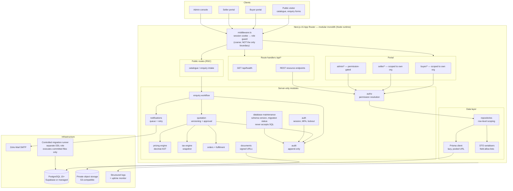

### 4.2 Request path and the four defensible layers **[C]**

A request crosses four independent boundaries. No single one is trusted alone — this directly answers the "middleware must not be the only security boundary" requirement.

| Layer | Where | Enforces | Failure mode if bypassed |
|---|---|---|---|
| 1. Edge guard | `src/middleware.ts` | Cookie presence, coarse role→prefix match, redirect to login | UX only, never data safety — this layer can be bypassed and is treated as such |
| 2. Route/handler guard | every server component, server action and route handler | `requireSession()`, `requirePermission()`, `requireOrganisationScope()` | 401/403 before any query runs |
| 3. Repository scope | `src/server/**/repository.ts` | Every query is constructed with the caller's organisation or admin scope baked in; there is no "find by id" that omits it | Prevents IDOR even if layer 2 has a gap |
| 4. Serialiser | `src/server/**/dto.ts` | Field allow-list per audience (`buyer`, `seller`, `admin`, `public`) | Strips internal columns even if a query is too broad |

**[C]** Layers 2–4 are mandatory per module. Layer 4 is what makes D1 and D2 mechanically true: `toBuyerQuoteDTO()` has no code path that reads `supplier_cost_total`.

**A fifth boundary for one surface only [C].** The database-maintenance endpoints of §22.9 add a boundary the other routes do not need: the request must arrive from a session whose user holds a `database.*` permission **and** the runner executes under a separate database role. Layer 2 alone would not be enough — a role mis-assignment would then permit DDL — so the runner's own credentials are the second half of the control (§29.4).

### 4.3 Runtime and rendering **[R]**

- Node.js runtime for all data-bearing routes; the Edge runtime is avoided because Prisma cannot run there. (Node is already the Stage 1 target.)
- Server Components read; Server Actions and route handlers write. No client component holds a database-facing credential or typed query.
- The public catalogue stays statically rendered where it holds no live data. Pages that gain live data move to dynamic rendering with explicit cache tags.
- `/api/health` becomes dynamic once it checks the database (§22.6).

---

## 5. Database design

**Two rules govern how this schema may ever change (D8, §29).** *Data* moves through authenticated APIs and admin screens; *structure* moves through committed migrations and nothing else. No routine record is ever corrected with a `psql` session, and no table is ever added by hand to fix an urgent problem — the migration file is written, reviewed and applied, and if that is too slow, the speed problem is the defect to fix.

### 5.1 Conventions **[C]**

| Rule | Detail |
|---|---|
| Engine | PostgreSQL 15+ |
| Identifier | `uuid` primary keys, `gen_random_uuid()` (pgcrypto/pg 13+ built-in). Non-sequential, safe in URLs and API responses. |
| Table names | `snake_case`, plural, mapped from Prisma PascalCase models via `@@map` |
| Timestamps | `created_at`, `updated_at` `timestamptz NOT NULL` on every mutable table; `deleted_at timestamptz NULL` where soft delete applies |
| Soft delete | Applied to master data and organisations only (`users`, `organisations`, `material_grades`, `products`, `supplier_listings`, `documents`). Transactional records (quotes, orders, audit) are **never** soft-deleted — they use status + archive. |
| Money | `numeric(18,2)` amounts · `numeric(18,4)` unit rates · `numeric(9,4)` percentages · `numeric(18,8)` FX · `numeric(18,3)` weights and quantities · `numeric(18,6)` unit-conversion factors. **No `float`/`double` anywhere.** |
| Currency | `char(3)` ISO 4217 on every monetary document; no implicit default at the database level |
| Enums | Native PostgreSQL enums via Prisma `enum`; appended by migration only (adding a value is safe, renaming is not) |
| Human references | `reference_sequences` allocates `ENQ-2026-000123`, `QT-2026-000045`, `ORD-2026-000031`; the number is immutable once issued |
| Immutability | Version tables (`*_versions`, `*_revisions`, `pricing_calculations`, `tax_lines`, `audit_logs`, `email_attempts`) are insert-only. Corrections create a new row. |
| Concurrency | Optimistic locking via `version integer` on `enquiries`, `buyer_quotes`, `orders`, `pricing_rule_sets`; the write asserts the version it read |
| Deletion | `ON DELETE RESTRICT` for financial and audit relationships; `ON DELETE CASCADE` only for pure child rows (lines, history, notes, attachments) |
| Personal data | Contact fields isolated in `organisation_contacts` and `users` (§5.4). Pseudonymised request metadata (IP, user agent) stored as salted hashes. |
| Schema change | Committed migration only, applied by the controlled runner under a DDL-capable role the application does not hold. Never `prisma db push`, never ad-hoc DDL, never a UI-supplied statement (§29.3, §29.5). |
| Routine data change | Authenticated API + admin screen, permission-checked, audited. A migration may create reference rows; it may never seed a business record (§24.2 step 19). |
| Migration bookkeeping | `_prisma_migrations` is Prisma's own record; **`migration_runs`** (§8.7) is ours, and it is what the console reads: who attempted what, when, with which checksum and result. |

### 5.2 Enumerations

```text
user_role              ADMIN | BUYER | SELLER
user_status            INVITED | ACTIVE | SUSPENDED | DISABLED | ARCHIVED
admin_tier             SUPER_ADMIN | SOURCING_OPS_ADMIN | CATALOGUE_MANAGER | READ_ONLY_ADMIN
admin_permission       (60 values — see §17.3)
org_type               BUYER | SELLER | BOTH
verification_status    NOT_SUBMITTED | PENDING | UNDER_REVIEW | VERIFIED | REJECTED | EXPIRED
verification_type      GST | PAN | CIN | TRADE_LICENCE | ISO | IEC | OTHER
transaction_model      PRINCIPAL | AGENCY | MANAGED_SUPPLY              [C — D4]
                       -- INTERMEDIARY is a legacy alias for AGENCY, never an enum value (§15.6)
enquiry_status         NEW | UNDER_REVIEW | MATCHING_SUPPLIERS | QUOTES_REQUESTED | QUOTES_RECEIVED |
                       COMPARING_QUOTES | QUOTE_DRAFTED | QUOTE_SENT | NEGOTIATION |
                       BUYER_SELLER_INTRODUCTION | WON | LOST | CANCELLED
enquiry_priority       LOW | NORMAL | HIGH | URGENT
enquiry_source         WEB_FORM | PHONE | EMAIL | REFERRAL | EXISTING_CUSTOMER | ADMIN_ENTRY
supplier_match_status  PROPOSED | APPROVED_FOR_RFQ | RFQ_SENT | QUOTE_RECEIVED | DECLINED | WITHDRAWN | EXCLUDED
supplier_quote_status  DRAFT | SUBMITTED | SUPERSEDED | WITHDRAWN | EXPIRED
buyer_quote_status     DRAFT | PENDING_APPROVAL | APPROVED | SENT | VIEWED | NEGOTIATION |
                       ACCEPTED | REJECTED | EXPIRED | SUPERSEDED | CANCELLED
approval_action        SUBMIT_FOR_APPROVAL | APPROVE | REJECT | REQUEST_CHANGES | WITHDRAW
contact_share_status   REQUESTED | APPROVED | DENIED | REVOKED | EXPIRED
contact_share_scope    PARTY_NAME | CONTACT_PERSON | EMAIL | PHONE | ADDRESS | ALL_CONTACT
pricing_rule_status    DRAFT | TESTING | PENDING_APPROVAL | ACTIVE | RETIRED
pricing_component_type BASE_RATE | GRADE_ADJUSTMENT | CONTAMINATION_DEDUCTION | QUANTITY_ADJUSTMENT |
                       LOCATION_ADJUSTMENT | FREIGHT | HANDLING | LOADING | PACKAGING | TESTING |
                       MARGIN | COMMISSION | DISCOUNT | SURCHARGE | ROUNDING | MIN_ORDER_ADJUSTMENT
charge_party           PURCHASE | SALE | BOTH
visibility             INTERNAL | BUYER_VISIBLE | SUPPLIER_VISIBLE
tax_rule_status        DRAFT | ACTIVE | RETIRED
tax_component_type     GST | IGST | CGST | SGST | UTGST | VAT | SALES_TAX | CESS |
                       WITHHOLDING_TAX | REVERSE_CHARGE | EXEMPT | OTHER
                       [SUPERSEDED — D7 replaces this enum with tax_components_ref, §15.5]
tax_base_rule          GOODS_VALUE | SERVICE_VALUE | COMMISSION_VALUE | FREIGHT_VALUE |
                       GOODS_PLUS_FREIGHT | TAXABLE_SUBTOTAL
tax_applies_to         PURCHASE | SALE | BOTH
order_status           DRAFT | CONFIRMED | SOURCING | READY_TO_DISPATCH | IN_TRANSIT |
                       DELIVERED | INVOICED | CLOSED | CANCELLED
payment_status         UNPAID | PARTIALLY_PAID | PAID | OVERDUE | WAIVED
payment_direction      RECEIVABLE | PAYABLE
cost_type              SUPPLIER_PURCHASE | INBOUND_FREIGHT | HANDLING | EXPENSE | COMMISSION | OTHER
shipment_status        PLANNED | DISPATCHED | IN_TRANSIT | DELIVERED | FAILED | RETURNED
listing_status         DRAFT | ACTIVE | PAUSED | EXPIRED | WITHDRAWN
product_condition      NEW | REFURBISHED | USED | UNKNOWN
document_type          GST_CERTIFICATE | PAN_CARD | TRADE_LICENCE | ISO_CERTIFICATE | ENQUIRY_ATTACHMENT |
                       SUPPLIER_QUOTE_ATTACHMENT | PURCHASE_ORDER | SALES_INVOICE | PURCHASE_INVOICE |
                       WEIGHMENT_SLIP | TEST_REPORT | EWAY_BILL | OTHER
document_visibility    INTERNAL | BUYER_VISIBLE | SUPPLIER_VISIBLE
scan_status            PENDING | CLEAN | INFECTED | FAILED
email_status           QUEUED | SENDING | SENT | FAILED | BOUNCED | SUPPRESSED | CANCELLED
audit_severity         INFO | NOTICE | WARNING | CRITICAL
```

### 5.3 Table definitions — Group A: identity, organisation and access

Notation: `PK` primary key · `FK→x` foreign key · `UQ` unique · `IDX` indexed · `NN` not null.

```text
users — one row per human identity. The only table authentication reads.
  id                      uuid        PK
  email                   text        NN UQ          -- lowercased + trimmed at write time
  email_verified_at       timestamptz NULL
  password_hash           text        NULL           -- argon2id/bcrypt; NULL until invite accepted
  password_changed_at     timestamptz NULL
  full_name               text        NN
  phone                   text        NULL           -- internal contact; never public
  role                    user_role   NN
  status                  user_status NN default 'INVITED'
  locale                  text        NN default 'en-IN'
  mfa_enabled             boolean     NN default false
  mfa_secret_ciphertext   text        NULL           -- application-encrypted, never logged
  failed_login_count      int         NN default 0
  locked_until            timestamptz NULL
  last_login_at           timestamptz NULL
  created_at / updated_at timestamptz NN
  deleted_at              timestamptz NULL
  IDX (role, status) · IDX (status, created_at) · IDX (deleted_at)

sessions — server-side session store. Cookie holds an opaque token; only its hash is stored.
  id              uuid        PK
  user_id         uuid        FK→users NN ON DELETE CASCADE
  token_hash      text        NN UQ          -- sha-256 of the cookie value
  role_at_issue   user_role   NN             -- invalidate on role change
  ip_hash         text        NULL
  user_agent_hash text        NULL
  created_at      timestamptz NN
  last_seen_at    timestamptz NN
  expires_at      timestamptz NN
  revoked_at      timestamptz NULL
  revoked_reason  text        NULL
  IDX (user_id, expires_at) · IDX (expires_at) · IDX (revoked_at)

auth_events — authentication audit trail, independent of the business audit log.
  id               uuid        PK
  user_id          uuid        FK→users NULL ON DELETE SET NULL
  email_attempted  text        NULL       -- normalised; never a password
  event_type       text        NN        -- LOGIN_SUCCESS | LOGIN_FAILED | LOGOUT | MFA_CHALLENGE |
                                          -- PASSWORD_RESET_REQUESTED | PASSWORD_CHANGED |
                                          -- ACCOUNT_LOCKED | SESSION_REVOKED
  success          boolean     NN
  ip_hash          text        NULL
  user_agent_hash  text        NULL
  detail           jsonb       NULL       -- redacted, no secrets
  occurred_at      timestamptz NN
  IDX (user_id, occurred_at) · IDX (email_attempted, occurred_at) · IDX (event_type, occurred_at)

admin_profiles — staff extension. 1:1 with a user whose role = ADMIN.
  id                 uuid        PK
  user_id            uuid        FK→users NN UQ
  staff_code         text        NN UQ
  tier               admin_tier  NN
  job_title          text        NULL
  desk               text        NULL       -- e.g. scrap desk, parts desk
  mfa_required       boolean     NN default true
  approval_limit     numeric(18,2) NULL     -- max quote value this admin may approve alone
  is_active          boolean     NN default true
  created_at / updated_at timestamptz NN

admin_permission_grants — per-user override on top of the tier baseline (§17.3).
  id            uuid        PK
  admin_id      uuid        FK→admin_profiles NN ON DELETE CASCADE
  permission    admin_permission NN
  effect        text        NN        -- GRANT | REVOKE
  granted_by_id uuid        FK→admin_profiles NULL
  reason        text        NULL
  expires_at    timestamptz NULL
  created_at    timestamptz NN
  UQ (admin_id, permission) · IDX (admin_id)

portal_invitations — onboarding token for a buyer or seller user.
  id            uuid        PK
  email         text        NN
  role          user_role   NN
  organisation_id uuid      FK→organisations NULL
  invited_by_id uuid        FK→users NULL
  token_hash    text        NN UQ
  expires_at    timestamptz NN
  accepted_at   timestamptz NULL
  revoked_at    timestamptz NULL
  created_at    timestamptz NN
  IDX (email, expires_at) · IDX (organisation_id)

organisations — the legal trading entity. Replaces a separate buyer/seller company table.
  id                    uuid        PK
  legal_name            text        NN
  trade_name            text        NULL
  org_type              org_type    NN
  registration_number   text        NULL       -- CIN / equivalent
  gstin                 text        NULL       -- validated format only; see §15.5
  pan                   text        NULL
  iec                   text        NULL
  country_code          char(2)     NN
  state_code            text        NULL       -- jurisdiction input for tax (§15.5)
  city                  text        NULL
  website               text        NULL
  verification_status   verification_status NN default 'NOT_SUBMITTED'
  account_status        text        NN default 'ACTIVE'  -- ACTIVE | ON_HOLD | CLOSED
  is_listable           boolean     NN default false    -- supplier may be matched
  internal_notes        text        NULL       -- admin-only, never serialised outward
  created_at / updated_at timestamptz NN
  deleted_at            timestamptz NULL
  UQ (gstin) WHERE gstin IS NOT NULL · UQ (pan) WHERE pan IS NOT NULL
  IDX (org_type, verification_status) · IDX (state_code) · IDX (deleted_at)

organisation_addresses
  id            uuid        PK
  organisation_id uuid      FK→organisations NN ON DELETE CASCADE
  kind          text        NN        -- BILLING | SHIPPING | SITE | REGISTERED
  label         text        NULL
  line1 / line2 text
  city          text        NN
  state_code    text        NN
  postal_code   text        NULL
  country_code  char(2)     NN
  is_default    boolean     NN default false
  created_at / updated_at timestamptz NN
  IDX (organisation_id, kind)

organisation_contacts — PRIVATE by default (D2). Never joined into public or cross-party responses.
  id              uuid        PK
  organisation_id uuid        FK→organisations NN ON DELETE CASCADE
  user_id         uuid        FK→users NULL ON DELETE SET NULL
  full_name       text        NN
  role_label      text        NULL
  email           text        NN
  phone           text        NULL
  is_primary      boolean     NN default false
  shareable       boolean     NN default false   -- admin may consent to share this contact
  created_at / updated_at timestamptz NN
  UQ (organisation_id, email) · IDX (organisation_id, is_primary)

organisation_verifications — business verification with document evidence.
  id              uuid        PK
  organisation_id uuid        FK→organisations NN ON DELETE CASCADE
  type            verification_type NN
  status          verification_status NN default 'PENDING'
  reference_value text        NULL       -- the claimed number (GSTIN, PAN…), stored normalised
  document_id     uuid        FK→documents NULL
  verified_by_id  uuid        FK→admin_profiles NULL
  verified_at     timestamptz NULL
  expires_at      timestamptz NULL
  rejection_reason text       NULL
  created_at / updated_at timestamptz NN
  UQ (organisation_id, type) · IDX (status, expires_at)

buyer_profiles — 1:1 with a user whose role = BUYER.
  id                 uuid        PK
  user_id            uuid        FK→users NN UQ
  organisation_id    uuid        FK→organisations NN
  job_title          text        NULL
  department         text        NULL
  approval_limit     numeric(18,2) NULL
  preferred_currency char(3)     NULL
  default_ship_to_id uuid        FK→organisation_addresses NULL
  created_at / updated_at timestamptz NN
  IDX (organisation_id)

supplier_profiles — 1:1 with a user whose role = SELLER.
  id                  uuid        PK
  user_id             uuid        FK→users NN UQ
  organisation_id     uuid        FK→organisations NN
  contact_role        text        NULL
  is_primary_contact  boolean     NN default false
  credit_terms_days   int         NULL
  can_submit_quotes   boolean     NN default true
  created_at / updated_at timestamptz NN
  IDX (organisation_id)

reference_sequences — concurrency-safe human reference allocation.
  prefix      text    NN
  year        int     NN
  last_value  bigint  NN default 0
  PK (prefix, year)
```

### 5.4 Table definitions — Group B: catalogue, pricing reference, enquiry and supplier quoting

```text
material_categories — scrap taxonomy root (ferrous, non-ferrous, alloys, plastics…).
  id               uuid        PK
  parent_id        uuid        FK→material_categories NULL
  code             text        NN UQ
  name             text        NN
  description      text        NULL
  is_active        boolean     NN default true
  sort_order       int         NN default 0
  created_at / updated_at timestamptz NN
  deleted_at       timestamptz NULL
  IDX (parent_id, sort_order)

material_grades — a tradable grade. The unit of pricing and of supplier matching.
  id                  uuid        PK
  category_id         uuid        FK→material_categories NN
  code                text        NN UQ        -- e.g. HMS-1-2, CU-MILL-BERRY
  name                text        NN
  description         text        NULL
  canonical_uom       text        NN default 'KG'
  min_order_quantity  numeric(18,3) NULL
  severity_default    text        NULL          -- typical contamination severity key (§9.3)
  is_active           boolean     NN default true
  is_public           boolean     NN default true   -- appears on the public catalogue page
  created_at / updated_at timestamptz NN
  deleted_at          timestamptz NULL
  IDX (category_id, is_active) · IDX (is_public)

material_grade_specs — quality attributes with acceptable ranges.
  id                 uuid        PK
  material_grade_id  uuid        FK→material_grades NN ON DELETE CASCADE
  attribute          text        NN        -- ISRI_CODE | PURITY | MOISTURE | DENSITY | SHEARING | …
  unit               text        NULL
  expected_min       numeric(18,4) NULL
  expected_max       numeric(18,4) NULL
  is_required        boolean     NN default false
  sort_order         int         NN default 0
  UQ (material_grade_id, attribute)

product_categories — spare-parts taxonomy.
  id          uuid        PK
  parent_id   uuid        FK→product_categories NULL
  code        text        NN UQ
  name        text        NN
  is_active   boolean     NN default true
  sort_order  int         NN default 0
  IDX (parent_id, sort_order)

products — catalogue definition for spare parts (not a stock item).
  id                 uuid        PK
  category_id        uuid        FK→product_categories NN
  code               text        NN UQ        -- internal SKU/catalogue code
  name               text        NN
  brand              text        NULL        -- buyer-visible brand is legitimate; supplier is not
  description        text        NULL
  canon_uom          text        NN default 'PCS'
  condition          product_condition NN default 'UNKNOWN'
  is_active          boolean     NN default true
  is_public          boolean     NN default true
  created_at / updated_at timestamptz NN
  deleted_at         timestamptz NULL
  IDX (category_id, is_active) · IDX (code)

product_specs — key/value specifications (part numbers, dimensions, voltage…).
  id           uuid        PK
  product_id   uuid        FK→products NN ON DELETE CASCADE
  name         text        NN
  value        text        NN
  unit         text        NULL
  is_required  boolean     NN default false
  is_mpn       boolean     NN default false   -- one MPN per product
  UQ (product_id, name) · partial UQ (product_id) WHERE is_mpn

supplier_listings — what a supplier states it can supply. The supplier's public-facing asset.
  id                 uuid        PK
  organisation_id    uuid        FK→organisations NN
  created_by_id      uuid        FK→users NN
  kind               text        NN        -- MATERIAL | PRODUCT
  material_grade_id  uuid        FK→material_grades NULL
  product_id         uuid        FK→products NULL
  title              text        NN
  description        text        NULL
  available_quantity numeric(18,3) NULL
  uom                text        NULL
  location_state     text        NULL
  lead_time_days     int         NULL
  status             listing_status NN default 'DRAFT'
  published_at       timestamptz NULL
  expires_at         timestamptz NULL
  created_at / updated_at timestamptz NN
  deleted_at         timestamptz NULL
  CHECK (kind = 'MATERIAL' AND material_grade_id IS NOT NULL OR
         kind = 'PRODUCT'  AND product_id IS NOT NULL)
  IDX (organisation_id, status) · IDX (material_grade_id) · IDX (product_id) · IDX (status, published_at)
  -- NOTE: no price columns. Suppliers never publish prices; they quote confidentially (§5.6).

price_records — reference/market rate history used as a pricing-engine input.
  id                 uuid        PK
  material_grade_id  uuid        FK→material_grades NULL
  product_id         uuid        FK→products NULL
  source             text        NN        -- MARKET_FEED | ADMIN_ENTRY | SUPPLIER_QUOTE_HISTORY
  basis              text        NN        -- INCOMING | OUTGOING | REFERENCE
  unit_rate          numeric(18,4) NN
  currency_code      char(3)     NN
  uom                text        NN
  jurisdiction_state text        NULL
  effective_from     timestamptz NN
  effective_to       timestamptz NULL
  recorded_by_id     uuid        FK→admin_profiles NULL
  note               text        NULL
  created_at         timestamptz NN
  CHECK (material_grade_id IS NOT NULL OR product_id IS NOT NULL)
  IDX (material_grade_id, effective_from DESC) · IDX (product_id, effective_from DESC) · IDX (basis, effective_from)

enquiries — the central sales opportunity. One row per buyer requirement.
  id                      uuid        PK
  reference               text        NN UQ        -- ENQ-2026-000123
  buyer_user_id           uuid        FK→users NN
  buyer_organisation_id   uuid        FK→organisations NN
  submitted_by_contact_id uuid        FK→organisation_contacts NULL
  source                  enquiry_source NN default 'WEB_FORM'
  kind                    text        NN        -- MATERIAL | PRODUCT | MIXED
  title                   text        NN
  description             text        NULL
  material_grade_id       uuid        FK→material_grades NULL
  product_id              uuid        FK→products NULL
  requested_quantity      numeric(18,3) NULL
  requested_uom           text        NULL
  target_unit_price       numeric(18,4) NULL   -- buyer's expectation; internal, never sent to suppliers
  currency_code           char(3)     NN
  delivery_state          text        NULL
  delivery_address_id     uuid        FK→organisation_addresses NULL
  required_by             date        NULL
  incoterms               text        NULL
  transaction_model       transaction_model NN    [C — D4]   -- no default; set deliberately before any RFQ
  transaction_model_set_by_id uuid    FK→admin_profiles NULL
  transaction_model_set_at    timestamptz NULL
  status                  enquiry_status NN default 'NEW'
  priority                enquiry_priority NN default 'NORMAL'
  owner_admin_id          uuid        FK→admin_profiles NULL
  tax_jurisdiction_state  text        NULL      -- seller-of-record state, drives tax grouping (§15.5)
  tax_treatment_id        uuid        FK→tax_treatments NULL
  version                 int         NN default 1
  first_responded_at      timestamptz NULL
  quote_sent_at           timestamptz NULL
  closed_at               timestamptz NULL
  lost_reason             text        NULL
  created_at / updated_at timestamptz NN
  IDX (buyer_organisation_id, status, created_at DESC)
  IDX (status, priority, created_at) · IDX (owner_admin_id, status)
  IDX (material_grade_id) · IDX (transaction_model, status) · IDX (required_by)

enquiry_lines — multi-line requirements for MIXED or multi-grade enquiries.
  id              uuid        PK
  enquiry_id      uuid        FK→enquiries NN ON DELETE CASCADE
  line_no         int         NN
  kind            text        NN
  material_grade_id uuid      FK→material_grades NULL
  product_id      uuid        FK→products NULL
  description     text        NULL
  quantity        numeric(18,3) NN
  uom             text        NN
  target_unit_price numeric(18,4) NULL
  specs           jsonb       NULL       -- buyer-stated attributes; validated per grade
  UQ (enquiry_id, line_no)

enquiry_attachments — links a private document to an enquiry.
  id            uuid        PK
  enquiry_id    uuid        FK→enquiries NN ON DELETE CASCADE
  document_id   uuid        FK→documents NN
  visibility    document_visibility NN default 'INTERNAL'
  created_at    timestamptz NN
  UQ (enquiry_id, document_id)

enquiry_status_history — append-only workflow trail (feeds the UI timeline and audit).
  id             uuid        PK
  enquiry_id     uuid        FK→enquiries NN ON DELETE CASCADE
  from_status    enquiry_status NULL
  to_status      enquiry_status NN
  actor_user_id  uuid        FK→users NULL
  reason         text        NULL
  created_at     timestamptz NN
  IDX (enquiry_id, created_at)

supplier_matches — which suppliers were considered for an enquiry, and why.
  id                     uuid        PK
  enquiry_id             uuid        FK→enquiries NN ON DELETE CASCADE
  organisation_id        uuid        FK→organisations NN
  status                 supplier_match_status NN default 'PROPOSED'
  match_score            numeric(5,2) NULL     -- ranking aid, not a price
  reason                 text        NULL       -- admin rationale
  proposed_by_id         uuid        FK→admin_profiles NULL
  approved_by_id         uuid        FK→admin_profiles NULL
  approved_at            timestamptz NULL
  excluded_reason        text        NULL
  created_at / updated_at timestamptz NN
  UQ (enquiry_id, organisation_id)
  IDX (organisation_id, status) · IDX (enquiry_id, status)

supplier_rfqs — the confidential request sent to one matched supplier.
  id                     uuid        PK
  reference              text        NN UQ
  enquiry_id             uuid        FK→enquiries NN
  supplier_organisation_id uuid      FK→organisations NN
  sent_by_id             uuid        FK→admin_profiles NN
  sent_at                timestamptz NULL
  response_due_at        timestamptz NULL
  brief                  jsonb       NN         -- redacted brief: NO buyer identity, NO target price
  brief_text             text        NULL
  status                 text        NN default 'DRAFT'  -- DRAFT | SENT | RESPONDED | DECLINED | EXPIRED
  token_hash             text        NULL UQ    -- optional tokenised external link
  created_at / updated_at timestamptz NN
  UQ (enquiry_id, supplier_organisation_id, sent_at)
  IDX (supplier_organisation_id, status) · IDX (enquiry_id)

supplier_quote_submissions — a supplier's confidential offer. Never buyer-visible.
  id                      uuid        PK
  reference               text        NN UQ
  rfq_id                  uuid        FK→supplier_rfqs NN
  enquiry_id              uuid        FK→enquiries NN
  supplier_organisation_id uuid       FK→organisations NN
  submitted_by_user_id    uuid        FK→users NN
  status                  supplier_quote_status NN default 'DRAFT'
  currency_code           char(3)     NN
  valid_until             date        NULL
  payment_terms_days      int         NULL
  delivery_lead_days      int         NULL
  freight_amount          numeric(18,2) NULL
  freight_included        boolean     NN default false
  packaging_terms         text        NULL
  testing_terms           text        NULL
  remarks                 text        NULL
  total_amount            numeric(18,2) NULL   -- computed on submit from lines
  is_internal_only        boolean     NN default true  -- enforced by serialiser, documented here
  submitted_at            timestamptz NULL
  created_at / updated_at timestamptz NN
  IDX (enquiry_id, status) · IDX (supplier_organisation_id, submitted_at DESC) · IDX (rfq_id)

supplier_quote_lines
  id                    uuid        PK
  supplier_quote_id     uuid        FK→supplier_quote_submissions NN ON DELETE CASCADE
  line_no               int         NN
  material_grade_id     uuid        FK→material_grades NULL
  product_id            uuid        FK→products NULL
  description           text        NULL
  quantity              numeric(18,3) NN
  uom                   text        NN
  unit_price            numeric(18,4) NN
  line_total            numeric(18,2) NN
  grade_specs           jsonb       NULL
  UQ (supplier_quote_id, line_no)

supplier_quote_attachments
  id                 uuid        PK
  supplier_quote_id  uuid        FK→supplier_quote_submissions NN ON DELETE CASCADE
  document_id        uuid        FK→documents NN
  created_at         timestamptz NN
```

```text
supplier_quote_charges — the cost lines that make a quote comparable on a landed basis.
  id                 uuid        PK
  supplier_quote_id  uuid        FK→supplier_quote_submissions NN ON DELETE CASCADE
  charge_type        charge_party NN          -- FREIGHT | LOADING | PACKAGING | TESTING | OTHER
  charge_party       charge_party NN default 'PURCHASE'
  amount             numeric(18,2) NN
  currency_code      char(3)     NN
  is_included_in_price boolean   NN default false
  note               text        NULL
  IDX (supplier_quote_id, charge_type)
```

### 5.5 Enquiry / RFQ data model — quotation-ready lead capture

The buyer enquiry is the **primary source of truth for the commercial requirement**. It must
carry enough structured information for the desk to obtain supplier quotations, compare them
and prepare an accurate buyer quotation **without contacting the buyer again for missing
information**. This section is the authoritative model; the frontend wizard in
`src/components/enquiry/` and the catalogue in `src/lib/content/enquiry-fields.ts` are built
from it, field for field.

#### 5.5.1 Design rules

| Rule | Detail |
|---|---|
| Two requirement branches | Scrap material (group B) and industrial spare parts (group C) are **separate conditional schemas**, never one union table of nullable columns. Both are stored as `enquiry_lines` rows, with `kind` on the line. |
| Enquiry kind | `enquiries.kind` = `MATERIAL` \| `PRODUCT` \| `MIXED`. A `MIXED` enquiry carries one line of each kind, so a single brief can ask for scrap **and** parts. |
| Not everything is mandatory | Field status is declared once, in the catalogue: `REQUIRED`, `SCRAP`, `PRODUCT`, `DELIVERY`, `OPTIONAL`, `LATER`. The database enforces the hard subset with `CHECK` constraints; the rest is application validation. |
| Unknown is legitimate | Technical facts (grade, purity, contamination, brand, part number, technical spec) accept `UNKNOWN`. A CHECK never forces a value there, because rejecting a real lead on a fact the buyer cannot know loses business. |
| Unknown means clarify | `enquiry_clarifications` records each unknown against the field, with a status the desk works through. This is what flags a lead instead of rejecting it. |
| Late facts | `LATER` fields (billing address, GSTIN, full delivery address) are collected before the invoice or order. They do not block intake. |
| No price is invented | `target_unit_price` is buyer-supplied and optional. It is **internal** — never serialised to a supplier, and `NULL` is not a missing required field. |
| Readiness is computed, not typed | `enquiries.readiness_state` is derived from blockers + open clarifications, never set by hand. |

#### 5.5.2 Group A — buyer and business details

Stored on `organisations`, `organisation_addresses` and `organisation_contacts` (§5.3) plus the
enquiry's delivery snapshot. Contacts remain private by default (D2).

| Field | Key | Status | Type / constraint |
|---|---|---|---|
| Contact person name | `contact_person_name` | REQUIRED | `text NOT NULL` (copied to the enquiry as a snapshot) |
| Company / business name | `business_name` | REQUIRED | resolves to `organisations.legal_name` |
| Mobile with country code | `mobile` | REQUIRED | `text`, E.164; stored `text` not numeric |
| Business email | `business_email` | REQUIRED | `citext`; free-mail domains flagged, not rejected |
| Business type | `business_type` | REQUIRED | enum `business_type` |
| GSTIN where applicable | `gstin` | OPTIONAL → LATER | `text`, format-checked; required before a tax invoice |
| Company website | `website` | OPTIONAL | `text`, `https` only |
| Billing address | `billing_address` | LATER | `organisation_addresses` (`kind='BILLING'`) |
| Delivery city | `delivery_city` | REQUIRED | `text` |
| Delivery state / region | `delivery_state` | REQUIRED | `text`; also a **tax jurisdiction input** (§15.5) |
| Delivery PIN code | `delivery_postal_code` | REQUIRED | `text` (leading zeros are significant — never an integer) |

#### 5.5.3 Group B — scrap material requirement (line kind `MATERIAL`)

| Field | Key | Status | Type / constraint |
|---|---|---|---|
| Material category | `material_category` | SCRAP | FK→`material_categories` |
| Metal / material type | `metal_type` | SCRAP | `text` |
| Grade | `material_grade_id` | SCRAP, `UNKNOWN` allowed | FK→`material_grades NULL` |
| Grade specification | `grade_specification` | SCRAP, `UNKNOWN` allowed | `text` |
| Scrap form | `scrap_form` | SCRAP, `UNKNOWN` allowed | enum `scrap_form` |
| Quantity | `quantity` | SCRAP | `numeric(18,3)`, `CHECK (quantity > 0)` |
| Unit | `uom` | SCRAP | enum `quantity_uom` (`KG`/`MT`/`TONNE`) |
| Condition | `condition` | SCRAP, `UNKNOWN` allowed | enum `material_condition` |
| Purity / composition | `purity_pct` | SCRAP, `UNKNOWN` allowed | `numeric(9,4)`, `CHECK 0–100` |
| Contamination | `contamination_pct` | SCRAP, `UNKNOWN` allowed | `numeric(9,4)`, `CHECK 0–100` |
| Source of scrap | `scrap_source` | OPTIONAL | `text` |
| Material photographs | via `enquiry_attachments` | OPTIONAL | private `documents`, `visibility='INTERNAL'` |
| Inspection requirement | `inspection_requirement` | DELIVERY | enum `inspection_level` |
| Sample availability | `sample_available` | SCRAP | enum `sample_answer` |

#### 5.5.4 Group C — industrial spare-part requirement (line kind `PRODUCT`)

| Field | Key | Status | Type / constraint |
|---|---|---|---|
| Product category | `product_category_id` | PRODUCT | FK→`product_categories` |
| Product name | `product_name` | PRODUCT | `text` |
| Manufacturer / brand | `manufacturer` | PRODUCT, `UNKNOWN` allowed | `text` |
| Part number / SKU | `part_number` | PRODUCT, `UNKNOWN` allowed | `text`; needed unless a nameplate photo is attached |
| Technical specification | `technical_spec` | PRODUCT, `UNKNOWN` allowed | `text` |
| Material / grade (part) | `part_material` | OPTIONAL, `UNKNOWN` allowed | `text` |
| Quantity | `quantity` | PRODUCT | `numeric(18,3)`, `CHECK (quantity > 0)` |
| Unit | `uom` | PRODUCT | enum `quantity_uom` (`PCS`/`SET`/`M`) |
| Condition | `product_condition` | PRODUCT | enum `product_condition` |
| Compatible machine / model | `compatible_machine` | OPTIONAL | `text` |
| Drawing / datasheet / photo | via `enquiry_attachments` | PRODUCT | private `documents` |
| Equivalent acceptable | `equivalent_acceptable` | PRODUCT | enum `equivalent_policy` |

#### 5.5.5 Group D — delivery and logistics

| Field | Key | Status | Type / constraint |
|---|---|---|---|
| Delivery / pickup location | `delivery_location` | REQUIRED | `text` |
| Delivery PIN code | `delivery_postal_code` | REQUIRED | `text` |
| Full delivery address | `full_delivery_address` | DELIVERY | `text`; may reference `organisation_addresses` |
| Freight preference | `freight_preference` | DELIVERY | enum `freight_preference` |
| Loading / unloading responsibility | `loading_responsibility` | DELIVERY | enum `loading_party` |
| Pickup arrangements (scrap) | `pickup_arrangements` | SCRAP | `text` |
| Weighbridge available | `weighbridge_available` | OPTIONAL | `boolean NULL` (unknown ≠ false) |
| Site inspection / equipment | `site_equipment` | OPTIONAL | `text` |
| Preferred delivery date | `preferred_delivery_date` | DELIVERY | `date` |
| Transport restrictions | `transport_restrictions` | OPTIONAL | `text` |

#### 5.5.6 Group E — commercial details

| Field | Key | Status | Type / constraint |
|---|---|---|---|
| Target price | `target_unit_price` | OPTIONAL, `UNKNOWN` allowed | `numeric(18,4)` — **internal, never supplier-visible** |
| Target price unit | `target_price_uom` | with target price | enum `quantity_uom` |
| Tax preference | `tax_preference` | REQUIRED | enum `tax_preference` (`INCLUDED`/`EXTRA`) — a *preference*, never a rate |
| Payment preference | `payment_preference` | OPTIONAL | enum `payment_preference` |
| Advance payment possible | `advance_pct` | OPTIONAL | `numeric(9,4)`, `CHECK 0–100` |
| Requested credit period | `credit_period_days` | OPTIONAL | `int`, `CHECK >= 0` |
| One-time or recurring | `requirement_frequency` | REQUIRED | enum `requirement_frequency` |
| Monthly quantity | `monthly_quantity` | SCRAP, when recurring | `numeric(18,3)`; CHECK requires it when `RECURRING` |
| Quotation validity preference | `quote_validity_days` | OPTIONAL | `int` |
| Commercial remarks | `commercial_remarks` | OPTIONAL | `text` |

#### 5.5.7 Group F — additional information

| Field | Key | Status | Type / constraint |
|---|---|---|---|
| Requirement description | `description` | REQUIRED | `text` |
| Photos, PDFs, Excel/BOM, drawings | via `enquiry_attachments` | OPTIONAL | ≤10 files/lead, 10 MB each, private |
| Sample requirement | `sample_requirement` | OPTIONAL | enum `sample_stage` |
| Inspection availability | `inspection_availability` | OPTIONAL | enum `availability` |
| Preferred communication | `preferred_communication` | OPTIONAL | enum `comm_channel` |
| Additional instructions | `additional_instructions` | OPTIONAL | `text` |

#### 5.5.8 Conditional validation rules (the contract both the wizard and the API enforce)

| Rule | Fields |
|---|---|
| Required for every enquiry | contact person, business name, mobile, business email, business type, delivery city/state/PIN, requirement description, tax preference, requirement frequency, and at least one line |
| Required only for scrap | material category, metal type, quantity + unit, scrap form, condition, sample availability, monthly quantity when `RECURRING` |
| Required only for spare parts | product name, quantity + unit, condition, equivalent-acceptable answer; part number **or** an attachment |
| Required only for delivered quotations | full delivery address, freight preference, loading responsibility, preferred delivery date, inspection requirement |
| Optional but recommended | photographs, drawings, scrap source, site equipment, weighbridge, payment preference, advance, credit period, quotation validity, commercial remarks |
| Collected later | billing address, GSTIN, full delivery address where not quoted, purchase-order reference |
| Never rejected | any `UNKNOWN`-allowed field left unknown — recorded as a clarification instead |

#### 5.5.9 Quotation-readiness (Task 3)

```text
enquiry_readiness   NOT_READY | CLARIFICATION_REQUIRED | READY
```

A lead becomes `READY` only when **all** of these hold:

1. Every blocker field is present (`READINESS_BLOCKERS` in the catalogue, mirrored by
   `enquiry_clarifications` having no open blocker).
2. At least one line has a quantity and a unit.
3. Delivery state is known (it drives tax jurisdiction).
4. Tax preference is answered (it changes the quoted basis).
5. Requirement frequency is answered (one-time vs recurring changes the pricing model).

`UNKNOWN` technical fields do **not** block readiness; they produce
`CLARIFICATION_REQUIRED`, which is an accepted lead with a desk task attached. The desk cannot
move an enquiry to `QUOTES_REQUESTED` while any blocker is open — that rule is enforced in the
state machine (§13), not only in the UI.

#### 5.5.10 Admin enquiry detail — grouped review screen

The admin screen groups the same record into ten sections, in working order: (1) buyer/business,
(2) material/product specifications, (3) quantity and units, (4) delivery and logistics,
(5) commercial requirements, (6) attachments, (7) missing information and clarification
checklist, (8) supplier matching, (9) supplier quotation comparison, (10) buyer quotation
preparation. Sections 1 and 6 are permission-gated; section 9 is internal-only.


#### 5.5.11 Entities that carry the lead

```text
enquiry_clarifications — one row per field the desk must confirm before pricing.
  id              uuid        PK
  enquiry_id      uuid        FK→enquiries NN ON DELETE CASCADE
  line_id         uuid        FK→enquiry_lines NULL ON DELETE CASCADE
  field_group     char(1)     NN          -- A | B | C | D | E | F
  field_key       text        NN          -- catalogue key, e.g. 'grade', 'partNumber'
  reason          text        NN
  is_blocker      boolean     NN default false   -- true = blocks READY
  status          text        NN default 'OPEN'  -- OPEN | ANSWERED | WAIVED
  answered_value  text        NULL        -- what the buyer supplied later
  answered_by_id  uuid        FK→users NULL
  answered_at     timestamptz NULL
  resolved_by_id  uuid        FK→admin_profiles NULL
  created_at / updated_at timestamptz NN
  UQ (enquiry_id, field_group, field_key) · IDX (enquiry_id, status)

enquiries — columns added for quotation-ready capture (extends §5.4)
  kind                    enquiry_kind      NN default 'MATERIAL'   -- was text
  business_type           business_type     NULL
  contact_person_snapshot text              NULL   -- as given at submission
  delivery_city           text              NULL
  delivery_postal_code    text              NULL
  delivery_location       text              NULL
  delivery_state          text              NULL   -- tax jurisdiction input (§15.5)
  full_delivery_address   text              NULL
  freight_preference      freight_preference NULL
  loading_responsibility  loading_party     NULL
  pickup_arrangements     text              NULL
  weighbridge_available   boolean           NULL   -- NULL = unknown, not false
  site_equipment          text              NULL
  transport_restrictions  text              NULL
  preferred_delivery_date date              NULL
  tax_preference          tax_preference    NULL   -- INCLUDED | EXTRA (never a rate)
  payment_preference      payment_preference NULL
  advance_pct             numeric(9,4)      NULL   CHECK (0–100)
  credit_period_days      int               NULL
  requirement_frequency   requirement_frequency NULL
  quote_validity_days     int               NULL
  commercial_remarks      text              NULL
  sample_requirement      sample_stage      NULL
  inspection_availability availability      NULL
  preferred_communication comm_channel      NULL
  additional_instructions text              NULL
  readiness_state         enquiry_readiness NN default 'NOT_READY'
  readiness_checked_at    timestamptz       NULL
  IDX (readiness_state, created_at DESC) · IDX (delivery_state)

enquiry_lines — branch payload (extends §5.4)
  line_kind               enquiry_kind      NN default 'MATERIAL'
  -- scrap branch (NULL for spare-part lines)
  scrap_form              scrap_form        NULL
  condition               material_condition NULL
  purity_pct              numeric(9,4)      NULL   CHECK (0–100)
  contamination_pct       numeric(9,4)      NULL   CHECK (0–100)
  scrap_source            text              NULL
  inspection_requirement  inspection_level  NULL
  sample_available        sample_answer     NULL
  monthly_quantity        numeric(18,3)     NULL
  -- spare-part branch (NULL for scrap lines)
  manufacturer            text              NULL
  part_number             text              NULL
  technical_spec          text              NULL
  part_material           text              NULL
  compatible_machine      text              NULL
  equivalent_acceptable   equivalent_policy NULL
  CHECK (quantity IS NULL OR quantity > 0)
  CHECK (purity_pct IS NULL OR purity_pct BETWEEN 0 AND 100)
```

### 5.6 Supplier quotation capture (Task 4)

A supplier quote is captured as a header plus lines plus charge lines, so a comparison is
arithmetic rather than a reading exercise. It is `is_internal_only = true` by definition.

| Captured field | Where | Notes |
|---|---|---|
| Offered item and matching specification | `supplier_quote_lines` + `grade_specs` jsonb | A quote that misses the brief is recorded as such |
| Offered grade / brand / model | `supplier_quote_lines.material_grade_id` / `product_id`, `grade_specs` | Equivalents identifiable as equivalents |
| Available quantity | `supplier_quote_lines.quantity` + `uom` | Below requested volume must be visible |
| Basic price and unit | `supplier_quote_lines.unit_price` `numeric(18,4)` + `uom` | Normalised to the enquiry unit for comparison |
| Tax treatment and rate | `supplier_quote_taxes` (§5.8) | Per-quote; no universal rate |
| Freight | `supplier_quote_charges` (`FREIGHT`) or inline `freight_amount` | `freight_included` states the basis |
| Loading / unloading | `supplier_quote_charges` (`LOADING`) | Who provides equipment is separate from who pays |
| Packaging and handling | `supplier_quote_charges` (`PACKAGING`) | Material to parts |
| Inspection / testing | `supplier_quote_charges` (`TESTING`) | Third-party testing is a cost line |
| Delivery timeline | `delivery_lead_days` | Read against the buyer's required date |
| Payment terms | `payment_terms_days` | Financing cost of the terms |
| Quote validity | `valid_until` | Expired quotes stay visible but cannot be selected |
| Stock confirmation | `stock_status` enum | `HELD` / `ALLOCATED` / `ON_ORDER` / `UNKNOWN` |
| Certificates and documents | `supplier_quote_attachments` | Private, signed-URL access only |
| Supplier remarks | `remarks` | Conditions attached to the offer |

### 5.7 Comparison basis

Comparison is **landed-first**. Each returned quote is normalised through the pricing engine to:

```text
landed_cost = Σ(line qty × unit_price normalised to the enquiry uom)
            + freight + loading + packaging + testing + other charges
            + applicable purchase-side tax
```

Ranking order, and the reason for it: landed cost → specification compliance → delivery against
the required date → payment terms and validity → supplier reliability. A headline rate excluding
freight is the normal case; comparing headline rates is how a desk loses money.

### 5.8 Buyer quotation generation (Task 5)

```text
buyer_quotes — the commercial document sent to the buyer.
  id                  uuid        PK
  reference           text        NN UQ        -- QT-2026-000045
  enquiry_id          uuid        FK→enquiries NN
  buyer_organisation_id uuid      FK→organisations NN
  transaction_model   transaction_model NN     -- PRINCIPAL | AGENCY | MANAGED_SUPPLY (frozen here) [C — D4]
  status              buyer_quote_status NN default 'DRAFT'
  current_version_id  uuid        FK→buyer_quote_versions NULL
  currency_code       char(3)     NN
  delivery_terms      text        NULL
  payment_terms       text        NULL
  valid_until         date        NULL
  version             int         NN default 1
  created_by_id       uuid        FK→admin_profiles NN
  approved_by_id      uuid        FK→admin_profiles NULL
  approved_at         timestamptz NULL
  sent_at             timestamptz NULL
  created_at / updated_at timestamptz NN
  IDX (enquiry_id, status) · IDX (buyer_organisation_id, sent_at DESC)

buyer_quote_versions — insert-only snapshot. A revision is a new version, never an edit.
  id                     uuid        PK
  buyer_quote_id         uuid        FK→buyer_quotes NN ON DELETE CASCADE
  version_no             int         NN
  requirement_snapshot   jsonb       NN   -- the enquiry as submitted (groups A, D, E, F)
  lines_snapshot         jsonb       NN   -- buyer-facing lines only
  supplier_quote_id      uuid        FK→supplier_quote_submissions NULL  -- internal reference
  cost_snapshot          jsonb       NN   -- supplier price, freight, handling, other costs (INTERNAL)
  margin_type            text        NULL -- COMMISSION | MARGIN
  margin_value           numeric(18,4) NULL
  tax_snapshot           jsonb       NN   -- type, rate, base, jurisdiction, effective date, amount
  gross_amount           numeric(18,2) NN
  tax_amount             numeric(18,2) NN
  net_amount             numeric(18,2) NN
  exclusions             text        NULL
  special_conditions     text        NULL
  created_by_id          uuid        FK→admin_profiles NN
  created_at             timestamptz NN
  UQ (buyer_quote_id, version_no) · IDX (buyer_quote_id, created_at DESC)

buyer_quote_lines — what the buyer sees. No supplier identity, no supplier cost, no margin.
  id                    uuid        PK
  buyer_quote_version_id uuid       FK→buyer_quote_versions NN ON DELETE CASCADE
  line_no               int         NN
  description           text        NN
  specification         text        NULL
  quantity              numeric(18,3) NN
  uom                   text        NN
  unit_price            numeric(18,4) NN   -- buyer-facing price, all components applied
  line_total            numeric(18,2) NN
  UQ (buyer_quote_version_id, line_no)

supplier_quote_taxes — tax captured on a supplier quote, per quote.
  id                 uuid        PK
  supplier_quote_id  uuid        FK→supplier_quote_submissions NN ON DELETE CASCADE
  tax_type           tax_component_type NN
  rate_pct           numeric(9,4) NN
  taxable_base       tax_base_rule NN
  tax_amount         numeric(18,2) NN
  jurisdiction       text        NULL
  effective_date     date        NULL
  IDX (supplier_quote_id)
```

**Generation inputs** (all mandatory inputs to the calculation, none of them a constant):

1. Buyer requirement snapshot — the enquiry as submitted, immutable.
2. Selected supplier offer — one quote, with its lines and conditions.
3. Supplier procurement price — internal.
4. Freight and handling expenses — from the supplier charges or the desk's own quote.
5. Other procurement costs — testing, certification, weighbridge, documentation.
6. Transaction model — `PRINCIPAL`, `AGENCY` or `MANAGED_SUPPLY`, frozen on the quote (D4).
7. Commission or trading margin — `COMMISSION` for agency, `MARGIN` for principal and managed supply.
8. Transaction-specific tax configuration — resolved through §15.5, never a stored rate in code.
9. Delivery and payment terms — as quoted.
10. Quote validity — explicit expiry.
11. Exclusions and special conditions — what the price does not cover.

**Disclosure rules, enforced by the serialiser, not by convention:**

| Data | Buyer | Supplier | Admin |
|---|---|---|---|
| Supplier identity | until introduction approved | own record | full |
| Supplier cost / procurement price | never | own quote | full |
| Commission / margin | never | never | full |
| Buyer target price / budget | own entry | never | full |
| Buyer or seller contact details | own record | own record | full, share gated by D2 |
| Tax configuration | on the quote | on their quote | full |

### 5.9 New enumerations for this section

```text
enquiry_kind           MATERIAL | PRODUCT | MIXED
business_type          TRADER | MANUFACTURER | FABRICATOR | FOUNDRY | EPC | RECYCLER | OTHER
scrap_form             SHEETS | PLATES | PIPES | WIRES | CABLES | TURNINGS | BORINGS | INGOTS |
                       OFFCUTS | HMS | MIXED | OTHER | UNKNOWN
material_condition     CLEAN | MIXED | CONTAMINATED | PROCESSED | UNPROCESSED | UNKNOWN
quantity_uom           KG | MT | TONNE | PCS | SET | M
inspection_level       NONE | VISUAL | SAMPLING | THIRD_PARTY
sample_answer          YES | NO | ON_REQUEST | UNKNOWN
sample_stage           NOT_NEEDED | BEFORE_AWARD | BEFORE_DISPATCH
equivalent_policy      YES | NO_OEM_ONLY | WITH_APPROVAL | UNKNOWN
freight_preference     INCLUDED | SEPARATE | BUYER_ARRANGED
loading_party          SELLER | BUYER | SHARED
tax_preference         INCLUDED | EXTRA
payment_preference     ADVANCE | AGAINST_DELIVERY | CREDIT
requirement_frequency  ONE_TIME | RECURRING
availability           OPEN | BY_APPOINTMENT | NONE
comm_channel           EMAIL | PHONE | WHATSAPP
enquiry_readiness      NOT_READY | CLARIFICATION_REQUIRED | READY
stock_status           HELD | ALLOCATED | ON_ORDER | UNKNOWN
clarification_status   OPEN | ANSWERED | WAIVED
```

`UNKNOWN` is a first-class value in `scrap_form`, `material_condition`, `sample_answer` and
`equivalent_policy` — the schema models "the buyer does not know" rather than forcing a guess.

### 5.10 Status of this document

Sections 1–5 are written. The enquiry/RFQ model in §5.5–§5.9 is implemented in the frontend as
defined here, field for field:

| Document section | Frontend implementation |
|---|---|
| §5.5.2–5.5.7 field catalogue | `src/lib/content/enquiry-fields.ts` (status, format, example, unknown-allowed) |
| §5.5.8 conditional validation | the same catalogue's `VALIDATION_RULES`, enforced by the wizard's step and kind gating |
| §5.5.9 quotation readiness | `evaluateReadiness` + `components/enquiry/readiness.tsx` |
| §5.5.10 grouped admin review | `/admin/enquiries/[id]` |
| §5.6 supplier quote capture | `/admin/supplier-quotations` comparison matrix |
| §5.8 generation inputs | `/admin/quotation-preparation` |

Field status is not restated in the form: each `<Field>` resolves its marker from the catalogue
via `STATUS_BY_CONTROL_NAME`, so a label cannot promise something the catalogue does not declare,
and `REQUIRED` controls carry `required`/`aria-required` from the same source.

**Draft retention (frontend contract for Stage 2).** The wizard keeps every step and every kind
branch mounted and hides the inactive ones, so a value entered for scrap survives a switch to
spare parts and back, and survives moving between steps. A five-step form that discards what the
buyer already typed is not quotable. Stage 2 must preserve the same guarantee on the server: a
draft enquiry is persisted per submission step, not only on final submit.

**Verified behaviour, not assumed behaviour.** `scripts/wizard-interaction.mjs` drives real Chrome
over the DevTools Protocol (Node built-ins only, no test dependency) at 1440×900, 768×1024 and
390×844. It exercises the kind switch, Back/Next, rail jumps, unknown answers, value retention,
disabled submission, overflow and console errors — 100 assertions across the three viewports.

**Status after Stage 2B and M0 closure.** §1–§5 (Part A) and §6–§28 (Part B) are written, and §29 records the M0 database-and-schema-management requirement (**D8**). The former gap in
§6–§17 is closed, and the forward references that pointed at it have been renumbered — §6.5 lists
every old→new mapping and the two that contradicted each other. The enquiry/RFQ model in §5.5–§5.9
remains implemented in the frontend, field for field, and is unchanged by Part B.

**What Part B does not do.** It designs; it implements nothing. There is still no database, ORM,
session, mail integration or stored record in the repository, and the domain model remains static
copy plus labelled example layouts. §6.4 separates what exists from what is proposed, and §27 lists
the decisions that must be taken before Milestone 1. The document should not be approved as a whole
until those decisions in §27 are recorded.

---

# Part B — Stage 2B: quality, traceability, catalogue, SEO and delivery architecture

> **Revision note (Stage 2B, 2026-10-30).** Part A (§1–§5.9) designed identity, organisation,
> enquiry, supplier quoting and buyer quotation. It left §6–§17 unwritten and carried forward
> references to them. Part B completes the architecture and, in doing so, **renumbers** those
> forward references; §6.5 lists every old→new mapping so nothing points at a missing section.
> Part B also records **one substantive conflict** between confirmed decision D1 and the
> already-shipped frontend (§6.6). It is raised as an open decision, **not** silently resolved.
>
> **Nothing in this document is implemented.** No table, migration, endpoint or package exists.
> Where the frontend already contains a working feature, §6.4 says so explicitly.

## 6. Scope of Part B, traceability and reconciliation

### 6.1 What Part B adds

Part B designs the **physical goods** half of the platform — the part Part A deferred. Part A
answers "how is an enquiry quoted and sold". Part B answers "how is a specific tonne of material
catalogued, inspected, approved, dispatched, disputed and settled, and how is the evidence that
proves it stored and never rewritten".

| Part B area | Why it exists |
|---|---|
| Catalogue and configurable composition (§9) | Scrap is not a SKU. Grade, composition and contamination are the product, and they are configurable data, not columns. |
| Parties and actual lots (§10) | A quotation is for a *requirement*; a trade is for a *lot*. The lot is the unit of inspection, approval, dispatch and dispute. |
| Inspection and evidence versioning (§11) | Declared § tested must never be confused. Evidence is versioned and immutable. |
| Buyer approval (§12) | A buyer must approve a **specific lot against a specific inspection version**, not "the material" in general. |
| Seven-stage workflow (§13) | The transaction gate model, as a state machine with server-enforced entry conditions. |
| Dispatch, rejection, dispute, settlement (§14) | The money and risk events after approval. |
| Transaction models and tax (§15) | Three commercial models and per-transaction tax snapshots. |
| Snapshots and audit (§16) | What a quotation said on the day it was issued, forever. |
| Admin access control (§17) | Who may do what, including approval and contact disclosure. |
| Separation and storage (§18) | Public, buyer, seller, internal — enforced in queries and by signed URLs. |
| SEO and locations (§19–§21) | Programmatic location coverage without inventing content, and without misrepresenting service coverage. |
| API (§22) | Endpoint catalogue, validation and access boundaries. |
| Database and schema management (§29) | Two-tier control: routine business data through admin APIs, structural change through reviewed migrations. PRIMEMET must be operable by its staff, and no interface may accept SQL. |
| Mail, migration, security, plan (§23–§28) | How it is built and in what order. |

### 6.2 Status tags

Part A's tags continue unchanged: **[C]** confirmed, **[R]** recommendation, **[O]** open decision.
Part B adds one:

| Tag | Meaning |
|---|---|
| **[E]** | **Exists.** Implemented in the current frontend and must be preserved. A database design that contradicts an **[E]** row is wrong unless the row is explicitly superseded. |

### 6.3 Requirement traceability — Stage 2B items R1–R20

| # | Stage 2B requirement | Section | Ships in phase |
|---|---|---|---|
| R1 | Database entity relationship diagram | §7 | 1 |
| R2 | Tables, fields, data types, relationships, indexes | §8 | 1 |
| R3 | Category, product, scrap grade, configurable composition models | §9 | 1 |
| R4 | Supplier, buyer and actual scrap lot models | §10 | 1 |
| R5 | Inspection records, declared vs tested, report versioning | §11 | 2 |
| R6 | Buyer approval bound to lot and inspection evidence | §12 | 2 |
| R7 | Seven-stage quality and transaction workflow | §13 | 2 |
| R8 | Dispatch authorisation, rejection, disputes, settlement | §14 | 3 |
| R9 | `PRINCIPAL`, `AGENCY`, `MANAGED_SUPPLY` transaction models | §15 | 1 |
| R10 | Historical quotation snapshots and audit logs | §16 | 3 |
| R11 | Admin authentication, roles and permissions | §17 | 2 |
| R12 | Public/private separation and secure document storage | §18 | 2 |
| R13 | Dynamic SEO metadata, AI content generation, location coverage | §19 | 4 |
| R14 | City, district, industrial-area and state SEO relationships | §20 | 4 |
| R15 | Sitemap, canonical URLs, redirects, publication lifecycle | §21 | 4 |
| R16 | API endpoint specifications and data-access boundaries | §22 | 2 |
| R17 | Database migration and implementation sequence | §24 | 1 |
| **R18** | **Database and schema management: admin-managed routine data, version-controlled migrations, restricted technical-administrator maintenance interface** | **§29** | **M9 (console + runner); routine data per §29.2** |
| **R19** | **Managed PostgreSQL hosting research: verified India-region availability by service, backups/PITR/residency, pooling, cost model, recommendation — provider and region still pending owner approval** | **§30** | **M0 (research); O-27.7 before M1 infrastructure** |
| **R20** | **Document retention and legal hold: category-wise policy, archival/deletion rules, backup expiry separated from record retention, statutory periods all pending CA/legal confirmation** | **§31** | **M0 (proposal); O-27.5 before M1** |

Cross-cutting requirements are consolidated rather than repeated: **validation rules** appear as a
`Validation` block inside each table group and again as a checklist in §8.9; **security** is
consolidated in §25; **frontend compatibility** is §26; **unresolved decisions** are §27;
**operability and schema change control** are §29.

### 6.4 Existing functionality versus proposed architecture **[E]**

This is the boundary the brief requires to be stated plainly. The left column is what a user can
do today; the right column is what does not exist anywhere in the repository.

| Area | Exists today **[E]** | Proposed (not implemented) |
|---|---|---|
| Marketing site | 18 public routes, real copy, static rendering | — |
| Enquiry intake | Multi-step wizard, conditional scrap/parts branches, catalogue-driven required markers, draft retention across steps and branches, **disabled submit** | Persistence, reference number, acknowledgement email |
| Supplier offer capture | Comparison UI over 15 fields, landed-cost ranking | Storage, confidentiality enforcement |
| Admin enquiry screen | 10 grouped sections, readiness and clarification panel | Real rows |
| Admin quotation prep | Model, margin, tax snapshot, approval states (UI) | Pricing engine, approval workflow, versioning || Catalogue/QA screens | `/admin/catalogue`, `/admin/composition`, `/admin/lots`, `/admin/lots/[ref]`, `/admin/inspections`, `/admin/rejections` as **labelled example layouts** | Stored categories, grades, attributes, lots, inspections |
| Public quality page | `/quality-assurance` — seven stages, declared-vs-tested, dispatch gate | — (copy is final) |
| Auth | Login/register **previews**; `middleware.ts` pass-through with TODOs | Sessions, password hashing, MFA, role guards |
| Pricing | Static formula display on `/admin/pricing` | Rule sets, components, versions, calculation records |
| Tax | Snapshot fields in UI only | `tax_rules`, `tax_treatments`, immutable snapshots |
| Documents | None | Private bucket, signed URLs, malware scan, versioning |
| Mail | None | Queue, retry, suppression |
| SEO | Static metadata, 7 grade + 4 part detail pages, `sitemap` absent | Dynamic metadata, canonical rules, redirects, location pages |
| Database | **None** — no client, no schema, no connection string | Everything above |
| Database maintenance console (D8) | **None** — no schema version to display, no migrations to list, no runner, no `DB_ADMIN` tier | `/admin/database`, `migration_runs`, controlled runner, backup verification (§29) |

**[C]** No existing route may change URL, and no existing copy may be replaced, as a result of
implementing this architecture. New capability is additive.

### 6.5 Corrections to Part A forward references

Part A referenced sections that did not yet exist, and two of those references were inconsistent
with each other. Part B fixes both the omission and the inconsistencies:

| Part A location | Old target | New target | Why |
|---|---|---|---|
| §1 delivery shape | "Nine milestones (§14)" | §28 | §14 is dispatch/settlement, not the roadmap |
| §3.1 | "state machine in §9" | §13 | §9 is the catalogue model |
| §3.1 | "audited introduction of §8" | §18 | Contact sharing is a disclosure rule, §18 |
| §3.2 | "pricing engine (§6)" | §16 | Pricing engine sits with snapshots and audit |
| §3.3 | "permissions (§10)" | §17 | RBAC is §17 |
| §3.4 | "rounding stages (§6.6)" | §16.6 | Pricing engine rounding model |
| §4.3 | "health (§12.12)" | §22.6 | §12 is buyer approval |
| §5.2 | "42 values — see §10.2" | §17.3 | Permission matrix |
| §5.3 | "§10.2" (grants) | §17.3 | as above |
| §5.3 | "see §7" (GSTIN) | §15.5 | Tax engine |
| §5.3 | "tax (§7)" | §15.5 | as above |
| §5.4 | "severity key (§6.6)" | §9.3 | That §6.6 reference was wrong: it described a composition severity scale, not rounding |
| §5.4 | "tax grouping (§7)" | §15.5 | as above |
| §5.5 | "tax jurisdiction input (§7)" | §15.5 | as above |
| §5.6 | "machine (§9)" | §13 | Enquiry state machine |
| §5.6 | "tax jurisdiction input (§7)" | §15.5 | as above |
| §5.8 | "resolved through §7" | §15.5 | as above |
| §5.10 | list of unwritten sections | §6.3 | Superseded by the traceability table |

### 6.6 The commercial-model conflict, resolved by D4 **[C]**

**Status: closed by decision D4 (business owner, 2026-10-30).** The disagreement is retained
verbatim below as the historical record; the resolution it produced is at the end of the section.

[**C**] Part A records decision **D1** as `transaction_model = INTERMEDIARY | PRINCIPAL`, and §3.2
documents those two models in detail.

[**E**] The shipped frontend disagrees. `src/lib/content/catalogue.ts` already defines:

```ts
export type CommercialModel = "PRINCIPAL" | "AGENCY" | "MANAGED_SUPPLY";
```

and `/trading-models` publishes **four** commercial models: Principal Trading, Sourcing &
Procurement, Agency & Intermediary Services, and Managed Industrial Supply. Stage 2B requirement R9
also specifies exactly `PRINCIPAL`, `AGENCY`, `MANAGED_SUPPLY`.

So the three sources disagree: two values (D1), three values (shipped code, R9), four values
(published page). A database cannot satisfy all three.

| Model | D1 | `CommercialModel` **[E]** | `/trading-models` **[E]** | R9 |
|---|---|---|---|---|
| `PRINCIPAL` — buy and resell | ✅ | ✅ | ✅ Principal Trading | ✅ |
| `AGENCY` — facilitate, fee/commission | as `INTERMEDIARY` | ✅ | ✅ Agency & Intermediary Services | ✅ |
| `MANAGED_SUPPLY` — recurring managed supply | — | ✅ | ✅ Managed Industrial Supply | ✅ |
| Sourcing & Procurement | — | — | ✅ | — |

**Resolution adopted — decision D4 [C].** Adopt R9 as the transaction enum, because it is what the
code and the published page already say, and treat D1 as satisfied by renaming rather than
reversing:

```text
transaction_model = PRINCIPAL | AGENCY | MANAGED_SUPPLY      -- adopted (D4)
```

1. `INTERMEDIARY` → `AGENCY`. Same legal posture, same commission flow, same separation of
   supplier cost from buyer price. This is a **rename**, not a change of accounting model, so
   Part A §3.2's analysis survives intact with the label changed.
2. `MANAGED_SUPPLY` is added as a third model with its own commercial identity: a recurring
   supply arrangement, priced per period or per scheduled call-off, carrying committed volume,
   service level and review cadence.
3. **Sourcing & Procurement is not a transaction model.** It describes the *service* performed,
   not how money flows. On any given transaction PRIMEMET still either buys (principal) or
   facilitates for a fee (agency). Keep it as a marketing-level `service_line`, **not** an enum
   value, so reporting stays decidable. If the owner disagrees and it needs its own settlement
   behaviour, it becomes a fourth enum value and §15 must gain a fourth accounting flow.

**Alternative considered and rejected.** If D1 were kept exactly as written, then `catalogue.ts`
and `/trading-models` would both have to change, which would violate §6.4's "no existing copy may
be replaced". Neither option is free; the adopted one is cheaper and keeps the published site
truthful.

**Decision record (D4).**

1. The enum is `PRINCIPAL | AGENCY | MANAGED_SUPPLY`. It is created with these three values in
   migration 1, so **no rename migration exists anywhere** (§24.3).
2. `INTERMEDIARY` is retained **only** as a legacy alias mapped to `AGENCY`. It is not an enum
   value, never appears in a column, and must be translated by any import adapter before insert
   (§15.6).
3. Sourcing & Procurement is a **service line**, not a transaction model. It is recorded on a
   nullable `enquiries.service_line` column used for marketing and reporting only, and carries no
   settlement behaviour. If it ever needs its own settlement behaviour it becomes a fourth enum
   value and §15 gains a fourth accounting flow — an owner decision, not an implementation detail.
4. Part A's `INTERMEDIARY` accounting analysis survives unchanged: `AGENCY` has the same legal
   posture, the same commission flow and the same separation of supplier cost from buyer price.

**Residual copy drift — recorded, not fixed [E].** Three shipped strings still use the old
vocabulary: `src/app/admin/enquiries/[id]/page.tsx:76` and
`src/app/admin/quotation-preparation/page.tsx:44` both read "INTERMEDIARY or PRINCIPAL", and
`/trading-models` presents four cards under the heading "Commercial models". These are copy-only,
cause no build or test failure, and are out of scope for a documentation change (§26.4). They are
listed here so the divergence is not rediscovered later as a surprise.

### 6.7 Vocabulary locked to the shipped frontend **[E]**

To prevent the duplicate-model problem the brief warns about, Part B does **not** invent a second
vocabulary. Every database enum below is a direct mapping of a type that already exists:

| Frontend type | Values **[E]** | Database enum (§8.2) |
|---|---|---|
| `CategoryKind` | `SCRAP`, `SPARE_PARTS` | `category_kind` |
| `PublicationState` | `PUBLISHED`, `DRAFT`, `ARCHIVED` | `publication_state` |
| `PriceMode` | `FIXED`, `REQUEST`, `BULK_TIERED` | `price_mode` |
| `CommercialModel` | `PRINCIPAL`, `AGENCY`, `MANAGED_SUPPLY` | `transaction_model` |
| `VerificationStatus` | `NOT_SUBMITTED`, `PENDING`, `UNDER_REVIEW`, `VERIFIED`, `REJECTED`, `EXPIRED` | `verification_status` |
| `CompositionBasis` | `MIN`, `MAX`, `TARGET`, `RANGE` | `composition_basis` |
| `InspectionMethod` | per §8.2 | `inspection_method` |
| `LotStage` | 7 values | `lot_stage` |
| `BuyerApprovalState` | 6 values | `buyer_approval_state` |
| `DispatchState` | 5 values | `dispatch_state` |
| `InspectionRecommendation` | `PENDING`, `ACCEPT`, `REJECT`, `REINSPECT` | `inspection_recommendation` |
| `RejectionReason` | per §14.3 | `rejection_reason` |
| `ResolutionOption` | per §14.3 | `resolution_option` |
| `MoneyValue = null` | unpriced is `null`, never `0` | `numeric(18,2) NULL` — **no default** |

That last row is a rule, not a convenience: `MoneyValue = null` exists so an unpriced lot cannot be
read as a free one. The database must preserve it — a `DEFAULT 0` on any money column is a defect.

## 7. Entity relationship diagram (R1)

### 7.1 How to read it

The diagram is split by domain so it stays reviewable. Relationships are the same in every view;
only entities are partitioned. Cardinality: `||--o{` one-to-zero-or-many, `||--||` one-to-one,
`}o--||` many-to-one, `||--|{` one-to-one-or-many.

Three domains matter most and are drawn first:

1. **Catalogue** — what can be quoted.
2. **Lot and evidence** — what was actually bought, tested and approved.
3. **Commercial** — what was quoted, sold, dispatched and settled.

### 7.2 Domain A — identity, organisation, catalogue

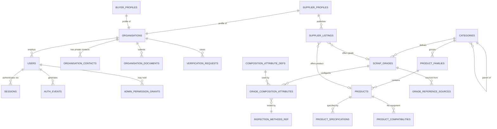

### 7.3 Domain B — lots, inspection and evidence

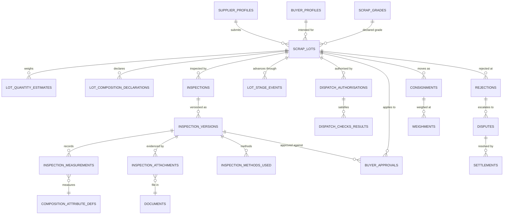

### 7.4 Domain C — enquiry to settlement, snapshots and audit

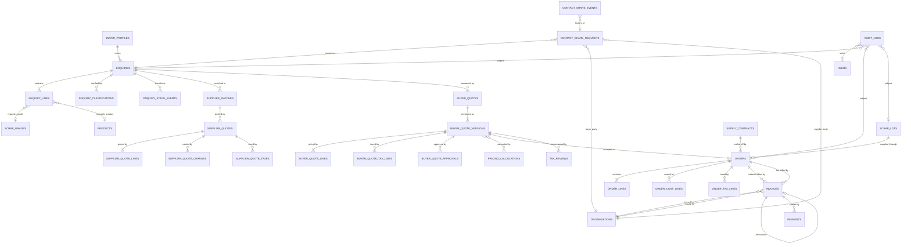

Two edges leave and re-enter `INVOICES`, and that is the whole of D5 in one picture: one order can
billion — no. One order can carry two documents, from two different issuers, and a re-invoicing
document points at the supplier's original. `ORDERS` now carries both `transaction_model` (D4) and `inventory_mode` (D6).

**Not in this diagram, deliberately:** `STOCK_POSITIONS` and `STOCK_MOVEMENTS`. They are deferred
past M7 and gated on owner authorisation (§15.8). An ERD that shows tables which do not exist is the
same defect as a screen that shows records which do not exist.

### 7.5 Domain D — content, SEO and locations

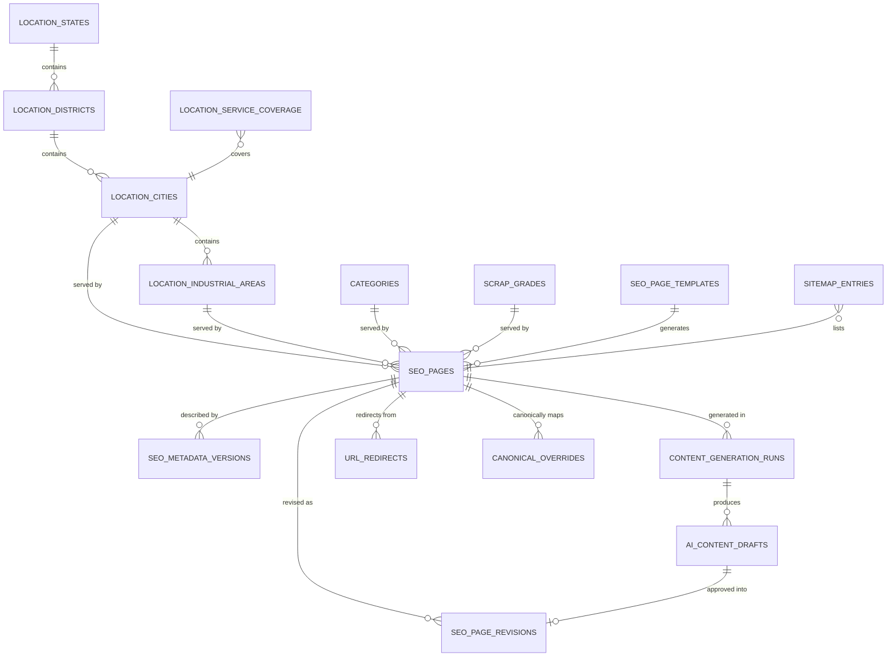

### 7.6 Relationship inventory (authoritative)

| Parent | Child | Cardinality | On delete |
|---|---|---|---|
| `organisations` | `users` | 1 : 0..n | RESTRICT |
| `organisations` | `organisation_contacts` | 1 : 0..n | CASCADE |
| `organisations` | `organisation_documents` | 1 : 0..n | RESTRICT |
| `categories` | `scrap_grades` | 1 : 0..n | RESTRICT |
| `categories` | `product_families` | 1 : 0..n | RESTRICT |
| `product_families` | `products` | 1 : 0..n | RESTRICT |
| `scrap_grades` | `grade_composition_attributes` | 1 : 0..n | CASCADE |
| `composition_attribute_defs` | `grade_composition_attributes` | 1 : 0..n | RESTRICT |
| `scrap_lots` | `inspections` | 1 : 0..n | RESTRICT |
| `inspections` | `inspection_versions` | 1 : 1..n | RESTRICT |
| `inspection_versions` | `inspection_measurements` | 1 : 0..n | CASCADE |
| `inspection_versions` | `inspection_attachments` | 1 : 0..n | CASCADE |
| `inspection_versions` | `buyer_approvals` | 1 : 0..n | RESTRICT |
| `scrap_lots` | `lot_stage_events` | 1 : 0..n | CASCADE |
| `scrap_lots` | `dispatch_authorisations` | 1 : 0..n | RESTRICT |
| `scrap_lots` | `rejections` | 1 : 0..n | RESTRICT |
| `rejections` | `disputes` | 1 : 0..n | RESTRICT |
| `disputes` | `settlements` | 1 : 0..n | RESTRICT |
| `enquiries` | `enquiry_lines` | 1 : 1..n | CASCADE |
| `enquiries` | `enquiry_stage_events` | 1 : 0..n | CASCADE |
| `enquiries` | `supplier_matches` | 1 : 0..n | RESTRICT |
| `supplier_matches` | `supplier_quotes` | 1 : 0..n | RESTRICT |
| `supplier_quotes` | `supplier_quote_lines` | 1 : 1..n | CASCADE |
| `enquiries` | `buyer_quotes` | 1 : 0..n | RESTRICT |
| `buyer_quotes` | `buyer_quote_versions` | 1 : 1..n | RESTRICT |
| `buyer_quote_versions` | `buyer_quote_lines` | 1 : 1..n | RESTRICT |
| `buyer_quote_versions` | `orders` | 1 : 0..1 | RESTRICT |
| `orders` | `order_cost_lines` | 1 : 0..n | RESTRICT |
| `orders` | `invoices` | 1 : 0..n | RESTRICT |
| `invoices` | `invoices` (counterparty) | 1 : 0..1 | RESTRICT |
| `organisations` | `invoices` (as issuer) | 1 : 0..n | RESTRICT |
| `organisations` | `invoices` (as recipient) | 1 : 0..n | RESTRICT |
| `supply_contracts` | `orders` | 1 : 0..n | RESTRICT |
| `buyer_quote_versions` | `tax_reviews` | 1 : 0..n | RESTRICT |
| `tax_treatments` | `tax_reviews` | 1 : 0..n | RESTRICT |
| `invoices` | `payments` | 1 : 0..n | RESTRICT |
| `location_states` | `location_districts` | 1 : 0..n | RESTRICT |
| `location_districts` | `location_cities` | 1 : 0..n | RESTRICT |
| `location_cities` | `location_industrial_areas` | 1 : 0..n | RESTRICT |
| `seo_pages` | `seo_page_revisions` | 1 : 0..n | RESTRICT |
| `seo_pages` | `url_redirects` | 1 : 0..n | CASCADE |
| `ai_content_drafts` | `seo_page_revisions` | 1 : 0..1 | RESTRICT |

**Rule [C].** `CASCADE` is permitted only for rows that are meaningless without their parent (a
quote line, an inspection measurement, a stage-event row). Anything financial, evidential or
auditable is `RESTRICT`: the database must refuse the delete rather than quietly lose a record.


## 8. Table catalogue — fields, types, relationships, indexes (R2)

### 8.1 Conventions

Part A §5.1 applies unchanged. Part B adds:

| Rule | Detail |
|---|---|
| Physical names | `snake_case` plural, Prisma `@@map`. Field names in the UI keep their shipped camelCase; only the storage layer differs. |
| Every table | `id uuid PK`, `created_at`, `updated_at` `timestamptz NN`. Insert-only tables carry `created_at` only. |
| Money | `numeric(18,2)`, **nullable, no default** — an unpriced amount is `NULL`, never `0` **[E]** |
| Percentage | `numeric(9,4)` — a value of 0.1 % is stored `0.1000`, and the column name says which bound it is (`max_pct` / `min_pct`) |
| Weight | `numeric(18,3)` kilograms canonical; the presentation unit is snapshotted alongside |
| Enum change | Append-only by migration. Renames need an explicit `ALTER TYPE … RENAME VALUE` and a data check |
| Index naming | `ix_<table>_<cols>`, partial indexes `ix_<table>_<cols>_<predicate>` |

### 8.2 New enumerations introduced by Part B

```text
category_kind             SCRAP | SPARE_PARTS                               [E]
publication_state         PUBLISHED | DRAFT | ARCHIVED                      [E]
price_mode                FIXED | REQUEST | BULK_TIERED                     [E]
transaction_model         PRINCIPAL | AGENCY | MANAGED_SUPPLY               [C — D4]
composition_basis         MIN | MAX | TARGET | RANGE                        [E]
composition_unit          PERCENT | PPM | MM | MICRON | COUNT | RATIO
inspection_method         VISUAL | CHEMICAL_ASSAY | XRF | LABORATORY |
                          MOISTURE | CONTAMINATION | FOREIGN_MATERIAL |
                          WEIGHT_VERIFICATION | DIMENSIONAL | PHOTO_DOCUMENTATION   [E]
inspection_recommendation PENDING | ACCEPT | REJECT | REINSPECT              [E]
buyer_approval_state      NOT_SHARED | AWAITING_REVIEW | APPROVED |
                          APPROVED_WITH_TOLERANCE | REJECTED |
                          FURTHER_INSPECTION_REQUESTED                       [E]
lot_stage                 SUPPLIER_SUBMISSION | INSPECTION | BUYER_REVIEW |
                          COMMERCIAL_CONFIRMATION | DISPATCH_AUTHORISATION |
                          DESTINATION_INSPECTION | CLOSED                    [E]
dispatch_state            NOT_READY | BLOCKED | AUTHORISED | DISPATCHED | DELIVERED  [E]
rejection_reason          GRADE_MISMATCH | COMPOSITION_OUT_OF_SPEC |
                          CONTAMINATION_EXCESS | MOISTURE_EXCESS |
                          FOREIGN_MATERIAL | WEIGHT_SHORTFALL |
                          DOCUMENTATION_DEFICIENT | LATE_DELIVERY |
                          DAMAGE_IN_TRANSIT | OTHER
resolution_option         ACCEPT_WITH_DEDUCTION | RETURN_TO_SUPPLIER |
                          REPLACE_LOT | REGRADE_AND_RENEGOTIATE |
                          REINSPECT_JOINTLY | REJECT_AND_REFUND
dispute_status            OPEN | UNDER_REVIEW | AWAITING_COUNTERPARTY |
                          RESOLVED | WITHDRAWN | ESCALATED
settlement_status         PENDING | PARTIALLY_SETTLED | SETTLED | WRITTEN_OFF
weighment_stage           SUPPLIER_SITE | DISPATCH | DESTINATION | JOINT
seo_page_type             CATEGORY | SCRAP_GRADE | PRODUCT | SERVICE | LOCATION_CITY |
                          LOCATION_DISTRICT | LOCATION_INDUSTRIAL_AREA | LOCATION_STATE | GUIDE
content_source            HUMAN | AI_ASSISTED | IMPORTED
content_review_state      UNREVIEWED | IN_REVIEW | APPROVED | REJECTED | PUBLISHED
coverage_level            SERVICED | PICKUP_ONLY | REFERRAL_ONLY | NOT_SERVICED
redirect_status_code      MOVED_PERMANENTLY_301 | MOVED_TEMPORARILY_302 | GONE_410
invoice_role              ANY | MATERIAL | COMMISSION | SERVICE_FEE | FREIGHT | OTHER   [C — D5]
                          -- ANY is an explicit non-null wildcard, never NULL (§15.5.2)
invoice_status            DRAFT | ISSUED | PARTIALLY_PAID | PAID | VOID | CREDITED    [C — D5]
inventory_mode            BACK_TO_BACK | STOCK                                       [C — D6]
tax_review_decision       APPROVED | ADJUSTED | REJECTED                             [C — D7]
migration_direction       UP | DOWN                                                [C — D8]
migration_run_status      PENDING | VALIDATED | APPLYING | APPLIED | FAILED |
                          ROLLED_BACK | FAULTED                                   [C — D8]
```

### 8.3 Group C — catalogue and configurable composition (R3)

```text
categories — the two shipped kinds, plus their presentation. One row per public catalogue page.
  id                  uuid        PK
  slug                text        NN UQ          -- /scrap-metals, /spare-parts  [E] must not change
  kind                category_kind NN
  name                text        NN
  short_description   text        NULL
  long_description    text        NULL
  hero_document_id    uuid        FK→documents NULL
  publication_state   publication_state NN default 'DRAFT'   [E]
  published_at        timestamptz NULL
  sort_order          int         NN default 0
  created_at/updated_at timestamptz NN
  IDX (kind, publication_state, sort_order) · UQ (slug)

product_families — groups products under a category (e.g. bearings, pumps, valves).
  id              uuid PK
  category_id     uuid FK→categories NN RESTRICT
  slug            text NN UQ
  name            text NN
  description     text NULL
  publication_state publication_state NN default 'DRAFT'
  sort_order      int  NN default 0
  IDX (category_id, publication_state, sort_order)

products — spare parts. Never a price, never a stock count on the public row.
  id                  uuid PK
  family_id           uuid FK→product_families NN RESTRICT
  slug                text NN UQ              -- /spare-parts/[slug]  [E]
  part_number         text NULL               -- may be unknown at intake
  alternate_numbers   text[] NN default '{}'  -- OEM cross-references
  brand               text NULL
  manufacturer        text NULL               -- NULL means unknown, and the UI says so
  title               text NN
  short_description   text NULL
  technical_specification text NULL           -- free text; structured specs in child table
  condition           product_condition NN default 'UNKNOWN'
  price_mode          price_mode NN default 'REQUEST'   [E]
  publication_state   publication_state NN default 'DRAFT'  [E]
  published_at        timestamptz NULL
  created_at/updated_at timestamptz NN
  deleted_at          timestamptz NULL
  IDX (family_id, publication_state) · IDX (brand, condition) · IDX (part_number)
  IDX (publication_state, published_at) · UQ (slug)

product_specifications — structured attributes, rows not columns.
  id          uuid PK
  product_id  uuid FK→products NN CASCADE
  attribute   text NN          -- "bore", "pressure rating", "voltage"
  value_text  text NN
  unit        text NULL
  sort_order  int  NN default 0
  IDX (product_id, sort_order)

product_compatibilities — "fits equipment X". Deliberately conservative: a claim, with a source.
  id               uuid PK
  product_id       uuid FK→products NN CASCADE
  equipment_make   text NN
  equipment_model  text NN
  fitment_type     text NN      -- DIRECT | EQUIVALENT | REQUIRES_ADAPTOR
  source_note      text NULL    -- who confirmed it; an unsourced fitment claim is not published
  verified_at      timestamptz NULL
  IDX (product_id) · IDX (equipment_make, equipment_model)

scrap_grades — the tradeable grade. Slug is a live SEO URL and must not change.
  id                  uuid PK
  category_id         uuid FK→categories NN RESTRICT
  slug                text NN UQ          -- /scrap-metals/[slug]  [E]
  code                text NN            -- internal short code, e.g. HMS-1
  name                text NN
  short_description   text NULL
  trade_description   text NULL
  typical_origin      text NULL
  hazard_class        text NULL
  default_price_mode  price_mode NN default 'REQUEST'   [E]
  publication_state   publication_state NN default 'DRAFT'  [E]
  published_at        timestamptz NULL
  created_at/updated_at timestamptz NN
  deleted_at          timestamptz NULL
  IDX (category_id, publication_state) · UQ (code) · UQ (slug)

composition_attribute_defs — the controlled vocabulary of measurable attributes.
  id            uuid PK
  symbol        text NN UQ          -- "Fe", "Cu", "Moisture", "Max dimension"
  name          text NN
  canonical_unit composition_unit NN
  is_elemental  boolean NN default true
  description   text NULL
  sort_order    int NN default 0
  IDX (sort_order)

grade_composition_attributes — per-grade configurable limits. This is the "configurable composition".
  id                  uuid PK
  grade_id            uuid FK→scrap_grades NN CASCADE
  attribute_id        uuid FK→composition_attribute_defs NN RESTRICT
  basis               composition_basis NN          [E]
  reference_min       numeric(12,6) NULL             -- stored in the attribute's canonical unit
  reference_max       numeric(12,6) NULL
  reference_target    numeric(12,6) NULL
  unit                composition_unit NN
  is_critical         boolean NN default false       -- a breach blocks dispatch (§14.1)
  tolerance_pct       numeric(9,4) NULL              -- commercial tolerance, agreed per grade
  source_note         text NULL                      -- buyer spec / supplier sheet / contract
  verification        verification_status NN default 'NOT_SUBMITTED'   [E]
  sort_order          int NN default 0
  IDX (grade_id, sort_order) · UQ (grade_id, attribute_id)
  CHECK (basis <> 'RANGE' OR (reference_min IS NOT NULL AND reference_max IS NOT NULL))
  CHECK (basis <> 'TARGET' OR reference_target IS NOT NULL)
  CHECK (reference_min IS NULL OR reference_max IS NULL OR reference_min <= reference_max)

grade_reference_sources — provenance for the limits above.
  id            uuid PK
  grade_id      uuid FK→scrap_grades NN CASCADE
  source_type   text NN     -- BUYER_SPEC | SUPPLIER_SHEET | CONTRACT | STANDARD | INTERNAL
  reference     text NULL   -- standard number or document
  document_id   uuid FK→documents NULL
  effective_from date NULL
  effective_to   date NULL
  IDX (grade_id, source_type)

inspection_methods_ref — reference list matching the shipped InspectionMethod values. [E]
  id         uuid PK
  key        inspection_method NN UQ
  label      text NN
  use_note   text NULL
  sort_order int NN default 0
```

**Validation rules (Group C).**

| Rule | Enforcement |
|---|---|
| A published grade must have at least one composition attribute or an explicit `declared-only` note | Application check at publish; a grade with no specification cannot be inspected against anything |
| `reference_min <= reference_max` and both in the attribute's canonical unit | CHECK constraint |
| `unit` must equal `composition_attribute_defs.canonical_unit` unless an explicit conversion factor is stored | Trigger or application guard |
| Slug is immutable once `publication_state = 'PUBLISHED'` | Trigger raises on update to `slug` where published |
| `products.technical_specification` may be `NULL` (unknown) but must never hold an invented value | Application; the wizard already offers "Unknown / not specified" **[E]** |
| A `product_compatibilities` row may not be published without `source_note` or `verified_at` | Application check |

### 8.4 Group D — parties and actual scrap lots (R4)

Part A defined `organisations`, `users`, `buyer`/`supplier` verification. Part B adds the profile
halves and the lot — the unit of trade.

```text
supplier_profiles — the sourcing side. One per supplier organisation.
  id                    uuid PK
  organisation_id       uuid FK→organisations NN UQ RESTRICT
  capabilities          text[] NN default '{}'   -- SCRAP | SPARE_PARTS | BOTH
  materials_handled     text[] NN default '{}'
  geographic_reach      text[] NN default '{}'   -- state codes
  monthly_capacity_kg   numeric(18,3) NULL
  has_weighbridge       boolean NULL
  has_testing_facility  boolean NULL
  payment_terms_days    int NULL
  verification          verification_status NN default 'NOT_SUBMITTED'  [E]
  rating_internal       numeric(3,2) NULL        -- internal only, never exposed
  notes_internal        text NULL                -- internal only
  created_at/updated_at timestamptz NN
  IDX (verification) · IDX (capabilities) USING GIN

buyer_profiles — the demand side.
  id                    uuid PK
  organisation_id       uuid FK→organisations NN UQ RESTRICT
  industries            text[] NN default '{}'
  preferred_grades      uuid[] NN default '{}'
  typical_monthly_kg    numeric(18,3) NULL
  delivery_states       text[] NN default '{}'
  credit_terms_days     int NULL
  credit_limit          numeric(18,2) NULL      -- internal only
  verification          verification_status NN default 'NOT_SUBMITTED'  [E]
  notes_internal        text NULL
  created_at/updated_at timestamptz NN
  IDX (verification) · IDX (industries) USING GIN

supplier_listings — a supplier's standing offer. Not a price, not stock.
  id              uuid PK
  supplier_id     uuid FK→supplier_profiles NN RESTRICT
  grade_id        uuid FK→scrap_grades NULL
  product_id      uuid FK→products NULL
  quantity_kg     numeric(18,3) NULL
  location_city_id uuid FK→location_cities NULL
  available_from  date NULL
  available_to    date NULL
  status          listing_status NN default 'DRAFT'   (Part A §5.2)
  notes           text NULL
  created_at/updated_at timestamptz NN
  IDX (supplier_id, status) · IDX (grade_id, status) · IDX (product_id, status)
  CHECK (grade_id IS NOT NULL OR product_id IS NOT NULL)

scrap_lots — ONE physical lot offered by ONE supplier, intended for ONE buyer context.
            The unit of inspection, approval, dispatch, dispute and settlement.
  id                    uuid PK
  reference             text NN UQ          -- LOT-2026-000123, immutable
  supplier_id           uuid FK→supplier_profiles NN RESTRICT
  buyer_id              uuid FK→buyer_profiles NULL RESTRICT      -- NULL while unallocated
  enquiry_id            uuid FK→enquiries NULL RESTRICT
  order_id              uuid FK→orders NULL RESTRICT
  grade_id              uuid FK→scrap_grades NN RESTRICT
  listing_id            uuid FK→supplier_listings NULL SET NULL
  declared_grade_text   text NULL           -- what the supplier called it, verbatim
  origin_location_id    uuid FK→location_cities NULL
  destination_location_id uuid FK→location_cities NULL
  stage                 lot_stage NN default 'SUPPLIER_SUBMISSION'   [E]
  stage_entered_at      timestamptz NN
  dispatch_state        dispatch_state NN default 'NOT_READY'        [E]
  declared_quantity_kg  numeric(18,3) NULL
  verified_quantity_kg  numeric(18,3) NULL  -- set only from a weighment or inspection
  quantity_tolerance_pct numeric(9,4) NULL
  supplier_rate         numeric(18,4) NULL  -- INTERNAL: procurement side
  buyer_rate            numeric(18,4) NULL  -- sale side; NULL until quoted
  currency_code         char(3) NN
  uom_code              text NN default 'KG'
  uom_factor            numeric(18,6) NN default 1.0
  transaction_model     transaction_model NN    [C — D4]
  risk_band             text NULL           -- LOW | MEDIUM | HIGH, drives inspection depth (§13)
  closed_at             timestamptz NULL
  created_at/updated_at timestamptz NN
  IDX (supplier_id, stage) · IDX (buyer_id, stage) · IDX (grade_id, stage)
  IDX (stage, stage_entered_at) · IDX (enquiry_id) · IDX (order_id) · UQ (reference)
  CHECK (declared_quantity_kg IS NULL OR declared_quantity_kg > 0)
  CHECK (stage <> 'CLOSED' OR closed_at IS NOT NULL)

lot_quantity_estimates — every weighing event, never overwritten. Supplier claim is not a measurement.
  id            uuid PK
  lot_id        uuid FK→scrap_lots NN CASCADE
  stage         weighment_stage NN
  quantity_kg   numeric(18,3) NN
  method        text NN          -- WEIGHBRIDGE | PLATFORM_SCALE | VISUAL_ESTIMATE | CERTIFIED
  measured_at   timestamptz NN
  measured_by_id uuid FK→users NULL
  weighment_document_id uuid FK→documents NULL
  is_estimate   boolean NN default false   -- VISUAL_ESTIMATE is an estimate and is labelled so
  notes         text NULL
  IDX (lot_id, stage, measured_at)
  CHECK (quantity_kg > 0)

lot_composition_declarations — what the supplier CLAIMED. A declaration, not a measurement. [E]
  id              uuid PK
  lot_id          uuid FK→scrap_lots NN CASCADE
  attribute_id    uuid FK→composition_attribute_defs NN RESTRICT
  declared_value  numeric(12,6) NULL
  declared_text   text NULL        -- free text when the supplier gives a range or a word
  unit            composition_unit NN
  source          text NULL        -- "supplier sheet", "verbal", "certificate"
  declared_at     timestamptz NN
  declared_by_id  uuid FK→users NULL
  IDX (lot_id) · UQ (lot_id, attribute_id)
```

**Validation rules (Group D).**

| Rule | Enforcement |
|---|---|
| A `scrap_lots` row may not reach `BUYER_REVIEW` without at least one `inspection_versions` row | §13.3 gate, enforced server-side |
| `verified_quantity_kg` is written only by inspection or weighment code paths, never by a form | Application service boundary |
| `supplier_rate` and `buyer_rate` are separate columns and never joined into a buyer or supplier DTO | DTO allow-list (Part A §4.2 layer 4) |
| A declared composition value may coexist with a measured one; they are different tables and are never merged | Schema separation |
| `risk_band` may not be `LOW` for a lot whose grade has `is_critical` attributes and no inspection | Application check at stage entry |

### 8.5 Group E — inspection, evidence and buyer approval (R5, R6)

```text
inspections — the inspection event for a lot. One lot may be inspected more than once.
  id                    uuid PK
  reference             text NN UQ        -- INS-2026-000045
  lot_id                uuid FK→scrap_lots NN RESTRICT
  location_city_id      uuid FK→location_cities NULL
  inspector_user_id     uuid FK→users NULL
  inspector_name        text NULL         -- external inspectors may have no account
  agency                text NULL         -- laboratory or third-party agency
  scheduled_for         timestamptz NULL
  inspected_on          timestamptz NULL
  status                text NN default 'PLANNED'  -- PLANNED | IN_PROGRESS | COMPLETED | CANCELLED
  current_version_no    int NN default 0
  created_at/updated_at timestamptz NN
  IDX (lot_id, inspected_on) · IDX (status, scheduled_for)

inspection_versions — INSERT-ONLY. A correction creates version n+1 and supersedes n.
                      Buyer approval is bound to one of these rows, never to the lot alone.
  id                    uuid PK
  inspection_id         uuid FK→inspections NN RESTRICT
  version_no            int NN
  supersedes_version_id uuid FK→inspection_versions NULL RESTRICT
  reason_for_version    text NOT NULL     -- CORRECTION | REINSPECTION | ADDITIONAL_TEST | APPEAL
  recommendation        inspection_recommendation NN default 'PENDING'   [E]
  declared_grade_id     uuid FK→scrap_grades NULL
  assessed_grade_id     uuid FK→scrap_grades NULL   -- may differ from declared: that is the point
  visual_findings       text NULL
  chemical_findings     text NULL
  xrf_findings          text NULL
  laboratory_findings   text NULL
  moisture_findings     text NULL
  contamination_findings text NULL
  foreign_material_findings text NULL
  weight_verification   text NULL
  remarks               text NULL
  media_count           int NN default 0
  is_current            boolean NN default true
  completed_at          timestamptz NULL
  created_by_id         uuid FK→users NN
  created_at            timestamptz NN
  IDX (inspection_id, version_no) · UQ (inspection_id, version_no)
  IDX (inspection_id) WHERE is_current
  CHECK (version_no >= 1)

inspection_measurements — the TESTED values, each provably tied to a method, a date and a report.
  id                uuid PK
  version_id        uuid FK→inspection_versions NN CASCADE
  attribute_id      uuid FK→composition_attribute_defs NN RESTRICT
  measured_value    numeric(12,6) NULL
  measured_text     text NULL
  unit              composition_unit NN
  method            inspection_method NN
  tested_on         date NULL
  agency            text NULL
  report_document_id uuid FK→documents NULL
  report_on_file    boolean NN default false
  outside_reference boolean NULL       -- computed against the grade's reference limits
  deviation_note    text NULL
  IDX (version_id, attribute_id)
  CHECK (measured_value IS NOT NULL OR measured_text IS NOT NULL)
  CHECK (report_on_file = false OR report_document_id IS NOT NULL)

inspection_methods_used — which methods the version actually applied. [E]
  id          uuid PK
  version_id  uuid FK→inspection_versions NN CASCADE
  method      inspection_method NN
  note        text NULL
  UQ (version_id, method)

inspection_attachments — the evidence set. Points at immutable documents.
  id           uuid PK
  version_id   uuid FK→inspection_versions NN CASCADE
  document_id  uuid FK→documents NN RESTRICT
  kind         text NN       -- PHOTO | LAB_REPORT | XRF_OUTPUT | WEIGHMENT_SLIP | VIDEO | CERTIFICATE
  caption      text NULL
  visible_to_buyer boolean NN default true   -- internal-only evidence is possible and labelled
  sort_order   int NN default 0
  IDX (version_id, sort_order) · IDX (document_id)

buyer_approvals — approval of a LOT against a SPECIFIC INSPECTION VERSION. (R6)
  id                   uuid PK
  lot_id               uuid FK→scrap_lots NN RESTRICT
  inspection_version_id uuid FK→inspection_versions NN RESTRICT   -- the evidence approved
  order_id             uuid FK→orders NULL RESTRICT
  buyer_id             uuid FK→buyer_profiles NN RESTRICT
  state                buyer_approval_state NN default 'NOT_SHARED'   [E]
  shared_at            timestamptz NULL
  reviewed_at          timestamptz NULL
  decided_at           timestamptz NULL
  decided_by_user_id   uuid FK→users NULL
  tolerance_pct        numeric(9,4) NULL     -- required when state = APPROVED_WITH_TOLERANCE
  tolerance_note       text NULL
  rejection_reason_id  uuid FK→rejection_reasons_ref NULL
  remarks              text NULL
  evidence_snapshot    jsonb NULL            -- the attachment ids + measurement hash shown to the buyer
  is_current           boolean NN default true
  created_at/updated_at timestamptz NN
  IDX (lot_id, is_current) · IDX (inspection_version_id) · IDX (buyer_id, state)
  CHECK (state <> 'APPROVED_WITH_TOLERANCE' OR tolerance_pct IS NOT NULL)
  CHECK (state <> 'REJECTED' OR rejection_reason_id IS NOT NULL)
```

**Validation rules (Group E) — the ones that carry legal weight.**

| Rule | Enforcement |
|---|---|
| **A new inspection version invalidates any approval bound to the old one.** `is_current` flips; the approval's `inspection_version_id` no longer matches the current version, so the dispatch gate fails | Application gate in §14.1 + partial unique index `(lot_id) WHERE is_current` on `buyer_approvals` |
| An approval may not be created against a version with `recommendation = 'REJECT'` | CHECK via trigger |
| An approval may not reference an inspection version belonging to a different lot | Composite FK or trigger |
| `evidence_snapshot` is written at share time and never updated — it records *what the buyer was actually shown* | Application; column excluded from all update paths |
| A measurement with `report_on_file = true` must reference a document | CHECK constraint |
| A measured value without `method` or `tested_on` is rejected | CHECK constraint |
| Declared and measured values are stored in different tables and are never summed, averaged or substituted | Schema separation; no view joins them as one "composition" |

That last rule implements the brief's "declared versus tested" requirement structurally: there is no
single column anywhere that could be read as "the" composition without naming which one it is.

### 8.6 Group F — dispatch, rejection, dispute and settlement (R8)

```text
dispatch_authorisations — the gate's verdict, recorded, with its overrides and reasons.
  id                  uuid PK
  lot_id              uuid FK→scrap_lots NN RESTRICT
  order_id            uuid FK→orders NULL RESTRICT
  buyer_approval_id   uuid FK→buyer_approvals NN RESTRICT   -- the approval this relies on
  state               dispatch_state NN default 'NOT_READY' [E]
  authorised_by_id    uuid FK→users NULL
  authorised_at       timestamptz NULL
  override_used       boolean NN default false
  override_reason     text NULL
  override_by_id      uuid FK→users NULL
  blocked_reason      text NULL
  checklist_snapshot  jsonb NN                -- the nine checks and their results at that moment
  created_at/updated_at timestamptz NN
  IDX (lot_id, state) · IDX (order_id)
  CHECK (state <> 'AUTHORISED' OR (authorised_by_id IS NOT NULL AND authorised_at IS NOT NULL))
  CHECK (override_used = false OR (override_reason IS NOT NULL AND override_by_id IS NOT NULL))

dispatch_check_results — one row per check per authorisation attempt. The nine shipped checks. [E]
  id                   uuid PK
  authorisation_id     uuid FK→dispatch_authorisations NN CASCADE
  check_key            text NN         -- inspection | evidence | approval | terms | tolerance |
                                        -- rejection | freight | weight | transporter
  passed               boolean NN
  blocking             boolean NN default true
  detail               text NULL
  evidence_document_id uuid FK→documents NULL
  UQ (authorisation_id, check_key)

consignments — the physical movement. One order may have several.
  id                   uuid PK
  reference            text NN UQ      -- CNS-2026-000012
  lot_id               uuid FK→scrap_lots NN RESTRICT
  order_id             uuid FK→orders NULL RESTRICT
  transporter_name     text NULL
  vehicle_number       text NULL
  driver_contact       text NULL       -- internal only
  eway_bill_number     text NULL
  dispatched_at        timestamptz NULL
  expected_arrival_at  timestamptz NULL
  delivered_at         timestamptz NULL
  status               shipment_status NN default 'PLANNED'
  created_at/updated_at timestamptz NN
  IDX (lot_id) · IDX (status, dispatched_at)

weighments — every weighing point, including the destination re-weigh that starts most disputes.
  id            uuid PK
  consignment_id uuid FK→consignments NULL CASCADE
  lot_id        uuid FK→scrap_lots NN RESTRICT
  stage         weighment_stage NN
  gross_kg      numeric(18,3) NULL
  tare_kg       numeric(18,3) NULL
  net_kg        numeric(18,3) NOT NULL
  weighed_at    timestamptz NN
  weighbridge_id text NULL
  document_id   uuid FK→documents NULL
  recorded_by_id uuid FK→users NULL
  IDX (lot_id, stage, weighed_at) · IDX (consignment_id)
  CHECK (net_kg > 0)
  CHECK (gross_kg IS NULL OR tare_kg IS NULL OR net_kg = gross_kg - tare_kg)

rejection_reasons_ref — reference list matching the shipped RejectionReason values. [E]
  id          uuid PK
  key         rejection_reason NN UQ
  label       text NN
  default_resolution resolution_option NULL
  sort_order  int NN default 0

rejections — a rejection event, at despatch site or destination. Never deletes a lot or an approval.
  id                    uuid PK
  reference             text NN UQ      -- REJ-2026-000007
  lot_id                uuid FK→scrap_lots NN RESTRICT
  order_id              uuid FK→orders NULL RESTRICT
  inspection_version_id uuid FK→inspection_versions NULL RESTRICT
  consignment_id        uuid FK→consignments NULL RESTRICT
  reason_id             uuid FK→rejection_reasons_ref NN RESTRICT
  stage_of_detection    lot_stage NN
  detected_at           timestamptz NN
  detected_by_id        uuid FK→users NULL
  buyer_id              uuid FK→buyer_profiles NULL
  supplier_id           uuid FK→supplier_profiles NULL
  quantity_kg           numeric(18,3) NULL
  evidence_summary      text NULL
  state                 text NN default 'OPEN'   -- OPEN | UNDER_REVIEW | RESOLVED | WITHDRAWN
  resolution_option     resolution_option NULL
  resolved_at           timestamptz NULL
  created_at/updated_at timestamptz NN
  IDX (lot_id, state) · IDX (order_id) · IDX (reason_id)
  CHECK (state <> 'RESOLVED' OR (resolution_option IS NOT NULL AND resolved_at IS NOT NULL))

disputes — formal escalation, with both sides' positions preserved verbatim.
  id                uuid PK
  reference         text NN UQ        -- DSP-2026-000003
  rejection_id      uuid FK→rejections NN RESTRICT
  opened_by_org_id  uuid FK→organisations NN RESTRICT
  against_org_id    uuid FK→organisations NULL RESTRICT
  status            dispute_status NN default 'OPEN'
  disputed_amount   numeric(18,2) NULL
  currency_code     char(3) NN
  claim_summary     text NULL
  counter_summary   text NULL
  assigned_to_id    uuid FK→users NULL
  opened_at         timestamptz NN
  due_at            timestamptz NULL
  resolved_at       timestamptz NULL
  outcome           text NULL
  created_at/updated_at timestamptz NN
  IDX (status, due_at) · IDX (rejection_id)

dispute_events — the negotiation trail. Insert-only; nothing is edited after the fact.
  id           uuid PK
  dispute_id   uuid FK→disputes NN CASCADE
  event_type   text NN       -- MESSAGE | EVIDENCE_ADDED | OFFER_MADE | OFFER_ACCEPTED |
                              -- ESCALATED | RESOLVED | WITHDRAWN
  actor_org_id uuid FK→organisations NULL RESTRICT
  actor_user_id uuid FK→users NULL
  body         text NULL
  document_id  uuid FK→documents NULL
  created_at   timestamptz NN
  IDX (dispute_id, created_at)

settlements — the money finally agreed. May differ from the quotation; that difference is recorded.
  id                    uuid PK
  reference             text NN UQ     -- SET-2026-000009
  order_id              uuid FK→orders NULL RESTRICT
  dispute_id            uuid FK→disputes NULL RESTRICT
  rejection_id          uuid FK→rejections NULL RESTRICT
  status                settlement_status NN default 'PENDING'
  basis                 text NN        -- DISPATCH_WEIGHT | DESTINATION_WEIGHT | AGREED_FIXED |
                                          DEDUCTION_APPLIED | HOLD
  settled_quantity_kg   numeric(18,3) NULL
  agreed_rate           numeric(18,4) NULL
  gross_amount          numeric(18,2) NULL
  deduction_amount      numeric(18,2) NULL
  deduction_reason      text NULL
  net_amount            numeric(18,2) NULL
  currency_code         char(3) NN
  approved_by_id        uuid FK→users NULL
  approved_at           timestamptz NULL
  settled_at            timestamptz NULL
  created_at/updated_at timestamptz NN
  IDX (order_id) · IDX (status) · IDX (settled_at)
  CHECK (net_amount IS NULL OR gross_amount IS NULL OR net_amount = gross_amount - COALESCE(deduction_amount,0))
  CHECK (status <> 'SETTLED' OR (approved_by_id IS NOT NULL AND settled_at IS NOT NULL))

orders — the commercial commitment. Part A and Part B both referenced this table; D6 forces its
         definition, because inventory_mode lives here.
  id                      uuid PK
  reference               text NN UQ           -- ORD-2026-000018
  buyer_quote_version_id  uuid FK→buyer_quote_versions NULL UQ RESTRICT  -- NULL for a stock buy
  supply_contract_id      uuid FK→supply_contracts NULL RESTRICT         -- MANAGED_SUPPLY only
  buyer_org_id            uuid FK→organisations NULL RESTRICT            -- NULL while STOCK
  supplier_org_id         uuid FK→organisations NULL RESTRICT
  enquiry_id              uuid FK→enquiries NULL RESTRICT
  transaction_model       transaction_model NN          [C — D4, frozen from the enquiry]
  inventory_mode          inventory_mode NN default 'BACK_TO_BACK'    [C — D6]
  status                  order_status NN default 'DRAFT'
  currency_code           char(3) NN
  goods_amount            numeric(18,2) NULL
  freight_amount          numeric(18,2) NULL
  tax_amount              numeric(18,2) NULL
  grand_total             numeric(18,2) NULL      -- the only total the buyer ever sees
  supplier_cost_total     numeric(18,2) NULL      -- INTERNAL
  margin_amount           numeric(18,2) NULL      -- INTERNAL, derived
  commission_amount       numeric(18,2) NULL      -- INTERNAL, AGENCY only
  tax_snapshot            jsonb NULL              -- §15.5.3, per component incl. invoice_role
  quotation_snapshot_id   uuid FK→quotation_snapshots NULL RESTRICT
  confirmed_at            timestamptz NULL
  version                 integer NN default 1    -- optimistic locking (§5.1)
  created_by_id           uuid FK→users NULL
  created_at/updated_at   timestamptz NN
  IDX (buyer_org_id, status) · IDX (supplier_org_id, status) · IDX (status, confirmed_at)
  IDX (transaction_model, inventory_mode)
  CHECK (inventory_mode <> 'STOCK'        OR buyer_org_id IS NULL)   -- owned stock has no buyer yet
  CHECK (inventory_mode <> 'BACK_TO_BACK' OR buyer_org_id IS NOT NULL)
  CHECK (status <> 'CONFIRMED' OR confirmed_at IS NOT NULL)
  CHECK (transaction_model <> 'AGENCY' OR commission_amount IS NOT NULL OR status = 'DRAFT')

invoices — ONE row per issued document. A deal may carry several, issued by different parties (D5).
  id                      uuid PK
  reference               text NN UQ      -- INV-2026-000021
  order_id                uuid FK→orders NN RESTRICT
  invoice_role            invoice_role NN -- MATERIAL | COMMISSION | SERVICE_FEE | FREIGHT | OTHER
  transaction_model       transaction_model NN     -- frozen from orders (D4)
  issuer_org_id           uuid FK→organisations NN RESTRICT
  recipient_org_id        uuid FK→organisations NN RESTRICT
  supplier_reference      text NULL       -- the supplier's own document number, when re-invoicing
  counterparty_invoice_id uuid FK→invoices NULL RESTRICT   -- links a material doc to its fee doc
  currency_code           char(3) NN
  subtotal_amount         numeric(18,2) NULL
  tax_total_amount        numeric(18,2) NULL
  total_amount            numeric(18,2) NULL
  tax_snapshot            jsonb NULL      -- §15.5.3, per component incl. invoice_role
  issued_at               timestamptz NULL
  due_at                  timestamptz NULL
  status                  invoice_status NN default 'DRAFT'
  document_id             uuid FK→documents NULL RESTRICT
  created_at/updated_at   timestamptz NN
  IDX (order_id, invoice_role) · IDX (recipient_org_id, status) · IDX (issuer_org_id, status)
  IDX (issued_at)
  CHECK (issuer_org_id <> recipient_org_id)
  CHECK (invoice_role <> 'COMMISSION' OR transaction_model <> 'PRINCIPAL')
  CHECK (status <> 'ISSUED' OR issued_at IS NOT NULL)

payments — money movement against one invoice, or on account.
  id                 uuid PK
  reference          text NN UQ          -- PAY-2026-000031
  invoice_id         uuid FK→invoices NULL RESTRICT    -- NULL = received on account
  order_id           uuid FK→orders NULL RESTRICT
  direction          payment_direction NN             -- RECEIVABLE | PAYABLE
  amount             numeric(18,2) NN
  currency_code      char(3) NN
  method             text NULL           -- NEFT | RTGS | UPI | CHEQUE | CASH | ADJUSTMENT
  bank_reference     text NULL
  received_at        timestamptz NN
  reconciled_at      timestamptz NULL
  reconciled_by_id   uuid FK→users NULL
  document_id        uuid FK→documents NULL
  created_at/updated_at timestamptz NN
  IDX (invoice_id) · IDX (order_id) · IDX (received_at) · IDX (direction, reconciled_at)
  CHECK (amount > 0)
```

**Invoice integrity — `issuer_is_primemet` is derived, never stored [C — D5 correction].**

A stored boolean would be a second source of truth for something already knowable from
`issuer_org_id`, and the two could disagree after a correction or an import. The flag is therefore
derived in one place, and PRIMEMET's identity is a property of the organisation row:

```sql
-- organisations gains: org_kind TEXT NN DEFAULT 'OTHER'  -- 'PRIMEMET' | 'SUPPLIER' | 'BUYER' | 'OTHER'
CREATE UNIQUE INDEX organisations_one_primemet_org
  ON organisations (org_kind) WHERE org_kind = 'PRIMEMET';   -- exactly one self organisation

CREATE VIEW v_invoice_classification AS
SELECT i.id, i.order_id, i.invoice_role, i.issuer_org_id,
       (o.org_kind = 'PRIMEMET')                                          AS issuer_is_primemet,
       (i.invoice_role = 'MATERIAL' AND o.org_kind <> 'PRIMEMET')         AS pass_through,
       (o.org_kind = 'PRIMEMET' AND i.invoice_role <> 'MATERIAL')         AS counts_as_primemet_revenue
FROM invoices i
JOIN organisations o ON o.id = i.issuer_org_id;
```

Consequences of deriving rather than storing:

1. `issuer_is_primemet`, `pass_through` and `counts_as_primemet_revenue` **cannot contradict** the
   issuer, because there is nothing to keep in sync — no trigger, no job, no transactional
   consistency problem. The user's concern about conflicting stored values is removed by construction.
2. Accounts receivable, ageing and the revenue line read **`v_invoice_classification`**, never
   `invoices` directly. A pass-through material document cannot be counted as PRIMEMET revenue.
3. The one-PRIMEMET-row guarantee is a partial unique index, so the join in the view is
   single-valued and cannot multiply rows.
4. `organisations.org_kind` is additive; existing `org_type` (`BUYER | SELLER | BOTH`) still
   describes the *counterparty* role and is unchanged (§26.1).

**Validation rules (Group F).**

| Rule | Enforcement |
|---|---|
| `state = 'AUTHORISED'` requires a passing result for **every blocking** check, or a recorded override with actor, reason and timestamp | Application gate + CHECK on the override triple |
| An authorisation is invalidated when the lot's current inspection version changes, or when the order's terms change | Gate re-evaluates `checklist_snapshot` against current rows; a stale snapshot blocks |
| `net_kg` must equal `gross_kg − tare_kg` when both are present | CHECK constraint |
| A settlement may not be `SETTLED` without approver and date | CHECK constraint |
| `dispute_events` and `settlements` are insert-only; resolution is a new row/state change with an audit entry | Part A §5.1 immutability + §16 |
| Resolving a rejection must choose one `resolution_option`; the affected monetary effect is recorded in `settlements`, never recomputed silently | Application |
| `invoice_role = 'COMMISSION'` may not appear on a `PRINCIPAL` order | CHECK constraint on `invoices` |
| An invoice's issuer and recipient may never be the same organisation | CHECK constraint |
| A pass-through material document never enters PRIMEMET's receivables, ageing or revenue | Read from `v_invoice_classification`; no stored flag exists that could drift from the issuer |
| A `STOCK` order has no buyer yet; a `BACK_TO_BACK` order must have one | Both are CHECK constraints on `orders` |
| An invoice's `transaction_model` is copied from its order and never re-entered by hand | Application on issue; mismatches rejected |
| An `AGENCY` order carries a commission once it leaves `DRAFT` | CHECK constraint on `orders` |

### 8.7 Group G — documents, pricing calculations, snapshots and audit (R10)

```text
documents — ONE row per stored file version. Immutable once uploaded. Part A referenced this table
            seven times without defining it; this is the definition.
  id                uuid PK
  storage_key       text NN UQ        -- opaque object key in the private bucket; never a public URL
  bucket            text NN
  original_filename text NN
  mime_type         text NN
  size_bytes        bigint NN
  checksum_sha256   text NN           -- integrity + duplicate detection
  document_type     document_type NN  (Part A §5.2)
  visibility        document_visibility NN default 'INTERNAL'   -- INTERNAL | BUYER_VISIBLE | SUPPLIER_VISIBLE
  sensitivity       text NN default 'NORMAL'  -- NORMAL | COMMERCIAL | PERSONAL | LEGAL
  owner_org_id      uuid FK→organisations NULL RESTRICT
  uploaded_by_id    uuid FK→users NULL
  scan_status       scan_status NN default 'PENDING'
  scan_result       text NULL
  retention_until   date NULL
  legal_hold        boolean NN default false
  superseded_by_id  uuid FK→documents NULL RESTRICT   -- versioning, never overwrite
  created_at        timestamptz NN     -- insert-only: no updated_at
  IDX (document_type, created_at) · IDX (owner_org_id) · IDX (scan_status)
  IDX (visibility) · UQ (storage_key) · IDX (checksum_sha256)
  CHECK (scan_status <> 'CLEAN' OR scan_result IS NOT NULL)
  CHECK (legal_hold = false OR retention_until IS NULL)

document_access_log — every signed-URL issue and download. Needed to answer "who saw this?".
  id              uuid PK
  document_id     uuid FK→documents NN RESTRICT
  user_id         uuid FK→users NULL
  org_id          uuid FK→organisations NULL
  action          text NN      -- SIGNED_URL_ISSUED | DOWNLOAD | VIEW | DENIED
  ip_hash         text NULL
  user_agent_hash text NULL
  purpose         text NULL    -- e.g. "buyer approval review"
  created_at      timestamptz NN
  IDX (document_id, created_at) · IDX (user_id, created_at)

pricing_rule_sets — versioned formula sets. Part A §5.4 defined components; this is the header.
  id              uuid PK
  key             text NN
  name            text NN
  version         int NN
  status          pricing_rule_status NN default 'DRAFT'
  currency_code   char(3) NN
  effective_from  timestamptz NN
  effective_to    timestamptz NULL
  approved_by_id  uuid FK→users NULL
  approved_at     timestamptz NULL
  created_at/updated_at timestamptz NN
  UQ (key, version) · IDX (status, effective_from)
  CHECK (status <> 'ACTIVE' OR (approved_by_id IS NOT NULL AND approved_at IS NOT NULL))

pricing_calculations — insert-only record of one engine run: inputs, outputs and the rule version.
  id                uuid PK
  rule_set_id       uuid FK→pricing_rule_sets NN RESTRICT
  subject_type      text NN       -- ENQUIRY_LINE | LOT | BUYER_QUOTE_VERSION | SUPPLIER_QUOTE
  subject_id        uuid NN
  inputs_snapshot   jsonb NN
  outputs_snapshot  jsonb NN
  rounding_applied  jsonb NULL
  engine_version    text NN
  computed_at       timestamptz NN
  computed_by_id    uuid FK→users NULL
  IDX (subject_type, subject_id) · IDX (computed_at)

quotation_snapshots — the immutable record of what a quotation said when it was issued. (R10)
  id                  uuid PK
  buyer_quote_version_id uuid FK→buyer_quote_versions NN UQ RESTRICT
  rendered_payload  jsonb NN       -- every field as issued, including tax and totals
  composition_snapshot jsonb NULL   -- grade limits in force at issue time
  price_basis_snapshot jsonb NULL   -- which rule set/version produced each figure
  tax_snapshot      jsonb NN        -- D3: type, rate, base, amount, jurisdiction, effective date
  document_id       uuid FK→documents NULL RESTRICT   -- the issued PDF, if rendered
  canonical_hash    text NN         -- sha-256 of rendered_payload, to prove it was not edited
  issued_at         timestamptz NN
  issued_by_id      uuid FK→users NN
  IDX (buyer_quote_version_id) · UQ (canonical_hash)

audit_logs — append-only. Part A §5.2 defined the enums; this is the table.
  id            uuid PK
  occurred_at   timestamptz NN
  actor_user_id uuid FK→users NULL
  actor_role    user_role NULL
  actor_ip_hash text NULL
  action        text NN          -- dot notation: enquiry.status_changed, quote.approved,
                                  -- contact_share.approved, tax_rule.retired, seo_page.published
  entity_type   text NN
  entity_id     uuid NULL
  before_state  jsonb NULL
  after_state   jsonb NULL
  severity      audit_severity NN default 'INFO'
  request_id    text NULL        -- correlates the request across logs
  created_at    timestamptz NN
  IDX (entity_type, entity_id, occurred_at) · IDX (actor_user_id, occurred_at)
  IDX (action, occurred_at) · IDX (severity, occurred_at)

audit_log_failures — writes that could not be persisted. Losing an audit row is itself an event.
  id           uuid PK
  attempted_at timestamptz NN
  payload      jsonb NN
  error        text NN
  resolved     boolean NN default false
  IDX (resolved, attempted_at)

migration_runs — one row per attempt to apply a versioned migration through the controlled runner.
                 D8/§29. Makes "who changed the schema, when, and did it work" answerable from inside
                 the product rather than from a developer's terminal. Closed once, never edited after.
  id                    uuid PK
  migration_id          text NN        -- the directory name, e.g. 20261102_add_invoice_role
  description           text NN        -- read from the migration's committed metadata.json, never operator input
  file_checksum_sha256  text NN        -- of the .sql actually executed: proves the reviewed file is the run file
  direction             migration_direction NN default 'UP'   -- DOWN only where a reversal was tested
  objects_affected      jsonb NN       -- tables/columns/indexes/constraints/views/functions touched
  destructive           boolean NN default false  -- drops, narrows or rewrites data
  requires_backup       boolean NN default true
  app_version           text NN        -- the deployed build that carried the file
  schema_before         text NULL      -- head of _prisma_migrations at attempt time
  schema_after          text NULL
  backup_verified       boolean NN default false
  backup_reference      text NULL      -- provider snapshot id, or a recorded manual attestation
  dry_run_result        jsonb NULL     -- captured validation/diff output before applying
  status                migration_run_status NN default 'PENDING'
  started_at            timestamptz NULL
  finished_at           timestamptz NULL
  duration_ms           int NULL
  error_code            text NULL
  error_detail          text NULL      -- sanitised: never SQL fragments, parameter values or row data
  applied_by_id         uuid FK→users NN RESTRICT
  approved_by_id        uuid FK→users NULL RESTRICT   -- second approver where required [R]
  request_id            text NULL
  created_at            timestamptz NN
  IDX (migration_id, started_at) · IDX (status, started_at) · IDX (applied_by_id, started_at)
  CHECK (status <> 'APPLIED' OR backup_verified OR NOT requires_backup)
  CHECK (status <> 'APPLIED' OR (finished_at IS NOT NULL AND schema_after IS NOT NULL))
  CHECK (status <> 'FAILED'  OR error_detail IS NOT NULL)
  CHECK (direction <> 'DOWN' OR destructive = false)   -- a reversal that loses data is not offered
  CHECK (status <> 'ROLLED_BACK' OR direction = 'DOWN')
```

**Validation rules (Group G).**

| Rule | Enforcement |
|---|---|
| No `UPDATE` on `audit_logs`, `quotation_snapshots`, `document_access_log`, `pricing_calculations` | Revoked at the database role level, in addition to application discipline |
| A snapshot's `canonical_hash` must match a recomputation of `rendered_payload` on read; a mismatch is a `CRITICAL` audit event | Application verification on every reprint |
| A document may never be overwritten: a new version is a new row with `superseded_by_id` set on the old one | Application + no `UPDATE` of `storage_key`/`checksum` |
| `documents.visibility = 'INTERNAL'` must never appear in any buyer or supplier DTO | DTO allow-list; a `document` served to a buyer is checked against visibility *and* ownership |
| Every signed URL issue writes a `document_access_log` row, including `DENIED` | Application service; the only place URLs are minted |
| A `migration_runs` row is written **before** the first statement runs and closed exactly once afterwards; a crashed attempt leaves `APPLYING` or `FAULTED`, never nothing | Runner writes the row first and updates only the terminal transition; no `DELETE` grant |
| `file_checksum_sha256` must match the committed file the operator reviewed | Runner recomputes the checksum at execution and refuses on mismatch |

### 8.8 Group H — SEO, locations, generated content and publication (R13, R14, R15)

```text
location_states — the top of the geography tree. Internal, drives coverage and tax jurisdiction.
  id          uuid PK
  code        text NN UQ       -- ISO 3166-2 subdivision, e.g. "MH"
  name        text NN
  country_code char(2) NN
  tax_region_code text NULL    -- joins to tax rules (§15.5); a state is a tax jurisdiction input
  is_serviced boolean NN default false
  IDX (country_code, is_serviced)

location_districts — an intermediate administrative grouping. Exists because buyers search by it.
  id         uuid PK
  state_id   uuid FK→location_states NN RESTRICT
  code       text NULL
  name       text NN
  slug       text NN
  IDX (state_id, name) · UQ (state_id, slug)

location_cities — the primary serviceable unit.
  id            uuid PK
  district_id   uuid FK→location_districts NN RESTRICT
  name          text NN
  slug          text NN
  latitude      numeric(9,6) NULL
  longitude     numeric(9,6) NULL
  population    int NULL
  is_serviced   boolean NN default false
  IDX (district_id, name) · UQ (district_id, slug) · IDX (is_serviced)

location_industrial_areas — the unit an industrial buyer actually recognises. Highest SEO value.
  id           uuid PK
  city_id      uuid FK→location_cities NN RESTRICT
  name         text NN
  slug         text NN
  area_type    text NULL    -- MIDC | SEZ | INDUSTRIAL_ESTATE | CLUSTER | PORT_ZONE
  notes        text NULL
  is_serviced  boolean NN default false
  IDX (city_id, name) · UQ (city_id, slug) · IDX (is_serviced)

location_service_coverage — how PRIMEMET actually serves a place. Prevents false coverage claims.
  id             uuid PK
  city_id        uuid FK→location_cities NN RESTRICT
  coverage_level coverage_level NN default 'NOT_SERVICED'
  min_pickup_kg  numeric(18,3) NULL
  lead_time_days int NULL
  notes          text NULL
  effective_from date NN
  effective_to   date NULL
  IDX (coverage_level) · UQ (city_id, effective_from)

seo_page_templates — the shape of a programmatic page family. Content is composed, not invented.
  id              uuid PK
  key             text NN UQ        -- location_city_scrap_grade, industrial_area_service...
  page_type       seo_page_type NN
  title_pattern   text NN           -- "{grade} scrap collection in {city} | PRIMEMET"
  description_pattern text NN
  h1_pattern      text NN
  required_facts  text[] NN default '{}'  -- data that must exist before the page may publish
  is_active       boolean NN default true
  IDX (page_type, is_active)

seo_pages — one row per addressable public page. Static pages and generated pages share the table.
  id               uuid PK
  path             text NN UQ        -- canonical path, no trailing slash, lowercase
  page_type        seo_page_type NN
  template_id      uuid FK→seo_page_templates NULL RESTRICT
  category_id      uuid FK→categories NULL RESTRICT
  grade_id         uuid FK→scrap_grades NULL RESTRICT
  product_id       uuid FK→products NULL RESTRICT
  state_id         uuid FK→location_states NULL
  district_id      uuid FK→location_districts NULL
  city_id          uuid FK→location_cities NULL
  industrial_area_id uuid FK→location_industrial_areas NULL
  publication_state publication_state NN default 'DRAFT'   [E]
  robots_index     boolean NN default true
  robots_follow    boolean NN default true
  canonical_path   text NULL         -- set only when this page must point elsewhere
  is_published     boolean NN default false
  published_at     timestamptz NULL
  first_indexed_at timestamptz NULL
  last_reviewed_at timestamptz NULL
  priority         numeric(2,1) NN default 0.5
  change_frequency text NN default 'MONTHLY'
  created_at/updated_at timestamptz NN
  IDX (page_type, publication_state) · IDX (city_id, grade_id) · IDX (is_published, published_at)
  UQ (path)
  CHECK (publication_state <> 'PUBLISHED' OR is_published = true)

seo_page_revisions — content versions. A published revision is never edited in place.
  id             uuid PK
  seo_page_id    uuid FK→seo_pages NN RESTRICT
  version_no     int NN
  title          text NN
  meta_description text NN
  h1             text NN
  body_markdown  text NN
  content_source content_source NN default 'HUMAN'
  review_state   content_review_state NN default 'UNREVIEWED'
  reviewed_by_id uuid FK→users NULL
  reviewed_at    timestamptz NULL
  published_at   timestamptz NULL
  created_by_id  uuid FK→users NULL
  created_at     timestamptz NN
  UQ (seo_page_id, version_no)
  IDX (seo_page_id, published_at)
  CHECK (review_state <> 'APPROVED' OR reviewed_by_id IS NOT NULL)

seo_metadata_versions — per-page metadata beyond title/description: OG, schema, hreflang.
  id           uuid PK
  seo_page_id  uuid FK→seo_pages NN RESTRICT
  version_no   int NN
  og_title     text NULL
  og_description text NULL
  og_document_id uuid FK→documents NULL
  structured_data jsonb NULL       -- JSON-LD as stored, validated before publish
  hreflang     text NULL
  created_at   timestamptz NN
  UQ (seo_page_id, version_no)

content_generation_runs — one AI-assisted generation attempt, with the prompt and the model.
  id              uuid PK
  seo_page_id     uuid FK→seo_pages NULL RESTRICT
  template_id     uuid FK→seo_page_templates NULL
  model_name      text NN
  prompt_hash     text NN
  prompt_excerpt  text NULL          -- never full secrets; the prompt is stored redacted
  input_facts     jsonb NN           -- the data the model was allowed to use
  token_count     int NULL
  cost_amount     numeric(18,4) NULL
  status          text NN default 'SUCCEEDED'  -- SUCCEEDED | FAILED | BLOCKED
  created_by_id   uuid FK→users NULL
  created_at      timestamptz NN
  IDX (seo_page_id, created_at)

ai_content_drafts — model output. Never published directly; it must become a reviewed revision.
  id             uuid PK
  run_id         uuid FK→content_generation_runs NN CASCADE
  seo_page_id    uuid FK→seo_pages NULL
  title          text NN
  meta_description text NN
  body_markdown  text NN
  facts_used     jsonb NN           -- which input facts each claim rests on
  unverified_claims text[] NN default '{}'   -- anything the model asserted without a source
  review_state   content_review_state NN default 'UNREVIEWED'
  published_revision_id uuid FK→seo_page_revisions NULL
  created_at     timestamptz NN
  IDX (review_state, created_at)

url_redirects — permanent record of every path that once existed. Needed to preserve SEO.
  id            uuid PK
  from_path     text NN UQ
  to_path       text NN
  status_code   redirect_status_code NN default 'MOVED_PERMANENTLY_301'
  reason        text NULL
  created_by_id uuid FK→users NULL
  created_at    timestamptz NN
  hit_count     bigint NN default 0
  is_active     boolean NN default true
  IDX (is_active) · UQ (from_path)
  CHECK (from_path <> to_path)

canonical_overrides — deliberate canonicalisation decisions, with a reason.
  id           uuid PK
  seo_page_id  uuid FK→seo_pages NN RESTRICT
  canonical_path text NN
  reason       text NN
  created_by_id uuid FK→users NULL
  created_at   timestamptz NN
  UQ (seo_page_id)

sitemap_entries — what is expected to be in the sitemap, and when it was last verified.
  id            uuid PK
  seo_page_id   uuid FK→seo_pages NN RESTRICT
  included      boolean NN default true
  last_built_at timestamptz NULL
  last_status   int NULL           -- HTTP status observed at the last check
  IDX (included, last_built_at)
```

**Validation rules (Group H).**

| Rule | Enforcement |
|---|---|
| A page may not publish unless every `required_facts` entry for its template resolves to real data | Publish gate against `seo_page_templates.required_facts` |
| `robots_index = false` and `is_published = true` may coexist (a live page kept out of search); the inverse is not allowed | Application; drafting rule in §21.4 |
| A location page requires `location_service_coverage.coverage_level = 'SERVICED'` or an explicit disclosure block | Prevents publishing "scrap collection in <city>" for a city PRIMEMET does not serve |
| AI output may not be published without `review_state = 'APPROVED'` and a `reviewed_by_id` | CHECK + workflow |
| `ai_content_drafts.unverified_claims` must be empty before approval | Application check |
| Changing a published `path` requires a `url_redirects` row in the same transaction | Trigger or service-level transaction |
| Every published page keeps at least one immutable `seo_page_revisions` row | No delete; `RESTRICT` |

### 8.9 Consolidated validation checklist

| # | Rule | Where enforced |
|---|---|---|
| 1 | No `float`/`double` anywhere; money `numeric(18,2)` nullable with no default | Schema review, CI grep |
| 2 | Approved quotation versions and orders carry an immutable tax snapshot | §16.4 |
| 3 | Buyer approval is bound to a lot **and** an inspection version | §12.2, §14.1 |
| 4 | A new inspection version invalidates prior approval | §11.5 |
| 5 | Supplier cost, margin, commission and internal notes never enter a buyer/seller DTO | §18.2 |
| 6 | Contact details never appear in a public response; sharing is an approved event | §18.3 |
| 7 | Quantities positive; `net = gross − tare` | CHECK constraints |
| 8 | Dispatch requires every blocking check, or an audited override | §14.1 |
| 9 | Audit log is append-only and failure to write it is itself logged | §16.6 |
| 10 | Documents are immutable, scanned before release and never overwritten | §18.4 |
| 11 | Unpriced amounts are `NULL`, never `0` | §6.7 |
| 12 | Declared and measured composition never share a column | §8.5 |
| 13 | Slugs are immutable once published | §21.5 |
| 14 | Redirect written whenever a published path changes | §21.5 |
| 15 | No page claims coverage that `location_service_coverage` does not support | §20.4 |
| 16 | An invoice's issuer alone determines who holds the receivable; no stored flag can disagree | §8.6 — derived view |
| 17 | At most one `ACTIVE` tax rule per canonical scope and period; ambiguity fails closed | §15.5.2 |
| 18 | A quotation flagged for tax review cannot be approved without a `tax_reviews` row naming that version | §15.5.4 |
| 19 | A `STOCK` order has no buyer yet; a `BACK_TO_BACK` order must have one | CHECK constraints on `orders` |
| 20 | `INTERMEDIARY` is never stored; the column holds `PRINCIPAL` / `AGENCY` / `MANAGED_SUPPLY` only | §15.6 |
| 21 | No interface accepts SQL text for execution; the runner executes committed files only, identified by `migration_id` | §29.4, §29.5 |
| 22 | Every schema change exists as a committed migration with a checksum, before it is applied anywhere | §29.3 |
| 23 | A migration may create reference rows, never a business record | §24.2 step 19 |
| 24 | Routine data permission and structural permission never meet in one grant by default | §17.2, §29.4 |

## 9. Category, product, scrap grade and configurable composition models (R3)

### 9.1 Why composition is rows, not columns

A grade is not "steel with 0.3 % copper". It is a set of limits, each with a basis, a unit, a
tolerance, a criticality and a provenance. Manufacturers change their specification; buyers add
elements; a lab reports a different unit. If composition were columns (`cu_pct`, `fe_pct`, …),
every one of those events would be a schema migration and a deploy.

**[E]** The frontend already models composition this way: `CompositionAttribute` in
`src/lib/content/catalogue.ts` has `symbol`, `basis`, `referenceMin/Max/Target`, `source`,
`declared`, `measured`, `method`, `testedOn`, `agency`, `reportOnFile`, `verification`. The schema
in §8.3 splits that one frontend object across three tables on purpose:

| Frontend field **[E]** | Stored in | Why separate |
|---|---|---|
| `symbol`, `name`, `unit` | `composition_attribute_defs` | Controlled vocabulary, reused across grades |
| `basis`, `referenceMin/Max/Target`, `source`, `verification` | `grade_composition_attributes` | The *specification* for this grade |
| `declared` | `lot_composition_declarations` | What the supplier claimed about *this lot* |
| `measured`, `method`, `testedOn`, `agency`, `reportOnFile` | `inspection_measurements` | What was actually tested, on *this inspection version* |

Splitting them is the core of the "declared versus tested" requirement: `declared` and `measured`
are never the same column, so no screen or report can accidentally present one as the other.

### 9.2 The four catalogue models

```text
Category  ──< Product family ──< Product ──< Product specification
    │                                └────< Product compatibility
    └──< Scrap grade ──< Grade composition attribute ──> Composition attribute definition
```

| Model | Identity | Public URL | Distinct because |
|---|---|---|---|
| `categories` | `SCRAP` or `SPARE_PARTS` | `/scrap-metals`, `/spare-parts` | Two fundamentally different buyer intents; already two routes **[E]** |
| `product_families` | grouped parts | none (internal grouping and breadcrumbs) | Parts group by equipment function, not chemistry |
| `products` | one part, one slug | `/spare-parts/[slug]` **[E]** | Identified by part number/brand, quoted per piece |
| `scrap_grades` | one grade, one slug | `/scrap-metals/[slug]` **[E]** | Identified by composition, quoted per tonne |

### 9.3 The configurable composition model in use

A worked example, using shapes already present in the frontend:

| Attribute | Basis | Min | Max | Unit | Critical | Tolerance | Source |
|---|---|---|---|---|---|---|---|
| Fe | `MIN` | 99.0000 | — | PERCENT | yes | 0.5000 | Buyer-agreed reference |
| Cu | `MAX` | — | 0.2000 | PERCENT | yes | 0.0500 | Buyer-agreed reference |
| Moisture | `MAX` | — | 1.0000 | PERCENT | yes | 0.1000 | Supplier sheet |
| Foreign material | `MAX` | — | 0.5000 | PERCENT | no | 0.1000 | Internal |
| Max dimension | `MAX` | — | 1500.000000 | MM | no | — | Buyer spec |

Four consequences follow, and each is a design decision:

1. **Adding an element is data entry.** No migration, no deploy.
2. **A unit mismatch is detectable.** `unit` must equal the definition's canonical unit, or a
   conversion factor must be stored explicitly (§8.3).
3. **Criticality drives the dispatch gate.** A breach of an `is_critical` attribute blocks dispatch
   unless an override is recorded (§14.1).
4. **A range may be unknown.** `basis`, limits and tolerance may all be `NULL` for an attribute
   that has never been specified; the UI then says "not specified" rather than inventing a value.

### 9.4 Avoiding the duplicate catalogue the brief warns about

**[O-9.4]** There are currently **two** admin screens describing the same domain:
`/admin/materials` (built in Stage 1) and `/admin/catalogue` (built in the catalogue/QA phase).
This is exactly the duplication the brief prohibits. The schema resolves it: there is one
`scrap_grades` table and one set of composition tables, so both screens must read the same
structure. The *navigation* duplication is a UI decision for the owner:

| Option | Effect |
|---|---|
| Keep both, split by function **[R]** | `/admin/catalogue` becomes the grade and composition editor; `/admin/materials` becomes the material reference library. Explicit titles, one link between them. |
| Merge into one screen | Cleaner, but discards working UI from the catalogue/QA phase |

**Recommendation:** keep both, split by function, and rename `/admin/materials` to "Reference library"
so a user cannot mistake one for the other. No schema impact either way.

### 9.5 Sale-side versus procurement-side fields

Per D1, each grade row carries commercial fields on **both** sides. They must never be joined into
one DTO:

| Column | Audience | DTO included in |
|---|---|---|
| `scrap_lots.supplier_rate` | Internal | `admin` only |
| `scrap_lots.buyer_rate` | Sale side | `admin`, and `buyer` once quoted |
| `grade_composition_attributes.tolerance_pct` | Commercial | `admin`, `buyer` (it is the buyer's protection) |
| `buyer_profiles.credit_limit`, `notes_internal` | Internal | `admin` only |
| `supplier_profiles.rating_internal`, `notes_internal` | Internal | `admin` only |

## 10. Supplier, buyer and actual scrap lot models (R4)

### 10.1 Three levels, three lifespans

| Level | Table | Lifespan | Mutability |
|---|---|---|---|
| Standing commercial record | `organisations` + `supplier_profiles` / `buyer_profiles` | Permanent | Editable, audited |
| Standing offer | `supplier_listings` | Until withdrawn | Editable while `DRAFT`/`ACTIVE` |
| **Actual physical lot** | `scrap_lots` | Permanent historical record | Facts locked once inspected |

**[C]** The distinction that matters legally: an enquiry line is a *requirement*, a supplier listing
is an *offer to supply*, and a `scrap_lots` row is *specific material that was inspected and
approved*. Only the last may be dispatched, rejected, disputed or settled. Quotations price
requirements; transactions trade lots.

### 10.2 The lot lifecycle and what locks when

| Event | Locks |
|---|---|
| First `inspections` row created | `grade_id`, `supplier_id`, `declared_quantity_kg` become history (changes need a new lot or an audited correction) |
| First `inspection_versions` row | That version is immutable; corrections create n+1 |
| `buyer_approvals` decided | The approval row is immutable; a new approval supersedes it (`is_current`) |
| `dispatch_authorisations` = `AUTHORISED` | The checklist snapshot and the approval it relied on are frozen |
| `rejections` raised | The lot's stage is frozen pending resolution |
| `settlements` = `SETTLED` | All monetary fields on the chain are frozen |

**[R]** A lot is never deleted. An erroneous lot is closed (`stage = 'CLOSED'`, `closed_at`) with a
`CLOSED_AS_ERROR` resolution and an audit entry, so the record of the mistake survives.

### 10.3 Supplier and buyer profile rules

| Rule | Reason |
|---|---|
| A profile row is required before any lot, listing or enquiry may reference the party | Prevents orphan transactions |
| `verification` must be `VERIFIED` before a lot may enter `DISPATCH_AUTHORISATION` | An unverified supplier cannot be paid; an unverified buyer cannot be billed reliably |
| Contact fields live in `organisation_contacts`, not on the profile | D2: disclosure must be an event, not a column |
| `rating_internal` and all `notes_internal` are excluded from every non-admin DTO | Confidential commercial judgement |
| A party may see their own lots, listings and approvals — never the counterparty's | Repository scoping (Part A §4.2 layer 3) |

## 11. Inspection records, declared versus tested, report versioning (R5)

### 11.1 The three states of a specification value

At any moment, for any attribute on any lot, there are exactly three possible truths. The schema
keeps them in three different places so they cannot be confused:

| State | Stored in | UI wording **[E]** |
|---|---|---|
| Specified — what was agreed | `grade_composition_attributes` | "Reference: max 0.20 %" |
| Declared — what the supplier said | `lot_composition_declarations` | "Declared by supplier: 0.18 %" |
| Measured — what testing found | `inspection_measurements` | "Tested: 0.22 % (XRF, 12 Mar, report on file)" |

A measured value that carries no `method`, no `tested_on`, or `report_on_file = false` is not
"tested" in any meaningful sense and the UI labels it "reported, report not on file".

### 11.2 The `InspectionMethod` values are already fixed

**[E]** `INSPECTION_METHODS` in `catalogue.ts` defines `VISUAL`, `CHEMICAL_ASSAY`, `XRF`,
`LABORATORY`, `MOISTURE`, `CONTAMINATION`, `FOREIGN_MATERIAL`, `WEIGHT_VERIFICATION`. The enum in
§8.2 matches it exactly and adds only `DIMENSIONAL` and `PHOTO_DOCUMENTATION`, which the shipped
inspection record already has fields for (`visual`, `chemical`, `xrf`, `laboratory`, `moisture`,
`contamination`, `foreignMaterial`, `weightVerification`, `media`). The frontend's flat fields map
to `inspection_versions` columns of the same meaning; its `methods[]` array maps to
`inspection_methods_used` rows.

### 11.3 Why inspections and inspection versions are separate tables

An `inspections` row is an *event* ("we inspected this lot on 12 March"). An `inspection_versions`
row is a *documented state of knowledge*. They separate because the same event legitimately
produces more than one documented state:

| Reason | Creates version |
|---|---|
| Transcription error in a value | n+1, `CORRECTION` |
| Re-inspection after a failed test | n+1, `REINSPECTION` |
| Additional test ordered by the buyer | n+1, `ADDITIONAL_TEST` |
| Appeal against a rejection | n+1, `APPEAL` |

Version rules **[C]**:

1. Versions are **insert-only**. There is no update path for a completed version.
2. Exactly one version per inspection has `is_current = true` (partial unique index).
3. `supersedes_version_id` forms a chain; a broken chain is a data defect and is reported.
4. Attachments and measurements belong to a version, never to the inspection, so evidence cannot
   silently attach to the wrong state of knowledge.

### 11.4 Evidence integrity

| Requirement | Design |
|---|---|
| Evidence cannot be swapped after the buyer saw it | `buyer_approvals.evidence_snapshot` records the attachment ids and a measurement hash at share time |
| Evidence cannot be altered | `documents` are immutable with a SHA-256 checksum; a replacement is a new row with `superseded_by_id` |
| A lab report must be provable | `inspection_measurements.report_document_id` + `report_on_file` boolean, both surfaced in the UI |
| Media count matches reality | `inspection_versions.media_count` is derived from `inspection_attachments`, not typed |
| Who saw what, and when | `document_access_log` records every signed URL issue |

### 11.5 Invalidation cascade — the rule that makes approval meaningful

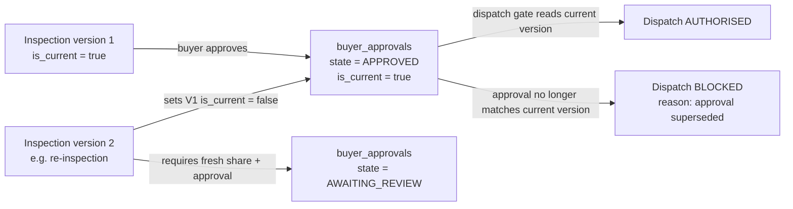

**[C]** No approval survives a new inspection version. This is deliberately strict: it prevents the
failure mode where a lot is re-tested unfavourably and shipped on an old approval.

## 12. Buyer approval bound to lot and inspection evidence (R6)

### 12.1 What approval means, precisely

An approval records: **this buyer** accepted **this lot** against **this inspection version**, at
**this time**, with **this tolerance**, having been shown **this evidence set**.

**[E]** The shipped states are `NOT_SHARED`, `AWAITING_REVIEW`, `APPROVED`,
`APPROVED_WITH_TOLERANCE`, `REJECTED`, `FURTHER_INSPECTION_REQUESTED`. The schema keeps all six.

### 12.2 The binding constraints

| Constraint | Mechanism |
|---|---|
| Approval names one lot | `lot_id` NOT NULL |
| Approval names one inspection version | `inspection_version_id` NOT NULL |
| The version must belong to that lot | Composite FK `(lot_id, inspection_version_id)` → unique index on `inspection_versions` |
| Approval is invalid once the version is superseded | Gate compares `inspection_version_id` with the current version |
| Only one current approval per lot | Partial unique index `(lot_id) WHERE is_current` |
| Tolerance is mandatory when approving with tolerance | CHECK |
| Rejection requires a reason | CHECK |
| Approval cannot be given against a `REJECT` recommendation | Trigger |

### 12.3 State machine

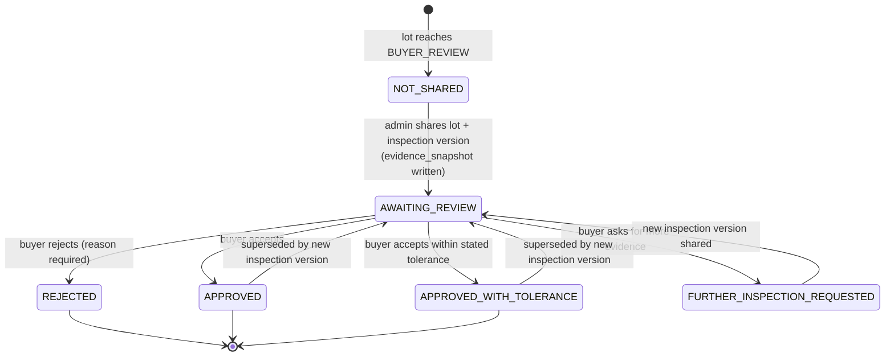

Note the two return transitions from an approved state: they exist **only** as the invalidation
cascade of §11.5, and they never occur without a new inspection version.

### 12.4 Who may do what

| Actor | May share | May approve | May override |
|---|---|---|---|
| Buyer | no | own organisation's lots only | no |
| Seller | no | no | no |
| Admin (`SOURCING_OPS_ADMIN`+) | yes | records the buyer's decision | no |
| Admin (`SUPER_ADMIN`) | yes | yes | dispatch override only, with reason (§14.1) |

**[C]** An Admin records a buyer's decision; an Admin does not approve *on behalf of* a buyer without
recorded evidence of that decision (email, signed document, portal action). That evidence reference
goes in `remarks` or as a `document_id`, and the audit entry names both the decider and the recorder.

## 13. Seven-stage quality and transaction workflow (R7)

### 13.1 The stages are fixed and already published

**[E]** `/quality-assurance` publishes seven stages; `WORKFLOW_STAGES` and `STAGE_REQUIREMENTS` in
`catalogue.ts` define them with the records each requires, and `DISPATCH_CHECKS` defines the nine
blocking checks. The database must not rename or reorder them, because that would contradict live
copy. `lot_stage` and `dispatch_check_results.check_key` mirror them exactly.

| # | `lot_stage` | Owner | Must record before leaving |
|---|---|---|---|
| 1 | `SUPPLIER_SUBMISSION` | Sourcing | Supplier, declared grade, declared quantity, origin |
| 2 | `INSPECTION` | QA | Inspection record, methods used, measurements, evidence |
| 3 | `BUYER_REVIEW` | Desk | Evidence shared, buyer approval against a version |
| 4 | `COMMERCIAL_CONFIRMATION` | Commercial | Model, rate, weight basis, payment terms, tax treatment |
| 5 | `DISPATCH_AUTHORISATION` | Operations | All nine dispatch checks or an audited override |
| 6 | `DESTINATION_INSPECTION` | Operations | Dispatch weighment, transporter, arrival weighment |
| 7 | `CLOSED` | Commercial | Destination acceptance, final settlement |

### 13.2 Lot state machine

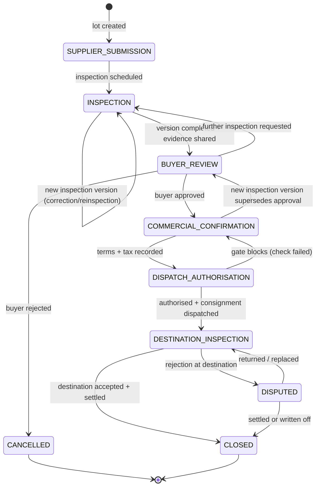

### 13.3 Entry conditions (server-enforced, not advisory)

| Transition | Blocking condition | Failure behaviour |
|---|---|---|
| `SUPPLIER_SUBMISSION` → `INSPECTION` | Declared quantity and grade present | Reject with field-level errors |
| `INSPECTION` → `BUYER_REVIEW` | A completed `inspection_versions` row with `is_current` | Stage unchanged |
| `BUYER_REVIEW` → `COMMERCIAL_CONFIRMATION` | `buyer_approvals` = `APPROVED` or `APPROVED_WITH_TOLERANCE` against the **current** version | Stage unchanged; reason shown |
| `COMMERCIAL_CONFIRMATION` → `DISPATCH_AUTHORISATION` | Model, rate, weight basis, payment terms; tax snapshot resolvable | Stage unchanged |
| `DISPATCH_AUTHORISATION` → `DESTINATION_INSPECTION` | All nine checks pass, or override with actor/reason; approval still current; supplier and buyer verified | `dispatch_state = BLOCKED`, blocking reasons listed |
| `DESTINATION_INSPECTION` → `CLOSED` | Arrival weighment + acceptance + settlement row | Stage unchanged |
| any → `DISPUTED` | A `rejections` row exists | — |

**[C]** Every transition writes a `lot_stage_events` row and an `audit_logs` row in the same
transaction as the state change. A stage change that cannot be audited does not happen.

### 13.4 Enquiry versus lot — two machines, one deal

The brief asks for state transitions on both. They are different because they answer different
questions: the enquiry machine tracks *commercial intent*, the lot machine tracks *physical goods*.

| Enquiry (`enquiry_status`, Part A §5.5) | Corresponding lot stage |
|---|---|
| `NEW`, `UNDER_REVIEW` | lot may not exist yet |
| `MATCHING_SUPPLIERS`, `QUOTES_REQUESTED`, `QUOTES_RECEIVED`, `COMPARING_QUOTES` | lot at `SUPPLIER_SUBMISSION` / `INSPECTION` |
| `QUOTE_DRAFTED`, `QUOTE_SENT`, `NEGOTIATION` | lot at `BUYER_REVIEW` / `COMMERCIAL_CONFIRMATION` |
| `WON` | lot proceeds to `DISPATCH_AUTHORISATION` |
| `LOST`, `CANCELLED` | lot closed or returned to supplier |

**Rule [C].** An enquiry may be `WON` only when an order exists; an order may be created only from
an `ACCEPTED` buyer quote version. The enquiry machine never advances on a verbal confirmation.

## 14. Dispatch authorisation, rejection, disputes and settlement (R8)

### 14.1 The dispatch gate

**[E]** Nine blocking checks are already published. The gate is a **hard** gate: `BLOCKED` is a
state, not a warning.

| Check key | Passes when | Blocks because |
|---|---|---|
| `inspection` | A completed current inspection version exists | Dispatch stays blocked until an inspection record exists |
| `evidence` | Evidence was shared and `buyer_approvals.shared_at` is set | Approval cannot be requested on unseen evidence |
| `approval` | A current approval matches the current inspection version | A re-inspection invalidates approval |
| `terms` | Model, rate, weight basis, payment terms recorded | Undocumented terms are unenforceable |
| `tolerance` | Tolerance documented for the grade or the approval | Undocumented tolerance is an undocumented deduction |
| `rejection` | Rejection procedure and return-freight bearer recorded | Disputes become unbounded otherwise |
| `freight` | Outbound and return freight responsibility recorded | Money leaks |
| `weight` | Dispatch weighment recorded | Arrival comparison has no baseline |
| `transporter` | Vehicle, carrier and documents recorded | Goods become untraceable |

**Override [O-14.1].** The shipped copy allows "an override with reason and audit record". Whether
any override should exist at all is a business decision:

| Option | Consequence |
|---|---|
| No override, ever **[R]** | Simplest to defend; a check that fails is a fix, not a waiver |
| `SUPER_ADMIN` only, reason required, expiry 24 h | Matches current copy; needs `override_reason`, `override_by_id`, `override_expires_at` |
| Any Admin with permission | Weakest; not recommended |

**[R]** Recommendation: `SUPER_ADMIN` only, with reason and the affected check keys recorded
individually, so the override names precisely what was waived.

### 14.2 Rejection

A rejection is an **event with evidence**, never a deletion. The schema keeps the lot, the approval,
the inspection version and the consignment intact so the dispute is arguable months later.

| Field | Why it is required |
|---|---|
| `reason_id` | Drives resolution options and reporting |
| `stage_of_detection` | A despatch-site rejection and a destination rejection have different cost bearers |
| `inspection_version_id` | The state of knowledge at the time |
| `quantity_kg` | Rejections are frequently partial |
| `evidence_summary` | Narrative for the counterparty |

### 14.3 Resolution and disputes

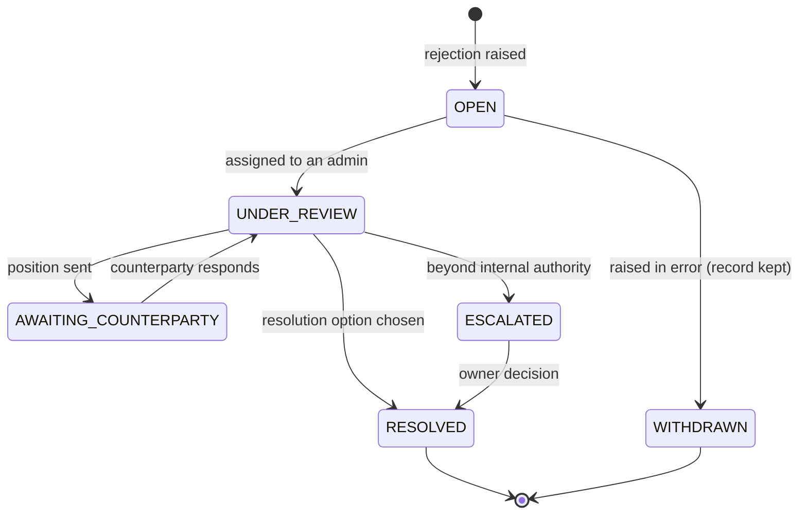

| `resolution_option` **[E]** | Commercial effect |
|---|---|
| `ACCEPT_WITH_DEDUCTION` | `settlements.deduction_amount` + reason; buyer billed net |
| `RETURN_TO_SUPPLIER` | Consignment returned; return freight bearer per `terms` check |
| `REPLACE_LOT` | New `scrap_lots` row linked via `enquiry_id`; original closed |
| `REGRADE_AND_RENEGOTIATE` | `assessed_grade_id` changes; re-quotation from a **new** quote version |
| `REINSPECT_JOINTLY` | New inspection version with both parties' inspectors recorded |
| `REJECT_AND_REFUND` | Settlement holds; payment reversal recorded |

**Rule [C].** A resolution never edits an issued quotation. If money changes, a new quote version
or a settlement adjustment is created, so the original remains provable (§16).

### 14.4 Settlement

Settlement is where the desk either makes its margin or discovers it did not. Three rules protect
that:

1. **Basis must be explicit** (`DISPATCH_WEIGHT`, `DESTINATION_WEIGHT`, `AGREED_FIXED`,
   `DEDUCTION_APPLIED`, `HOLD`). Silent re-weighting is the single most common dispute.
2. **Both sides settle separately.** Supplier settlement and buyer settlement are distinct
   `settlements` rows; in `AGENCY` the supplier may be paid directly.
3. **Net must reconcile:** `net = gross − deduction`, enforced by CHECK.

## 15. Transaction models: PRINCIPAL, AGENCY, MANAGED_SUPPLY (R9)

### 15.1 Status of this section

The enum values are **fixed by decision D4**: `PRINCIPAL | AGENCY | MANAGED_SUPPLY`, with
`INTERMEDIARY` retained only as a legacy alias for `AGENCY` (§15.6). The accounting questions that
Part A carried as O-15.4a and O-15.4b are **closed structurally** by D5 and D6; only the tax and
invoicing *policy* behind them remains with the accountant (§15.5, §27).

### 15.2 Three flows, one opportunity record

| Dimension | `PRINCIPAL` | `AGENCY` | `MANAGED_SUPPLY` |
|---|---|---|---|
| Money flow | PRIMEMET buys, then sells | PRIMEMET facilitates, earns fee/commission | PRIMEMET contracts to supply over time |
| Revenue line | `marginAmount` = sale − procurement | `commissionAmount` + service fee | Margin per call-off + service fee |
| Title | Passes to PRIMEMET | Does not pass to PRIMEMET | Per contract terms |
| Supplier invoice | To PRIMEMET | To buyer direct, or a PRIMEMET pass-through document **[D5 — §15.7]** | To PRIMEMET |
| Buyer invoice | Sales invoice, full value | Fee/commission, plus reimbursed freight | Sales invoice per call-off or per period |
| Inventory | `inventory_mode = STOCK` records owned stock; `BACK_TO_BACK` does not **[D6 — §15.8]** | None | Committed volume, not owned stock |
| Risk held | Price, quality, credit | Credit (limited), reputational | Price within committed band |
| Tax on | Full sale value | Commission/service value | Sale value per call-off |
| Documents issued | One sales invoice | Material document **plus** fee document, possibly different issuers **[D5]** | One sales invoice per call-off or period |
| Same table? | Yes — `enquiries.transaction_model`, `orders.transaction_model` | Yes | Yes + a `supply_contracts` link |

### 15.3 The `MANAGED_SUPPLY` addition

**[R]** Managed supply is a *repeating* arrangement, so it needs one additional header that the other
two models do not. It should not be modelled as a flag on an enquiry:

```text
supply_contracts — proposed; only for MANAGED_SUPPLY          [R]
  id                  uuid PK
  reference           text NN UQ        -- SMC-2026-000004
  buyer_id            uuid FK→buyer_profiles NN
  supplier_id         uuid FK→supplier_profiles NULL
  grade_id            uuid FK→scrap_grades NN
  committed_kg_per_month numeric(18,3) NULL
  price_basis         text NN            -- INDEX_LINKED | FIXED_PERIOD | FORMULA
  price_reference     text NULL
  review_cadence      text NN            -- MONTHLY | QUARTERLY
  service_level       text NULL          -- lead time, response time
  starts_on / ends_on date
  status              text NN default 'DRAFT'
  created_at/updated_at timestamptz NN
```

Each call-off creates an ordinary `orders` row with `transaction_model = 'MANAGED_SUPPLY'` and a
`supply_contract_id`, so reporting and settlement reuse the existing flow rather than a second one.

### 15.4 Accounting questions carried from Part A — now resolved

Each question below is closed at the level of *structure*. The policy that sits inside the structure
stays open, and is tracked separately in §27 so that "we have a table for it" is never mistaken for
"the accountant has ruled on it".

| ID | Question | Decision | What remains open |
|---|---|---|---|
| **[D5]** (was O-15.4a) | In `AGENCY`, does the supplier invoice the buyer directly, or invoice PRIMEMET who re-invoices? | Material invoicing and PRIMEMET's commission/service invoicing are **separate documents in one table**, each naming its own issuer. Both supplier-direct and PRIMEMET pass-through arrangements are supported by data, not by a code branch (§15.7). | **Policy [O-15.4a-P]:** which arrangement applies, and the GST/ITC treatment of each. Accountant, before M5. |
| **[D6]** (was O-15.4b) | In `PRINCIPAL`, is stock ever held, or pass-through only? | **Both are supported as one subtype field**, `orders.inventory_mode = BACK_TO_BACK | STOCK`. Back-to-back is prioritised and is the default; `STOCK` stays inoperable until the stock tables are authorised (§15.8). | None structural. Enabling `STOCK` needs owner authorisation and migration 20. |
| **[D4]** (was O-15.4c) | Is Sourcing & Procurement a transaction model or a service line? | A **service line**, recorded on `enquiries.service_line`, carrying no settlement behaviour (§6.6). | None. |

**[O-15.5]** is not closed by any of these. The tax *policy* — which component applies to which
model, at what rate, in which jurisdiction, and whether reverse charge or TDS ever applies — remains
entirely with the accountant. D7 changes only how such answers are *stored*.

### 15.5 Tax — transaction-specific, snapshot on record (D3, extended by D7)

No GST rate, no component applicability and no legal conclusion is hardcoded or asserted anywhere in
this document. The engine resolves rules from data at calculation time and freezes the outcome. What
D7 fixes is **how an answer is stored**, never **what the answer is**.

```text
tax_components_ref — the component list as data, not an enum. Seeded in migration 19. [D7]
  code            text PK          -- GST | IGST | CGST | SGST | UTGST | VAT | SALES_TAX |
                                   -- CESS | TDS | TCS | OTHER
  name            text NN
  is_statutory    boolean NN
  applies_at      tax_applies_to NN
  sort_order      smallint NN default 0
  active          boolean NN default true
  created_at/updated_at timestamptz NN
  UQ (code)

  Seeding this list states only that these component names exist. It does not state that any of
  them applies to PRIMEMET, to any model, or at any rate — that is tax_rules data and stays open.

tax_rules — data, not code.
  id                  uuid PK
  code                text NN
  component_code      text FK→tax_components_ref NN     [D7 — replaces tax_component_type]
  jurisdiction_state_id uuid FK→location_states NULL   -- NULL = national fallback
  invoice_role        invoice_role NN default 'ANY'    [D7 — never NULL, see 15.5.2]
  applies_to          tax_applies_to NN                 -- PURCHASE | SALE | BOTH
  transaction_model   transaction_model NULL            -- NULL = all models
  hsn_sac_code        text NULL
  rate_pct            numeric(9,4) NN
  taxable_base_rule   tax_base_rule NN
  includes_freight    boolean NN default false
  reverse_charge      boolean NN default false
  threshold_amount    numeric(18,2) NULL
  effective_from      date NN
  effective_to        date NULL
  status              tax_rule_status NN default 'DRAFT'
  approved_by_id      uuid FK→users NULL
  approved_at         timestamptz NULL
  legal_reference     text NULL        -- notification / circular cited
  created_at/updated_at timestamptz NN
  IDX (component_code, transaction_model, invoice_role, jurisdiction_state_id, effective_from)
  IDX (status, effective_from)
  CHECK (status <> 'ACTIVE' OR (approved_by_id IS NOT NULL AND approved_at IS NOT NULL))
  CHECK (rate_pct >= 0 AND rate_pct <= 100)
  CHECK (effective_to IS NULL OR effective_to >= effective_from)

tax_treatments — a named combination applied to one transaction and one document role.
  id                   uuid PK
  code                 text NN
  name                 text NN
  transaction_model    transaction_model NN
  applies_to           tax_applies_to NN
  invoice_role         invoice_role NN default 'ANY'      [D7]
  jurisdiction_state_id uuid FK→location_states NULL
  rule_ids             uuid[] NN       -- may span roles; the snapshot records which applied
  requires_admin_review boolean NN default true
  status               tax_rule_status NN default 'DRAFT'
  effective_from       date NN
  effective_to         date NULL
  created_at/updated_at timestamptz NN
```

#### 15.5.2 Overlap protection, and why `NULL` cannot be the wildcard (D7) **[C]**

Three columns can mean "applies to everything": `invoice_role`, `transaction_model` and
`jurisdiction_state_id`. A `NULL` in an exclusion constraint **cannot** express that, and the reason
is worth stating plainly:

> A GiST `=` operator treats `NULL` as distinct from every value — including from another `NULL`.
> Two `ACTIVE` rows that both leave `invoice_role` as `NULL` would therefore **never conflict**, and
> the constraint would silently permit exactly the duplicate it exists to prevent.

So `NULL` is not a wildcard here; it is a hole. The wildcard dimensions are canonicalised
differently, and the asymmetry is deliberate:

| Dimension | Representation | Why |
|---|---|---|
| `invoice_role` | **`NOT NULL`** enum carrying an explicit `ANY` sentinel | The role is a document-scoping concept that owns its own enum, so a sentinel pollutes nothing and removes `NULL` semantics from the constraint entirely |
| `transaction_model` | `NULL` allowed, wrapped in `COALESCE(…, 'ALL')` **inside the index expression** | It is the same business enum used by `enquiries` and `orders`; adding an `ALL` value there would corrupt real transactions |
| `jurisdiction_state_id` | `NULL` allowed, wrapped in `COALESCE(…, zero-uuid)` **inside the index expression** | `NULL` means "national fallback", which is a real and meaningful state |
| Date period | `daterange(effective_from, COALESCE(effective_to, 'infinity'), '[]')` | `&&` on a range is what makes an overlap an overlap |

The constraint is hand-written SQL, because Prisma cannot express `EXCLUDE`:

```sql
-- Migration 6, before any tax_rules row exists. Requires: CREATE EXTENSION IF NOT EXISTS btree_gist;
ALTER TABLE tax_rules
  ADD CONSTRAINT tax_rules_active_scope_no_overlap
  EXCLUDE USING gist (
    component_code                                 WITH =,
    COALESCE(transaction_model::text, 'ALL')       WITH =,
    invoice_role                                   WITH =,
    COALESCE(jurisdiction_state_id, '00000000-0000-0000-0000-000000000000') WITH =,
    daterange(effective_from, COALESCE(effective_to, 'infinity'::date), '[]') WITH &&
  )
  WHERE (status = 'ACTIVE');
```

**What this buys, exactly.** No two `ACTIVE` rows with the **same canonical scope** may overlap in
time. Two `ANY` rows for the same component, model and jurisdiction cannot both be active — which is
the duplicate that would silently double a rate.

**What it deliberately does not do.** A wildcard row and a specific row have different keys, so they
are *permitted* to coexist, and they must be: "this component applies generally" plus "freight is
treated differently" is a legitimate configuration. Coexistence is resolved by **documented
precedence** in the engine, not by the constraint:

1. a state-specific rule wins over the national fallback;
2. then the most specific `transaction_model` over `NULL`;
3. then a specific `invoice_role` over `ANY`;
4. if **more than one** rule survives all three filters, the engine raises `TAX_RULE_AMBIGUOUS` and
   refuses to price the document. It never picks one arbitrarily.

That fail-closed step is the real guarantee against ambiguous pricing; the exclusion constraint only
removes mechanical duplicates. Neither guarantee is sufficient alone.

**Migration consequences.** `btree_gist` must exist before the constraint (top of the same migration).
`transaction_model::text` and the `daterange` constructor must both be immutable for an index
expression — verified at M1 (§24.6). Because the constraint lives in hand-written SQL, `prisma migrate
dev` will not regenerate it from `schema.prisma`, and `prisma db pull` would surface it as drift; it is
therefore re-asserted by the constraint-verification step (§24.2, step 18) and re-tested every
migration (§24.6). A `prisma migrate reset` restores it only because it replays the migration file,
never because the schema declares it.

#### 15.5.3 Snapshot requirement (D3, extended by D7) **[C]**

`buyer_quote_versions.tax_snapshot` and `orders.tax_snapshot` store, as immutable JSON, **per
component**: `component_code`, `invoice_role`, `transaction_model`, `treatment_id`, `rule_id`,
`rate_pct`, `taxable_base_rule`, `base_amount`, `tax_amount`, `jurisdiction_state_id`,
`legal_reference`, `effective_from`, `calculated_at`. A rate change tomorrow never alters what a
quotation said last month, because a reprint reads the snapshot and never the rule table.

Recording the **role and the model per component** is what makes D5 auditable: one order can carry a
material-document tax line and a fee-document tax line, each with its own provenance.

#### 15.5.4 Admin review before a quotation is approved (D7) **[C]**

Tax must be reviewable, and the review must attach to the exact version that was approved — not to
"the quotation" in general:

```text
tax_reviews — insert-only. One row per review of one quote version's tax.
  id                      uuid PK
  buyer_quote_version_id  uuid FK→buyer_quote_versions NN RESTRICT
  treatment_id            uuid FK→tax_treatments NULL RESTRICT
  decision                tax_review_decision NN   -- APPROVED | ADJUSTED | REJECTED
  reviewed_by_id          uuid FK→users NN
  reviewed_at             timestamptz NN
  notes                   text NULL
  tax_snapshot            jsonb NN                 -- what the reviewer saw, frozen
  created_at              timestamptz NN
  IDX (buyer_quote_version_id) · IDX (reviewed_by_id, reviewed_at)
  CHECK (decision <> 'APPROVED' OR reviewed_by_id IS NOT NULL)
```

Nullability is the rule: a quote version whose treatment carries `requires_admin_review = true`
**cannot** reach `APPROVED` without a `tax_reviews` row naming that exact version. The table is
insert-only; a correction is a new review, and both stay visible.

#### 15.5.5 What remains open — [O-15.5]

Which component applies to which model, at what rate, in which jurisdiction, and whether reverse
charge, ITC or TDS ever applies — **all of it remains with the accountant.** This document inserts no
rate row, no treatment row and no legal conclusion, and neither should migration 19. The structure
above accepts any answer the accountant gives; it does not anticipate one.

### 15.6 Legacy mapping: `INTERMEDIARY` → `AGENCY` (D4)

| Legacy term | Stored value | Where it may still appear |
|---|---|---|
| `INTERMEDIARY` | `AGENCY` | Historical imports, spreadsheets and old screenshots only |
| Sourcing & Procurement | *(not a stored model)* `enquiries.service_line` | Marketing and reporting copy |

No production data exists, so this is a **code-level alias, not a data migration**. A future import
adapter must translate the value before insert; the database never accepts it (§24.3).

### 15.7 Agency document flows (D5)

```text
AGENCY order ─┬─ material document   issuer: SUPPLIER  → recipient: BUYER
              │                       invoice_role = MATERIAL
              │                       pass-through: PRIMEMET never owned the goods
              └─ fee document        issuer: PRIMEMET   → recipient: BUYER
                                      invoice_role = COMMISSION | SERVICE_FEE
              both point at the same order_id; counterparty_invoice_id links the pair
```

1. **Two documents, one deal.** Material billing and PRIMEMET's commission/service billing are
   separate `invoices` rows, each naming its own `issuer_org_id` and `invoice_role`.
2. **Both arrangements are data, not code.** Supplier-direct invoicing and PRIMEMET pass-through
   differ only in `issuer_org_id` and `supplier_reference`, with `pass_through` derived from the
   issuer rather than stored (§8.6) — which is what keeps [O-15.4a-P] a policy question rather than a
   build.
3. **Receivable exposure is single-valued and derived.** PRIMEMET holds a receivable only where the
   issuer is PRIMEMET's own organisation. A pass-through material document never enters PRIMEMET's
   ageing, revenue line or debtor report (§8.6).
4. **Nothing internal leaks across the pair.** The buyer sees the material document and the fee
   document; the supplier sees neither the buyer's fee amounts nor PRIMEMET's commission; the
   commission is `INTERNAL` and appears in no supplier or buyer DTO.
5. **`transaction_model` freezes before the first document is issued** (§3.2). Changing it afterwards
   would restate tax on documents already sent.

### 15.8 Inventory modes — `BACK_TO_BACK` and `STOCK` (D6)

`orders.inventory_mode` separates the two ways a principal deal can settle. It is **a subtype, not a
fourth transaction model**: the model says how money and title flow, the mode says whether PRIMEMET
held the goods.

| Mode | Meaning | Margin basis | Status |
|---|---|---|---|
| `BACK_TO_BACK` *(default)* | Sourced against a confirmed buyer order; PRIMEMET never holds stock | `sale − procurement` on the matched lot | **Prioritised for launch** |
| `STOCK` | PRIMEMET buys into owned inventory and issues from it | `issue price − weighted-average cost at issue` | **Deferred** until stock is authorised |

```text
orders.inventory_mode   inventory_mode NN default 'BACK_TO_BACK'
inventory_mode          BACK_TO_BACK | STOCK                        [C — D6]

CHECK (inventory_mode <> 'STOCK'        OR buyer_org_id IS NULL)    -- owned stock has no buyer yet
CHECK (inventory_mode <> 'BACK_TO_BACK' OR buyer_org_id IS NOT NULL)
```

`STOCK` needs two tables that are **deliberately not created in Milestone 1**: `stock_positions`
(grade, location, quantity, weighted-average cost) and `stock_movements` (receipt, issue, adjustment;
insert-only). Both are scheduled as migration 20, gated on owner authorisation.

Deferring rather than pre-creating empty tables follows the same rule as Stage 1's refusal of
placeholder records: an empty inventory table invites someone to fill it with plausible numbers, and
inventory figures nobody counted are worse than no inventory feature at all. `STOCK` therefore refuses
to activate until those tables exist — a guard, not a promise.

## 16. Historical quotation snapshots and audit logs (R10)

### 16.1 Why a snapshot, when the versions already exist

A version table records *the row as it was*. It does not record: which pricing rule version
produced each figure, which grade limits were in force, which tax rules applied, or what the buyer
actually received as a document. `quotation_snapshots` records all four, plus a hash proving the
payload was not edited after issue.

### 16.2 What is frozen, and when

| Moment | Frozen |
|---|---|
| Buyer quote version approval | The version row, its lines, its tax lines |
| Quote issuance | `quotation_snapshots.rendered_payload`, `canonical_hash`, `issued_at`, `issued_by_id` |
| Order confirmation | The order's tax snapshot and the quote version it came from |
| Settlement | All monetary fields on the order chain |

### 16.3 Proof of non-tampering

On every reprint or dispute review, the application recomputes `sha-256(rendered_payload)` and
compares it with `canonical_hash`. A mismatch is a `CRITICAL` audit event, blocks the reprint, and
is investigated. This is a cheap control that catches an application bug before it becomes a
commercial dispute.

### 16.4 Tax snapshot payslip

The snapshot is the answer to "why did this invoice say this?". It must be human-readable in an
admin view: component, invoice role, transaction model, rate, base, amount, jurisdiction, rule
reference, effective date. The shipped quotation screens already surface a tax-snapshot block **[E]**;
the database gives it something real to render.

Because a deal may now carry two documents with different tax treatment (D5), the admin view shows the
snapshot **per invoice role**, not as one blended total. A reviewer must be able to see the fee
document's tax without accidentally reading the material document's.

### 16.5 Audit log

| Property | Rule |
|---|---|
| Append-only | No update or delete grants for the application role |
| What is logged | Authentication, authorisation failures, every stage transition, every approval, every contact disclosure, every tax-rule and pricing-rule change, every document access, every publication and redirect, **every schema-change attempt and its outcome, and every backup verification (D8, §29.7)** |
| Content | `before_state` / `after_state` JSON, actor, role, IP hash, request id, severity |
| Correlated | One `request_id` per inbound request ties related rows together |
| Failure mode | If the audit write fails, the business write is rolled back; `audit_log_failures` catches writes that occurred anyway (e.g. a concurrent outage) |
| Retention | Never purged while the related record exists; legal hold exempts from any retention job |

### 16.6 Pricing engine and audit interaction

Part A referenced "rounding (§6.6)"; the corrected target is here. The engine:

1. Selects an **active, approved** rule set whose `effective_from` covers the transaction date.
2. Computes every component in `numeric` with explicit precision; no binary floating point.
3. Applies rounding **only** at documented stages — component amount, line total, tax, grand total —
   with `ROUND_HALF_UP`, and records every rounding step in `pricing_calculations.rounding_applied`.
4. Writes a `pricing_calculations` row naming the rule set version and engine version.
5. Refuses to run if the rule set is not `ACTIVE` or not approved.
6. Refuses to price a document whose tax treatment is ambiguous — more than one rule surviving the
   precedence filters of §15.5.2 raises `TAX_RULE_AMBIGUOUS` rather than picking one.

**[C]** A rule-set change that occurs after a quotation was issued never alters that quotation. The
engine is only consulted at computation time; the result is snapshotted.

### 16.7 Historical preservation rules

| Record | May be edited | May be deleted | Correction mechanism |
|---|---|---|---|
| `inspection_versions` | no | no | new version |
| `buyer_approvals` | no (superseded only) | no | new approval |
| `buyer_quote_versions` | no | no | new version |
| `quotation_snapshots` | no | no | never |
| `audit_logs` | no | no | never |
| `migration_runs` | no (terminal status transition only) | no | a failed run is superseded by a new attempt, never corrected |
| `settlements` | only while `PENDING` | no | new settlement row |
| `documents` | no | no (legal hold aware) | new version, `superseded_by_id` |
| Master data (`products`, `grades`) | yes, audited | soft delete only | `deleted_at` |

## 17. Admin authentication, roles and permissions (R11)

### 17.1 Authentication design

Part A defined `users`, `sessions` and `auth_events`. This section fixes the behaviour.

| Control | Decision | Rationale |
|---|---|---|
| Credential store | `password_hash` only, argon2id (bcrypt fallback), cost reviewed annually | Never reversible; never logged |
| Session | Opaque random token in `HttpOnly; Secure; SameSite=Lax` cookie; only `sha-256(token)` stored | A database read cannot yield a usable session |
| Session lifetime | Absolute 12 h, idle 30 min for admin, 7 d idle for buyer/seller | Admin sessions are the highest-value target |
| Role change | All sessions revoked (`role_at_issue` mismatch) | Prevents privilege change taking effect late |
| MFA | TOTP, mandatory for every `ADMIN` tier, optional for buyer/seller | Admin compromise is the catastrophic case |
| Lockout | 5 failures → 15 min lock; recorded in `users.locked_until` and `auth_events` | Brute-force resistance |
| Password reset | Single-use token, 30 min, hashed; invalidates all sessions on use | Standard containment |
| Invitation | `status = 'INVITED'`, `password_hash NULL` until accepted | No shared or default passwords |
| IP / UA | Salted hash only | Enough to correlate, not enough to surveil |
| Enumeration | Login responds identically for unknown email and wrong password | No account discovery |

**[C]** No seeding of users, no default admin, no backdoor. The first `SUPER_ADMIN` is created by a
documented one-off script run by the operator with database credentials (§24.5).

### 17.2 Admin tiers

**[E]** `admin_tier` is already defined in Part A §5.2:

| Tier | Scope |
|---|---|
| `SUPER_ADMIN` | Everything, including permission grants, tax approval, dispatch override |
| `SOURCING_OPS_ADMIN` | Enquiries, quotes, supplier matching, lots, inspection recording, approvals |
| `CATALOGUE_MANAGER` | Catalogue, composition, documents, SEO content — **no** commercial figures |
| `READ_ONLY_ADMIN` | View only, including audit log; no writes of any kind |
| `DB_ADMIN` | **Technical administrator (D8, §29).** Reads schema version, pending migrations, migration history, validation output and backup-verification status, and may ask the runner to apply an **already-approved, committed** migration. Holds **no business-data permission at all** by default: no enquiry, quote, lot, invoice, contact or catalogue access. Added by D8 so that structural authority never rides along with commercial authority. |

**[C] Why a separate tier rather than a permission on `SUPER_ADMIN`.** The owner's requirement is that routine data-management permissions and structural database permissions be separated. A tier is the only mechanism in this design that cannot be quietly widened by a single grant: `DB_ADMIN` holds the schema domain and nothing else, and every business tier — including `SUPER_ADMIN` — holds no `database.*` permission by default (§17.4, §29.4).

### 17.3 Permission matrix **[C]**

Part A §5.2 noted "42 values" as a provisional estimate, and Part B's first pass said 55. The
enumerated set is **74**; this section
is authoritative and both earlier figures are superseded. Permissions are `resource.action`, checked
server-side, deny-by-default.

| Domain | Permissions |
|---|---|
| `enquiry` (6) | `.view` `.create` `.edit` `.cancel` `.assign` `.close` |
| `quote` (6) | `.view` `.prepare` `.submit_for_approval` `.approve` `.send` `.revise` |
| `supplier_quote` (3) | `.request` `.view` `.compare` |
| `lot` (8) | `.view` `.create` `.edit_declaration` `.schedule_inspection` `.record_inspection` `.authorise_dispatch` `.override_gate` `.close` |
| `approval` (2) | `.request` `.record` |
| `rejection` (5) | `.raise` `.resolve` `.manage_dispute` `.prepare_settlement` `.approve_settlement` |
| `contact` (2) | `.view_restricted` `.approve_share` |
| `catalogue` (5) | `.view` `.edit` `.publish` `.edit_composition` `.approve_composition` |
| `pricing` (3) | `.edit` `.approve` `.view_internal` |
| `tax` (3) | `.edit` `.approve` `.view_snapshot` |
| `invoice` (2) | `.view` `.issue` |
| `document` (2) | `.view_internal` `.upload` |
| `audit` (2) | `.view` `.export` |
| `report` (1) | `.view` |
| `user` (3) | `.view` `.invite` `.suspend` |
| `access` (2) | `.assign_role` `.grant_permission` |
| `seo` (2) | `.edit` `.publish` |
| `content` (2) | `.generate` `.review` |
| `redirect` (1) | `.manage` |
| `party` (4) | `.view` `.edit` `.verify` `.suspend` |
| `order` (3) | `.view` `.edit` `.cancel` |
| `notification` (2) | `.view` `.retry` |
| `database` (5) | `.view_status` `.view_migrations` `.view_history` `.apply_migration` `.view_backup_status` |

**Tier defaults** **[R]** — a grant is additive on top of the tier baseline:

| Permission | SUPER | SOURCING_OPS | CATALOGUE | READ_ONLY |
|---|---|---|---|---|
| `enquiry.*` (view) | ✅ | ✅ | — | ✅ |
| `enquiry.*` (write) | ✅ | ✅ | — | — |
| `quote.*` (prepare/send) | ✅ | ✅ | — | — |
| `quote.approve` | ✅ | ✅ *(dual control, §17.4)* | — | — |
| `supplier_quote.*` | ✅ | ✅ | — | ✅ view |
| `lot.*` (write) | ✅ | ✅ | — | — |
| `lot.authorise_dispatch` | ✅ | ✅ | — | — |
| `lot.override_gate` | ✅ only | — | — | — |
| `approval.record` | ✅ | ✅ | — | — |
| `rejection.resolve` / `settlement.approve` | ✅ | resolve only | — | — |
| `contact.view_restricted` | ✅ | ✅ | — | — |
| `contact.approve_share` | ✅ | — *(D2: named approvers only)* | — | — |
| `catalogue.edit` / `publish` | ✅ | — | ✅ | — |
| `catalogue.approve_composition` | ✅ | ✅ | — | — |
| `pricing.*` / `tax.*` | ✅ | view only | — | view only |
| `pricing.approve` / `tax.approve` | ✅ | — | — | — |
| `invoice.view` | ✅ | ✅ | — | ✅ |
| `invoice.issue` | ✅ | ✅ | — | — |
| `document.view_internal` | ✅ | ✅ | ✅ | ✅ |
| `audit.view` | ✅ | — | — | ✅ |
| `user.*` / `access.*` | ✅ | — | — | — |
| `seo.*` / `content.*` / `redirect.*` | ✅ | — | ✅ | — |
| `party.view` | ✅ | ✅ | — | ✅ |
| `party.edit` / `.verify` | ✅ | ✅ | — | — |
| `party.suspend` | ✅ only | — | — | — |
| `order.view` | ✅ | ✅ | — | ✅ |
| `order.edit` | ✅ | ✅ | — | — |
| `order.cancel` | ✅ only | — | — | — |
| `notification.view` / `.retry` | ✅ / ✅ | view only | — | view only |
| `database.*` (D8) | — | — | — | — |

**D2 enforcement point [C].** `contact.approve_share` is held by `SUPER_ADMIN` and by named
individuals granted it explicitly. It is **not** part of any tier default beyond `SUPER_ADMIN`,
because the confirmed decision says "only authorised Admin users may approve introductions".

### 17.4 Rules that the matrix alone cannot express

| Rule | Mechanism |
|---|---|
| Dual control on quote approval | `quote.approve` requires a second distinct user when the quote's value exceeds a configurable threshold **[O-17.4]** |
| Separation of duties on tax | The user who edits a `tax_rules` row may not approve it (§15.5), and a quote version requiring tax review may not be approved without a `tax_reviews` row naming that version (§15.5.4) |
| Separation of duties on settlement | Preparer ≠ approver |
| A user may not approve their own lot's inspection and its dispatch | Checked against `created_by_id` on the inspection version |
| Permission grants are themselves audited | Every `admin_permission_grants` change writes an audit row with before/after |
| A suspended or disabled user's sessions die immediately | Session revocation in the same transaction as the status change |
| **Structural and commercial authority never combine** (D8) | The grant API refuses `database.*` on any business tier; `DB_ADMIN` cannot be granted a business permission; a user holding both requires two explicit, separately audited grants by a `SUPER_ADMIN` and appears on the access review report (§29.4) |
| **No arbitrary SQL anywhere** (D8) | Not expressible as a permission: no endpoint, job or admin screen accepts a SQL string. The runner takes a `migration_id` from the deployed set, resolved to a file whose checksum matches `migration_runs` (§29.5) |
| **Migration author ≠ production applier** [R] | Reported, not blocked: the console shows the commit author of the file beside the applying user; a mismatch is flagged for the operations review |
| Backup verification precedes application | Enforced by CHECK on `migration_runs` plus a runner precondition (§29.6) |

### 17.5 Authorisation mechanics

**[C]** Identical to Part A §4.2: middleware is UX only. Real enforcement is
`requirePermission(permission)` inside every server component, action and route handler, then
repository scoping, then DTO allow-lists. A permission check that only exists in a React component
is not a permission check.

## 18. Public/private separation and secure document storage (R12)

### 18.1 Four audiences, four DTOs

| Audience | Sees | Never sees |
|---|---|---|
| `public` | Marketing copy, grade descriptions, part titles/specs, published SEO pages | Any price, any party identity, any stock, any document |
| `buyer` | Own enquiries, own quotes, own orders, own lots' shared evidence, own organisation | Supplier identity and rate, margin, commission, internal notes, other buyers, inspection docs not shared |
| `seller` | Own listings, own RFQs, own quote submissions, own organisation | Buyer identity, buyer price, margin, other suppliers' quotes, other buyers |
| `admin` | Everything in scope of permission | Nothing (subject to permission) |

### 18.2 Field classification — mechanically enforced

Every column carries an implicit audience. The serialisers in `src/server/**/dto.ts` are built from
allow-lists, so a new column is **excluded by default** until someone deliberately adds it.

| Class | Examples | Rule |
|---|---|---|
| `PUBLIC` | Grade name, description, part title, published SEO copy | Safe in static output |
| `BUYER` | `buyer_rate` (after quote), quote totals, approval state | Buyer's own records only |
| `SUPPLIER` | RFQ details, supplier's own submission | Supplier's own records only |
| `INTERNAL` | `supplier_rate`, `margin_amount`, `commission_amount`, `rating_internal`, `credit_limit`, all `notes_internal` | Admin with permission only |
| `RESTRICTED` | `organisation_contacts`, phone, email, address | Only via an approved contact share (D2) |

**Test [C].** A repository-level test must assert that serialising any lot, quote or order as
`buyer` or `seller` never contains a key from the `INTERNAL` or `RESTRICTED` sets. This is a
regression guard, not documentation.

### 18.3 Contact sharing (D2) — an event, not a flag

```text
contact_share_requests
  id                  uuid PK
  reference           text NN UQ       -- CSH-2026-000002
  enquiry_id          uuid FK→enquiries NN RESTRICT
  order_id            uuid FK→orders NULL
  buyer_org_id        uuid FK→organisations NN RESTRICT
  supplier_org_id     uuid FK→organisations NN RESTRICT
  scope               contact_share_scope NN    -- which fields (Part A §5.2)
  requested_by_id     uuid FK→users NN
  requested_at        timestamptz NN
  status              contact_share_status NN default 'REQUESTED'
  approved_by_id      uuid FK→users NULL        -- the administrator who approved
  approved_at         timestamptz NULL
  denied_reason       text NULL
  effective_from      timestamptz NULL
  expires_at          timestamptz NULL          -- introduction is time-bounded
  revoked_at          timestamptz NULL
  revoked_by_id       uuid FK→users NULL
  created_at/updated_at timestamptz NN
  IDX (status, expires_at) · IDX (buyer_org_id) · IDX (supplier_org_id)
  CHECK (status <> 'APPROVED' OR (approved_by_id IS NOT NULL AND approved_at IS NOT NULL))
  CHECK (status <> 'DENIED' OR denied_reason IS NOT NULL)

contact_share_events — append-only history of every state change and every disclosure.
  id           uuid PK
  request_id   uuid FK→contact_share_requests NN CASCADE
  event_type   text NN      -- REQUESTED | APPROVED | DENIED | REVOKED | EXPIRED | DISCLOSED
  actor_user_id uuid FK→users NULL
  fields_shared text[] NULL -- exactly which contact fields were revealed
  created_at   timestamptz NN
  IDX (request_id, created_at)
```

| Rule | Enforcement |
|---|---|
| No contact field appears in a public page, sitemap, search index, listing or `public` DTO | DTO allow-list; a `RESTRICTED` key in a `public` payload fails the build-time test |
| Disclosure occurs only through `contact_share_requests` in `APPROVED` state and inside its window | Repository joins the request; there is no other read path for contact rows |
| Every disclosure writes `event_type = 'DISCLOSED'` with the exact field list | Application service |
| Expiry is automatic | `expires_at` compared at read time; a nightly job flips `EXPIRED` and audits it |
| Revocation is immediate and audited | Status change + event row + session-independent (read path checks state) |
| An Admin cannot disclose their own organisation's contacts to themselves | Not applicable — admins are staff, and `contact.view_restricted` is separately permissioned |

### 18.4 Document storage

| Aspect | Design |
|---|---|
| Provider | S3-compatible private bucket (Supabase Storage or equivalent) — **not configured in this stage** |
| Access | Never public. Every read is a short-lived signed URL (≤ 5 min) minted server-side after an authorisation check |
| Key layout | `{env}/{owner_org_id}/{document_type}/{yyyy}/{mm}/{uuid}.{ext}` — no user-supplied path components |
| Immutability | Upload once; no overwrite. Replacement = new row + `superseded_by_id` |
| Integrity | `checksum_sha256` verified on upload and on scan completion |
| Malware | `scan_status` gate: a document with `PENDING` or `INFECTED` is never served; `CLEAN` required |
| Visibility | `INTERNAL` / `BUYER_VISIBLE` / `SUPPLIER_VISIBLE`; enforced with ownership, not just the flag |
| Retention | `retention_until` honoured by a job; `legal_hold` overrides all deletion |
| Access logging | Every issue, download, view and denial in `document_access_log` |
| Size/type limits | Allow-list of MIME types; per-type size caps; EXIF stripped from images |
| Confidential inspection documents | `sensitivity = 'COMMERCIAL'` + `visibility = 'INTERNAL'` by default. A buyer sees only attachments explicitly shared via an approved flow |

**Rule [C].** No document URL is ever stored in a column that a public or buyer DTO can read. DTOs
carry `document_id`; URLs are minted on demand.

### 18.5 What must never reach the public site

| Never public | Guard |
|---|---|
| Supplier identity or rate | No public query joins `supplier_profiles` |
| Margin, commission, cost lines | `INTERNAL` class; excluded from `public`/`buyer` serialisers |
| Stock, tonnage or availability | No public column exists for it (§9.1 of the brief's no-fabrication rule) |
| Test reports and lab PDFs | `INTERNAL` by default; shared only as approval evidence to the named buyer |
| Buyer identity in supplier-facing output | `seller` DTO omits buyer fields |
| Internal notes on any profile | `notes_internal` excluded everywhere but admin |

## 19. Dynamic SEO metadata, AI content generation and location coverage (R13)

### 19.1 Metadata is generated from data, with a static fallback

Every public route today ships static metadata **[E]**. Adding a database must not make metadata
depend on a query succeeding: a database outage must degrade to the static values, not to empty
titles.

| Page class | Title source | Fallback |
|---|---|---|
| Static marketing (18 routes) | Hand-written, in code **[E]** | — (unchanged) |
| Grade page `/scrap-metals/[slug]` | `seo_page_revisions.title` if a published revision exists | Shipped static title **[E]** |
| Part page `/spare-parts/[slug]` | as above | Shipped static title **[E]** |
| Category page | as above | Shipped static title **[E]** |
| Generated location page | Template pattern + real facts | **Page must not render** (404) unless facts exist |

**Rule [C].** A generated page with missing facts returns 404, not a thin page. Publishing an empty
"scrap collection in <city>" page is worse than not having the page.

### 19.2 Metadata fields and precedence

| Element | Precedence |
|---|---|
| `<title>` | Published `seo_page_revisions.title` → template pattern → static code value |
| `meta description` | Published revision → template → static |
| `canonical` | `canonical_overrides` → self-canonical of `seo_pages.path` → request path |
| `robots` | `seo_pages.robots_index` / `robots_follow` |
| Open Graph | `seo_metadata_versions` → defaults |
| JSON-LD | `seo_metadata_versions.structured_data`, validated before publish |
| `hreflang` | Only where a genuine alternate exists; never invented |

**Validation:** JSON-LD is validated against the intended schema type at approval time. A page whose
structured data fails validation cannot be published.

### 19.3 AI content generation — constrained, never trusted

AI may draft; a human publishes. The architecture makes that impossible to bypass:

| Control | Design |
|---|---|
| Inputs | Only `input_facts` the run was given — grade data, city data, coverage level, published service terms |
| Prohibited in prompts | Invented prices, tonnages, certifications, client names, test results, guarantees |
| Output handling | Stored as `ai_content_drafts`, never as a page revision; publishing requires review |
| Provenance | `facts_used` records which input facts support the draft |
| Unverified claims | The review step must list or clear `unverified_claims` before approval (CHECK) |
| Model and cost | `content_generation_runs` records model, prompt hash, tokens, cost |
| Rate/cost control | Per-day budget and per-page cap; exceeding it blocks further runs |
| Reproducibility | `prompt_hash` + `input_facts` allow the same draft to be regenerated for review |
| Failure mode | A blocked or failed run publishes nothing; there is no partial publish path |
| Duplicate-content guard | Two pages whose generated bodies exceed a similarity threshold are flagged before approval |

**[C]** The system must never generate a claim of certification, accreditation or measured material
composition. Composition is measured in an inspection (§11), never authored.

### 19.4 Location coverage

`location_service_coverage` is the single source of truth for what PRIMEMET actually serves. It is
deliberately separate from `location_cities.is_serviced` (a city-level master flag) so coverage can
vary by city, by grade and over time.

| `coverage_level` | Meaning | Public wording |
|---|---|---|
| `SERVICED` | PRIMEMET collects and delivers here | Full location page permitted |
| `PICKUP_ONLY` | We buy here but do not deliver here | Page permitted with explicit constraint |
| `REFERRAL_ONLY` | Handled through a partner | Page must state the arrangement |
| `NOT_SERVICED` | Not covered | **No page**; the city may appear only in a "not currently covered" search experience |

**Rule [C].** Publishing a page requires a coverage row in an effective date range whose level is
not `NOT_SERVICED`, or an explicit disclosure block on the page. This is the mechanism that stops
the site claiming coverage the business does not have.

## 20. City, district, industrial-area and state SEO relationships (R14)

### 20.1 The hierarchy

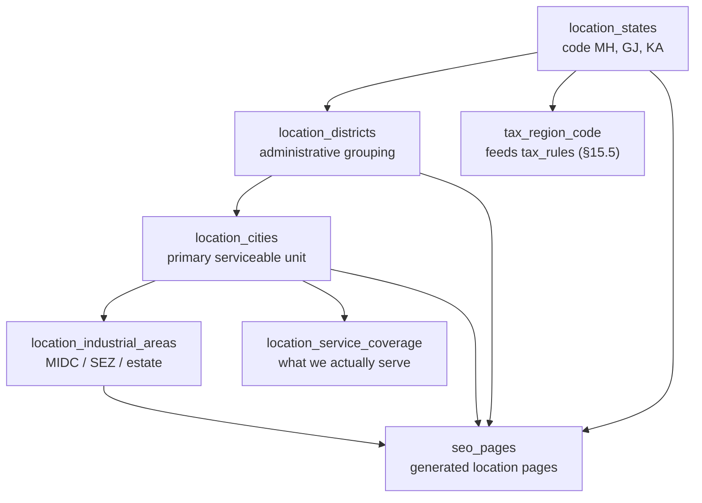

### 20.2 Why four levels, not two

| Level | SEO role | Data role |
|---|---|---|
| State | Broad query intent ("scrap buyers in Maharashtra"); landing pages, low volume, high authority value | Tax jurisdiction, coverage reporting |
| District | Rarely searched directly, but it prevents city-name collisions and gives breadcrumbs | Administrative grouping |
| City | Primary intent ("scrap buyers in Pune") — the page most likely to rank | Serviceable unit, pickup logistics |
| Industrial area | Highest-intent, lowest-competition ("MIDC Bhosari scrap") — the page a plant manager searches | Pickup point |

### 20.3 URL patterns

| Page type | Pattern | Example |
|---|---|---|
| State | `/{state-slug}` | `/maharashtra` |
| City | `/{city-slug}` | `/pune` |
| City + grade | `/scrap-metals/{grade-slug}/{city-slug}` | `/scrap-metals/heavy-melting-scrap/pune` |
| Industrial area | `/{city-slug}/{area-slug}` | `/pune/bhosari-midc` |

**[C]** These are **new** paths. They must not collide with any existing route. `/scrap-metals/[slug]`
already exists **[E]**, so city-in-path must be a deeper segment, never a sibling that would make
`/scrap-metals/pune` ambiguous with a grade slug. `check:routes` must be extended to assert that no
grade slug equals any city slug.

**[R]** Prefer a single segment count per template and no query parameters for addressability, so
each page has exactly one URL.

### 20.4 Uniqueness requirement — the anti-doorway rule

Google penalises doorway pages: near-identical pages differing only by place name. The architecture
prevents them structurally:

| Requirement | Mechanism |
|---|---|
| Minimum real data per page | `seo_page_templates.required_facts` must all resolve |
| Coverage must exist | §19.4 gate |
| Bodies must differ | Similarity guard at approval (§19.3) |
| No page for a place with no service | `NOT_SERVICED` → no page |
| Volume control | Generation is a batch job with a per-run cap and human review, never a crawl-and-generate loop |

### 20.5 Breadcrumbs and internal linking

| Page | Breadcrumb |
|---|---|
| City | State → City |
| Industrial area | State → City → Area |
| City + grade | Scrap metals → Grade → City |

**[R]** Every generated page must be reachable from at least one static hub page. A page reachable
only from the sitemap is an orphan and will not rank.

## 21. Sitemap, canonical URLs, redirects and publication lifecycle (R15)

### 21.1 Sitemap generation

| Aspect | Design |
|---|---|
| Files | `/sitemap.xml` index + segmented child sitemaps (pages, grades, parts, locations) |
| Inclusion | Only `seo_pages` with `publication_state = 'PUBLISHED'` and `robots_index = true` and HTTP 200 |
| `lastmod` | From `published_at` of the newest published revision — a data change, not "now" |
| Exclusions | Redirects, drafts, `noindex`, private routes, portal paths, API routes |
| Freshness | Rebuilt when a page publishes or unpublishes, and by a nightly job |
| Verification | `sitemap_entries.last_status` records the observed HTTP status of each URL at build time; a non-200 entry is dropped and reported |
| `robots.txt` | Static, disallows `/admin`, `/buyer`, `/seller`, `/api`; references the sitemap |

**Rule [C].** A sitemap entry that returns non-200 is a defect, not a warning. The build logs it and
the page is excluded from the next build until fixed.

### 21.2 Canonical URLs

| Situation | Canonical |
|---|---|
| Default | Self — `https://primemet.com{path}` |
| Same content, several paths | `canonical_overrides` with a recorded reason |
| Paginated listings | Page 2+ canonicalises to itself, not to page 1 (with `rel=prev/next` semantics) |
| Parameter variants (`?utm_`, `?ref=`) | Stripped for canonical; never indexed separately |
| Trailing slash / case | Normalised by redirect (§21.3), never duplicated |
| HTTP vs HTTPS, www vs apex | Redirect at edge, one canonical host |

### 21.3 Redirects

| Rule | Design |
|---|---|
| When created | Automatically, in the same transaction, whenever a published `path` changes or a page is archived |
| Codes | 301 for permanent moves, 302 only for temporary campaign paths, 410 for genuinely withdrawn content |
| Chains | A new mapping must point at a live target; chains are resolved at write time to a single hop |
| Loops | `from_path ≠ to_path` CHECK; cycle detection at write time |
| Preservation | `url_redirects` rows are never deleted while `is_active`; deactivation keeps history |
| Monitoring | `hit_count` tracks what still needs updating internally; a 301 hit is a signal to fix links |
| Existing URLs | Every one of the live routes and 11 detail pages in §26.1 must never 404 |

### 21.4 Publication lifecycle

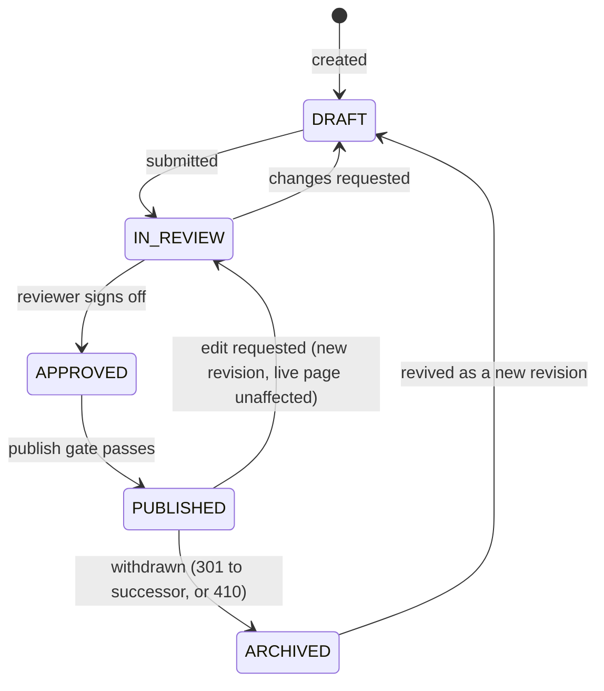

| Gate | Condition to leave the state |
|---|---|
| `DRAFT` → `IN_REVIEW` | Title, description, body and H1 present |
| `IN_REVIEW` → `APPROVED` | Human reviewer; `reviewed_by_id` set; `unverified_claims` empty |
| `APPROVED` → `PUBLISHED` | All `required_facts` resolve; coverage allows it; slug free; JSON-LD valid |
| `PUBLISHED` → `ARCHIVED` | A successor path or a 410 decision recorded |

**Rule [C].** Editing a live page creates a new revision; the published revision is never mutated,
so the sitemap `lastmod` is meaningful and a rollback is a state change, not a content reconstruction.

### 21.5 Slug and path immutability

| Rule | Enforcement |
|---|---|
| `categories.slug`, `scrap_grades.slug`, `products.slug` are immutable once published | Trigger; the existing routes depend on them **[E]** |
| A `seo_pages.path` change writes a redirect in the same transaction | Service-level transaction |
| Renaming a grade is a *name* change, not a slug change | Application rule |

### 21.6 Backwards compatibility with the current site **[E]**

The current site is fully static and has no sitemap. Publishing this architecture must not change
any live URL. The 18 public routes and 11 detail routes in §26.1 are a **frozen contract**: they may
gain data behind them, never move.

## 22. API endpoint specification and data-access boundaries (R16)

### 22.1 Conventions

| Aspect | Rule |
|---|---|
| Style | REST over Next.js route handlers under `/api/v1/`; server actions used for portal form posts |
| Versioning | Path version `v1`; additive changes only within a version |
| Auth | Session cookie (portal) or `Authorization: Bearer` (machine, future); never both |
| Idempotency | Writes accept `Idempotency-Key`; replay returns the original result |
| Pagination | Cursor-based (`?cursor=&limit=`, default 25, max 100); no offset paging on mutable lists |
| Filtering | Explicit allow-list per endpoint; unknown params rejected, not ignored |
| Errors | RFC 7807-style `{type, title, status, detail, errors[]}`; never leak stack traces or SQL |
| Validation | Schema validated at the boundary (zod or equivalent) before any service call; unknown fields rejected |
| Rate limits | Auth endpoints strict (per IP + per account); public read moderate; writes per user |
| Concurrency | `If-Match` with the row `version` on mutable commercial records; 409 on mismatch |
| Timeouts | Every external call (SMTP, storage) bounded; failure is a recorded outcome, never a hang |
| Caching | Public reads cacheable with revalidation tags; anything audience-specific `no-store` |
| PII in logs | Emails, phones and names redacted; IP/UA hashed |

### 22.2 Access boundaries

Every endpoint declares **one** audience. The DTO for that audience is chosen before the query, and
the repository scope is derived from the session — never from a client-supplied id.

| Audience | Scope source | Enforcement |
|---|---|---|
| `public` | none | Only `PUBLIC`-class fields; no session read at all |
| `buyer` | `session.org_id` | Repository filters `buyer_profile.organisation_id = session.org_id` |
| `seller` | `session.org_id` | Filters `supplier_profile.organisation_id = session.org_id` |
| `admin` | permission set | Permission check + optional explicit scope |

**Rule [C].** No endpoint accepts an organisation id, user id or role from the request body to
determine access. Scope comes from the session; a mismatched id is a 404, not a 403, so existence is
not confirmed.

**A fifth audience, `db_admin` [C].** The maintenance endpoints of §22.9 are neither `admin` nor
`public`: they require a `database.*` permission, which no business tier holds, and they execute
under a separate database role. A `SUPER_ADMIN` session calling one receives 403 unless it also holds
the technical grant — by design (D8).

### 22.3 Shared validation rules

| Rule | Applies to |
|---|---|
| `quantity_kg > 0`, ≤ 6 decimals, canonical kilograms | lot, weighment, listing, settlement |
| Money: decimal string, 2 dp, no float parsing anywhere | every monetary field |
| Percentage: 0–100, 4 dp | rate, tolerance, composition |
| Currency: ISO 4217, must match the document | quote, order, settlement |
| Enum values: exact match, case-sensitive | all enums |
| Dates: ISO 8601; effective ranges must not overlap for the same key | tax rules, pricing rule sets, coverage |
| Free text: length caps, HTML stripped, markdown sanitised on render | notes, findings, disputes |
| File uploads: MIME allow-list, size caps, checksum computed server-side | documents |
| Unknown or "not specified" values: accepted where the schema allows `NULL`, and never coerced to `0` or `""` | composition, part number, manufacturer |

### 22.4 Public endpoints (no session)

| Method | Path | Returns | Validation | Notes |
|---|---|---|---|---|
| `GET` | `/api/v1/public/categories` | published categories | — | Cacheable |
| `GET` | `/api/v1/public/grades` | published grades + composition spec | — | **No price, no stock** |
| `GET` | `/api/v1/public/grades/{slug}` | one grade | slug exists + published | 404 otherwise |
| `GET` | `/api/v1/public/parts` | published products | — | No price unless `price_mode = FIXED` with a real price |
| `GET` | `/api/v1/public/parts/{slug}` | one product + specs | published | 404 otherwise |
| `POST` | `/api/v1/public/enquiries` | reference + status | full enquiry schema, honeypot, rate limit | Creates an `enquiries` row; sends acknowledgement |
| `POST` | `/api/v1/public/contact` | acknowledgement | contact schema, rate limit | Creates an enquiry of `source = WEB_FORM` |
| `GET` | `/api/v1/public/locations/cities` | serviced cities | — | Only `coverage_level ≠ NOT_SERVICED` |

**Boundary.** A public response may never contain: any rate, any supplier or buyer identity, any
`INTERNAL` field, any document URL. Enforced by the `public` DTO and by the regression test in §18.2.

### 22.5 Buyer and seller endpoints

| Method | Path | Audience | Permission | Validation |
|---|---|---|---|---|
| `GET` | `/api/v1/buyer/enquiries` | buyer | — | own org only |
| `POST` | `/api/v1/buyer/enquiries` | buyer | — | enquiry schema; draft or submit |
| `GET` | `/api/v1/buyer/enquiries/{id}` | buyer | — | 404 if not own org |
| `PATCH` | `/api/v1/buyer/enquiries/{id}` | buyer | — | only while `NEW`/`UNDER_REVIEW` |
| `GET` | `/api/v1/buyer/quotations` | buyer | — | own org |
| `POST` | `/api/v1/buyer/quotations/{id}/accept` | buyer | — | version must be `SENT`/`VIEWED` |
| `POST` | `/api/v1/buyer/quotations/{id}/reject` | buyer | — | reason required |
| `GET` | `/api/v1/buyer/orders` | buyer | — | own org |
| `GET` | `/api/v1/buyer/lots/{id}/evidence` | buyer | — | **only** if an approval share exists; returns signed URLs |
| `POST` | `/api/v1/buyer/lots/{id}/approval` | buyer | — | `inspection_version_id` must be current; tolerance required for that state |
| `GET` | `/api/v1/seller/rfqs` | seller | — | own org |
| `POST` | `/api/v1/seller/quotes` | seller | — | one active quote per RFQ |
| `GET` | `/api/v1/seller/listings` · `POST` | seller | — | grade or product required |
| `GET` | `/api/v1/seller/payments` | seller | — | own settlements only |

**Boundary.** Buyer endpoints never return supplier identity, supplier rate, margin or commission.
Seller endpoints never return buyer identity, buyer price or another supplier's quote. Both enforced
by DTO, and both asserted in tests.

### 22.6 Operational endpoints — health

| Method | Path | Auth | Response |
|---|---|---|---|
| `GET` | `/api/health` | none | see below |

**[E]** The current implementation returns static JSON and must keep working unchanged until the
database exists:

```json
{ "status": "ok", "version": "0.1.0", "timestamp": "…", "database": "not_configured" }
```

**Required behaviour after integration [C]:**

| Condition | `status` | `database` | HTTP |
|---|---|---|---|
| No `DATABASE_URL` | `ok` | `not_configured` | 200 |
| Configured, query succeeds | `ok` | `connected` | 200 |
| Configured, query fails | `degraded` | `unavailable` | 503 |

Rules: the endpoint never claims a database is connected when it is not; the check is a bounded
`SELECT 1` with a short timeout; the response is never cached; no version string is invented — it is
read from the build. A separate `/api/health/ready` may gate deploys while `/api/health` stays a
liveness probe. Part A §4.3's note that this route becomes dynamic applies here.

### 22.7 Admin endpoints

| Method | Path | Permission | Notes |
|---|---|---|---|
| `GET` | `/api/v1/admin/enquiries` | `enquiry.view` | filters: status, model, owner, date |
| `PATCH` | `/api/v1/admin/enquiries/{id}/status` | `enquiry.edit` | validates legal transition (§13) |
| `POST` | `/api/v1/admin/enquiries/{id}/matches` | `supplier_quote.request` | issues RFQ |
| `POST` | `/api/v1/admin/supplier-quotes/{id}/request` | `supplier_quote.request` | idempotent |
| `GET` | `/api/v1/admin/supplier-quotes/compare` | `supplier_quote.compare` | landed-cost basis |
| `POST` | `/api/v1/admin/buyer-quotes` | `quote.prepare` | computes via pricing engine |
| `POST` | `/api/v1/admin/buyer-quotes/{id}/versions` | `quote.revise` | new version, never edits |
| `POST` | `/api/v1/admin/buyer-quotes/{id}/approve` | `quote.approve` | dual control (§17.4) |
| `POST` | `/api/v1/admin/buyer-quotes/{id}/send` | `quote.send` | writes snapshot + issues mail |
| `GET`/`POST` | `/api/v1/admin/lots` | `lot.view` / `lot.create` | |
| `PATCH` | `/api/v1/admin/lots/{id}/stage` | `lot.edit_declaration` etc. | gate enforced |
| `POST` | `/api/v1/admin/lots/{id}/inspections` | `lot.schedule_inspection` | |
| `POST` | `/api/v1/admin/inspections/{id}/versions` | `lot.record_inspection` | insert-only |
| `POST` | `/api/v1/admin/lots/{id}/dispatch-check` | `lot.authorise_dispatch` | evaluates nine checks |
| `POST` | `/api/v1/admin/lots/{id}/dispatch-override` | `lot.override_gate` | SUPER_ADMIN, reason required |
| `POST` | `/api/v1/admin/rejections` · `/{id}/resolve` | `rejection.raise` / `.resolve` | resolution option required |
| `POST` | `/api/v1/admin/settlements` · `/{id}/approve` | `rejection.prepare_settlement` / `.approve_settlement` | preparer ≠ approver |
| `POST` | `/api/v1/admin/contact-shares` · `/{id}/approve` | `contact.approve_share` | D2; scope + expiry required |
| `GET`/`POST` | `/api/v1/admin/documents` | `document.upload` | returns `document_id`, never a URL |
| `GET` | `/api/v1/admin/documents/{id}/url` | `document.view_internal` | mints a ≤5 min signed URL + logs it |
| `GET`/`POST`/`PATCH` | `/api/v1/admin/catalogue/**` | `catalogue.*` | slugs immutable when published |
| `GET`/`POST` | `/api/v1/admin/tax-rules` · `/{id}/approve` | `tax.edit` / `tax.approve` | editor ≠ approver |
| `GET` | `/api/v1/admin/tax/components` | `tax.view_snapshot` | the `tax_components_ref` list (D7) |
| `POST` | `/api/v1/admin/buyer-quotes/{id}/versions/{version}/tax-review` | `tax.approve` | writes `tax_reviews`; mandatory before approval when the treatment sets `requires_admin_review` (§15.5.4) |
| `GET` | `/api/v1/admin/orders/{id}/invoices` | `invoice.view` | every document on the deal, with `issuer_is_primemet` **derived** from `v_invoice_classification` |
| `POST` | `/api/v1/admin/orders/{id}/invoices` | `invoice.issue` | `invoice_role` and issuer are required; `transaction_model` is copied from the order, never supplied |
| `GET`/`POST` | `/api/v1/admin/pricing-rule-sets` | `pricing.edit` / `pricing.approve` | versioned |
| `GET` | `/api/v1/admin/audit-logs` | `audit.view` | cursor paging; export permissioned |
| `POST` | `/api/v1/admin/seo/pages` · `/{id}/publish` | `seo.edit` / `seo.publish` | publish gate §21.4 |
| `POST` | `/api/v1/admin/seo/generate` | `content.generate` | creates a draft, never a revision |
| `POST` | `/api/v1/admin/seo/drafts/{id}/approve` | `content.review` | clears `unverified_claims` |
| `GET`/`POST` | `/api/v1/admin/redirects` | `redirect.manage` | chain/loop validation |
| `POST` | `/api/v1/admin/users/invite` | `user.invite` | no password is ever set by an admin |
| `POST` | `/api/v1/admin/access/grants` | `access.grant_permission` | audited with before/after |

**Boundary.** Admin endpoints are the only ones permitted to return `INTERNAL` fields, and only
where the caller's permission covers them: a `CATALOGUE_MANAGER` calling a lot endpoint receives no
`supplier_rate`. That is a DTO-level consequence of permissions, not a separate filter applied later.

Three fields are never returned to a buyer or seller **at any permission level**, because D5 makes
them meaningful per issuer: `supplier_cost_total`, `margin_amount`, and `commission_amount` on another
party's document. An `AGENCY` buyer sees their own fee document and may see the material document
addressed to them; they never see a material document addressed to anyone else.

### 22.8 Error and status mapping

| Situation | Status | Body |
|---|---|---|
| Validation failure | 422 | `errors[]` with field paths |
| Unauthenticated | 401 | no detail about the resource |
| Authenticated, wrong audience | 404 | deliberately not 403, to avoid confirming existence |
| Lacking permission on own resource | 403 | permission name only |
| Illegal state transition | 409 | current state + allowed transitions |
| Concurrency mismatch | 409 | current version |
| Document not clean | 423 | scan status |
| Rate limited | 429 | `Retry-After` |
| Dependency down (DB/SMTP/storage) | 503 | bounded retry hint |

### 22.9 Database maintenance endpoints (D8, §29)

Audience `db_admin`. Every endpoint requires a `database.*` permission **and** execution under the
migration runner's own database role. **None of them accepts SQL, a statement, a query or a filename.**
The only identifier any of them takes is a `migration_id` that must exist in the deployed set.

| Method | Path | Permission | Returns / does | Notes |
|---|---|---|---|---|
| `GET` | `/api/v1/admin/database/status` | `database.view_status` | deployed schema version, `_prisma_migrations` head, last run outcome, runner availability | Read-only; the answer the "schema version" requirement asks for |
| `GET` | `/api/v1/admin/database/migrations` | `database.view_migrations` | applied and pending lists: `migration_id`, description, checksum, author, applied_at | Never returns file contents |
| `GET` | `/api/v1/admin/database/migrations/{migration_id}` | `database.view_migrations` | description, `objects_affected`, destructive flag, reversibility, checksum | Sourced from the migration's committed `metadata.json` |
| `GET` | `/api/v1/admin/database/history` | `database.view_history` | `migration_runs` including failures, cursor paged | Failures are the point of this endpoint |
| `POST` | `/api/v1/admin/database/migrations/{migration_id}/validate` | `database.view_migrations` | records a dry-run/validation result into `migration_runs.dry_run_result` | Changes no schema |
| `POST` | `/api/v1/admin/database/migrations/{migration_id}/apply` | `database.apply_migration` | starts the controlled runner | Body: `{confirm_migration_id, backup_reference}`. No SQL. Refused if backup not verified (§29.6) |
| `POST` | `/api/v1/admin/database/runs/{id}/rollback` | `database.apply_migration` | applies the tested `DOWN` file, where one exists | Refused when `destructive = true`; forward-fix is the documented procedure (§24.4) |
| `GET` | `/api/v1/admin/database/backups` | `database.view_backup_status` | last verified backup, its age and provider reference | Reads the record; never initiates a backup |

**Validation rules [C].** `confirm_migration_id` must equal the path parameter (a typed confirmation,
not security theatre — it stops a mis-click on the wrong row). Unknown body fields are rejected at the
boundary. A request body containing `sql`, `statement`, `query`, `ddl` or `filename` is rejected as a
schema violation *before* routing, so a future developer cannot accidentally add a SQL passthrough
without the endpoint schema changing first.

**Boundary [C].** `apply` is the only endpoint in this document that can change database structure,
and it is the only one no business tier can reach. It executes a file that was reviewed in a pull
request and is present in the deployed build; if the checksum differs from the one recorded at review
time, the runner refuses (§29.4).

## 23. Notification architecture — Zoho Mail with retry (Part A gap)

### 23.1 Persist before notify

**[C]** The rule that protects every workflow: **the business record is committed first, the email is
queued second**. A mail outage must never lose an enquiry, and a mail success must never imply a
record exists.

```text
request → validate → write business rows (single transaction) → commit
        → enqueue email_messages row (same transaction, outbox pattern) → return success
        → worker sends, records attempts, retries with backoff
```

### 23.2 Tables

```text
email_messages — the queue and the permanent record of what was sent.
  id                uuid PK
  template_key      text NN          -- ENQUIRY_ACK_BUYER, QUOTE_SENT_BUYER, RFQ_SUPPLIER, ...
  to_email          text NN
  to_name           text NULL
  cc                text[] NN default '{}'
  subject           text NN
  body_text         text NN
  body_html         text NULL
  reply_to          text NULL
  headers           jsonb NULL
  related_type      text NULL        -- ENQUIRY | QUOTE | ORDER | LOT | DISPUTE
  related_id        uuid NULL
  status            email_status NN default 'QUEUED'    (Part A §5.2)
  attempts          int NN default 0
  max_attempts      int NN default 5
  next_attempt_at   timestamptz NULL
  last_error        text NULL
  provider_message_id text NULL
  sent_at           timestamptz NULL
  created_at/updated_at timestamptz NN
  IDX (status, next_attempt_at) · IDX (related_type, related_id) · IDX (created_at)

email_attempts — insert-only. Every try, including failures.
  id            uuid PK
  message_id    uuid FK→email_messages NN CASCADE
  attempt_no    int NN
  started_at    timestamptz NN
  finished_at   timestamptz NULL
  outcome       text NN       -- SENT | TRANSIENT_FAILURE | PERMANENT_FAILURE | TIMEOUT
  smtp_code     text NULL
  error_detail  text NULL     -- redacted; never includes credentials
  IDX (message_id, attempt_no)

email_suppressions — hard bounces and complaints. A suppression is respected, never overridden.
  id           uuid PK
  email        text NN UQ
  reason       text NN        -- HARD_BOUNCE | COMPLAINT | MANUAL | INVALID_ADDRESS
  noted_at     timestamptz NN
  notes        text NULL
```

### 23.3 Retry policy

| Failure class | Behaviour |
|---|---|
| Transient (SMTP 4xx, timeout, connection refused) | Retry with exponential backoff: 1 min, 5 min, 15 min, 1 h, 4 h; jitter ±20 % |
| Permanent (SMTP 5xx invalid recipient, auth failure) | No retry; mark `FAILED`; add to `email_suppressions` on a recipient-level bounce |
| Auth failure on the SMTP account | Alert immediately; retries continue but the alert is the real signal |
| Exhausted attempts | `FAILED`, recorded, surfaced in admin; never silently dropped |
| Already sent | Idempotent: a message with `status = SENT` is never re-sent |
| Duplicate enqueue | Guarded by an idempotency key per (template, related_id) |

**Rule [C].** A user-facing confirmation never says "email sent". It says the request was received and
that a confirmation is being sent. Delivery is reported by the queue, not assumed by the handler.

### 23.4 Delivery configuration

| Item | Value |
|---|---|
| Provider | Zoho Mail SMTP |
| Host | `smtp.zoho.com` (`smtp.zoho.in` for Indian data centre accounts) |
| Port | `465` (implicit TLS) — 587 with STARTTLS as an alternative |
| Auth | `ZOHO_SMTP_USER` + `ZOHO_SMTP_PASSWORD` (**app-specific password**, not the account password) |
| From | `MAIL_FROM`, e.g. `PRIMEMET <enquiries@…>` — must match an authorised sender/domain |
| DNS | SPF, DKIM and DMARC must be published before go-live, or mail lands in spam |
| Limits | Respect Zoho's per-day and per-minute caps; the worker throttles accordingly |

### 23.5 Content rules

| Rule | Reason |
|---|---|
| Templates are code-reviewed, not admin-editable at launch | Prevents a broken template from reaching customers |
| No supplier cost, margin or internal note in any outbound mail | Same DTO discipline as the API (§18.2) |
| No attachment containing an internal document; send a signed link instead | Access revocation stays possible |
| Reply-to is a monitored mailbox, never a no-reply that a buyer cannot answer | Enquiries arrive by reply |
| Every mail states the record reference (`ENQ-`, `QT-`, `ORD-`) | Makes phone follow-up possible |
| Supplier mail never names the buyer; buyer mail never names the supplier | D2 |

## 24. Migration strategy and implementation sequence (R17)

### 24.1 Principles

| Principle | Consequence |
|---|---|
| Additive first | Every migration is expand → backfill → contract; no destructive change in the same release as the code that needs it |
| Reversible | Every migration has a tested rollback; enum additions are one-way and documented as such |
| No build-time database | Migrations never run during `next build`; the app boots without a database |
| One migration per logical change | Reviewable, revertable |
| Data, not DDL, for behaviour | Tax rates, pricing rules, thresholds and coverage are seeded rows, not code constants |
| Never touch live URLs | No migration may rename a published slug without writing a redirect |
| Committed before applied | A migration exists as a reviewed file in the repository **before** any environment runs it. There is no path that creates structure first and writes the file afterwards (§29.3) |
| Applied by the runner and recorded | Application goes through the controlled runner and writes a `migration_runs` row. A terminal `psql` session is not an approved instrument (§29.7) |
| Forward-fix preferred over reversal | Not every migration is reversible — an added enum value, a dropped column, a rewritten backfill. The documented procedure is a corrective migration; restore-from-backup is the last resort, not the first (§24.4) |
| Verified backup first | A production migration without a verified, restorable backup is refused by the runner (§29.6) |
| Structural ≠ data | A migration may create reference rows (step 19); it may never seed a business record |

### 24.2 Sequence

| Step | Migration content | Depends on |
|---|---|---|
| 0 | `prisma init` + connection strings; lazy client; **no tables** | Supabase project + `.env` |
| 1 | Enums + identity/org (`users`, `sessions`, `organisations` incl. `org_kind`, contacts, verification) | 0 |
| 2 | Catalogue (`categories`, families, `products`, `scrap_grades`, composition defs and attributes) | 1 |
| 3 | Parties (`supplier_profiles`, `buyer_profiles`, `supplier_listings`) | 1, 2 |
| 4 | Enquiry (`enquiries`, lines, clarifications, stage events) | 3 |
| 5 | Supplier quoting (`supplier_matches`, quotes, lines, charges, taxes) | 4 |
| 6 | Pricing + tax (`pricing_rule_sets`, components, `tax_components_ref`, `tax_rules`, `tax_treatments`) **+ `btree_gist` + the hand-written `EXCLUDE` constraint (§15.5.2)** | 1 |
| 7 | Buyer quotes + snapshots (`buyer_quotes`, versions, lines, tax lines, approvals, `quotation_snapshots`) | 5, 6 |
| 8 | Lots (`scrap_lots`, quantity estimates, declarations) | 2, 3, 4 |
| 9 | Inspection (`inspections`, versions, measurements, methods, attachments) | 8 |
| 10 | Approval linkage (`buyer_approvals`) + invalidation triggers | 7, 9 |
| 11 | Dispatch (`dispatch_authorisations`, check results, consignments, weighments) | 10 |
| 12 | Rejection, dispute, settlement | 11 |
| 13 | Orders (`orders` incl. `transaction_model` + `inventory_mode`, cost lines, `invoices`, `payments`, `supply_contracts`, `v_invoice_classification`) | 7, 12 |
| 14 | Documents + access log (`documents`, `document_access_log`) **and every FK constraint pointing at `documents`** — the nullable columns already exist from the earlier groups; the constraints are added here, after the table | 1 |
| 15 | Audit (`audit_logs`, `audit_log_failures`) + restrictive grants | 1 |
| 16 | Contact sharing (`contact_share_requests`, events) | 4, 14 |
| 17 | SEO + locations (states, districts, cities, areas, coverage, templates, pages, revisions, metadata, runs, drafts, redirects, canonical, sitemap) | 2 |
| 18 | Indexes, constraints verification, partial unique indexes, grants — including re-asserting the `EXCLUDE` constraint that Prisma cannot regenerate | all |
| 19 | Seed reference data only: enums-ref tables, `inspection_methods_ref`, `rejection_reasons_ref`, `tax_components_ref` **codes only — no rates, no treatments** | 18 |
| **20 (deferred)** | `stock_positions`, `stock_movements` — written only when `STOCK` is authorised (D6, §15.8). Not in M1. | 13 |

**[C]** Step 19 seeds **reference lists only**. It must not seed fake lots, quotes, orders, prices or
SEO pages. A seeded example that looks like a business record is a defect (§6.4).

**Ordering note [E].** `documents` is created in step 14, yet **17 column declarations across the
earlier groups reference it** — `organisation_documents` (group A), catalogue imagery, lot weighment
sheets, inspection reports and attachments, dispatch evidence, rejection and dispute evidence, and
`invoices.document_id`. All of those columns are therefore created **nullable and unconstrained** by
their own migrations, and the FK constraints are added in step 14 once the table exists. This is the
expand-then-constrain pattern applied to a cross-table dependency, and it is why step 14 is not simply
"create two tables".

Hand-writing step 14 this way is also the reason a naive `prisma migrate dev` run against an empty
database can produce a migration ordering that fails at the first FK: the schema file alone cannot
express "constrain later".

### 24.3 Renaming `INTERMEDIARY` → `AGENCY`: not a migration

Because D4 creates the enum with three values in migration 1, **no rename migration is scheduled
anywhere**. `INTERMEDIARY` never exists in the schema, so there is nothing to expand, backfill or
contract (§15.6).

The expand/contract pattern is retained below only as a **documented contingency** for a dataset that
somehow already holds the value — for example an inherited CSV import:

1. **Expand:** add `AGENCY` to the enum; deploy code that accepts both.
2. **Backfill:** `UPDATE … SET transaction_model = 'AGENCY' WHERE transaction_model = 'INTERMEDIARY'`
   with an audit row per table and a count check.
3. **Contract:** drop the old value in a later release, after telemetry shows zero reads.

Prisma cannot express "remove an enum value" safely; the final step is a hand-written migration.

### 24.4 Rollback

| Object | Rollback |
|---|---|
| New tables | Dropped by a single migration; no dependent code shipped in the same release |
| Added columns | Dropped after a release of zero reads |
| Added enum values | Not rollback-able; treat as permanent |
| Data seeds | Deleted by key, never by truncation |
| Restored backup | Documented procedure, tested once before go-live |

**[C] Reversibility is not assumed.** The table above describes what *can* be undone, and it is
shorter than the list of what cannot. An added enum value cannot be removed safely; a dropped column
loses its data whether or not the DDL is reversed; a `NOT NULL` constraint added after a backfill
destroys the information that rows once lacked the value. Each migration therefore declares its own
reversibility in its committed `metadata.json` (`reversible`, `destructive`), the console shows that
declaration before anyone can apply it, and `migration_runs` refuses a `DOWN` direction on a
`destructive` change. Where reversal is not safe, the documented procedure is **forward-fix**: a new
migration that corrects the state, reviewed and applied like any other (§29.6).

### 24.5 First administrator

A documented one-off operator script creates the first `SUPER_ADMIN` with an invitation token. No
default credentials, no seeded password, no environment-variable backdoor. Running it twice is a
no-op.

### 24.6 Verification per migration

| Check | When |
|---|---|
| `prisma validate` | Every change |
| `prisma migrate diff` reviewed against intent | Before applying |
| Apply to a disposable database | Before production |
| Constraint tests (CHECKs, partial indexes, cascades) | After step 18 |
| `EXCLUDE` constraint present, `btree_gist` installed, overlap rejected on a real insert | After step 6 and re-checked at step 18 |
| Index-expression immutability (`transaction_model::text`, `daterange(…)`) accepted by the target PostgreSQL version | Before step 6 is applied |
| `v_invoice_classification` returns one row per invoice and exactly one PRIMEMET issuer | After step 13 |
| No-float grep across schema and generated types | After every migration |
| Health endpoint returns `not_configured` with no `DATABASE_URL` | Every release |
| A `migration_runs` row exists for the applied migration, with matching `file_checksum_sha256` and `status = 'APPLIED'` | After every applied migration |
| The console's "pending migrations" list is empty once the deployment has caught up | After every deploy |
| No endpoint accepts a SQL body; the rejection is proven by an automated test | Continuous, from M9 |

## 25. Security considerations

### 25.1 Threat model summary

| Threat | Vector | Control |
|---|---|---|
| Unauthorised portal access | Direct URL to `/admin`, `/buyer`, `/seller` | Real guards in handler + repository scoping, not middleware alone |
| IDOR | Changing an id in a request | Scope from session; mismatched id returns 404 |
| Data leak through API | Over-broad query or a new column | DTO allow-lists, deny-by-default |
| Contact disclosure | Supplier/buyer harvesting | D2 event model §18.3 |
| Cost/margin exposure | Buyer sees internal figures | `INTERNAL` class excluded structurally |
| Credential stuffing | Login endpoint | Lockout, MFA for admins, generic errors, rate limit |
| Session theft | XSS or cookie capture | HttpOnly/Secure/SameSite, hashed tokens, short admin lifetime |
| Privilege escalation | Self-granting a permission | `access.grant_permission` restricted to SUPER_ADMIN, audited |
| Audit tampering | Update/delete on log | Revoked grants, append-only, tamper-evident hashing optional |
| Malicious upload | Document with malware | Scan gate; never served unless `CLEAN` |
| Path traversal | Upload filenames | Server-generated keys, no user path components |
| SQL injection | Query building | Prisma parameterisation; raw SQL only in reviewed migrations |
| Schema tampering / ad-hoc DDL | Terminal access, a convenience script, a "quick fix" endpoint | The application role holds no DDL rights; only the runner role can change structure; no interface accepts SQL (§29.5) |
| Unreviewed or altered migration | A file applied without review, or a reviewed file swapped after review | The runner recomputes `file_checksum_sha256` and refuses a mismatch against the reviewed checksum; disposable-database test before production (§29.4) |
| Irreversible migration | A change nobody can undo at 02:00 | Reversibility declared per migration and shown before applying; `DOWN` refused on destructive changes; verified backup; forward-fix documented as the primary procedure (§24.4, §29.6) |
| Technical-admin over-reach | `DB_ADMIN` used to read commercial data, or a business admin granted DDL | The tier holds no business permission; the grant API refuses `database.*` on any business tier (§17.4) |
| Unrecorded data change | A record corrected by hand outside the application | Every business write carries an audit row naming the actor; a row without a matching audit entry is detectable by reconciliation (§29.7) |
| Stored XSS | Findings, notes, SEO body | Sanitise markdown on render; no raw HTML in user fields |
| SSRF | Fetching a supplier-provided URL | No server-side fetch of user URLs in scope |
| Content fabrication | AI output published unreviewed | Review gate §19.3 |
| SEO spam / doorway pages | Programmatic locations | Coverage + uniqueness gates §20.4 |
| Denial of service | Public form flooding | Rate limits, honeypot, bounded work per request |
| Backup loss | Infrastructure event | Point-in-time recovery; restore tested before go-live |

### 25.2 Application controls

| Control | Requirement |
|---|---|
| Deny by default | No route is public unless explicitly listed |
| Four layers | Middleware (UX) → handler guard → repository scope → DTO allow-list (Part A §4.2) |
| CSRF | SameSite=Lax + origin check on state-changing posts; tokens where the flow crosses sites |
| Security headers | CSP (no `unsafe-eval`), HSTS, `X-Content-Type-Options`, `Referrer-Policy`, `frame-ancestors 'none'` |
| Secrets | Environment only; never in code, logs, error bodies or the client bundle |
| Least privilege DB roles | Separate roles for runtime and migrations; runtime cannot `DROP` or disable triggers. **D8 makes this load-bearing rather than advisory:** it is the mechanism that stops a compromised application from reshaping its own schema (§29.4) |
| Structural change control | Committed, reviewed migration only; applied by the runner; never `prisma db push` outside a scratch database (§29.3) |
| No SQL passthrough | Endpoint schemas reject `sql`/`statement`/`query`/`ddl`/`filename` before routing; the runner takes a `migration_id` resolved to a deployed file (§22.9) |
| Structural authority is not ambient | `SUPER_ADMIN` holds no `database.*` permission by default; `DB_ADMIN` holds nothing else (§17.2) |
| Dependency hygiene | `npm audit` in CI; no `--force` fixes; Next.js and `sharp` kept patched |
| Error handling | No stack traces to users; correlation id in the response, detail in logs |
| Rate limiting | Per IP and per account on auth, enquiry and upload paths |

### 25.3 Data controls

| Data | Control |
|---|---|
| Passwords | argon2id; never logged; rehash on policy change |
| Session tokens | Hashed at rest; revocable per session and per user |
| Contact data | `RESTRICTED`; disclosure event only |
| Documents | Private bucket; signed URLs; scan gate; access log |
| IP/UA | Salted hash only |
| Backups | Encrypted; access logged; restore rehearsed. **Verification is recorded, and the migration runner refuses to apply without it** (§29.6) |
| Retention | Legal hold overrides deletion; audit rows outlive their subjects |

### 25.4 Residual risks accepted

| Risk | Why accepted | Mitigation |
|---|---|---|
| Staff can see internal costs | Necessary for the job | Permission split + audit |
| Admin can override dispatch | Business requires it **[O-14.1]** | SUPER_ADMIN only, reason, audit |
| Manual data entry errors | No supplier API exists | Immutable versions, snapshots |
| AI drafts may be bland | Quality issue, not safety | Human review gate |
| Third-party SMTP/storage outage | Outside control | Outbox + retry; storage retry |
| A migration must occasionally be applied under pressure | Business reality; urgency invites shortcuts | Small, frequent, reviewed migrations; the runner makes the *correct* path also the *fastest* path, and forward-fix is rehearsed rather than improvised (§29.6) |
| The maintenance console is unused and drifts | Only a few people hold `DB_ADMIN` | Exercised at least once per milestone against a disposable database; a console that has never been used is not a control (§28.1 M9) |

## 26. Existing frontend route compatibility

### 26.1 The frozen route contract **[E]**

These routes exist and work today. Their URLs, copy and behaviour are a contract: the architecture
adds data behind them and never moves them.

| Group | Count | Routes |
|---|---|---|
| Public marketing | 16 | `/` `/about` `/become-a-supplier` `/contact` `/faqs` `/how-it-works` `/industries` `/privacy` `/quality-assurance` `/request-a-quote` `/scrap-metals` `/sell-scrap` `/source-scrap` `/spare-parts` `/terms` `/trading-models` |
| Public detail | 11 | 7 × `/scrap-metals/[slug]`, 4 × `/spare-parts/[slug]` |
| Auth previews | 4 | `/login` `/admin/login` `/register/buyer` `/register/seller` |
| Admin | 20 | dashboard, enquiries, enquiries/[id], suppliers, buyers, materials, products, pricing, supplier-quotations, quotation-preparation, quotations, reports, audit-log, catalogue, composition, lots, lots/[ref], inspections, rejections, login |
| Buyer | 7 | dashboard, enquiries/new, scrap-sourcing, spare-parts, quotations, orders, profile |
| Seller | 8 | dashboard, profile, tax, materials, products, quotations, enquiries, orders |
| API | 1 | `/api/health` |

The production build emits **71 pages**; the 11 detail pages come from 2 dynamic routes (7 grade slugs, 4 part slugs). Verified by `npm run build`.

**Planned additions do not disturb this table.** D8 (§29) adds one admin path, `/admin/database`, which does not exist today and is therefore not counted above. It is a **new** path: no existing URL moves, no existing admin page loses a navigation entry, and the build's page count grows rather than renumbers.

### 26.2 What each group gains, and what must not change

| Group | Gains from this architecture | Must not change |
|---|---|---|
| Public marketing | SEO metadata from data; location pages as **new** paths | Copy, layout, URLs |
| Grade/part detail | Composition spec, real part specs, published revisions | Slugs, titles' static fallback |
| Enquiry wizard | Persistence, reference number, acknowledgement mail | Steps, conditional branches, draft retention, required markers |
| Auth previews | Real authentication | Introduce no fake session in the interim |
| Admin portals | Real data, permissions, audit; a maintenance console for technical administrators (`/admin/database`, D8) | Navigation structure (extended, not replaced) |
| Buyer portals | Own enquiries, quotes, approvals | — |
| Seller portals | RFQs, quote submission, listings | — |
| `/api/health` | Real DB check | Current response shape when unconfigured |

### 26.3 The wizard is the highest-risk regression surface

**[E]** `src/components/enquiry/*` implements a multi-step wizard with conditional scrap/parts
branches, draft retention across steps *and* branches, and catalogue-driven required markers, covered
by `npm run check:wizard` (100 assertions at three viewports).

| Rule | Reason |
|---|---|
| Persistence is added **behind** the existing component, not by rewriting it | The 100 interaction assertions are the safety net |
| Required markers keep reading `enquiry-fields.ts` statuses | The catalogue remains the single source of truth |
| "Unknown / not specified" stays available for technical fields | The user must never be forced to invent data |
| Submit stays disabled until the phase that can actually accept it | A form that appears to send but does not is worse than a disabled one |

### 26.4 Duplicate-model reconciliation

Three duplications exist in the current tree and the architecture resolves them as follows:

| Duplication | Resolution | Section |
|---|---|---|
| `/admin/materials` vs `/admin/catalogue` | Split by function; one schema behind both | §9.4 |
| `INTERMEDIARY`/`PRINCIPAL` vs `PRINCIPAL`/`AGENCY`/`MANAGED_SUPPLY` vs the four published models | **Resolved by D4**: enum is the three values, `INTERMEDIARY` a legacy alias, Sourcing & Procurement a service line | §6.6, §15.6 |
| Frontend `CompositionAttribute` spreads declared and measured on one object | Split into specification / declaration / measurement tables | §9.1 |

### 26.5 Performance and rendering compatibility

| Constraint | Consequence |
|---|---|
| Static pages must stay static where no live data is involved | No `force-dynamic` on marketing routes |
| Database access is server-only | No Prisma import in a client component |
| Lazy client | The app boots and builds with no `DATABASE_URL` |
| Detail routes | `generateStaticParams` for published rows; revalidate on publish, not on every request |
| Portal routes | Dynamic, authenticated, `no-store` |

## 27. Decisions

### 27.1 Recorded decisions (closed)

| ID | Decision | Recorded | Where it lands |
|---|---|---|---|
| **D4** | `transaction_model = PRINCIPAL | AGENCY | MANAGED_SUPPLY`; `INTERMEDIARY` is a legacy alias for `AGENCY`, never stored; Sourcing & Procurement is a service line | 2026-10-30 | §6.6, §15.6, §24.3 |
| **D5** | Agency material invoicing and PRIMEMET's commission/service invoicing are **separate documents with their own issuer**; supplier-direct and PRIMEMET pass-through both supported as data; `issuer_is_primemet` **derived, never stored** | 2026-10-30 | §8.6, §15.7, §22.7 |
| **D6** | `BACK_TO_BACK` and `STOCK` are **inventory modes** on `orders`, not transaction models; back-to-back prioritised; `stock_positions` / `stock_movements` deferred | 2026-10-30 | §15.8, §24.2 step 20 |
| **D7** | Tax components are a **reference table**, rules carry `invoice_role` and effective dates, overlaps are guarded by a hand-written `EXCLUDE`, and a tax review is required before a flagged quotation is approved | 2026-10-30 | §15.5, §16.4, §24.6 |
| **D8** | **Database and schema management.** Routine business records are managed through authenticated APIs and admin screens, never by direct database editing; structural change uses version-controlled, reviewed, tested migrations applied by a controlled runner; a restricted console serves authorised technical administrators (schema version, pending migrations, descriptions, affected objects, backup status, application, history, results, validation, who/when/error); no interface accepts arbitrary SQL; structural permissions are separated from data permissions; history and results are preserved; testing and verified backups precede production application; reversibility is **not** assumed | 2026-10-30 | §2.1, §2.4, §4.1, §8.7, §17.2, §22.9, §24.1, §24.4, §29 |

These were approved in principle on 2026-10-30 and are now requirements, not proposals. Everything
below them remains genuinely undecided, and nothing in §27.2 may be implemented until the owner rules
on it.

**D8's implementation status.** D8 is a *requirement*, not a description of the product. Nothing in
it is built: there is no `/admin/database`, no `migration_runs` table, no runner and no `DB_ADMIN`
tier. §29.8 says so explicitly, and §28.1 places all of it in M9.

### 27.2 Still open

| ID | Decision needed | Blocks | Recommendation |
|---|---|---|---|
| **[O-9.4]** | Merge `/admin/materials` and `/admin/catalogue`, or split by function? | M2 (UI only) | Split by function, rename materials to "Reference library" |
| **[O-14.1]** | May a dispatch check ever be overridden? By whom, for how long? | **M7** *(was M3 — corrected)* | SUPER_ADMIN only, reason + expiry, per-check recording |
| **[O-15.4a-P]** | *(policy, not structure)* Which pass-through arrangement applies to agency deals, and what is the GST/ITC treatment of each document? | **M5** | Accountant; D5 supports both arrangements already |
| **[O-15.5]** | Which tax components apply to which model, at which rate, in which jurisdiction, and whether reverse charge, ITC or TDS applies? | M5 (quote approval), M7 (invoicing) | Accountant; the structure exists (D7), the answer does not |
| **[O-17.4]** | Is dual control on quote approval required, and above what value? | M5 | Yes, above a configurable threshold |
| **[O-27.1]** | Contact-share expiry: default duration of an approved introduction? | M4 | 30 days, revocable, renewable |
| **[O-27.2]** | May a buyer see a target price or a price band publicly? | M5 | No; `REQUEST` mode only, as today |
| **[O-27.3]** | Clarification SLA for incomplete technical fields? | M4 | 2 business days, then a best-effort quote |
| **[O-27.4]** | Liability position on "equivalent" part fitment claims | M7 | Publish only sourced fitments (§8.3) |
| **[O-27.5]** | Retention period per document class and legal hold policy — **proposed in full at §31.2–§31.3; statutory cells pending CA/legal** | **M1** *(was M2 — corrected; `documents` ships in M1)* | Adopt §31.2 internally; CA confirms every statutory cell and §31.7 |
| **[O-27.6]** | AI provider, data-residency and cost budget for content generation | M8 | Deferred; no provider chosen |
| **[O-27.7]** | Hosting and region (affects latency and data residency) — **research complete at §30; recommendation in §30.9** | M1 | Supabase `ap-south-1` Mumbai, Pro, Small compute (§30.9) — **not approved** |
| **[O-27.8]** | Which cities/areas are genuinely serviced at launch | M8 | Owner supplies the list; no page without coverage |
| **[O-29.1]** | Who holds `DB_ADMIN` in practice — named individuals, and a minimum of how many? | **M9** | Two named technical administrators; never a blanket tier |
| **[O-29.2]** | Must a destructive migration require a second approver, and is a dry-run mandatory for every migration? | **M9** | Yes to both; `approved_by_id` already exists on `migration_runs` |
| **[O-29.3]** | Retention of `migration_runs` and execution output | **M9** | Indefinite, matching the audit log; they are small rows |
| **[O-29.4]** | Does the console apply migrations in-process (web environment then needs DDL credentials) or delegate to a separate runner service? | **M9** | Separate runner service / ephemeral job with its own identity (§29.4) |
| **[O-30.1]** | *(new)* Where are Supabase backup copies stored, and can they be confined to India? The provider documents S3 storage but the page read did not state the bucket region | Not M1 — blocks any **residency claim** | Owner asks the provider in writing before any contract states India-only residency (§30.10) |

### 27.3 The four decisions needed before Milestone 1 can close

They change no table — that is why they are separable from the schema work, and why leaving them open
would start to cost after M1 rather than during it.

| ID | Needed by | Who | Consequence of leaving it open |
|---|---|---|---|
| **O-27.7** hosting region | **Before the Supabase project exists** | Owner | Data residency and latency are decided by the region; moving later is a migration, not a setting. **Evidence now available in §30 — five providers, 14 sources, verified 2026-10-30** |
| **O-27.5** retention and legal hold | **M1** | Legal adviser | `documents` ships in M1; a retention job added later must retro-fit existing rows. **Proposal in §31, statutory periods pending** |
| **O-9.4** `/admin/materials` vs `/admin/catalogue` | **M2** | Owner (UI only) | Two screens keep overlapping until one is retired |
| **O-14.1** dispatch override authority | **M7** | Owner + ops | The gate cannot be specified without knowing whether it can be bypassed |

Everything else in §27.2 can wait for its own milestone without blocking schema work.

**D8 adds four further items (O-29.1 – O-29.4).** None blocks M1; all four block M9, which is when the
maintenance console ships. They are deliberately *not* in the table above: M1 must not be delayed by
decisions about an interface that is eight milestones away.

## 28. Phased implementation plan and acceptance criteria

### 28.1 Phases

| Phase | Scope | Exit criteria (all must hold) |
|---|---|---|
| **M0 — Decisions** | Record D4–D7 (done, §27.1) and answer the four M1-blocking items of §27.3; D8 recorded (§29); hosting researched (§30); retention proposed (§31); readiness gated (§32) | D4–D8 recorded in §27.1; transaction enum, invoice roles, inventory modes and the tax structure fixed; hosting research complete and sourced; retention proposal complete with every statutory cell marked pending; the §27.3 items answered before migration 1 is written |
| **M1 — Schema** | Migrations 1–3, 6, 14, 15, 18, 19 (identity incl. `org_kind`, catalogue, parties, pricing/tax, documents, audit, reference seeds) + `btree_gist` and the hand-written `EXCLUDE`; `invoice_role` and `inventory_mode` enums; **no stock tables** | `prisma validate` clean; constraints tested; the overlap constraint rejects a duplicate `ACTIVE` scope on a real insert; no float in schema; app builds and runs with no `DATABASE_URL`; `/api/health` still reports `not_configured` |
| **M2 — Authentication** | Sessions, argon2id, MFA, lockout, invitations, RBAC, real guards, first-admin script | No portal route reachable without a session; buyer cannot reach admin; role change revokes sessions; every auth event audited |
| **M3 — Enquiry persistence** | Enquiry tables, wizard wiring, reference numbers, acknowledgement mail, admin register | Wizard's 100 interaction assertions still pass; a submitted enquiry survives a restart; mail failure never loses the enquiry |
| **M4 — Supplier quoting and owner's desk** | Matches, RFQs, supplier quotes, comparison, contact-share requests | Supplier never sees buyer identity; comparison uses landed cost; contact disclosure is a recorded event |
| **M5 — Quotation, pricing and tax** | Rule sets, engine, buyer quotes, versions, tax snapshots, approvals, dual control, `tax_reviews` | An issued quote reprints identically after a rate change; tax snapshot complete **per invoice role**; preparer ≠ approver; a version whose treatment requires review cannot be approved without a `tax_reviews` row; an ambiguous rule set raises `TAX_RULE_AMBIGUOUS` instead of guessing |
| **M6 — Lots, inspection, approval** | Lots, inspections, versions, measurements, evidence, buyer approvals, invalidation cascade | A new inspection version blocks dispatch; approval names a version; declared and measured never merge |
| **M7 — Dispatch, rejection, settlement** | Dispatch gate, consignments, weighments, rejections, disputes, settlements, orders, invoices, payments | All nine checks block correctly; override audited; settlement reconciles; nothing is deleted; an `AGENCY` deal produces a material document **and** a fee document with different issuers and exactly one receivable; a `BACK_TO_BACK` order reconciles; `STOCK` refuses to activate without migration 20 |
| **M8 — SEO and locations** | Templates, pages, revisions, coverage, redirects, sitemap, AI drafts | No page without coverage; no thin pages; AI drafts require approval; every old URL still 200 or 301 |
| **M9 — Hardening, database operations and production gate** | Headers, CSP, rate limits, dependency audit, monitoring, backup restore rehearsal — **plus §29 in full:** `/admin/database`, the controlled migration runner, `migration_runs`, the `DB_ADMIN` tier, backup verification and the no-SQL guarantee | `npm audit` clean; restore rehearsed; penetration checklist signed off; the console shows the deployed schema version and an empty pending list; a fresh migration applied on a disposable database through the runner leaves one `migration_runs` row with a matching checksum; a request body carrying a `sql` field is rejected before routing; a `destructive = true` migration offers no rollback; a business-tier session receives 403 from every `/database/**` endpoint; `DB_ADMIN` cannot open an enquiry |

### 28.2 Per-phase acceptance checklist

Every phase must satisfy all of the following, not only its own exit criteria:

| # | Criterion |
|---|---|
| 1 | `npm run typecheck`, `npm run lint`, `npm run build` pass |
| 2 | `npm run check:routes` passes; no route removed |
| 3 | `npm run check:content` passes; no fabricated data appears |
| 4 | `npm run check:wizard` passes |
| 5 | No fake session, record or "sent" claim exists anywhere |
| 6 | Health endpoint tells the truth about the database |
| 7 | Serialiser test proves no `INTERNAL` field reaches a buyer or seller payload |
| 8 | Every state transition writes an audit row |
| 9 | No secret in the repository; `.env.example` updated with placeholders only |
| 10 | Stage 1's honesty rule holds: anything unimplemented is visibly labelled |
| 11 | Every schema change in the phase exists as a committed migration; no structure was created by hand (D8, §29.3) |
| 12 | Every routine record the phase introduces can be created and corrected through an authenticated admin screen (D8, §29.2) |
| 13 | No endpoint added in the phase accepts SQL text, and the phase's migration history is visible in `migration_runs` (D8, §22.9) |

### 28.3 What must be true before the first deploy that a customer can reach

| Gate | Status now |
|---|---|
| Authentication live | ✗ not implemented |
| Portal guards enforced | ✗ middleware is a pass-through |
| Database configured and migrated | ✗ none |
| Contact disclosure controlled | ✗ no tables |
| Security headers | ✗ not set |
| Backup and restore rehearsed | ✗ none |
| Every routine business record manageable through an admin screen | ✗ screens exist as labelled previews; no persistence, and several domains of §29.2 have no screen yet |
| Controlled migration path with recorded history and verified backup | ✗ no runner, no console, no `migration_runs`, no `DB_ADMIN` tier |

Until every row is ✓, the application deploys as a **preview only**. That was Part A's mandatory
production gate and it still stands.

---

## 29. Database and schema management (D8) — operability, migrations and the maintenance console

> **Status: requirement, not description.** Nothing in this section is built. It records a permanent
> architecture requirement confirmed at M0 (D8) and states exactly how it must be satisfied, so that
> the schema work of M1 and the authentication work of M2 are not designed in a way that forecloses
> it. §29.8 lists what exists (nothing) and what M9 must deliver.

The requirement has one purpose: **PRIMEMET must be run by its own staff.** Two controls make that
true, and they are deliberately not the same control, not the same permission and not the same
interface.

### 29.1 The two-tier control model **[C]**

| | **Routine business data management** | **Structural database maintenance** |
|---|---|---|
| Changes | Rows: catalogue, parties, lots, inspections, quotations, orders, invoices, content | Schema: tables, columns, indexes, constraints, relationships, views, functions, policies |
| Performed through | An authenticated admin screen posting to `/api/v1/admin/**` | A committed migration file executed by the controlled runner |
| Authorised by | The domain permission of the business tier (§17.3) | `database.*`, held only by the `DB_ADMIN` tier (§17.2) |
| Frequency | Hourly, by staff, as ordinary work | Rarely, by a technical administrator, as a reviewed release step |
| Reviewed by | The business rule for that domain (quote approval, tax review, composition approval) | Pull-request review of the migration file, a disposable-database test, a verified backup |
| Recorded in | `audit_logs` — one row per business change | `migration_runs` (§8.7) + `audit_logs` (§29.7) |
| Reversible by | The domain's own corrective action, with history preserved | Tested `DOWN` where declared safe; otherwise forward-fix or restore (§24.4) |
| Needs a developer | No — this is the requirement | To *author* the migration; not to apply it |

**[C] The boundary is absolute in both directions.**

- A routine admin screen may never alter schema. There is no "add column" button, no dynamic field creator, and no JSON-blob escape hatch that pretends to be one (the configurable composition of §9 is *data rows against a defined structure*, not a schema generator).
- A migration may never be the way to change a business record. Seeding a fake lot, price, quote or SEO page through a migration is a defect (§24.2 step 19), because it produces data that looks real and has no author.
- An urgent fix does not create a third path. If the correct path is too slow, the speed is the defect.

### 29.2 Routine business data management **[C]**

Every routine business record must be creatable, readable, correctable and — where the domain allows —
archivable through an authenticated backend API and an admin screen. This is the operational test of
the requirement: *can the business run for a week without a developer?*

| # | Domain | Tables (§8) | Admin screen | Permission | Delivered |
|---|---|---|---|---|---|
| 1 | Catalogue and products | `categories`, `product_families`, `products`, `material_grades` | `/admin/materials`, `/admin/products`, `/admin/catalogue` **[E]** | `catalogue.*` | M1 schema; CRUD from M2 |
| 2 | Categories and specifications | `composition_definitions`, `composition_attributes`, part specs | `/admin/composition` **[E]** | `catalogue.edit_composition` | M1; CRUD from M2 |
| 3 | Suppliers and buyers | `organisations`, `supplier_profiles`, `buyer_profiles`, `organisation_contacts`, verification records | `/admin/suppliers`, `/admin/buyers` **[E]** | `party.*` | M1; CRUD from M2 |
| 4 | Scrap lots and inventory | `scrap_lots`, quantity estimates, declarations; `stock_*` deferred (D6) | `/admin/lots`, `/admin/lots/[ref]` **[E]** | `lot.*` | M1; CRUD from M6 |
| 5 | Inspections and quality reports | `inspections`, `inspection_versions`, measurements, report documents | `/admin/inspections` **[E]** | `lot.schedule_inspection`, `lot.record_inspection` | M1; CRUD from M6 |
| 6 | Quotations and pricing | `buyer_quotes`, `buyer_quote_versions`, `pricing_rule_sets`, `pricing_components` | `/admin/quotations`, `/admin/quotation-preparation`, `/admin/pricing` **[E]** | `quote.*`, `pricing.*` | M5 |
| 7 | SEO content and metadata | `seo_pages`, `seo_page_revisions`, `seo_metadata`, `location_*`, `url_redirects`, `ai_content_drafts` | none yet — planned `/admin/seo` | `seo.*`, `content.*`, `redirect.*` | M8 |
| 8 | Purchase and sales transactions | `supplier_quotes`, `orders`, `supply_contracts` | `/admin/supplier-quotations`, `/admin/enquiries/[id]` **[E]** | `supplier_quote.*`, `order.*` | M4, M7 |
| 9 | Orders, invoices and payments | `orders`, `invoices`, `payments` | none yet — planned `/admin/orders` | `order.*`, `invoice.*` | M7 |
| 10 | Dispatch, rejection and dispute | `dispatch_authorisations`, `consignments`, `weighments`, `rejections`, `disputes`, `settlements` | `/admin/rejections` **[E]** + lot page | `lot.authorise_dispatch`, `rejection.*` | M7 |
| 11 | Documents and approvals | `documents`, `buyer_approvals`, `contact_share_requests` | none yet — planned `/admin/documents` | `document.*`, `approval.*`, `contact.*` | M6 |
| 12 | Notification operations | `email_outbox`, `email_attempts` (§23.2) | none yet — planned `/admin/notifications` | `notification.*` | M3 |

**[E]** marks a screen that exists today as a **labelled preview** with no persistence; the rest are
planned paths. None of them is a database client, and none of them can change structure.

**The acceptance test for §29.2 [C].** Take a staff member holding the correct tier and remove every
developer, database client and deployment access. They must be able to: publish a grade with a new
composition limit; onboard a supplier and verify its documents; record an inspection and upload the
report; prepare, approve and issue a quotation; correct a misspelt product name; retire a redirect;
record a payment against an invoice; and answer "what changed on this record, by whom, when". If any
of those needs a `psql` session, the milestone is not finished. This is requirement **N1** of §2.4 and
it is checked at every milestone, not at the end.

**What is data and what is code [C].** The distinction the console depends on:

| Belongs in data — editable by an authorised admin | Belongs in code — migration and review only |
|---|---|
| Grades, composition limits, part specifications | Enum values, including the reference-list enums (§5.1) |
| Pricing rule sets and their components | The pricing engine's evaluator and rounding rules (§16.6) |
| Tax components and rates (D7) | Table, column, index, constraint, view and policy definitions |
| Coverage levels, SEO copy, templates, redirects | The `resource.action` permission vocabulary |
| Reference lists seeded by migration 19 | Anything an AI draft might propose (§19.3 — drafts are content, never schema) |

A reference table is data; its enum twin is code. That is why `tax_components_ref` is an editable
table (D7) while `inspection_method` remains an enum with a `_ref` companion — adding an inspection
method is a migration, adding a tax component is a row.

### 29.3 Structural change control **[C]**

All structural change is a **version-controlled migration**: reviewed, tested, and applied through a
controlled runner. Nothing is created by hand, in any environment, including development on a shared
database.

**What counts as structural.** Creating or modifying tables; adding or modifying columns; creating
indexes; adding constraints; changing relationships; creating or modifying views; changing database
functions; changing policies. Also: adding an enum value, installing an extension (`btree_gist`, §15.5.2),
and re-asserting a hand-written constraint that Prisma cannot regenerate.

| # | Rule | Why |
|---|---|---|
| 1 | The file exists in the repository before it runs anywhere | Otherwise the schema has no reviewable history and cannot be reproduced |
| 2 | Every migration carries a committed `metadata.json`: description, objects affected, `reversible`, `destructive`, and whether a backup is required | The console must *show* these before anyone applies them; the requirement asks for descriptions and affected objects, and a prose comment cannot be queried |
| 3 | Reviewed by a second person before it reaches production **[R]** | The reviewer is the only control that catches a semantically wrong migration — the one that runs cleanly and does the wrong thing |
| 4 | Applied to a disposable database first, and the result inspected | §24.6; a migration is not "tested" because it did not error |
| 5 | Backed up and verified first | §29.6 |
| 6 | Applied by the runner, which records the attempt before executing | §29.7 |
| 7 | Immutable once applied. A correction is a new migration | Editing an applied file desynchronises every environment that already ran it |
| 8 | `prisma db push` is prohibited outside a scratch database | It can drop and narrow columns to match the schema without a reviewable file — exactly the change that has no review |
| 9 | No migration may touch live URLs or published slugs without writing a redirect | §21.5 |

**Bootstrap honesty [E].** The console is an M9 deliverable, but migrations start in M1. The **runner**
is therefore a controlled command, not a web feature, and it exists from M1; the console is its
interface. Between M1 and M8 a technical administrator applies migrations by invoking the runner
under the same rules (reviewed file, disposable-database test, verified backup, `migration_runs`
record). What is deferred to M9 is the *interface*, not the discipline — and M1 is not permitted to
begin with an unreviewed `db push`.

### 29.4 The restricted database maintenance console **[C]**

One admin path — `/admin/database` — with three tabs: **Status**, **Migrations**, **History**. It is
reachable only by `DB_ADMIN`, it renders no business data, and it takes no SQL.

| # | Required function | Where | Permission | Source of truth |
|---|---|---|---|---|
| 1 | Current schema version | Status | `database.view_status` | `_prisma_migrations` head plus the last `APPLIED` run |
| 2 | Pending migrations | Status | `database.view_migrations` | Deployed migration set minus applied set |
| 3 | Migration descriptions | Migrations → detail | `database.view_migrations` | Committed `metadata.json` |
| 4 | Affected tables and database objects | Migrations → detail | `database.view_migrations` | `metadata.json` → `objects_affected` |
| 5 | Verified backup status | Status + apply dialog | `database.view_backup_status` | Provider snapshot reference, recorded on the run (§29.6) |
| 6 | Apply an approved migration through the runner | Migrations → apply | `database.apply_migration` | The runner, by `migration_id` |
| 7 | Migration history | History | `database.view_history` | `migration_runs`, cursor paged |
| 8 | Execution results and errors | History → detail | `database.view_history` | `migration_runs.status`, `duration_ms`, `error_code`, sanitised `error_detail` |
| 9 | Validation results | Migrations → validate | `database.view_migrations` | `migration_runs.dry_run_result` |
| 10 | Administrator, timestamp and execution details | Automatic on every attempt | — | `applied_by_id`, `approved_by_id`, `started_at`, `finished_at`, `file_checksum_sha256`, `app_version`, `request_id` |

**Permissions for the schema domain [C].** Five, and they are the only permissions `DB_ADMIN` holds:

| Permission | Grants |
|---|---|
| `database.view_status` | Schema version, runner availability, current environment |
| `database.view_migrations` | Pending and applied lists, descriptions, affected objects, validation runs |
| `database.view_history` | `migration_runs`, including failures |
| `database.view_backup_status` | Whether a verified restorable backup exists, and when |
| `database.apply_migration` | Invoke the runner: apply, and roll back where a tested `DOWN` exists |

**Runner contract [C].**

| Property | Rule |
|---|---|
| Input | A `migration_id` that exists in the deployed set. Nothing else — no SQL, no path, no filename |
| Identity | Connects with a DDL-capable database role the application runtime does **not** have |
| File integrity | Recomputes `file_checksum_sha256` and refuses on mismatch with the reviewed checksum |
| Preconditions | Backup verified; migration validated; no other run `APPLYING`; migration not already applied |
| Recording | Writes `migration_runs` **before** the first statement; closes it exactly once |
| Failure | Leaves `FAILED` or `FAULTED`; the console refuses further application until an operator resolves it, and a failed attempt is never hidden or retried automatically |
| Output | Sanitised: `error_detail` carries the message and code, never SQL fragments, parameter values or row data |

**What the console cannot do [C].** No SQL box. No file upload. No editing or deleting a migration
record. No creating a table, column or index. No running a query "just to check". No applying a
migration that is not in the deployed build. No business-data read of any kind. No granting of any
permission — `access.grant_permission` belongs to `SUPER_ADMIN`, not here.

**An unresolved architectural fork [O-29.4].** If the web application invokes the runner itself, the
web environment must hold DDL-capable credentials, which weakens the separation this section is built
on. The alternatives are **(a)** a separate runner service or ephemeral job with its own identity, and
a console that requests rather than executes, or **(b)** a console that only displays state while
application happens out-of-band. Option (a) is recommended, and it adds a deployment unit; option (b)
satisfies function 6 only indirectly. Recorded as open rather than silently decided, because it is a
genuine trade-off between "apply approved migrations through a controlled runner" and "separate the
DDL permissions".

### 29.5 Prohibitions **[C]**

| Prohibited | Reason |
|---|---|
| Arbitrary SQL execution through any public, buyer, seller or ordinary admin interface | It reduces every permission model to one permission |
| Accepting administrator- or AI-supplied SQL for execution | There is no safe sanitiser; the only safe design is not to have the feature |
| `prisma db push` or `migrate reset` against anything but a scratch database | Destructive without a reviewable file |
| Authoring, editing or deleting a migration through the UI | The file must be reviewable in version control |
| An AI-generated schema change | Content generation has no DDL path (§19.3) |
| A catalogue, pricing or tax operation that changes structure as a side effect | Data operations must not be able to reshape the schema |
| A migration that seeds business records | Fabricated data with no author (§24.2 step 19) |
| Granting `database.*` to a business tier, or a business permission to `DB_ADMIN` | Separation of duties (§17.4) |
| Silent failure | A failed migration must be visible, blocked and recorded |

### 29.6 Backup, restore and recovery before a production migration **[C]**

| Rule | Detail |
|---|---|
| Verified backup precedes every production migration | Not "a backup exists" but "a restorable backup was verified and its reference recorded" |
| Failure is closed, not open | The runner refuses to apply when verification has not succeeded within a bounded window before the attempt |
| Restore is rehearsed | At least once before go-live, and again after any change of provider, region or plan (§28.3) |
| Recovery window is known | Point-in-time recovery retention stated in the runbook, not assumed |
| Forward-fix is the primary repair | Rollback is the exception; restore is the last resort (§24.4) |
| Destructive migrations are scheduled, never opportunistic | Applied outside peak hours, by a named administrator, with the owner informed |
| The backup record is part of the audit trail | `migration_runs.backup_verified` / `backup_reference`, and an `audit_logs` row |

**[R] Gap to close at M9.** If the chosen provider exposes no API for snapshot state, a
`backup_verifications` table will be needed to record a manual attestation with an operator and a
timestamp. That is preferable to a console displaying a claim it cannot verify.

### 29.7 Audit and traceability of schema change **[C]**

- Every attempt writes a `migration_runs` row before executing: who, when, which migration, which
  checksum, from which build, with what validation output, and the outcome (§8.7).
- Every attempt also writes an `audit_logs` row with action `database.migration_applied`,
  `database.migration_failed` or `database.migration_rolled_back`, carrying `before_state` /
  `after_state` of the schema version.
- `migration_runs` is never deleted and outlives the administrator who created it; retention matches
  the audit log **[O-29.3]**.
- **Reconciliation.** Because every business write carries an audit row, a business record with no
  matching audit entry is evidence of a change that bypassed the application. That check is what makes
  the prohibition on direct database editing enforceable rather than aspirational; it runs daily from
  M2 and **reports** — it does not auto-delete or auto-revert.

### 29.8 Implementation status and requirement traceability

**Nothing here is implemented as a user-facing console.** The schema half of it now exists (M1, §33):
`migration_runs` is created by migration 1, with its four CHECK constraints in migration 18's part of
`20261031000100_m1_constraints`. The console, the runner and the permission tier remain unbuilt.

| Item | Status |
|---|---|
| `/admin/database` (any tab) | ✗ does not exist |
| `DB_ADMIN` tier; `database.*` permissions | ✗ not defined in code (the `database.*` permission **enum values** exist in migration 1) |
| `migration_runs` table | ✔ created in M1 (§33), no writer yet |
| Controlled runner; checksum verification | ✗ none |
| Committed `metadata.json` per migration | ✗ not yet — three migrations exist, each with `migration.sql` only |
| Backup verification record | ✗ none |
| Routine admin screens | ✗ exist as labelled previews with no persistence (§6.4) |

**Requirement → where satisfied.**

| Requirement element | Section |
|---|---|
| Routine records manageable through authenticated backend APIs | §29.2, §22.7 |
| The twelve domains, one by one | §29.2 |
| No direct database editing or developer intervention for routine work | §29.2 acceptance test; N1–N2 (§2.4) |
| All structural change is version-controlled | §29.3, §24.1 |
| What counts as a structural change | §29.3 |
| Restricted maintenance interface, ten functions | §29.4 |
| No arbitrary SQL; no operator-supplied SQL | §29.5, §22.9, N4 |
| Controlled migration runner | §29.4 runner contract |
| Migration permission restricted to technical administrators | §17.2, §17.4, §29.4 |
| Routine and structural permissions separated | §17.2, §17.4, §29.4 |
| AI and catalogue operations never change schema | §29.5, §19.3, §9.1 |
| Audit logs for schema and administrative operations | §29.7, §16.5 |
| Migration testing before production | §24.6, §29.3 rule 4 |
| Verified backups and recovery strategy before production | §29.6, §28.3 |
| Migration history and results preserved | §8.7 `migration_runs`, §29.7 |
| Approval and validation | §17.4, §29.4, §29.6 |
| Reversibility not assumed; rollback, recovery or forward-fix | §24.4, §29.6 |
| Deliverable milestone and acceptance | §28.1 M9, §28.2 criteria 11–13 |

---

## 30. Hosting options for managed PostgreSQL — research annex (R19)

> **Status: research, not a decision.** This section records what was verified on **2026-10-30** so
> that O-27.7 (hosting provider and region) can be decided with evidence instead of impressions.
> Nothing here provisions or configures anything, and nothing here approves a provider. The owner's
> approval in §30.10 is a prerequisite for M1.

### 30.1 Method, and what "verified" means here

| Question | How it was answered | What would NOT have been acceptable |
|---|---|---|
| Does the provider offer an India region? | The provider's own region table for the **PostgreSQL service**, opened and read | Inferring database availability from the provider's general cloud-region list |
| What are the limits? | The provider's own backup/PITR documentation | A blog post, a comparison site, or recollection |
| What does it cost? | The provider's own pricing page, quoted verbatim | An arithmetic estimate presented as a price |

Three facts in this section are marked **[unverified]** — they could not be established from an
official page in this session and must be confirmed before contract. They are not guesses that have
been quietly rounded into a conclusion.

**Verification date for every row below: 2026-10-30.** Prices and region lists change; re-verify at
selection time and record the date again in the runbook (§29.6).

### 30.2 Verified India-region availability — by service, not by cloud

This is the distinction the brief insists on. A cloud having a Mumbai region does not mean its
PostgreSQL service is offered there, and this research found exactly that kind of gap at Azure.

| Provider | Managed PostgreSQL service | India region(s) verified | City | Evidence |
|---|---|---|---|---|
| **Supabase** | Supabase Postgres (dedicated instance per project) | **`ap-south-1`** listed as a *specific* region | Mumbai | Region list on the Supabase regions page |
| **AWS** | Amazon RDS for PostgreSQL | **`ap-south-1`** and **`ap-south-2`** | Mumbai, Hyderabad | RDS service endpoints + RDS price list published for both regions |
| **Google Cloud** | Cloud SQL for PostgreSQL | **`asia-south1`** and **`asia-south2`** | Mumbai, Delhi | Cloud SQL *PostgreSQL* region-availability page (both Enterprise and Enterprise Plus tables) |
| **Azure** | Azure Database for PostgreSQL flexible server | **Central India**, **South India**, **Jio India Central**, **Jio India West** | Pune, Chennai, Jio-operated | Azure PostgreSQL overview region table |
| **Neon** | Neon Postgres | **None** | nearest: Singapore `aws-ap-southeast-1` | Neon regions page (8 regions listed, none in India) |

**The Azure finding, stated plainly.** Azure's PostgreSQL region table lists **Central India** and
**South India**, and the Jio-operated pair — but **not West India (Mumbai)**, which is the region most
people assume when they say "Azure India". Anyone specifying "Azure, Mumbai" for this project would be
specifying a database that the table does not list. Central India (Pune) is the closest listed
equivalent.

**The Supabase finding, stated plainly.** Mumbai appears under *specific* regions, not under the
*general* "APAC" grouping. The provider's own documentation warns that a general region is a
geographic area, not a jurisdiction, and that "region selection is a data-location control, not proof
of regulatory compliance". A residency requirement must therefore name `ap-south-1` explicitly.

**Neon is disqualified on location, not on quality.** Its nearest region is Singapore. That is a
different country for data-residency purposes and adds a cross-border hop to every query from an
India-deployed application.

### 30.3 Requirement fit against the fifteen comparison criteria

Legend: **✔** documented and adequate · **~** documented with a caveat · **✗** not met · **?**
unverified in this session.

| # | Criterion | Supabase (Mumbai) | AWS RDS (Mumbai) | Cloud SQL (Mumbai) | Azure (Central India) | Neon (Singapore) |
|---|---|---|---|---|---|---|
| 1 | India region availability | ✔ | ✔ | ✔ | ✔ (Pune/Chennai, not Mumbai) | ✗ |
| 2 | Mumbai specifically | ✔ `ap-south-1` | ✔ `ap-south-1` | ✔ `asia-south1` | ✗ not listed | ✗ |
| 3 | Latency to an India-deployed app | ✔ same region | ✔ same region | ✔ same region | ~ Pune, not Mumbai | ✗ cross-border |
| 4 | Managed backups | ✔ daily, Pro = 7 days | ✔ automated, 0–35 days | ✔ automated, 1 day–10 years, incremental | ✔ snapshot + WAL, 7–35 days | ~ scheduled backups on paid plans **[unverified]** |
| 5 | PITR | ✔ add-on, paid | ✔ within retention window | ✔ 1–7 days (Enterprise), 1–35 (Enterprise Plus) | ✔ within 7–35 days, RPO ≤5 min | ~ history window, configurable **[unverified]** |
| 6 | Disaster recovery | ~ restore to a new project; region fixed at creation | ✔ Multi-AZ, cross-region snapshot copy | ✔ restore backup into another region/zone | ✔ geo-redundant backup option | ~ single region per project |
| 7 | Backup-region availability | **?** backups stored in S3; the region is not stated | ✔ backups per region; copy to another region | ✔ cross-region restore documented | ✔ geo-redundant option (✅ in both India regions) | **?** |
| 8 | Data residency | ~ primary data in `ap-south-1`; **backup location unstated** | ✔ primary + backups stay in-region unless you copy them out | ✔ in-region; restore elsewhere is explicit | ✔ in-region; geo-redundant pairs to a partner region | ✗ Singapore |
| 9 | HA / failover | ~ managed instance; no Multi-AZ feature equivalent to RDS | ✔ Multi-AZ | ✔ regional HA | ✔ same-zone and zone-redundant (zone-redundant marked `$` in Central India) | ~ autoscaling, not HA **[unverified]** |
| 10 | Storage + compute scaling | ✔ disk $0.125/GB beyond 8 GB; compute resize by changing size | ✔ instance class + EBS volume | ✔ vCPU/RAM/disk independently | ✔ compute tier + storage tier | ✔ CU autoscaling, scale-to-zero |
| 11 | Connections and pooling | ✔ built-in pooler; documented per size (Micro 200 → 16XL 12,000 pooled) | ~ RDS Proxy is a separate paid component | ~ Cloud SQL connector, no bundled pooler | ✔ built-in PgBouncer on port 6432 | ? |
| 12 | Monthly price (list) | ✔ published in USD | ✔ published per region | ✔ published per region | ✔ published per region (INR) | ✔ published in USD |
| 13 | Operational complexity | ✔ low — one console, one decision | ✗ high — VPC, subnet groups, parameter groups, security groups | ✗ high — instance, network, connectors | ~ medium — server + networking, built-in pooler | ~ low |
| 14 | Vendor lock-in | ~ standard Postgres; the surrounding platform (auth/storage) is Supabase-specific | ✔ lowest — plain Postgres over TCP | ~ Postgres + GCP IAM/networking | ~ Postgres + Azure networking | ~ Postgres, plus branching model |
| 15 | Fit for PRIMEMET now and later | ✔ matches the architecture already written in Part A | ~ over-specified for the first 12 months | ~ over-specified | ~ viable if the org standardises on Azure | ✗ residency fails |

### 30.4 Backups, recovery and residency — the detail that decides the question

**Supabase.** Daily backups on Pro (7 days), Team (14), Enterprise (30). Physical backups by default
on Postgres 15.8.1.079 and newer. PITR is an add-on for finer granularity. Three limitations matter
to PRIMEMET and are stated by the provider: deleting a project **permanently removes all backups
including those stored in S3**; backups **do not include Storage objects**, only their metadata; and
daily backups **do not store custom-role passwords**, so a restore requires resetting them. Free-tier
projects have no managed backups and the provider recommends scheduled `db dump` to your own storage.

**AWS RDS.** Automated backups with retention 0–35 days (0 disables them), restore to any point in
that window. A free backup allowance equal to 100% of provisioned storage per region; beyond that,
backup storage is billed. Manual snapshots are independent of instance deletion, up to 100 per
region. Backups are stored in S3 for that region — which is why criterion 8 is a clean ✔ for AWS.

**Cloud SQL.** Incremental, encrypted backups; automated retention configurable from 1 day to 10
years on enhanced backups; a final backup on deletion (default retention 30 days); backups of deleted
instances are retained four days. PITR log retention is **1–7 days on Enterprise edition and 1–35
days on Enterprise Plus** — the edition therefore determines the recovery window, not a setting you
can pick freely.

**Azure.** Default retention 7 days, maximum 35; snapshot backups daily with WAL archiving giving an
RPO of up to five minutes; geo-redundant backup is available in **both** Central India and South
India; long-term retention to 10 years via Azure Backup; backups cannot be exported directly (use
`pg_dump`). Zone-redundant HA carries a `$` marker in Central India, i.e. a cost uplift.

**Residency gap to close before signature.** For Supabase, the region decides where the *primary*
data lives, but the documentation does not state where the backup copies are held. **[O-30.1]** below.
No other provider in this comparison has that gap.

### 30.5 Connection pooling

Pooling is not a detail at PRIMEMET's scale — it is the difference between a working serverless
deployment and exhausted connections. Supabase publishes the numbers per compute size (Micro: 60
direct / 200 pooled; Small: 90/400; Medium: 120/600; Large: 160/800; XL: 240/1,000; 2XL: 380/1,500),
which is enough to size the first year without measurement. Azure exposes PgBouncer on port 6432 on
the same hostname. AWS offers RDS Proxy as a separate component with its own cost; Cloud SQL offers
connectors rather than a bundled pooler — both add a piece of infrastructure that Supabase bundles.

Part A already assumes a pooled URL on port 6543 and a direct URL on 5432 for migrations. That
assumption holds for Supabase natively; on the other providers it would need re-specification, which
is a real, if unglamorous, migration cost.

### 30.6 Cost model, and the estimates that are honest

**Assumptions used for the estimates below** (all of them stated, none of them measured):

| Assumption | Value | Why |
|---|---|---|
| Workload at launch | <20 staff users, <100 enquiries/month, <5 GB database | A trading desk, not a marketplace |
| Compute | Smallest size that gives ≥2 GB RAM | Enough for Postgres + connection overhead at this volume |
| Storage | 8–20 GB | Catalogue, documents metadata, enquiry history |
| Backups | Within the provider's included window | 7-day PITR is sufficient for operational recovery |
| HA | **Not** enabled initially | Single-instance is acceptable until a customer-facing SLA exists |
| Network egress | <10 GB/month | Internal application traffic, not media |
| FX | **₹88 = US$1 (assumption for illustration only)** | Card/forex rate at billing differs; re-check at purchase |
| Taxes | Not included | Indian GST treatment on the invoice is for the CA |

| Provider and shape | Published list price | Approx. monthly (assumption applied) | Confidence |
|---|---|---|---|
| **Supabase Pro + Micro** (1 GB RAM, one project, 8 GB disk, 7-day backups) | $25/month, compute credit covers Micro | **≈ ₹2,200** | High — price read from the pricing page |
| **Supabase Pro + Small** (2 GB RAM, 400 pooled connections) | $25 + $15 − $10 credit = $30 | **≈ ₹2,640** | High |
| **Supabase + PITR add-on** | Price scales with compute size; **not published on the page opened** | **Requires provider quotation** | — |
| **Neon Launch**, typical published spend | From $0.106/CU-hr + $0.35/GB-month; "typical $15/mo" | ≈ ₹1,320 *(but Singapore)* | Medium — the figure is Neon's own "typical", not a specification |
| **AWS RDS for PostgreSQL**, `db.t4g.small`-class, 20 GB gp3, single-AZ, 7-day backups | Billed per instance-hour + storage + backup beyond the free allowance | **Requires provider calculator** | — |
| **Cloud SQL**, 1 vCPU / 3.75 GB, 20 GB SSD, Enterprise edition | Billed per vCPU-hour + RAM-hour + storage | **Requires provider calculator** | — |
| **Azure flexible server**, Burstable B1ms-class, 32 GB, 7-day retention | Billed per vCore-hour + storage; Azure prices India regions in INR | **Requires provider calculator** | — |

The three "requires calculator" rows are deliberate. Publishing an INR figure for them from memory
would be a fabricated price, and the brief forbids that. Each can be produced in a few minutes from
the provider's own calculator once a shape is chosen, and that is what the M1 infrastructure step
should do — before, not after, the account is opened.

**Costs that are easy to forget**, all documented by their providers: Supabase charges beyond 8 GB
disk ($0.125/GB), beyond 250 GB egress ($0.09/GB) and beyond 100 GB file storage; AWS bills backup
storage above the free allowance; Cloud SQL's *edition* changes both PITR window and price; Azure's
zone-redundant HA is a priced uplift.

### 30.7 Latency — what is known, what is not, and how to measure it

**No latency figure in this document is a measurement.** None is quoted from a benchmark. The only
claim made is structural: a database in the same region as the application server avoids a
cross-continent round trip, and Singapore is not the same region as Mumbai.

The variable that matters most is not the provider — it is **where the application runtime executes**.
If the Next.js deployment runs in a region other than the database's, every query in every request
pays the distance, and the fastest managed Postgres in Mumbai will feel slower than the slowest one
co-located.

**Benchmark procedure after selection** (to be run in M1, recorded in the runbook):

1. Deploy the application to its production region; confirm the database region from the provider
   console, not from the connection string alone.
2. From the deployed runtime — not from a laptop, and not from a different country — issue 10,000
   sequential `SELECT 1` round trips; record **p50 / p95 / p99**, not the mean.
3. Run one representative aggregate (a quotation total over 12 months of lines) 500 times; record
   p50/p95 and the plan.
4. Repeat over the **pooled** and the **direct** connection; record both, because migrations use the
   direct path.
5. Measure cold start separately from steady state — serverless compute makes the first query after
   idle unrepresentative.
6. Store the results in the runbook with the date. Re-run after any region or plan change.

Acceptance for M1 is not a millisecond target — it is that the numbers exist and are recorded.

### 30.8 Operational complexity and lock-in, honestly

| Provider | What you must operate yourself | Lock-in, and how bad it is |
|---|---|---|
| Supabase | Almost nothing; you accept its release cadence and its opinions about auth/storage | **Moderate.** The database is plain Postgres and `pg_dump` moves it. The surrounding platform (auth, storage, edge functions) is Supabase-shaped, and this architecture currently uses only Postgres — so lock-in today is low to moderate |
| AWS RDS | VPC, subnets, security groups, parameter groups, IAM, backups policy | **Lowest.** Standard Postgres over TCP; migrate anywhere |
| Cloud SQL | Networking, connectors, IAM, edition choice | Low–moderate; GCP-specific networking |
| Azure | Networking, server config, storage tier; PgBouncer is bundled | Low–moderate; Azure-specific identity/networking |
| Neon | Little; branching workflow is Neon-specific | Moderate; the branching model is not portable |

### 30.9 Recommendation

**Best overall: Supabase, region `ap-south-1` (Mumbai), Pro plan, Small compute.**
It is the only option that combines a *verified* Mumbai region, managed daily backups, a paid PITR
upgrade path, a documented pooler with published connection limits, and an operational burden small
enough for a team that has no database administrator. It also matches the connection model Part A
already assumes, so M1 migrates nothing.

**Best cost-conscious: the same Supabase Pro plan at Micro compute (≈₹2,200/month as an assumption-
based estimate).** Neon's usage pricing is lower on paper, but it fails criterion 1 — an India region
— and a cheaper database in Singapore costs more in latency and residency than it saves.

**Best operationally simple: Supabase again.** Azure is the runner-up *if* the organisation
standardises on Microsoft, because its built-in PgBouncer removes a component — but its PostgreSQL is
not listed in Mumbai, so the simplicity is bought with a region change.

**Trade-offs of the recommendation, stated against it:** a smaller provider than the hyperscalers,
with a single region per project and no equivalent of Multi-AZ; backup location not documented; PITR
priced as an add-on; and every quota (disk, egress, storage) has a documented overage. If the owner
requires contractual SLAs, private networking or an assured backup region, **AWS RDS in `ap-south-1`
is the correct answer instead**, at materially higher operational cost.

**Migration and lock-in.** Because the schema is plain PostgreSQL, moving between any two options in
this table is a `pg_dump`/`pg_restore` plus a connection-string change — days, not months — provided
the migration history is portable (§29.3 keeps it that way). What does not move cheaply is the region:
Supabase and Neon fix it at creation, so a wrong choice is a migration, not a setting. That asymmetry
is the reason region, not provider, is the decision that actually matters.

### 30.10 Outstanding approval — O-27.7 stays open

| Item | State |
|---|---|
| Provider and region **approved** | **No.** This section is evidence, not approval |
| Recommended | Supabase, `ap-south-1` Mumbai, Pro, Small compute |
| Who approves | Project Owner |
| Required before | Creating any project, account or connection string (M1 infrastructure step) |
| What approval must record | Provider, **exact region code**, plan and compute size, PITR on/off, and the date |
| Infrastructure provisioned by this research | **None** |

**[O-30.1] (new, infrastructure)** — *Where are Supabase backup copies stored, and can they be
confined to India?* The provider documents that backups live in S3 and that project deletion removes
them, but the page read did not state the bucket region. Owner + provider support, before signature.
Does not block schema work; **does** block any claim of India-only residency.

### 30.11 Source register

All opened **2026-10-30**; page content is the provider's own.

| # | Source | Used for |
|---|---|---|
| 1 | `https://supabase.com/docs/guides/platform/regions` | Supabase `ap-south-1`; residency caveat on general regions |
| 2 | `https://supabase.com/pricing` | Plan prices, compute table, connection limits, included quotas |
| 3 | `https://supabase.com/docs/guides/platform/backups` | Backup windows by plan, PITR add-on, deletion and Storage caveats |
| 4 | `https://docs.aws.amazon.com/general/latest/gr/rds-service.html` | RDS endpoints in `ap-south-1`, `ap-south-2` |
| 5 | `https://pricing.us-east-1.amazonaws.com/offers/v1.0/aws/AmazonRDS/current/region_index.json` | RDS price list published per India region (publication date 2026-10-29) |
| 6 | `https://docs.aws.amazon.com/AmazonRDS/latest/UserGuide/USER_WorkingWithAutomatedBackups.html` | Backup storage model, free allowance, S3, snapshot independence |
| 7 | `https://docs.aws.amazon.com/AmazonRDS/latest/UserGuide/USER_WorkingWithAutomatedBackups.BackupRetention.html` | Retention 0–35 days |
| 8 | `https://docs.cloud.google.com/sql/docs/postgres/region-availability-overview` | Cloud SQL PostgreSQL in `asia-south1`, `asia-south2` |
| 9 | `https://docs.cloud.google.com/sql/docs/postgres/backup-recovery/backups` | Backup options, retention ranges, final backup |
| 10 | `https://docs.cloud.google.com/sql/docs/postgres/backup-recovery/configure-pitr` | PITR 1–7 days Enterprise, 1–35 Enterprise Plus |
| 11 | `https://learn.microsoft.com/en-us/azure/postgresql/overview` | Azure region table; **West India absent**; PgBouncer 6432 |
| 12 | `https://learn.microsoft.com/en-us/azure/postgresql/backup-restore/concepts-backup-restore` | 7–35 day retention, RPO 5 min, geo-redundant, LTR |
| 13 | `https://neon.com/docs/introduction/regions` | **No India region**; Singapore nearest; region fixed at creation |
| 14 | `https://neon.com/pricing` | CU-hour and storage rates; "typical" spends |

## 31. Document retention and legal hold — proposed policy (R20)

> **Status: proposal. Not approved, not implemented, not legal advice.** Every statutory period in
> this section is marked **Pending CA/legal confirmation**. None has been invented, and no number
> below should be relied on until a qualified adviser signs it. O-27.5 remains open (§31.9).

### 31.1 Four different clocks, which must not be conflated

Most retention mistakes come from treating one number as if it answered every question. This policy
keeps four clocks separate, and the engineering follows the separation:

| Clock | Question it answers | Who sets it | Where it lives |
|---|---|---|---|
| **1. Active retention** | How long must this record stay available and unaltered? | Owner (business need) + CA/legal (statute) | `documents.retention_until` |
| **2. Archival** | May it move to cheaper, slower, access-on-request storage after N months? | Owner | Proposed `archived_at` on the document record; the row is never removed |
| **3. Legal hold** | Must everything touching this matter be frozen regardless of clock 1? | Owner + legal adviser, per matter | `documents.legal_hold` (exists, §8.6) and a case reference |
| **4. Backup expiry** | How far back can a *restore* reach? | Provider plan | Provider configuration, not application data |

Clocks 1 and 4 are not the same even when they look adjacent. Supabase Pro keeps **7 days** of daily
backups; the business may need a document for **8 years**. Backups are for recovering from an
accident, not for archiving: once a backup window passes, the only surviving copy of an old record is
the record itself. That is why retention is enforced in the schema and application, and why deletion
is a controlled act rather than an absence of data.

### 31.2 Proposed retention by category

"Proposed internal" is a business recommendation for the owner to accept, reduce or extend. It is
**not** a legal period. Eleven statutory cells say the same thing on purpose; the twelfth (temporary
uploads) is not a record at all, and saying so is more useful than a period nobody would enforce.

| # | Category | Business purpose | Proposed internal retention | Statutory (India) |
|---|---|---|---|---|
| 1 | **Invoices** (sales and commission) | Evidence of what was billed, at what tax treatment, to whom | Life of transaction **+ 8 years** | **Pending CA/legal confirmation** |
| 2 | **Quotations** (issued versions + snapshots) | Prove what the buyer was shown, at which rates, on which date | Life of the quotation **+ 3 years**; if accepted, the snapshot is retained with the order for its full period | **Pending CA/legal confirmation** |
| 3 | **Purchase records** (supplier invoices, procurement) | Cost basis for margin, tax and dispute defence | Life of transaction **+ 8 years** | **Pending CA/legal confirmation** |
| 4 | **Sales records** (orders, dispatch, delivery) | Delivery evidence, revenue recognition, dispute defence | Life of transaction **+ 8 years** | **Pending CA/legal confirmation** |
| 5 | **Inspection reports** (all versions) | The tested evidence behind a lot's declared specification | **Life of the lot + 8 years**; long-lived after any buyer approval or rejection cites it | **Pending CA/legal confirmation** |
| 6 | **Buyer approvals** | Proof the buyer accepted *this* inspection version, not an earlier one | **Life of the lot + 8 years** | **Pending CA/legal confirmation** |
| 7 | **Supplier documents** (KYC, tax, declarations) | Onboarding, statutory verification, dispute defence | **Duration of relationship + 8 years** after last transaction | **Pending CA/legal confirmation** |
| 8 | **Buyer documents** (KYC, GST, purchase orders) | Onboarding, invoicing correctness | **Duration of relationship + 8 years** after last transaction | **Pending CA/legal confirmation** |
| 9 | **Audit logs** | Who changed what, when, and why — the trail a dispute turns on | **Indefinite** (append-only; small rows) | **Pending CA/legal confirmation** |
| 10 | **Rejection and dispute evidence** | Photos, weighments, correspondence, decisions | **Closed dispute + 8 years**; on hold immediately when a dispute opens | **Pending CA/legal confirmation** |
| 11 | **Temporary uploads** (unlinked files) | Uploading before an enquiry or lot is saved | **24 hours** for unlinked; **30 days** while attached to an unsaved draft | Not applicable — these are not records |
| 12 | **Supporting transaction documents** (weighbridge, freight, LR/e-way, receipts) | The paperwork that makes a delivery provable | Life of transaction **+ 8 years** | **Pending CA/legal confirmation** |

### 31.3 Archival, deletion and hold — rules

| Rule | Statement |
|---|---|
| **A1** | Archival is permitted for categories 1–8 and 12 after **24 months** in the proposed policy, on owner approval, to cold storage. Archival changes *where* and *how fast*, never *whether* the record exists or whether its checksum still verifies. |
| **A2** | Archival is **never** automatic for a record referenced by an open dispute, an open enquiry, an unapproved quotation version, or a legal hold. |
| **A3** | **Deletion of a record linked to an active transaction is never permitted.** A foreign key from `orders`, `inspections`, `buyer_approvals` or `disputes` blocks it at the database level (§8.6 already uses `ON DELETE RESTRICT`). |
| **A4** | Deletion is permitted only when: retention has expired **and** no legal hold is active **and** the financial period is closed **and** the row is not referenced. Four conditions, all recorded. |
| **A5** | Deletion is a **state change plus a purge job**, not a `DELETE` typed into a console. The application marks `purge_after`, the job runs on a schedule, and each purge writes an audit row naming the document, the rule applied and the actor. |
| **A6** | A **legal hold overrides every other rule**, including A4, permanently until released by the owner or a legal adviser, and the release is itself audited. |
| **A7** | `documents.legal_hold = true` requires `retention_until IS NULL` — the existing CHECK (§8.6) already enforces that a held document has no expiry date competing with the hold. |
| **A8** | **Backup expiry is defined separately and is not a retention control.** No policy may rely on a backup to satisfy a retention duty (see §31.4). |
| **A9** | Personal data (contact names, phone numbers, email addresses, ID numbers) is retained **only as long as the business purpose requires**, and is not copied into free-text fields where it would escape these rules. Where a transaction is complete and no relationship continues, contact details are candidates for earlier deletion than the financial record, which must survive without them. |
| **A10** | Audit-log rows are **insert-only**. There is no delete path in the application at all, and the database role used by the app holds no `DELETE` on that table. |
| **A11** | Temporary uploads that never become documents are purged after **24 hours** by a scheduled job that logs a count, not the contents. |
| **A12** | A record under legal hold is excluded from **every** scheduled job by a single predicate, so that a new job cannot forget it. |

### 31.4 Backup expiry — deliberately shorter than retention

| Plan (verified §30.4) | Recovery window | Consequence for retention |
|---|---|---|
| Supabase Pro | 7 days of daily backups + PITR add-on | A record deleted 8 days ago cannot be recovered from a backup. The live record **is** the archive |
| Supabase Team | 14 days | Same, longer window |
| AWS RDS | 0–35 days | Configurable; still far shorter than an 8-year record duty |

**Implication, stated once and plainly:** the retention policy cannot delegate to backups. It must be
enforced by (a) never deleting a referenced record, (b) marking, not removing, and (c) an audit trail
that survives the record. If the owner later requires the ability to reconstruct a deleted record
years later, that is an **archive store** decision (object-storage cold tier), not a backup setting.

### 31.5 Access and confidentiality per category

| Category | Default visibility | Who may read | Confidentiality note |
|---|---|---|---|
| 1–4 Financial records | `INTERNAL` | Owner, ADMIN with finance permission, CA on request | Contains supplier cost and margin — **never** exposed to buyer or seller (§18.5) |
| 5 Inspection reports | `INTERNAL` | Admin, QA; buyer sees **only** the version cited by their approval | Raw measurement evidence stays internal |
| 6 Buyer approvals | `INTERNAL` + buyer's own | Buyer (own), ADMIN | Proves the version seen; not a quality warranty |
| 7 Supplier documents | `INTERNAL` | ADMIN; never the buyer | KYC, bank details |
| 8 Buyer documents | `INTERNAL` | ADMIN; never the seller | KYC, GST |
| 9 Audit logs | `INTERNAL` | SUPER_ADMIN, auditor | Append-only |
| 10 Dispute evidence | `INTERNAL` | ADMIN + legal | Hold-flagged |
| 11 Temporary uploads | none | Uploader only | Not a record; purged |
| 12 Supporting documents | `INTERNAL` | ADMIN; selected items buyer-visible | Freight and LR may carry third-party data |

### 31.6 Where the policy lands in the schema

Nothing new is required to start; the existing `documents` table already carries `retention_until` and
`legal_hold`, and `document_access_log` already records every issue and download. Two additions are
**proposed** and marked as such — neither is created by this document:

| Proposed addition | Why | Status |
|---|---|---|
| `legal_holds` table (matter reference, scope, opened_by, opened_at, released_by, released_at, reason) | A boolean on a document cannot express "hold everything touching enquiry X". A case-scoped table can, and makes release auditable | **[R]** — needs owner approval, M1-or-later |
| `document_purges` ledger (document_id, rule_applied, purged_at, actor) | Proves that a deletion was authorised rather than an accident | **[R]** — same |

### 31.7 What must be confirmed by the CA or legal adviser

1. The statutory period for **sales and purchase records** (and whether the business's own invoices
   fall under it).
2. The statutory period for **books of account**, and whether that clock starts at the transaction or
   at the end of the financial year.
3. Whether **quotation snapshots** carry any independent evidentiary duty once an order exists.
4. The **limitation period** applicable to contractual disputes in the jurisdictions PRIMEMET trades
   in — the practical floor for dispute evidence.
5. Whether GST/company law requires records to be **kept in India**, and whether a Supabase backup
   held outside India would breach that (§30.10, O-30.1).
6. Any **electronic-record** requirements (format, integrity, audit trail) that the current
   append-only design must evidence.
7. Whether **audit logs** have a prescribed retention, or whether indefinite retention creates its own
   data-protection exposure.
8. The **personal-data** retention position for buyers and suppliers who never transact.

### 31.8 What this policy deliberately does not do

- It does not assert a single number as "the law". Every statutory cell says *pending*.
- It does not delete anything automatically today; no purge job exists, and none ships before M1.
- It does not treat backups as an archive, and forbids any future shortcut that does.
- It does not silently approve O-27.5: the proposal above is the input to that decision, not the
  decision.

### 31.9 Decision state

| ID | Status | Recommendation | Owner | Blocks |
|---|---|---|---|---|
| **O-27.5** | **OPEN** — policy proposed above, not approved | Adopt §31.2 for internal retention; have CA/legal confirm every statutory cell and §31.7 before the first production invoice | Owner + CA/Legal Advisor | **M1** (retention fields and the hold predicate are used from migration 1) |
| **O-30.1** | **OPEN** — new, §30.10 | Confirm Supabase backup region before claiming India-only residency | Owner + provider | Not M1; blocks any residency claim |

## 32. M1 readiness, dependencies and blockers

> **M0 is documentation-complete; M1 is not authorised.** Nothing in this section is executed, and no
> item below is marked Complete without an artefact that exists today.

### 32.1 Status vocabulary

| Status | Means | Evidence rule |
|---|---|---|
| **Complete** | The artefact exists and has been observed | The evidence cell names the artefact or command result, with a date |
| **Pending** | Understood, not yet produced; no external blocker | Evidence requirement stated |
| **Blocked** | Cannot be produced until a named decision is made or a prerequisite exists | The blocking item is named by ID |
| **N/A** | Does not apply to M1 by design | Reason stated |

An item that "should be fine" is **Pending**. A design recorded in this document is **not** evidence
that the design works — where the schema is designed but untested against a database, the item is
Pending, because no PostgreSQL exists to test it on.

### 32.2 Dependency map — what constrains what

| Decision or prerequisite | Constrains | Why it cannot be deferred past its milestone |
|---|---|---|
| **O-27.7** hosting provider + region | Database region, deployment region, connection strings, backup residency, runbook | The region is fixed at project creation for Supabase and Neon; changing it later is a migration |
| **O-30.1** backup residency | Any India-only residency claim; CA advice on data location | Residency statements appear in customer contracts |
| **O-27.5** retention + legal hold | `documents.retention_until`, `legal_hold`, purge predicate, audit retention | Fields ship in migration 1; a job added later must retro-fit existing rows |
| **O-15.4a-P / O-15.5** CA tax treatment | Tax seed data, quotation approval, invoice generation, `tax_reviews` | Rates are **not** invented; without them quotes can be produced but tax cannot be computed |
| **O-17.4** dual control | Quotation approval permission set | Approval logic is written once, in M5 |
| **O-14.1** dispatch override | Nine dispatch checks, permission model, audit fields | The gate's shape depends on whether it can be bypassed |
| **O-9.4** materials vs catalogue | Admin navigation, and §26.4's duplicate-model reconciliation | Two overlapping screens confuse staff during the first real data entry |
| **O-27.1 / O-27.3** contact expiry, clarification SLA | Contact-share tables, notification cadence | Schema fields for sharing are in M1/M4 |
| **O-27.2 / O-27.4** target price, fitment liability | Buyer-facing quote payload, part claims copy | Payload shape and copy are hard to change after customers see them |
| **O-27.6** AI provider | AI draft pipeline, privacy review | Draft pipeline is M8 |
| **O-27.8** serviced cities | Location pages, sitemap, coverage gate | Publishing a page for an unserviced city is a misrepresentation |
| **O-29.1–O-29.4** console decisions | M9 only | Deliberately kept out of M1's critical path |

**Additional dependencies recorded in this architecture, beyond the obvious ones:**

1. **Tax policy → invoicing → settlement.** `tax_snapshot` is captured at quotation approval (§15.5), so
   a late CA decision means re-quoting, not re-configuring.
2. **Retention → storage lifecycle → deletion rules.** Archival tier choice depends on the retention
   period; the purge predicate depends on the hold model.
3. **Catalogue consolidation → catalogue data model.** If two admin surfaces remain, migrations must
   seed both consistently or the divergence is permanent.
4. **Hosting region → latency benchmark → performance acceptance.** A benchmark taken in the wrong
   region is worse than none, because it looks authoritative.
5. **Backup residency (O-30.1) → legal residency statement (O-27.5) → customer contracts.**
6. **Migration ordering → `migration_runs` (§8.7) → the audit of schema change.** A migration applied
   outside the runner leaves no row, and the reconciliation check (§29.7) will flag it — deliberately.

### 32.3 M1 readiness checklist

Roles: **Owner** (Project Owner) · **TL** (Technical Lead) · **CA** (CA/Legal Advisor) · **OPS**
(Operations). "Blocks M1" means M1 must not complete without it.

#### A. Infrastructure

| Item | Status | Evidence required | Depends on | Role | Blocks M1 |
|---|---|---|---|---|---|
| Hosting provider decision | **Blocked** | Recorded decision with provider named | O-27.7 | Owner | **Yes** |
| Database region decision | **Blocked** | Exact region code (`ap-south-1` if the recommendation is accepted) | O-27.7 | Owner | **Yes** |
| PostgreSQL configuration (version, parameters, timezone, extensions incl. `btree_gist`) | **Pending** | A created instance with `SHOW server_version` and `\dx` recorded | O-27.7 | TL | Yes |
| Development / staging / production separation | **Pending** | Three distinct projects or databases, named in the runbook | O-27.7 | TL | Yes for production, no for schema |
| Network access and database security | **Pending** | IP allow-list / TLS-required setting screenshotted into the runbook; no `0.0.0.0/0` | above | TL | Yes |
| Connection pooling (pooled URL, direct URL for migrations) | **Pending** | Both strings present in the environment; a migration run using the direct URL only | O-27.7 | TL | Yes |
| Environment variables and secret management | **Pending** | `.env.example` updated with placeholders; real values in the hosting secret store only; no secret in git | above | TL | **Yes** |

#### B. Database architecture

| Item | Status | Evidence required | Depends on | Role | Blocks M1 |
|---|---|---|---|---|---|
| Schema approval (as designed in §8) | **Blocked** | Owner sign-off recorded in §27 | O-27.5, O-15.5 scope | Owner + TL | **Yes** |
| ERD approval (§7) | **Blocked** | Same sign-off | above | Owner + TL | **Yes** |
| Table definitions (§8, 30+ tables) | **Pending** — documented, not yet implemented | `prisma validate` clean; generated SQL reviewed | above | TL | Yes |
| Primary and foreign keys | **Pending** | Migration SQL shows every FK; 17 forward `documents` references handled expand-then-constrain (§24.4) | above | TL | Yes |
| Indexes and constraints | **Pending** | The `EXCLUDE` overlap constraint rejects a duplicate ACTIVE scope on a real insert (§24.6) | DB exists | TL | Yes |
| Unique constraints | **Pending** | `org_kind = 'PRIMEMET'` partial unique index enforced; one PRIMEMET org cannot be duplicated | above | TL | Yes |
| Data integrity rules (§8.9 checklist, 24 items) | **Pending** | Each rule either a constraint or a tested service-layer assertion | above | TL | Yes |
| Transaction boundaries | **Pending** | Written list: enquiry submit, quote approval, invoice issue, dispatch authorisation | schema | TL | Yes |
| Migration naming and versioning | **Pending** | Three migrations created with the agreed prefix, checksums recorded | tooling | TL | Yes |
| Migration dependency order (21 steps, §24.2) | **Pending** | A fresh database built from migrations 1→19 with no manual step | above | TL | Yes |
| `btree_gist` availability and immutability of index expressions | **Pending** | `CREATE EXTENSION` succeeds; the `COALESCE`/`daterange` expression is accepted by GiST | instance exists | TL | Yes |

#### C. Application security

| Item | Status | Evidence required | Depends on | Role | Blocks M1 |
|---|---|---|---|---|---|
| Authentication dependencies chosen | **Pending** | Decision recorded; package not installed during M1 unless M2 starts | O-27.x | TL | No (M2) |
| Role-based access control model (§17, 74 permissions) | **Pending** — designed | Permission seed applied; matrix test in M2 | schema | TL | No (M2) |
| Admin permission assignments | **Pending** | First-admin bootstrap script run once, audited | M2 | TL | No |
| Technical administrator (`DB_ADMIN`) permissions | **Pending** | Tier exists in the schema; no user holds it in M1 | M9 | TL | No |
| API authorisation | **Pending** | No API route reads data without a session check (M2) | M2 | TL | No |
| Session and token security | **Pending** | Cookie flags, rotation, revocation tested | M2 | TL | No |
| Audit logging | **Pending** — table designed (§16) | Insert-only table exists after migration; app role has no DELETE | schema | TL | Yes (table), No (writes) |
| Sensitive-data access controls (internal cost, margin, evidence) | **Pending** | Serialiser test proving no INTERNAL field leaves the server (§28.2 item 7) | M2 | TL | No |

#### D. Document management

| Item | Status | Evidence required | Depends on | Role | Blocks M1 |
|---|---|---|---|---|---|
| Private document storage (bucket, not public) | **Blocked** | Bucket created private; a direct URL without a signature returns 403 | O-27.7 | TL | **Yes** (M1 creates the table; storage could be M2 — owner to decide) |
| Upload validation (type, size, checksum, scan state) | **Pending** | A rejected upload and an accepted upload both recorded | above | TL | No (M2) |
| File access permissions (signed URLs, per-role) | **Pending** | `document_access_log` row per issue (§8.6) | M2 | TL | No |
| Retention and archival (§31) | **Blocked** | Approved policy | O-27.5 | Owner + CA | **Yes** (fields ship now) |
| Legal-hold support | **Blocked** | Hold predicate approved; release audited | O-27.5 | Owner + CA | **Yes** |
| Temporary upload lifecycle | **Pending** | 24-hour purge job specified, not implemented | M2 | TL | No |
| Backup and recovery of documents | **Pending** | Restore rehearsal covering objects, not just rows (Supabase backups exclude Storage objects) | O-27.7 | TL | No (M9 gate) |

#### E. Operations and reliability

| Item | Status | Evidence required | Depends on | Role | Blocks M1 |
|---|---|---|---|---|---|
| Backup schedule | **Blocked** | Provider plan chosen with retention stated (§30.4) | O-27.7 | TL | **Yes** |
| Backup verification | **Pending** | A restore performed and dated in the runbook | DB exists | TL | No (M9) |
| Recovery testing | **Pending** | Same rehearsal, including "restore then run the app" | above | TL | No (M9) |
| Disaster recovery plan | **Pending** | One page: who decides, what is restored first, RPO/RTO stated *after* measurement | O-27.7 | Owner + TL | No |
| Database monitoring | **Pending** | Metrics visible in the provider console; alert on connection saturation | instance | TL | No |
| Error logging | **Pending** | Application errors captured server-side; no secret in logs | app | TL | No |
| Migration execution logs (§8.7) | **Pending** | `migration_runs` created in M1, written by the runner in M9 | schema | TL | No (M9) |
| Rollback or forward-fix strategy | **Pending** — principle stated (§24.4) | Written decision per migration class; destructive ones forward-fix only | schema | TL | Yes (policy), No (runner) |

#### F. Existing application compatibility — the part that protects today's work

| Item | Status | Evidence required | Depends on | Role | Blocks M1 |
|---|---|---|---|---|---|
| Existing frontend compatibility | **Complete** *(2026-10-30)* | `npm run build` emits 71 pages; `npm run typecheck` clean; `npm run lint` clean | — | TL | **Yes** — re-verify after migration 1 |
| Existing enquiry workflow compatibility | **Complete** *(2026-10-30)* | `npm run check:wizard` 100 assertions at three viewports | — | TL | **Yes** — re-verify after M3 wiring |
| Existing public catalogue compatibility | **Complete** *(2026-10-30)* | Grade and part pages 200; slugs unchanged (§26.1) | — | TL | Yes |
| Existing admin workflow compatibility | **Complete** *(2026-10-30)* | Admin routes present and labelled previews; no fake data | — | TL | Yes |
| SEO URL preservation | **Complete** *(2026-10-30)* | `npm run check:routes` 57 routes / 56 required / 100 files, 0 problems | — | TL | **Yes** |
| Existing routes and redirects | **Complete** *(2026-10-30)* | Same check; no route removed | — | TL | Yes |
| Existing content preservation | **Complete** *(2026-10-30)* | `npm run check:content` 105 assertions | — | TL | Yes |
| No accidental regression | **Pending** | All four suites re-run **after** migration 1 and compared to this baseline | M1 code | TL | **Yes** |

#### G. Testing and deployment

| Item | Status | Evidence required | Depends on | Role | Blocks M1 |
|---|---|---|---|---|---|
| Migration testing strategy | **Pending** | Disposable database policy: apply to a throwaway DB before any shared DB | O-27.7 | TL | **Yes** |
| Schema validation | **Pending** | `prisma validate` clean; `prisma migrate diff` reviewed | deps | TL | **Yes** |
| API integration testing | **N/A for M1** | No data APIs ship in M1 | — | TL | No |
| Permission testing | **N/A for M1** | No sessions in M1 | — | TL | No |
| Data integrity testing | **Pending** | Each §8.9 rule exercised against the disposable database | schema | TL | **Yes** |
| Backup restoration testing | **Pending** | Restore into a disposable instance; application connects and reads | instance | TL | No (M9) |
| Staging deployment | **Pending** | Staging environment exists with migrations applied | infra | TL | No (production is the gate) |
| Production deployment approval | **Blocked** | Owner approval, after every §28.3 row is ✓ | all | Owner | **Yes** |
| Rollback / recovery validation | **Pending** | Forward-fix demonstrated once on staging | staging | TL | No |
| Post-deployment verification | **Pending** | The four suites plus `/api/health` truth check after deploy | deploy | TL | **Yes** |

### 32.4 M1 blockers, separated by type

| Type | Blocker | State | Who clears it |
|---|---|---|---|
| **Project-owner decision** | O-27.7 provider + region | Recommended in §30.9, **unapproved** | Owner |
| **Project-owner decision** | O-27.5 retention approval | Proposed in §31.2, **unapproved** | Owner (+ CA for statute) |
| **CA/legal decision** | Statutory retention cells (§31.7) | All **pending** | CA/Legal Advisor |
| **CA/legal decision** | Backup residency statement (O-30.1) | **Unverified** by provider docs | Owner asks provider |
| **Technical prerequisite** | No ORM, no migrations, no `prisma` dependency | **Implemented in M1** — Prisma 6.16.2, schema and three committed migrations | TL |
| **Technical prerequisite** | The `EXCLUDE` constraint, partial unique index and `COALESCE` GiST expression are **designed, never executed** | **Executed and proven in M1** — see §33. The `COALESCE(…::text, 'ALL')` form as printed in §15.5.2 is **not executable** and was replaced by an `IMMUTABLE` function | TL |
| **Infrastructure prerequisite** | No database project, no connection strings, no secret store | None exist | TL after O-27.7 |
| **Infrastructure prerequisite** | Deployment region alignment with DB region | Undecided today | TL |
| **Security prerequisite** | Auth/guards/headers all absent — **does not block M1 schema work**, blocks any production deploy | None exist | TL (M2/M9) |

**Not blockers for M1** (deliberately): O-9.4 (M2), O-14.1 (M7), O-15.4a-P and O-15.5 (M5/M7),
O-17.4 (M5), O-27.1/O-27.3 (M4), O-27.2 (M5), O-27.4 (M7), O-27.6/O-27.8 (M8), O-29.1–O-29.4 (M9).

### 32.5 M0 completion statement

M0 is **documentation-ready** on the nine tests of the closure brief:

| # | Test | State |
|---|---|---|
| 1 | Database and schema management integrated | ✔ §29, D8 |
| 2 | Hosting research complete and sourced | ✔ §30, 14 sources, verified 2026-10-30 |
| 3 | Retention policy documented | ✔ §31, statutory cells pending |
| 4 | Decision register reconciled | ✔ §27.1–§27.3 (+ O-30.1) |
| 5 | Unresolved decisions identified | ✔ 16 open |
| 6 | M1 readiness checklist complete | ✔ §32.3, 59 items across 7 domains |
| 7 | Dependencies and blockers documented | ✔ §32.2, §32.4 |
| 8 | References consistent | ✔ verified, see the closing report |
| 9 | Existing uncommitted work intact | ✔ 17 paths, unchanged by this work |

**M0 being documentation-ready does not authorise M1.** It does not constitute approval of a hosting
provider or region, approval of the retention policy, approval of any business policy, permission to
configure infrastructure, or permission to execute a migration.

## Appendix A — Corrections log

| Date | Change | Reason |
|---|---|---|
| 2026-10-30 | Part B written (§6–§28) | Completed Stage 2B |
| 2026-10-30 | Part A forward references renumbered (§6.5) | §6–§17 did not exist; two references contradicted each other |
| 2026-10-30 | §7.6 relationship inventory rewritten once | An editing artefact produced a placeholder row; removed rather than annotated |
| 2026-10-30 | `admin_permission` count corrected from 42 to 55 | §17.3 enumerates the actual set |
| 2026-10-30 | Transaction enum conflict raised as [O-6.6] (closed by D4) | D1, the shipped code and R9 disagree |
| 2026-10-30 | D4–D7 applied (§3.2, §6.6, §8.6, §15.1–15.8, §16, §17.3, §22.7, §24, §27, §28.1) | Owner approved D4–D7 in principle with six corrections |
| 2026-10-30 | `issuer_is_primemet` changed from a stored boolean to a derived view column (§8.6) | Owner correction: a stored flag can contradict `issuer_org_id` |
| 2026-10-30 | `invoice_role` made `NOT NULL` with an `ANY` sentinel; other wildcards `COALESCE`d in the index expression (§15.5.2) | Owner correction: `NULL` defeats a GiST `=` exclusion constraint |
| 2026-10-30 | `orders`, `invoices`, `payments` defined in §8.6 | Referenced by the ERD, the inventory and migration 13, but never specified |
| 2026-10-30 | `admin_permission` count corrected from 55 to 60; the domain list already summed to 58 | Enumeration recounted; D5 adds `invoice.view` and `invoice.issue` |
| 2026-10-30 | Stale milestones corrected: O-14.1 M3→M7, O-27.5 M2→M1 | The dispatch gate is M7; `documents` ships in M1 |
| 2026-10-30 | **D8 recorded; new §29 written** (§2.1, §2.4, §4.1, §4.2, §5, §5.1, §5.10, §6.1, §6.3, §6.4, §8.2, §8.7, §8.9, §16.5, §16.7, §17.2–§17.4, §22.2, §22.9, §24.1, §24.4, §24.6, §25.1–§25.4, §26.1, §26.2, §27.1–§27.3, §28.1–§28.3, §29) | M0 closure: the database and schema management requirement is confirmed and must be integrated, not bolted on |
| 2026-10-30 | `migration_runs` defined, plus `migration_direction` and `migration_run_status` (§8.7, §8.2) | D8 requires migration history, results and errors to be preserved **and readable from the product** |
| 2026-10-30 | Permission set extended 60 → 74; `DB_ADMIN` tier added (§17.2, §17.3) | D8 separates structural from data authority; `party`, `order` and `notification` domains close gaps that left §29.2's domains unauthorisable |
| 2026-10-30 | R18 added to traceability; M9 scope, exit criteria, per-phase checklist and pre-deploy gate extended (§6.3, §28) | D8 |
| 2026-10-30 | §24.4 restated so that reversibility is **not** assumed: rollback, recovery or forward-fix, declared per migration | Owner requirement; the earlier wording implied every migration could be undone |
| 2026-10-30 | **§30 written — managed PostgreSQL hosting research (R19)**, 14 official sources opened the same day; O-27.7 recommendation recorded, **not approved** | M0 closure Part 2: the region decision cannot be taken from provider marketing; availability had to be verified per service |
| 2026-10-30 | §30 records that **Azure's PostgreSQL region table lists Central India and South India but not West India (Mumbai)**, and that **Neon has no India region** | Two assumptions a reasonable reader would otherwise make, both wrong |
| 2026-10-30 | **§31 written — retention and legal-hold proposal (R20)**, with every statutory period marked *pending CA/legal confirmation* | M0 closure Part 3; no statutory figure was invented |
| 2026-10-30 | §31.1 separates four clocks (active retention, archival, legal hold, backup expiry) and §31.4 forbids treating backups as an archive | The Supabase Pro backup window is 7 days while a record may be needed for 8 years; conflating them would leave records unrecoverable |
| 2026-10-30 | **§32 written — M1 readiness, dependencies and blockers** (59 checklist items, statuses with evidence rules) | M0 closure Part 4; "Pending" is used wherever an artefact does not exist, including designs not yet executed |
| 2026-10-30 | **O-30.1 added**; O-27.5 and O-27.7 recommendations updated to point at §31 and §30; R19–R20 added; M0 exit criteria extended | Keeping the register and traceability consistent with the new annexes |

---

## 33. M1 implementation record — schema executed (2026-10-31)

M1 ("Schema") is implemented. This section records what exists, what was **proven by execution**, and
the corrections that running the SQL forced. It supersedes the "nothing implemented" rows in §29.8 and
§32.4 where they concern the schema.

### 33.1 What exists

| Artefact | Content |
|---|---|
| `prisma/schema.prisma` | 34 models, 49 enums (every enum of §5.2 and §8.2 — enums are append-only, so later-milestone enums are declared now), numeric precision per §5.1 |
| `prisma/migrations/20261031000000_m1_initial_schema` | Generated from the schema; 34 tables, 45 foreign keys, 120 indexes |
| `prisma/migrations/20261031000100_m1_constraints` | `btree_gist`; `tax_rules_active_scope_no_overlap`; 2 partial-GSTIN/PAN indexes; `ix_orgs_one_primemet_org`; `ix_pricing_rule_sets_one_active`; ~40 CHECK constraints; index renaming to §8.1 convention |
| `prisma/migrations/20261031000200_m1_reference_seeds` | `tax_components_ref` (11 names), `inspection_methods_ref` (10 methods). **No tax treatment, no rate, no location, no business record** |
| `src/lib/env.ts`, `src/lib/db.ts` | Validated environment (all optional, nothing required to build); lazy Prisma client that throws a named error rather than pretending to be connected |
| `src/app/api/health/route.ts` | Implements the §22.6 table exactly, with a 2 s bounded `SELECT 1` |
| `scripts/check-schema.mjs` | `npm run check:schema` — 46 assertions against PostgreSQL 17 in WASM |
| `prisma/README.md` | Operating notes, scope, findings |

Scope excluded exactly as §28.1 requires: no enquiries, lots, inspections, orders, invoices, stock,
SEO or city/district/area tables. `pricing_components` is **not** created, because §24.2 names it but
no section defines its columns and M1 does not invent schema.

### 33.2 Corrections forced by execution

| # | Item | Finding | Resolution |
|---|---|---|---|
| 1 | §15.5.2 `EXCLUDE` expression | `COALESCE("transaction_model"::text, 'ALL')` fails with **`functions in index expression must be marked IMMUTABLE`** — the enum-to-text cast is `STABLE`. The constraint as printed cannot be created. | `IMMUTABLE` SQL wrapper `pm_tax_scope_model()`. An `ALL` enum label was rejected: it would introduce a wildcard token into a business enum. **§15.5.2 should be updated to match.** |
| 2 | §15.5.2 range bounds | `'[]'` is inclusive, so a rule ending **31 March** and the next starting **31 March** are a one-day overlap and are rejected. | Kept as specified and pinned by an explicit test. Switching to `')'` is a **CA decision**, not an edit. |
| 3 | Generated index names | Two Prisma-generated names differ only past PostgreSQL's 63-byte limit and truncate onto the same identifier. | Every index renamed into the `ix_<table>_<cols>` convention (§8.1); asserted by the test. |
| 4 | `buyer_profiles` / `supplier_profiles` | Defined twice: §5.3 (1:1 with a **user**) and §8.4 (1:1 with an **organisation**). | One table each in the §8.4 shape; `user_id` kept as a **nullable unique** link. No field dropped. |
| 5 | `supplier_listings.location_city_id` | References `location_cities`, which is M8. | Column kept, **no FK** in M1; the constraint arrives with migration 17. |

### 33.3 Evidence

`npm run check:schema` → **46 passed, 0 failed**. It asserts, among others: the `EXCLUDE` constraint
rejects a duplicate ACTIVE scope and an overlapping date range while accepting a different invoice role,
a different transaction model, a different jurisdiction state and non-overlapping dates; the second
PRIMEMET organisation is rejected; a duplicate GSTIN is rejected but two NULL GSTINs coexist; a second
ACTIVE rule set for one key is rejected; the CHECK constraints reject an unapproved ACTIVE tax rule, an
out-of-range rate, a NULL `invoice_role`, a non-normalised email and an unscanned-CLEAN document; no
float/double column exists; every index name fits 63 bytes.

Runtime, with no `DATABASE_URL`: `next build` succeeds (70/70 pages) and `/api/health` returns
`200 {"status":"ok","database":"not_configured"}`. With an unreachable `DATABASE_URL` it returns
`503 {"status":"degraded","database":"unavailable","database_detail":"connection_failed"}` and the
connection string never appears in the body.

### 33.4 Residual limits of this record

- Verified on **PostgreSQL 17.4 via PGlite (WASM)**. Not yet applied to a managed provider, so
  `btree_gist` availability, pooler behaviour and real network latency remain unproven (§30.9).
- ~~`prisma generate` has not run successfully here~~ — **corrected 2026-10-31:** generation succeeds
  (Prisma 6.16.2, both engines present locally). The earlier claim described an auto-install hang, not
  a blocked download. `src/lib/db.ts` still loads the client lazily, so a checkout without a generated
  client can still build.
- No `.env` exists and none should be created until O-27.7 is approved.
- Nothing is committed to git; the working tree change set is listed in the M1 report.
| 2026-10-31 | **§33 added — M1 schema executed.** Found that §15.5.2's `EXCLUDE` expression is not executable (non-IMMUTABLE enum cast) and that the inclusive `'[]'` range makes back-to-back periods illegal | Executing the design is what surfaced both; §15.5.2 now names its own repair |
| 2026-10-31 | `buyer_profiles`/`supplier_profiles` unified on the §8.4 organisation shape; `supplier_listings.location_city_id` left without an FK until M8; `pricing_components` not invented | Each removes a duplicate or an ungrounded assumption instead of guessing |

## 34. Phase 1 implementation record — canonical catalogue (2026-10-31)

### 34.1 Canonical material hierarchy

Four levels, each with one job:

```
material_families  (stainless steel, aluminium)
  └─ material_grades   (304, 6061, 6063)   — metallurgical identity
       └─ materials     (one row per grade) — commercial identity
            └─ material_product_types (sheet, plate, pipe, coil, bar)
```

`materials.grade_id` is **unique**, so the database refuses a second material for the same grade.
Product form is a relationship, never a duplicate material: SS 304 sheet and SS 304 pipe are one
material and five rows in `material_product_types`, each pointing at its own specification template.

### 34.2 General grades versus ScrapGrade

These are different things and stay separate:

| | `material_grades` (new) | `scrap_grades` (M1, unchanged) |
|---|---|---|
| Purpose | Metallurgical reference identity | Tradable catalogue entry buyers see |
| Key | family + code (`304`) | category + code + slug |
| Composition | none — reference only | `grade_composition_attributes` |
| Listing | cannot hold a listing | `supplier_listings` attach here |

`scrap_grades.material_id` is the only change to a pre-existing table: **nullable, no default,
`ON DELETE SET NULL`**. Every existing row remains valid and unbackfilled, and deleting a material
cannot delete a scrap grade. Backfilling is a data decision, not a schema one.

### 34.3 Alias approval and verification

`material_aliases` stores the phrase verbatim and its `normalised_alias = lower(btrim(alias))`. Four
rules are enforced by the database, not by convention:

- `material_aliases_normalised_is_derived` — a mismatched normalised form is rejected.
- `material_aliases_verified_needs_verifier` — `VERIFIED` requires a named verifier **and** a timestamp.
- `material_aliases_retired_needs_timestamp` — retirement is recorded, never silent.
- `alias_verifications_verified_needs_decider` — an append-only `material_alias_verifications` row
  cannot claim `VERIFIED` without the person who decided.

Uniqueness is `(normalised_alias, language)`, so one phrase resolves to exactly one material per
language. Aliases are **retired, never deleted**: the phrase mattered when an old quotation cited
it. Only `VERIFIED AND NOT is_retired` aliases may appear in published content.

**Known limitation:** the database cannot stop an operator from registering `6063` as an alias of
the 6061 material, because the unique key is the phrase rather than the target. That is a
data-review rule; the Phase 1 fixtures state it explicitly instead of implying a constraint that
does not exist.

### 34.4 Product-type-specific specifications

`spec_templates.product_type_id` plus `spec_template_attributes` gives each (material, form) pair
its own ordered attribute set, so a pipe specification carries wall thickness and a sheet
specification does not. A template belongs to a form, not to a material — that is what keeps five
forms from needing five materials.

### 34.5 Migration sequence

| # | Migration | Content |
|---|---|---|
| 1–3 | `20261031*_m1_*` | M1, **unchanged** (checksums pinned in `scripts/check-schema-m1.mjs`) |
| 4 | `20261031130000_m1_phase1_canonical_catalogue` | Generated by `prisma migrate diff` from the frozen M1 datamodel: 11 tables, 3 enums, 30 indexes, 18 FKs, additive only |
| 5 | `20261031130100_m1_phase1_constraints` | Hand-written: 9 CHECK constraints and the one-primary partial unique index that Prisma cannot express |

Split exactly as M1 did between its generated migration and `20261031000100_m1_constraints`.

### 34.6 Read-only catalogue routes

`/admin/catalogue` is the index; `/admin/catalogue/[section]` renders nine sections from one
registry (`src/lib/content/catalogue-sections.ts`) with shared navigation: materials, families,
grades, product-types, aliases, spec-templates, attributes, search-intents, seo-content.
`/admin/materials` is preserved unchanged.

**Every section is read-only.** Authentication and role-based authorisation are M2, so a create or
update endpoint would be an unauthenticated write surface over catalogue data. The sections describe
the stored record and the rules it must enforce.

### 34.7 Known limitations

- No persistence in the running application: the catalogue tables exist; nothing reads or writes them yet.
- No write endpoints, by design (no auth until M2).
- `seo-content` has no table; generation and publication are Phase 2.
- Availability, stock and price are deliberately absent from the canonical models, so identity cannot drift with commercial state.
- The verification test split is implementation-authored: `check-schema-m1.mjs`, `check-schema.mjs` and `check-catalogue.mjs` were written by the same author as the code they test. Passing them is **not** independent acceptance.
