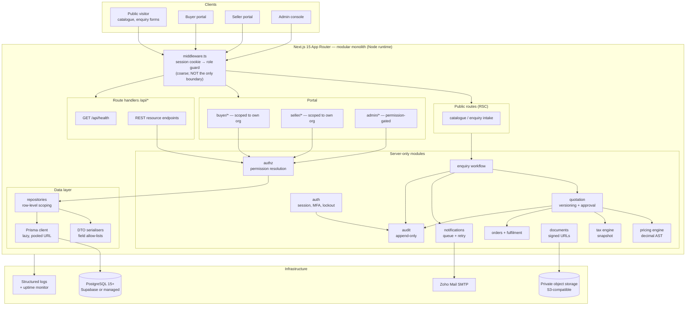

# PRIMEMET — Stage 2A: Backend Architecture

| | |
|---|---|
| **Document** | Stage 2A backend architecture (design only) |
| **Status** | **Draft for business-owner approval.** Nothing in this document is implemented. |
| **Version** | 2.0 — incorporates confirmed decisions D1–D3 (transaction model, contact sharing, transaction-specific tax) |
| **Date** | 2026-10-30 |
| **Baseline** | Stage 1 frontend, git commit `1d674a9`, working tree clean |
| **Audience** | Business owner, implementing engineer, reviewing accountant/legal adviser |
| **Change authority** | Business owner only. Sections marked **[O]** must not be implemented until decided. |

## How to read this document

Every requirement carries a status tag:

| Tag | Meaning |
|---|---|
| **[C]** | **Confirmed.** Approved by the business owner. Implementation must satisfy it exactly. |
| **[R]** | **Recommendation.** Proposed by the architect, not yet approved. Safe to follow unless the owner objects. |
| **[O]** | **Open decision.** Needs business-owner (or adviser) input before the related milestone starts. Listed in §15. |

Confirmed decisions in force for this document:

| ID | Decision | Status |
|---|---|---|
| **D1** | Both transaction models are supported: `INTERMEDIARY` (commission/service fee) and `PRINCIPAL` (buy-and-resell). The model is recorded on every opportunity and every order, with separate quotation and accounting flows. | **[C]** |
| **D2** | Buyer↔seller contact details are private by default. Only authorised Admin users may approve an introduction; approval, date, administrator and parties are recorded and auditable. No contact detail appears in public pages, search, listings or unauthorised API responses. | **[C]** |
| **D3** | Tax is transaction-specific and configurable. No universal GST rate is hardcoded. Type, rate, taxable base, amount, jurisdiction, effective date and a calculation snapshot are preserved on approved quotation versions and transaction records; intermediary and principal may differ where the law requires. Tax configuration changes are auditable and require authorised Admin review. | **[C]** |

---

## 1. Executive summary

PRIMEMET is a managed B2B platform for industrial scrap sourcing and spare-parts procurement. PRIMEMET is not a marketplace that lets buyers and sellers transact directly: it is an **operated desk**. A buyer submits a requirement, PRIMEMET staff source it, suppliers quote confidentially, PRIMEMET compares offers and issues a single buyer-facing quotation, and the deal becomes an order that PRIMEMET tracks to fulfilment. Supplier identity, supplier pricing and PRIMEMET's own margin are internal by construction.

**Current state.** Stage 1 delivered the complete public site, the Admin/Buyer/Seller portal shells and a shared design system — frontend only. There is no database, ORM, session, mail integration or business record anywhere in the repository, and the portal routes are openly reachable. That is the single largest risk in the current codebase and it is closed in Milestone 2.

**What this architecture delivers.** A modular monolith (Next.js App Router + PostgreSQL + Prisma) that keeps the existing UI and adds persistence, authentication, authorisation, a versioned pricing engine, a transaction-specific tax model, an audit trail, private document storage and email notification. Four structural commitments shape every table and endpoint below:

1. **Two transaction models, one opportunity record** (D1). `transactionModel` is a first-class, audited attribute of every enquiry and order. Intermediary deals carry a `commissionAmount`; principal deals carry `supplierCostTotal` and a derived `marginAmount`. Both expose exactly one `grandTotal` to the buyer.
2. **Contact is a controlled disclosure event** (D2). Contact data lives in its own table and is never joined into a buyer- or seller-facing response. Introduction is an explicit, approved, time-bounded and audited `contact_share_request` — not a flag flipped on a profile.
3. **Tax is data, not code** (D3). `tax_rules` rows carry rate, jurisdiction, taxable-base rule and effective dates; `tax_treatments` group them per transaction model; every approved quotation version and order stores an immutable `tax_snapshot` (type, rate, base, amount, jurisdiction, effective date, calculation time).
4. **Internal commercial data cannot leak through a query.** Supplier costs, margins and commissions live in tables and columns that only Admin-scoped repositories select. Buyer and seller DTOs are built field by field, never spread from a full row.

**Mandatory production gate.** Authentication and the portal role guards must be live before any deployment that is reachable from the internet. Until then the application is a preview, and it must be deployed as one or not at all.

**Delivery shape.** Nine milestones (§14). Milestone 1 (schema + migration) and Milestone 2 (authentication) are strictly sequential and block everything else; Milestones 3–8 are largely parallel once those two land; Milestone 9 is a gate, not a phase.

---

## 2. Scope

### 2.1 In scope for Stage 2

**[C]** Users and roles (ADMIN, BUYER, SELLER), organisation and business verification records, materials and spare-parts catalogue, supplier listings, buyer enquiries, supplier matching, confidential supplier quotations, buyer quotations with versions and approvals, transaction-specific tax, pricing rules and formula versions, orders and fulfilment, audit logging, private document storage and email notification.

### 2.2 Explicitly out of scope for Stage 2

**[C]** No change to the Stage 1 visual design or public page copy. No third-party marketplace integration, logistics-provider API, payment gateway or e-invoicing integration. No mobile application. No automated credit scoring or KYC bureau integration. No accounting-system integration (Tally/Zoho Books) in Stage 2 — the schema records accounting-relevant amounts but does not post journals.

### 2.3 Non-negotiables

**[C]** PostgreSQL only, via Prisma. All monetary, rate, weight and quantity values are `numeric`/`Decimal` with explicit precision — never floating point. No secrets in the repository. No database access at build time. Every supplier cost, margin and commission is internal-only. Every sensitive Admin action is auditable.

---

## 3. Business model

### 3.1 The operated workflow

The order of operations is fixed and is the backbone of the state machine in §9:

```
Buyer requirement → Admin review → Supplier identification → Confidential supplier quotes
   → Comparison (price, quality, quantity, freight, tax, terms) → Buyer-facing quotation
   → Acceptance / negotiation → Order → Fulfilment → Close
```

**[C]** PRIMEMET staff perform every intermediate step. A buyer never sees a supplier's identity or price; a supplier never sees the buyer's identity, the buyer's price or the margin. Disclosure is only ever the audited introduction of §8.

### 3.2 Two transaction models (D1) **[C]**

The same enquiry pipeline serves both models. The model is chosen by an authorised Admin before a supplier RFQ is issued **[R]**, can be revised with an audit entry while the enquiry is still open, and is then frozen onto the order.

| Dimension | `INTERMEDIARY` | `PRINCIPAL` |
|---|---|---|
| **Legal posture** | PRIMEMET acts as agent/facilitator between buyer and supplier | PRIMEMET buys from the supplier and sells to the buyer as principal |
| **Revenue line** | `commissionAmount` + agreed service fee | `marginAmount` = buyer revenue − procurement cost |
| **Cost of goods** | Supplier quote is the supplier's own price; PRIMEMET never takes title | Supplier quote is PRIMEMET's purchase cost; title passes to PRIMEMET |
| **Supplier quote role** | Commercial reference; margin added on top | Recorded purchase cost; drives `supplierCostTotal` and stock-style valuation |
| **Buyer invoice** | PRIMEMET invoice for commission/service (and any reimbursed freight) | PRIMEMET sales invoice for goods |
| **Supplier invoice** | Supplier ⇒ buyer, or supplier ⇒ PRIMEMET as pass-through **[O§15.4]** | Supplier ⇒ PRIMEMET (purchase invoice) |
| **Two-sided documents** | Buyer-facing quote + supplier-side quote, both stored | Purchase order/record + sales quote + sales invoice |
| **Tax treatment** | Tax on the commission/service line; goods tax may sit with the supplier **[O§15.3]** | Tax on the full sale value; purchase-side input tax recorded separately |
| **Inventory** | None | Optional stock record at receipt **[R, deferred]** |
| **Buyer-visible fields** | Total incl. PRIMEMET fee, tax, delivery | Total price, tax, delivery |
| **Never buyer-visible** | Supplier price, supplier identity, commission % of supplier | Supplier cost, margin, supplier identity |

**Data-model consequences [C]:**

- `enquiries.transaction_model` and `orders.transaction_model` are `NOT NULL` columns of enum `transaction_model`; both also carry `transaction_model_set_by_id` / `_set_at` for accountability.
- A model change writes an `audit_logs` row (`TRANSACTION_MODEL_CHANGED`) with the old and new value and the actor. It is blocked once a buyer quote has been `APPROVED` or the order exists.
- `buyer_quote_versions` carries `commission_amount`, `supplier_cost_total` and `margin_amount` as **internal-only** columns; the buyer DTO omits them.
- `order_cost_lines` records the principal purchase side (supplier purchase, inbound freight, handling, expenses); intermediary deals record their commission there too, so reporting reads one table for both models.
- Margin and commission are computed by the pricing engine (§6) from `pricing_components.visibility = 'INTERNAL'`, so no figure is ever typed into a buyer document by hand.

### 3.3 Party roles

| Party | Relationship to PRIMEMET | Self-service scope |
|---|---|---|
| **Buyer** | Customer. Raised enquiries, receives quotations, places orders. | Own organisation, own enquiries, own quotations, own orders, own profile and tax details |
| **Seller (supplier)** | Source. Receives confidential RFQ briefs, submits quotations, may list material/parts. | Own organisation, own listings, own RFQs received, own quote submissions, own documents |
| **Admin** | Operator. Runs the desk. | Everything in scope of their granted permissions (§10) |
| **Unregistered visitor** | Prospect. | Public catalogue and marketing pages only; no prices, no party data |

**[C]** A user may hold exactly one portal role. A company that both buys and sells uses one `organisations` row with `org_type = 'BOTH'` and two separate user accounts — one per role — rather than a dual-role account. This keeps every authorisation decision single-valued.

### 3.4 Money and model conventions **[R]**

- **Currency:** one `currency_code` per enquiry/quote/order, ISO 4217, default from `system_settings.default_currency_code`. No cross-currency arithmetic inside a document; if a foreign-currency deal is ever needed, an explicit `fx_rate` snapshot is stored on the version (§5, `buyer_quote_versions.fx_rate`).
- **Units:** canonical storage is kilograms for weight and pieces for counts; the document's presentation unit (`uom_code`) and its conversion factor are snapshotted, so a historical quote reprints exactly as issued.
- **Money precision:** amounts `numeric(18,2)`; unit rates `numeric(18,4)`; weights/quantities `numeric(18,3)`; percentages `numeric(9,4)`; FX `numeric(18,8)`. Rounding is `ROUND_HALF_UP` applied only at the stages defined in §6.6.

---

## 4. System architecture

### 4.1 Shape **[R]**

A **modular monolith**: one Next.js application, one PostgreSQL database, one deployment unit. There is no message broker, no microservice and no separate admin backend. Modules are internal boundaries (folders and service classes), so a module can later be extracted without a rewrite, but no network boundary exists today. This is the correct shape for a desk of this size: transactional consistency across enquiry → quote → order is the dominant requirement, and distributed transactions would add cost with no benefit.



### 4.2 Request path and the four defensible layers **[C]**

A request crosses four independent boundaries. No single one is trusted alone — this directly answers the "middleware must not be the only security boundary" requirement.

| Layer | Where | Enforces | Failure mode if bypassed |
|---|---|---|---|
| 1. Edge guard | `src/middleware.ts` | Cookie presence, coarse role→prefix match, redirect to login | UX only, never data safety — this layer can be bypassed and is treated as such |
| 2. Route/handler guard | every server component, server action and route handler | `requireSession()`, `requirePermission()`, `requireOrganisationScope()` | 401/403 before any query runs |
| 3. Repository scope | `src/server/**/repository.ts` | Every query is constructed with the caller's organisation or admin scope baked in; there is no "find by id" that omits it | Prevents IDOR even if layer 2 has a gap |
| 4. Serialiser | `src/server/**/dto.ts` | Field allow-list per audience (`buyer`, `seller`, `admin`, `public`) | Strips internal columns even if a query is too broad |

**[C]** Layers 2–4 are mandatory per module. Layer 4 is what makes D1 and D2 mechanically true: `toBuyerQuoteDTO()` has no code path that reads `supplier_cost_total`.

### 4.3 Runtime and rendering **[R]**

- Node.js runtime for all data-bearing routes; the Edge runtime is avoided because Prisma cannot run there. (Node is already the Stage 1 target.)
- Server Components read; Server Actions and route handlers write. No client component holds a database-facing credential or typed query.
- The public catalogue stays statically rendered where it holds no live data. Pages that gain live data move to dynamic rendering with explicit cache tags.
- `/api/health` becomes dynamic once it checks the database (§12.12).

---

## 5. Database design

### 5.1 Conventions **[C]**

| Rule | Detail |
|---|---|
| Engine | PostgreSQL 15+ |
| Identifier | `uuid` primary keys, `gen_random_uuid()` (pgcrypto/pg 13+ built-in). Non-sequential, safe in URLs and API responses. |
| Table names | `snake_case`, plural, mapped from Prisma PascalCase models via `@@map` |
| Timestamps | `created_at`, `updated_at` `timestamptz NOT NULL` on every mutable table; `deleted_at timestamptz NULL` where soft delete applies |
| Soft delete | Applied to master data and organisations only (`users`, `organisations`, `material_grades`, `products`, `supplier_listings`, `documents`). Transactional records (quotes, orders, audit) are **never** soft-deleted — they use status + archive. |
| Money | `numeric(18,2)` amounts · `numeric(18,4)` unit rates · `numeric(9,4)` percentages · `numeric(18,8)` FX · `numeric(18,3)` weights and quantities · `numeric(18,6)` unit-conversion factors. **No `float`/`double` anywhere.** |
| Currency | `char(3)` ISO 4217 on every monetary document; no implicit default at the database level |
| Enums | Native PostgreSQL enums via Prisma `enum`; appended by migration only (adding a value is safe, renaming is not) |
| Human references | `reference_sequences` allocates `ENQ-2026-000123`, `QT-2026-000045`, `ORD-2026-000031`; the number is immutable once issued |
| Immutability | Version tables (`*_versions`, `*_revisions`, `pricing_calculations`, `tax_lines`, `audit_logs`, `email_attempts`) are insert-only. Corrections create a new row. |
| Concurrency | Optimistic locking via `version integer` on `enquiries`, `buyer_quotes`, `orders`, `pricing_rule_sets`; the write asserts the version it read |
| Deletion | `ON DELETE RESTRICT` for financial and audit relationships; `ON DELETE CASCADE` only for pure child rows (lines, history, notes, attachments) |
| Personal data | Contact fields isolated in `organisation_contacts` and `users` (§5.4). Pseudonymised request metadata (IP, user agent) stored as salted hashes. |

### 5.2 Enumerations

```text
user_role              ADMIN | BUYER | SELLER
user_status            INVITED | ACTIVE | SUSPENDED | DISABLED | ARCHIVED
admin_tier             SUPER_ADMIN | SOURCING_OPS_ADMIN | CATALOGUE_MANAGER | READ_ONLY_ADMIN
admin_permission       (42 values — see §10.2)
org_type               BUYER | SELLER | BOTH
verification_status    NOT_SUBMITTED | PENDING | UNDER_REVIEW | VERIFIED | REJECTED | EXPIRED
verification_type      GST | PAN | CIN | TRADE_LICENCE | ISO | IEC | OTHER
transaction_model      INTERMEDIARY | PRINCIPAL
enquiry_status         NEW | UNDER_REVIEW | MATCHING_SUPPLIERS | QUOTES_REQUESTED | QUOTES_RECEIVED |
                       COMPARING_QUOTES | QUOTE_DRAFTED | QUOTE_SENT | NEGOTIATION |
                       BUYER_SELLER_INTRODUCTION | WON | LOST | CANCELLED
enquiry_priority       LOW | NORMAL | HIGH | URGENT
enquiry_source         WEB_FORM | PHONE | EMAIL | REFERRAL | EXISTING_CUSTOMER | ADMIN_ENTRY
supplier_match_status  PROPOSED | APPROVED_FOR_RFQ | RFQ_SENT | QUOTE_RECEIVED | DECLINED | WITHDRAWN | EXCLUDED
supplier_quote_status  DRAFT | SUBMITTED | SUPERSEDED | WITHDRAWN | EXPIRED
buyer_quote_status     DRAFT | PENDING_APPROVAL | APPROVED | SENT | VIEWED | NEGOTIATION |
                       ACCEPTED | REJECTED | EXPIRED | SUPERSEDED | CANCELLED
approval_action        SUBMIT_FOR_APPROVAL | APPROVE | REJECT | REQUEST_CHANGES | WITHDRAW
contact_share_status   REQUESTED | APPROVED | DENIED | REVOKED | EXPIRED
contact_share_scope    PARTY_NAME | CONTACT_PERSON | EMAIL | PHONE | ADDRESS | ALL_CONTACT
pricing_rule_status    DRAFT | TESTING | PENDING_APPROVAL | ACTIVE | RETIRED
pricing_component_type BASE_RATE | GRADE_ADJUSTMENT | CONTAMINATION_DEDUCTION | QUANTITY_ADJUSTMENT |
                       LOCATION_ADJUSTMENT | FREIGHT | HANDLING | LOADING | PACKAGING | TESTING |
                       MARGIN | COMMISSION | DISCOUNT | SURCHARGE | ROUNDING | MIN_ORDER_ADJUSTMENT
charge_party           PURCHASE | SALE | BOTH
visibility             INTERNAL | BUYER_VISIBLE | SUPPLIER_VISIBLE
tax_rule_status        DRAFT | ACTIVE | RETIRED
tax_component_type     GST | IGST | CGST | SGST | UTGST | VAT | SALES_TAX | CESS |
                       WITHHOLDING_TAX | REVERSE_CHARGE | EXEMPT | OTHER
tax_base_rule          GOODS_VALUE | SERVICE_VALUE | COMMISSION_VALUE | FREIGHT_VALUE |
                       GOODS_PLUS_FREIGHT | TAXABLE_SUBTOTAL
tax_applies_to         PURCHASE | SALE | BOTH
order_status           DRAFT | CONFIRMED | SOURCING | READY_TO_DISPATCH | IN_TRANSIT |
                       DELIVERED | INVOICED | CLOSED | CANCELLED
payment_status         UNPAID | PARTIALLY_PAID | PAID | OVERDUE | WAIVED
payment_direction      RECEIVABLE | PAYABLE
cost_type              SUPPLIER_PURCHASE | INBOUND_FREIGHT | HANDLING | EXPENSE | COMMISSION | OTHER
shipment_status        PLANNED | DISPATCHED | IN_TRANSIT | DELIVERED | FAILED | RETURNED
listing_status         DRAFT | ACTIVE | PAUSED | EXPIRED | WITHDRAWN
product_condition      NEW | REFURBISHED | USED | UNKNOWN
document_type          GST_CERTIFICATE | PAN_CARD | TRADE_LICENCE | ISO_CERTIFICATE | ENQUIRY_ATTACHMENT |
                       SUPPLIER_QUOTE_ATTACHMENT | PURCHASE_ORDER | SALES_INVOICE | PURCHASE_INVOICE |
                       WEIGHMENT_SLIP | TEST_REPORT | EWAY_BILL | OTHER
document_visibility    INTERNAL | BUYER_VISIBLE | SUPPLIER_VISIBLE
scan_status            PENDING | CLEAN | INFECTED | FAILED
email_status           QUEUED | SENDING | SENT | FAILED | BOUNCED | SUPPRESSED | CANCELLED
audit_severity         INFO | NOTICE | WARNING | CRITICAL
```

### 5.3 Table definitions — Group A: identity, organisation and access

Notation: `PK` primary key · `FK→x` foreign key · `UQ` unique · `IDX` indexed · `NN` not null.

```text
users — one row per human identity. The only table authentication reads.
  id                      uuid        PK
  email                   text        NN UQ          -- lowercased + trimmed at write time
  email_verified_at       timestamptz NULL
  password_hash           text        NULL           -- argon2id/bcrypt; NULL until invite accepted
  password_changed_at     timestamptz NULL
  full_name               text        NN
  phone                   text        NULL           -- internal contact; never public
  role                    user_role   NN
  status                  user_status NN default 'INVITED'
  locale                  text        NN default 'en-IN'
  mfa_enabled             boolean     NN default false
  mfa_secret_ciphertext   text        NULL           -- application-encrypted, never logged
  failed_login_count      int         NN default 0
  locked_until            timestamptz NULL
  last_login_at           timestamptz NULL
  created_at / updated_at timestamptz NN
  deleted_at              timestamptz NULL
  IDX (role, status) · IDX (status, created_at) · IDX (deleted_at)

sessions — server-side session store. Cookie holds an opaque token; only its hash is stored.
  id              uuid        PK
  user_id         uuid        FK→users NN ON DELETE CASCADE
  token_hash      text        NN UQ          -- sha-256 of the cookie value
  role_at_issue   user_role   NN             -- invalidate on role change
  ip_hash         text        NULL
  user_agent_hash text        NULL
  created_at      timestamptz NN
  last_seen_at    timestamptz NN
  expires_at      timestamptz NN
  revoked_at      timestamptz NULL
  revoked_reason  text        NULL
  IDX (user_id, expires_at) · IDX (expires_at) · IDX (revoked_at)

auth_events — authentication audit trail, independent of the business audit log.
  id               uuid        PK
  user_id          uuid        FK→users NULL ON DELETE SET NULL
  email_attempted  text        NULL       -- normalised; never a password
  event_type       text        NN        -- LOGIN_SUCCESS | LOGIN_FAILED | LOGOUT | MFA_CHALLENGE |
                                          -- PASSWORD_RESET_REQUESTED | PASSWORD_CHANGED |
                                          -- ACCOUNT_LOCKED | SESSION_REVOKED
  success          boolean     NN
  ip_hash          text        NULL
  user_agent_hash  text        NULL
  detail           jsonb       NULL       -- redacted, no secrets
  occurred_at      timestamptz NN
  IDX (user_id, occurred_at) · IDX (email_attempted, occurred_at) · IDX (event_type, occurred_at)

admin_profiles — staff extension. 1:1 with a user whose role = ADMIN.
  id                 uuid        PK
  user_id            uuid        FK→users NN UQ
  staff_code         text        NN UQ
  tier               admin_tier  NN
  job_title          text        NULL
  desk               text        NULL       -- e.g. scrap desk, parts desk
  mfa_required       boolean     NN default true
  approval_limit     numeric(18,2) NULL     -- max quote value this admin may approve alone
  is_active          boolean     NN default true
  created_at / updated_at timestamptz NN

admin_permission_grants — per-user override on top of the tier baseline (§10.2).
  id            uuid        PK
  admin_id      uuid        FK→admin_profiles NN ON DELETE CASCADE
  permission    admin_permission NN
  effect        text        NN        -- GRANT | REVOKE
  granted_by_id uuid        FK→admin_profiles NULL
  reason        text        NULL
  expires_at    timestamptz NULL
  created_at    timestamptz NN
  UQ (admin_id, permission) · IDX (admin_id)

portal_invitations — onboarding token for a buyer or seller user.
  id            uuid        PK
  email         text        NN
  role          user_role   NN
  organisation_id uuid      FK→organisations NULL
  invited_by_id uuid        FK→users NULL
  token_hash    text        NN UQ
  expires_at    timestamptz NN
  accepted_at   timestamptz NULL
  revoked_at    timestamptz NULL
  created_at    timestamptz NN
  IDX (email, expires_at) · IDX (organisation_id)

organisations — the legal trading entity. Replaces a separate buyer/seller company table.
  id                    uuid        PK
  legal_name            text        NN
  trade_name            text        NULL
  org_type              org_type    NN
  registration_number   text        NULL       -- CIN / equivalent
  gstin                 text        NULL       -- validated format only; see §7
  pan                   text        NULL
  iec                   text        NULL
  country_code          char(2)     NN
  state_code            text        NULL       -- jurisdiction input for tax (§7)
  city                  text        NULL
  website               text        NULL
  verification_status   verification_status NN default 'NOT_SUBMITTED'
  account_status        text        NN default 'ACTIVE'  -- ACTIVE | ON_HOLD | CLOSED
  is_listable           boolean     NN default false    -- supplier may be matched
  internal_notes        text        NULL       -- admin-only, never serialised outward
  created_at / updated_at timestamptz NN
  deleted_at            timestamptz NULL
  UQ (gstin) WHERE gstin IS NOT NULL · UQ (pan) WHERE pan IS NOT NULL
  IDX (org_type, verification_status) · IDX (state_code) · IDX (deleted_at)

organisation_addresses
  id            uuid        PK
  organisation_id uuid      FK→organisations NN ON DELETE CASCADE
  kind          text        NN        -- BILLING | SHIPPING | SITE | REGISTERED
  label         text        NULL
  line1 / line2 text
  city          text        NN
  state_code    text        NN
  postal_code   text        NULL
  country_code  char(2)     NN
  is_default    boolean     NN default false
  created_at / updated_at timestamptz NN
  IDX (organisation_id, kind)

organisation_contacts — PRIVATE by default (D2). Never joined into public or cross-party responses.
  id              uuid        PK
  organisation_id uuid        FK→organisations NN ON DELETE CASCADE
  user_id         uuid        FK→users NULL ON DELETE SET NULL
  full_name       text        NN
  role_label      text        NULL
  email           text        NN
  phone           text        NULL
  is_primary      boolean     NN default false
  shareable       boolean     NN default false   -- admin may consent to share this contact
  created_at / updated_at timestamptz NN
  UQ (organisation_id, email) · IDX (organisation_id, is_primary)

organisation_verifications — business verification with document evidence.
  id              uuid        PK
  organisation_id uuid        FK→organisations NN ON DELETE CASCADE
  type            verification_type NN
  status          verification_status NN default 'PENDING'
  reference_value text        NULL       -- the claimed number (GSTIN, PAN…), stored normalised
  document_id     uuid        FK→documents NULL
  verified_by_id  uuid        FK→admin_profiles NULL
  verified_at     timestamptz NULL
  expires_at      timestamptz NULL
  rejection_reason text       NULL
  created_at / updated_at timestamptz NN
  UQ (organisation_id, type) · IDX (status, expires_at)

buyer_profiles — 1:1 with a user whose role = BUYER.
  id                 uuid        PK
  user_id            uuid        FK→users NN UQ
  organisation_id    uuid        FK→organisations NN
  job_title          text        NULL
  department         text        NULL
  approval_limit     numeric(18,2) NULL
  preferred_currency char(3)     NULL
  default_ship_to_id uuid        FK→organisation_addresses NULL
  created_at / updated_at timestamptz NN
  IDX (organisation_id)

supplier_profiles — 1:1 with a user whose role = SELLER.
  id                  uuid        PK
  user_id             uuid        FK→users NN UQ
  organisation_id     uuid        FK→organisations NN
  contact_role        text        NULL
  is_primary_contact  boolean     NN default false
  credit_terms_days   int         NULL
  can_submit_quotes   boolean     NN default true
  created_at / updated_at timestamptz NN
  IDX (organisation_id)

reference_sequences — concurrency-safe human reference allocation.
  prefix      text    NN
  year        int     NN
  last_value  bigint  NN default 0
  PK (prefix, year)
```

### 5.4 Table definitions — Group B: catalogue, pricing reference, enquiry and supplier quoting

```text
material_categories — scrap taxonomy root (ferrous, non-ferrous, alloys, plastics…).
  id               uuid        PK
  parent_id        uuid        FK→material_categories NULL
  code             text        NN UQ
  name             text        NN
  description      text        NULL
  is_active        boolean     NN default true
  sort_order       int         NN default 0
  created_at / updated_at timestamptz NN
  deleted_at       timestamptz NULL
  IDX (parent_id, sort_order)

material_grades — a tradable grade. The unit of pricing and of supplier matching.
  id                  uuid        PK
  category_id         uuid        FK→material_categories NN
  code                text        NN UQ        -- e.g. HMS-1-2, CU-MILL-BERRY
  name                text        NN
  description         text        NULL
  canonical_uom       text        NN default 'KG'
  min_order_quantity  numeric(18,3) NULL
  severity_default    text        NULL          -- typical contamination severity key (§6.6)
  is_active           boolean     NN default true
  is_public           boolean     NN default true   -- appears on the public catalogue page
  created_at / updated_at timestamptz NN
  deleted_at          timestamptz NULL
  IDX (category_id, is_active) · IDX (is_public)

material_grade_specs — quality attributes with acceptable ranges.
  id                 uuid        PK
  material_grade_id  uuid        FK→material_grades NN ON DELETE CASCADE
  attribute          text        NN        -- ISRI_CODE | PURITY | MOISTURE | DENSITY | SHEARING | …
  unit               text        NULL
  expected_min       numeric(18,4) NULL
  expected_max       numeric(18,4) NULL
  is_required        boolean     NN default false
  sort_order         int         NN default 0
  UQ (material_grade_id, attribute)

product_categories — spare-parts taxonomy.
  id          uuid        PK
  parent_id   uuid        FK→product_categories NULL
  code        text        NN UQ
  name        text        NN
  is_active   boolean     NN default true
  sort_order  int         NN default 0
  IDX (parent_id, sort_order)

products — catalogue definition for spare parts (not a stock item).
  id                 uuid        PK
  category_id        uuid        FK→product_categories NN
  code               text        NN UQ        -- internal SKU/catalogue code
  name               text        NN
  brand              text        NULL        -- buyer-visible brand is legitimate; supplier is not
  description        text        NULL
  canon_uom          text        NN default 'PCS'
  condition          product_condition NN default 'UNKNOWN'
  is_active          boolean     NN default true
  is_public          boolean     NN default true
  created_at / updated_at timestamptz NN
  deleted_at         timestamptz NULL
  IDX (category_id, is_active) · IDX (code)

product_specs — key/value specifications (part numbers, dimensions, voltage…).
  id           uuid        PK
  product_id   uuid        FK→products NN ON DELETE CASCADE
  name         text        NN
  value        text        NN
  unit         text        NULL
  is_required  boolean     NN default false
  is_mpn       boolean     NN default false   -- one MPN per product
  UQ (product_id, name) · partial UQ (product_id) WHERE is_mpn

supplier_listings — what a supplier states it can supply. The supplier's public-facing asset.
  id                 uuid        PK
  organisation_id    uuid        FK→organisations NN
  created_by_id      uuid        FK→users NN
  kind               text        NN        -- MATERIAL | PRODUCT
  material_grade_id  uuid        FK→material_grades NULL
  product_id         uuid        FK→products NULL
  title              text        NN
  description        text        NULL
  available_quantity numeric(18,3) NULL
  uom                text        NULL
  location_state     text        NULL
  lead_time_days     int         NULL
  status             listing_status NN default 'DRAFT'
  published_at       timestamptz NULL
  expires_at         timestamptz NULL
  created_at / updated_at timestamptz NN
  deleted_at         timestamptz NULL
  CHECK (kind = 'MATERIAL' AND material_grade_id IS NOT NULL OR
         kind = 'PRODUCT'  AND product_id IS NOT NULL)
  IDX (organisation_id, status) · IDX (material_grade_id) · IDX (product_id) · IDX (status, published_at)
  -- NOTE: no price columns. Suppliers never publish prices; they quote confidentially (§5.6).

price_records — reference/market rate history used as a pricing-engine input.
  id                 uuid        PK
  material_grade_id  uuid        FK→material_grades NULL
  product_id         uuid        FK→products NULL
  source             text        NN        -- MARKET_FEED | ADMIN_ENTRY | SUPPLIER_QUOTE_HISTORY
  basis              text        NN        -- INCOMING | OUTGOING | REFERENCE
  unit_rate          numeric(18,4) NN
  currency_code      char(3)     NN
  uom                text        NN
  jurisdiction_state text        NULL
  effective_from     timestamptz NN
  effective_to       timestamptz NULL
  recorded_by_id     uuid        FK→admin_profiles NULL
  note               text        NULL
  created_at         timestamptz NN
  CHECK (material_grade_id IS NOT NULL OR product_id IS NOT NULL)
  IDX (material_grade_id, effective_from DESC) · IDX (product_id, effective_from DESC) · IDX (basis, effective_from)

enquiries — the central sales opportunity. One row per buyer requirement.
  id                      uuid        PK
  reference               text        NN UQ        -- ENQ-2026-000123
  buyer_user_id           uuid        FK→users NN
  buyer_organisation_id   uuid        FK→organisations NN
  submitted_by_contact_id uuid        FK→organisation_contacts NULL
  source                  enquiry_source NN default 'WEB_FORM'
  kind                    text        NN        -- MATERIAL | PRODUCT | MIXED
  title                   text        NN
  description             text        NULL
  material_grade_id       uuid        FK→material_grades NULL
  product_id              uuid        FK→products NULL
  requested_quantity      numeric(18,3) NULL
  requested_uom           text        NULL
  target_unit_price       numeric(18,4) NULL   -- buyer's expectation; internal, never sent to suppliers
  currency_code           char(3)     NN
  delivery_state          text        NULL
  delivery_address_id     uuid        FK→organisation_addresses NULL
  required_by             date        NULL
  incoterms               text        NULL
  transaction_model       transaction_model NN default 'INTERMEDIARY'
  transaction_model_set_by_id uuid    FK→admin_profiles NULL
  transaction_model_set_at    timestamptz NULL
  status                  enquiry_status NN default 'NEW'
  priority                enquiry_priority NN default 'NORMAL'
  owner_admin_id          uuid        FK→admin_profiles NULL
  tax_jurisdiction_state  text        NULL      -- seller-of-record state, drives tax grouping (§7)
  tax_treatment_id        uuid        FK→tax_treatments NULL
  version                 int         NN default 1
  first_responded_at      timestamptz NULL
  quote_sent_at           timestamptz NULL
  closed_at               timestamptz NULL
  lost_reason             text        NULL
  created_at / updated_at timestamptz NN
  IDX (buyer_organisation_id, status, created_at DESC)
  IDX (status, priority, created_at) · IDX (owner_admin_id, status)
  IDX (material_grade_id) · IDX (transaction_model, status) · IDX (required_by)

enquiry_lines — multi-line requirements for MIXED or multi-grade enquiries.
  id              uuid        PK
  enquiry_id      uuid        FK→enquiries NN ON DELETE CASCADE
  line_no         int         NN
  kind            text        NN
  material_grade_id uuid      FK→material_grades NULL
  product_id      uuid        FK→products NULL
  description     text        NULL
  quantity        numeric(18,3) NN
  uom             text        NN
  target_unit_price numeric(18,4) NULL
  specs           jsonb       NULL       -- buyer-stated attributes; validated per grade
  UQ (enquiry_id, line_no)

enquiry_attachments — links a private document to an enquiry.
  id            uuid        PK
  enquiry_id    uuid        FK→enquiries NN ON DELETE CASCADE
  document_id   uuid        FK→documents NN
  visibility    document_visibility NN default 'INTERNAL'
  created_at    timestamptz NN
  UQ (enquiry_id, document_id)

enquiry_status_history — append-only workflow trail (feeds the UI timeline and audit).
  id             uuid        PK
  enquiry_id     uuid        FK→enquiries NN ON DELETE CASCADE
  from_status    enquiry_status NULL
  to_status      enquiry_status NN
  actor_user_id  uuid        FK→users NULL
  reason         text        NULL
  created_at     timestamptz NN
  IDX (enquiry_id, created_at)

supplier_matches — which suppliers were considered for an enquiry, and why.
  id                     uuid        PK
  enquiry_id             uuid        FK→enquiries NN ON DELETE CASCADE
  organisation_id        uuid        FK→organisations NN
  status                 supplier_match_status NN default 'PROPOSED'
  match_score            numeric(5,2) NULL     -- ranking aid, not a price
  reason                 text        NULL       -- admin rationale
  proposed_by_id         uuid        FK→admin_profiles NULL
  approved_by_id         uuid        FK→admin_profiles NULL
  approved_at            timestamptz NULL
  excluded_reason        text        NULL
  created_at / updated_at timestamptz NN
  UQ (enquiry_id, organisation_id)
  IDX (organisation_id, status) · IDX (enquiry_id, status)

supplier_rfqs — the confidential request sent to one matched supplier.
  id                     uuid        PK
  reference              text        NN UQ
  enquiry_id             uuid        FK→enquiries NN
  supplier_organisation_id uuid      FK→organisations NN
  sent_by_id             uuid        FK→admin_profiles NN
  sent_at                timestamptz NULL
  response_due_at        timestamptz NULL
  brief                  jsonb       NN         -- redacted brief: NO buyer identity, NO target price
  brief_text             text        NULL
  status                 text        NN default 'DRAFT'  -- DRAFT | SENT | RESPONDED | DECLINED | EXPIRED
  token_hash             text        NULL UQ    -- optional tokenised external link
  created_at / updated_at timestamptz NN
  UQ (enquiry_id, supplier_organisation_id, sent_at)
  IDX (supplier_organisation_id, status) · IDX (enquiry_id)

supplier_quote_submissions — a supplier's confidential offer. Never buyer-visible.
  id                      uuid        PK
  reference               text        NN UQ
  rfq_id                  uuid        FK→supplier_rfqs NN
  enquiry_id              uuid        FK→enquiries NN
  supplier_organisation_id uuid       FK→organisations NN
  submitted_by_user_id    uuid        FK→users NN
  status                  supplier_quote_status NN default 'DRAFT'
  currency_code           char(3)     NN
  valid_until             date        NULL
  payment_terms_days      int         NULL
  delivery_lead_days      int         NULL
  freight_amount          numeric(18,2) NULL
  freight_included        boolean     NN default false
  packaging_terms         text        NULL
  testing_terms           text        NULL
  remarks                 text        NULL
  total_amount            numeric(18,2) NULL   -- computed on submit from lines
  is_internal_only        boolean     NN default true  -- enforced by serialiser, documented here
  submitted_at            timestamptz NULL
  created_at / updated_at timestamptz NN
  IDX (enquiry_id, status) · IDX (supplier_organisation_id, submitted_at DESC) · IDX (rfq_id)

supplier_quote_lines
  id                    uuid        PK
  supplier_quote_id     uuid        FK→supplier_quote_submissions NN ON DELETE CASCADE
  line_no               int         NN
  material_grade_id     uuid        FK→material_grades NULL
  product_id            uuid        FK→products NULL
  description           text        NULL
  quantity              numeric(18,3) NN
  uom                   text        NN
  unit_price            numeric(18,4) NN
  line_total            numeric(18,2) NN
  grade_specs           jsonb       NULL
  UQ (supplier_quote_id, line_no)

supplier_quote_attachments
  id                 uuid        PK
  supplier_quote_id  uuid        FK→supplier_quote_submissions NN ON DELETE CASCADE
  document_id        uuid        FK→documents NN
  created_at         timestamptz NN
```

```text
supplier_quote_charges — the cost lines that make a quote comparable on a landed basis.
  id                 uuid        PK
  supplier_quote_id  uuid        FK→supplier_quote_submissions NN ON DELETE CASCADE
  charge_type        charge_party NN          -- FREIGHT | LOADING | PACKAGING | TESTING | OTHER
  charge_party       charge_party NN default 'PURCHASE'
  amount             numeric(18,2) NN
  currency_code      char(3)     NN
  is_included_in_price boolean   NN default false
  note               text        NULL
  IDX (supplier_quote_id, charge_type)
```

### 5.5 Enquiry / RFQ data model — quotation-ready lead capture

The buyer enquiry is the **primary source of truth for the commercial requirement**. It must
carry enough structured information for the desk to obtain supplier quotations, compare them
and prepare an accurate buyer quotation **without contacting the buyer again for missing
information**. This section is the authoritative model; the frontend wizard in
`src/components/enquiry/` and the catalogue in `src/lib/content/enquiry-fields.ts` are built
from it, field for field.

#### 5.5.1 Design rules

| Rule | Detail |
|---|---|
| Two requirement branches | Scrap material (group B) and industrial spare parts (group C) are **separate conditional schemas**, never one union table of nullable columns. Both are stored as `enquiry_lines` rows, with `kind` on the line. |
| Enquiry kind | `enquiries.kind` = `MATERIAL` \| `PRODUCT` \| `MIXED`. A `MIXED` enquiry carries one line of each kind, so a single brief can ask for scrap **and** parts. |
| Not everything is mandatory | Field status is declared once, in the catalogue: `REQUIRED`, `SCRAP`, `PRODUCT`, `DELIVERY`, `OPTIONAL`, `LATER`. The database enforces the hard subset with `CHECK` constraints; the rest is application validation. |
| Unknown is legitimate | Technical facts (grade, purity, contamination, brand, part number, technical spec) accept `UNKNOWN`. A CHECK never forces a value there, because rejecting a real lead on a fact the buyer cannot know loses business. |
| Unknown means clarify | `enquiry_clarifications` records each unknown against the field, with a status the desk works through. This is what flags a lead instead of rejecting it. |
| Late facts | `LATER` fields (billing address, GSTIN, full delivery address) are collected before the invoice or order. They do not block intake. |
| No price is invented | `target_unit_price` is buyer-supplied and optional. It is **internal** — never serialised to a supplier, and `NULL` is not a missing required field. |
| Readiness is computed, not typed | `enquiries.readiness_state` is derived from blockers + open clarifications, never set by hand. |

#### 5.5.2 Group A — buyer and business details

Stored on `organisations`, `organisation_addresses` and `organisation_contacts` (§5.3) plus the
enquiry's delivery snapshot. Contacts remain private by default (D2).

| Field | Key | Status | Type / constraint |
|---|---|---|---|
| Contact person name | `contact_person_name` | REQUIRED | `text NOT NULL` (copied to the enquiry as a snapshot) |
| Company / business name | `business_name` | REQUIRED | resolves to `organisations.legal_name` |
| Mobile with country code | `mobile` | REQUIRED | `text`, E.164; stored `text` not numeric |
| Business email | `business_email` | REQUIRED | `citext`; free-mail domains flagged, not rejected |
| Business type | `business_type` | REQUIRED | enum `business_type` |
| GSTIN where applicable | `gstin` | OPTIONAL → LATER | `text`, format-checked; required before a tax invoice |
| Company website | `website` | OPTIONAL | `text`, `https` only |
| Billing address | `billing_address` | LATER | `organisation_addresses` (`kind='BILLING'`) |
| Delivery city | `delivery_city` | REQUIRED | `text` |
| Delivery state / region | `delivery_state` | REQUIRED | `text`; also a **tax jurisdiction input** (§7) |
| Delivery PIN code | `delivery_postal_code` | REQUIRED | `text` (leading zeros are significant — never an integer) |

#### 5.5.3 Group B — scrap material requirement (line kind `MATERIAL`)

| Field | Key | Status | Type / constraint |
|---|---|---|---|
| Material category | `material_category` | SCRAP | FK→`material_categories` |
| Metal / material type | `metal_type` | SCRAP | `text` |
| Grade | `material_grade_id` | SCRAP, `UNKNOWN` allowed | FK→`material_grades NULL` |
| Grade specification | `grade_specification` | SCRAP, `UNKNOWN` allowed | `text` |
| Scrap form | `scrap_form` | SCRAP, `UNKNOWN` allowed | enum `scrap_form` |
| Quantity | `quantity` | SCRAP | `numeric(18,3)`, `CHECK (quantity > 0)` |
| Unit | `uom` | SCRAP | enum `quantity_uom` (`KG`/`MT`/`TONNE`) |
| Condition | `condition` | SCRAP, `UNKNOWN` allowed | enum `material_condition` |
| Purity / composition | `purity_pct` | SCRAP, `UNKNOWN` allowed | `numeric(9,4)`, `CHECK 0–100` |
| Contamination | `contamination_pct` | SCRAP, `UNKNOWN` allowed | `numeric(9,4)`, `CHECK 0–100` |
| Source of scrap | `scrap_source` | OPTIONAL | `text` |
| Material photographs | via `enquiry_attachments` | OPTIONAL | private `documents`, `visibility='INTERNAL'` |
| Inspection requirement | `inspection_requirement` | DELIVERY | enum `inspection_level` |
| Sample availability | `sample_available` | SCRAP | enum `sample_answer` |

#### 5.5.4 Group C — industrial spare-part requirement (line kind `PRODUCT`)

| Field | Key | Status | Type / constraint |
|---|---|---|---|
| Product category | `product_category_id` | PRODUCT | FK→`product_categories` |
| Product name | `product_name` | PRODUCT | `text` |
| Manufacturer / brand | `manufacturer` | PRODUCT, `UNKNOWN` allowed | `text` |
| Part number / SKU | `part_number` | PRODUCT, `UNKNOWN` allowed | `text`; needed unless a nameplate photo is attached |
| Technical specification | `technical_spec` | PRODUCT, `UNKNOWN` allowed | `text` |
| Material / grade (part) | `part_material` | OPTIONAL, `UNKNOWN` allowed | `text` |
| Quantity | `quantity` | PRODUCT | `numeric(18,3)`, `CHECK (quantity > 0)` |
| Unit | `uom` | PRODUCT | enum `quantity_uom` (`PCS`/`SET`/`M`) |
| Condition | `product_condition` | PRODUCT | enum `product_condition` |
| Compatible machine / model | `compatible_machine` | OPTIONAL | `text` |
| Drawing / datasheet / photo | via `enquiry_attachments` | PRODUCT | private `documents` |
| Equivalent acceptable | `equivalent_acceptable` | PRODUCT | enum `equivalent_policy` |

#### 5.5.5 Group D — delivery and logistics

| Field | Key | Status | Type / constraint |
|---|---|---|---|
| Delivery / pickup location | `delivery_location` | REQUIRED | `text` |
| Delivery PIN code | `delivery_postal_code` | REQUIRED | `text` |
| Full delivery address | `full_delivery_address` | DELIVERY | `text`; may reference `organisation_addresses` |
| Freight preference | `freight_preference` | DELIVERY | enum `freight_preference` |
| Loading / unloading responsibility | `loading_responsibility` | DELIVERY | enum `loading_party` |
| Pickup arrangements (scrap) | `pickup_arrangements` | SCRAP | `text` |
| Weighbridge available | `weighbridge_available` | OPTIONAL | `boolean NULL` (unknown ≠ false) |
| Site inspection / equipment | `site_equipment` | OPTIONAL | `text` |
| Preferred delivery date | `preferred_delivery_date` | DELIVERY | `date` |
| Transport restrictions | `transport_restrictions` | OPTIONAL | `text` |

#### 5.5.6 Group E — commercial details

| Field | Key | Status | Type / constraint |
|---|---|---|---|
| Target price | `target_unit_price` | OPTIONAL, `UNKNOWN` allowed | `numeric(18,4)` — **internal, never supplier-visible** |
| Target price unit | `target_price_uom` | with target price | enum `quantity_uom` |
| Tax preference | `tax_preference` | REQUIRED | enum `tax_preference` (`INCLUDED`/`EXTRA`) — a *preference*, never a rate |
| Payment preference | `payment_preference` | OPTIONAL | enum `payment_preference` |
| Advance payment possible | `advance_pct` | OPTIONAL | `numeric(9,4)`, `CHECK 0–100` |
| Requested credit period | `credit_period_days` | OPTIONAL | `int`, `CHECK >= 0` |
| One-time or recurring | `requirement_frequency` | REQUIRED | enum `requirement_frequency` |
| Monthly quantity | `monthly_quantity` | SCRAP, when recurring | `numeric(18,3)`; CHECK requires it when `RECURRING` |
| Quotation validity preference | `quote_validity_days` | OPTIONAL | `int` |
| Commercial remarks | `commercial_remarks` | OPTIONAL | `text` |

#### 5.5.7 Group F — additional information

| Field | Key | Status | Type / constraint |
|---|---|---|---|
| Requirement description | `description` | REQUIRED | `text` |
| Photos, PDFs, Excel/BOM, drawings | via `enquiry_attachments` | OPTIONAL | ≤10 files/lead, 10 MB each, private |
| Sample requirement | `sample_requirement` | OPTIONAL | enum `sample_stage` |
| Inspection availability | `inspection_availability` | OPTIONAL | enum `availability` |
| Preferred communication | `preferred_communication` | OPTIONAL | enum `comm_channel` |
| Additional instructions | `additional_instructions` | OPTIONAL | `text` |

#### 5.5.8 Conditional validation rules (the contract both the wizard and the API enforce)

| Rule | Fields |
|---|---|
| Required for every enquiry | contact person, business name, mobile, business email, business type, delivery city/state/PIN, requirement description, tax preference, requirement frequency, and at least one line |
| Required only for scrap | material category, metal type, quantity + unit, scrap form, condition, sample availability, monthly quantity when `RECURRING` |
| Required only for spare parts | product name, quantity + unit, condition, equivalent-acceptable answer; part number **or** an attachment |
| Required only for delivered quotations | full delivery address, freight preference, loading responsibility, preferred delivery date, inspection requirement |
| Optional but recommended | photographs, drawings, scrap source, site equipment, weighbridge, payment preference, advance, credit period, quotation validity, commercial remarks |
| Collected later | billing address, GSTIN, full delivery address where not quoted, purchase-order reference |
| Never rejected | any `UNKNOWN`-allowed field left unknown — recorded as a clarification instead |

#### 5.5.9 Quotation-readiness (Task 3)

```text
enquiry_readiness   NOT_READY | CLARIFICATION_REQUIRED | READY
```

A lead becomes `READY` only when **all** of these hold:

1. Every blocker field is present (`READINESS_BLOCKERS` in the catalogue, mirrored by
   `enquiry_clarifications` having no open blocker).
2. At least one line has a quantity and a unit.
3. Delivery state is known (it drives tax jurisdiction).
4. Tax preference is answered (it changes the quoted basis).
5. Requirement frequency is answered (one-time vs recurring changes the pricing model).

`UNKNOWN` technical fields do **not** block readiness; they produce
`CLARIFICATION_REQUIRED`, which is an accepted lead with a desk task attached. The desk cannot
move an enquiry to `QUOTES_REQUESTED` while any blocker is open — that rule is enforced in the
state machine (§9), not only in the UI.

#### 5.5.10 Admin enquiry detail — grouped review screen

The admin screen groups the same record into ten sections, in working order: (1) buyer/business,
(2) material/product specifications, (3) quantity and units, (4) delivery and logistics,
(5) commercial requirements, (6) attachments, (7) missing information and clarification
checklist, (8) supplier matching, (9) supplier quotation comparison, (10) buyer quotation
preparation. Sections 1 and 6 are permission-gated; section 9 is internal-only.


#### 5.5.11 Entities that carry the lead

```text
enquiry_clarifications — one row per field the desk must confirm before pricing.
  id              uuid        PK
  enquiry_id      uuid        FK→enquiries NN ON DELETE CASCADE
  line_id         uuid        FK→enquiry_lines NULL ON DELETE CASCADE
  field_group     char(1)     NN          -- A | B | C | D | E | F
  field_key       text        NN          -- catalogue key, e.g. 'grade', 'partNumber'
  reason          text        NN
  is_blocker      boolean     NN default false   -- true = blocks READY
  status          text        NN default 'OPEN'  -- OPEN | ANSWERED | WAIVED
  answered_value  text        NULL        -- what the buyer supplied later
  answered_by_id  uuid        FK→users NULL
  answered_at     timestamptz NULL
  resolved_by_id  uuid        FK→admin_profiles NULL
  created_at / updated_at timestamptz NN
  UQ (enquiry_id, field_group, field_key) · IDX (enquiry_id, status)

enquiries — columns added for quotation-ready capture (extends §5.4)
  kind                    enquiry_kind      NN default 'MATERIAL'   -- was text
  business_type           business_type     NULL
  contact_person_snapshot text              NULL   -- as given at submission
  delivery_city           text              NULL
  delivery_postal_code    text              NULL
  delivery_location       text              NULL
  delivery_state          text              NULL   -- tax jurisdiction input (§7)
  full_delivery_address   text              NULL
  freight_preference      freight_preference NULL
  loading_responsibility  loading_party     NULL
  pickup_arrangements     text              NULL
  weighbridge_available   boolean           NULL   -- NULL = unknown, not false
  site_equipment          text              NULL
  transport_restrictions  text              NULL
  preferred_delivery_date date              NULL
  tax_preference          tax_preference    NULL   -- INCLUDED | EXTRA (never a rate)
  payment_preference      payment_preference NULL
  advance_pct             numeric(9,4)      NULL   CHECK (0–100)
  credit_period_days      int               NULL
  requirement_frequency   requirement_frequency NULL
  quote_validity_days     int               NULL
  commercial_remarks      text              NULL
  sample_requirement      sample_stage      NULL
  inspection_availability availability      NULL
  preferred_communication comm_channel      NULL
  additional_instructions text              NULL
  readiness_state         enquiry_readiness NN default 'NOT_READY'
  readiness_checked_at    timestamptz       NULL
  IDX (readiness_state, created_at DESC) · IDX (delivery_state)

enquiry_lines — branch payload (extends §5.4)
  line_kind               enquiry_kind      NN default 'MATERIAL'
  -- scrap branch (NULL for spare-part lines)
  scrap_form              scrap_form        NULL
  condition               material_condition NULL
  purity_pct              numeric(9,4)      NULL   CHECK (0–100)
  contamination_pct       numeric(9,4)      NULL   CHECK (0–100)
  scrap_source            text              NULL
  inspection_requirement  inspection_level  NULL
  sample_available        sample_answer     NULL
  monthly_quantity        numeric(18,3)     NULL
  -- spare-part branch (NULL for scrap lines)
  manufacturer            text              NULL
  part_number             text              NULL
  technical_spec          text              NULL
  part_material           text              NULL
  compatible_machine      text              NULL
  equivalent_acceptable   equivalent_policy NULL
  CHECK (quantity IS NULL OR quantity > 0)
  CHECK (purity_pct IS NULL OR purity_pct BETWEEN 0 AND 100)
```

### 5.6 Supplier quotation capture (Task 4)

A supplier quote is captured as a header plus lines plus charge lines, so a comparison is
arithmetic rather than a reading exercise. It is `is_internal_only = true` by definition.

| Captured field | Where | Notes |
|---|---|---|
| Offered item and matching specification | `supplier_quote_lines` + `grade_specs` jsonb | A quote that misses the brief is recorded as such |
| Offered grade / brand / model | `supplier_quote_lines.material_grade_id` / `product_id`, `grade_specs` | Equivalents identifiable as equivalents |
| Available quantity | `supplier_quote_lines.quantity` + `uom` | Below requested volume must be visible |
| Basic price and unit | `supplier_quote_lines.unit_price` `numeric(18,4)` + `uom` | Normalised to the enquiry unit for comparison |
| Tax treatment and rate | `supplier_quote_taxes` (§5.8) | Per-quote; no universal rate |
| Freight | `supplier_quote_charges` (`FREIGHT`) or inline `freight_amount` | `freight_included` states the basis |
| Loading / unloading | `supplier_quote_charges` (`LOADING`) | Who provides equipment is separate from who pays |
| Packaging and handling | `supplier_quote_charges` (`PACKAGING`) | Material to parts |
| Inspection / testing | `supplier_quote_charges` (`TESTING`) | Third-party testing is a cost line |
| Delivery timeline | `delivery_lead_days` | Read against the buyer's required date |
| Payment terms | `payment_terms_days` | Financing cost of the terms |
| Quote validity | `valid_until` | Expired quotes stay visible but cannot be selected |
| Stock confirmation | `stock_status` enum | `HELD` / `ALLOCATED` / `ON_ORDER` / `UNKNOWN` |
| Certificates and documents | `supplier_quote_attachments` | Private, signed-URL access only |
| Supplier remarks | `remarks` | Conditions attached to the offer |

### 5.7 Comparison basis

Comparison is **landed-first**. Each returned quote is normalised through the pricing engine to:

```text
landed_cost = Σ(line qty × unit_price normalised to the enquiry uom)
            + freight + loading + packaging + testing + other charges
            + applicable purchase-side tax
```

Ranking order, and the reason for it: landed cost → specification compliance → delivery against
the required date → payment terms and validity → supplier reliability. A headline rate excluding
freight is the normal case; comparing headline rates is how a desk loses money.

### 5.8 Buyer quotation generation (Task 5)

```text
buyer_quotes — the commercial document sent to the buyer.
  id                  uuid        PK
  reference           text        NN UQ        -- QT-2026-000045
  enquiry_id          uuid        FK→enquiries NN
  buyer_organisation_id uuid      FK→organisations NN
  transaction_model   transaction_model NN     -- INTERMEDIARY | PRINCIPAL (frozen here)
  status              buyer_quote_status NN default 'DRAFT'
  current_version_id  uuid        FK→buyer_quote_versions NULL
  currency_code       char(3)     NN
  delivery_terms      text        NULL
  payment_terms       text        NULL
  valid_until         date        NULL
  version             int         NN default 1
  created_by_id       uuid        FK→admin_profiles NN
  approved_by_id      uuid        FK→admin_profiles NULL
  approved_at         timestamptz NULL
  sent_at             timestamptz NULL
  created_at / updated_at timestamptz NN
  IDX (enquiry_id, status) · IDX (buyer_organisation_id, sent_at DESC)

buyer_quote_versions — insert-only snapshot. A revision is a new version, never an edit.
  id                     uuid        PK
  buyer_quote_id         uuid        FK→buyer_quotes NN ON DELETE CASCADE
  version_no             int         NN
  requirement_snapshot   jsonb       NN   -- the enquiry as submitted (groups A, D, E, F)
  lines_snapshot         jsonb       NN   -- buyer-facing lines only
  supplier_quote_id      uuid        FK→supplier_quote_submissions NULL  -- internal reference
  cost_snapshot          jsonb       NN   -- supplier price, freight, handling, other costs (INTERNAL)
  margin_type            text        NULL -- COMMISSION | MARGIN
  margin_value           numeric(18,4) NULL
  tax_snapshot           jsonb       NN   -- type, rate, base, jurisdiction, effective date, amount
  gross_amount           numeric(18,2) NN
  tax_amount             numeric(18,2) NN
  net_amount             numeric(18,2) NN
  exclusions             text        NULL
  special_conditions     text        NULL
  created_by_id          uuid        FK→admin_profiles NN
  created_at             timestamptz NN
  UQ (buyer_quote_id, version_no) · IDX (buyer_quote_id, created_at DESC)

buyer_quote_lines — what the buyer sees. No supplier identity, no supplier cost, no margin.
  id                    uuid        PK
  buyer_quote_version_id uuid       FK→buyer_quote_versions NN ON DELETE CASCADE
  line_no               int         NN
  description           text        NN
  specification         text        NULL
  quantity              numeric(18,3) NN
  uom                   text        NN
  unit_price            numeric(18,4) NN   -- buyer-facing price, all components applied
  line_total            numeric(18,2) NN
  UQ (buyer_quote_version_id, line_no)

supplier_quote_taxes — tax captured on a supplier quote, per quote.
  id                 uuid        PK
  supplier_quote_id  uuid        FK→supplier_quote_submissions NN ON DELETE CASCADE
  tax_type           tax_component_type NN
  rate_pct           numeric(9,4) NN
  taxable_base       tax_base_rule NN
  tax_amount         numeric(18,2) NN
  jurisdiction       text        NULL
  effective_date     date        NULL
  IDX (supplier_quote_id)
```

**Generation inputs** (all mandatory inputs to the calculation, none of them a constant):

1. Buyer requirement snapshot — the enquiry as submitted, immutable.
2. Selected supplier offer — one quote, with its lines and conditions.
3. Supplier procurement price — internal.
4. Freight and handling expenses — from the supplier charges or the desk's own quote.
5. Other procurement costs — testing, certification, weighbridge, documentation.
6. Transaction model — `INTERMEDIARY` or `PRINCIPAL`, frozen on the quote.
7. Commission or trading margin — `COMMISSION` for intermediary, `MARGIN` for principal.
8. Transaction-specific tax configuration — resolved through §7, never a stored rate in code.
9. Delivery and payment terms — as quoted.
10. Quote validity — explicit expiry.
11. Exclusions and special conditions — what the price does not cover.

**Disclosure rules, enforced by the serialiser, not by convention:**

| Data | Buyer | Supplier | Admin |
|---|---|---|---|
| Supplier identity | until introduction approved | own record | full |
| Supplier cost / procurement price | never | own quote | full |
| Commission / margin | never | never | full |
| Buyer target price / budget | own entry | never | full |
| Buyer or seller contact details | own record | own record | full, share gated by D2 |
| Tax configuration | on the quote | on their quote | full |

### 5.9 New enumerations for this section

```text
enquiry_kind           MATERIAL | PRODUCT | MIXED
business_type          TRADER | MANUFACTURER | FABRICATOR | FOUNDRY | EPC | RECYCLER | OTHER
scrap_form             SHEETS | PLATES | PIPES | WIRES | CABLES | TURNINGS | BORINGS | INGOTS |
                       OFFCUTS | HMS | MIXED | OTHER | UNKNOWN
material_condition     CLEAN | MIXED | CONTAMINATED | PROCESSED | UNPROCESSED | UNKNOWN
quantity_uom           KG | MT | TONNE | PCS | SET | M
inspection_level       NONE | VISUAL | SAMPLING | THIRD_PARTY
sample_answer          YES | NO | ON_REQUEST | UNKNOWN
sample_stage           NOT_NEEDED | BEFORE_AWARD | BEFORE_DISPATCH
equivalent_policy      YES | NO_OEM_ONLY | WITH_APPROVAL | UNKNOWN
freight_preference     INCLUDED | SEPARATE | BUYER_ARRANGED
loading_party          SELLER | BUYER | SHARED
tax_preference         INCLUDED | EXTRA
payment_preference     ADVANCE | AGAINST_DELIVERY | CREDIT
requirement_frequency  ONE_TIME | RECURRING
availability           OPEN | BY_APPOINTMENT | NONE
comm_channel           EMAIL | PHONE | WHATSAPP
enquiry_readiness      NOT_READY | CLARIFICATION_REQUIRED | READY
stock_status           HELD | ALLOCATED | ON_ORDER | UNKNOWN
clarification_status   OPEN | ANSWERED | WAIVED
```

`UNKNOWN` is a first-class value in `scrap_form`, `material_condition`, `sample_answer` and
`equivalent_policy` — the schema models "the buyer does not know" rather than forcing a guess.

### 5.10 Status of this document

Sections 1–5 are written. The enquiry/RFQ model in §5.5–§5.9 is implemented in the frontend as
defined here, field for field:

| Document section | Frontend implementation |
|---|---|
| §5.5.2–5.5.7 field catalogue | `src/lib/content/enquiry-fields.ts` (status, format, example, unknown-allowed) |
| §5.5.8 conditional validation | the same catalogue's `VALIDATION_RULES`, enforced by the wizard's step and kind gating |
| §5.5.9 quotation readiness | `evaluateReadiness` + `components/enquiry/readiness.tsx` |
| §5.5.10 grouped admin review | `/admin/enquiries/[id]` |
| §5.6 supplier quote capture | `/admin/supplier-quotations` comparison matrix |
| §5.8 generation inputs | `/admin/quotation-preparation` |

**Still to be written:** §6 supplier matching detail, §7 tax engine (referenced by §5.5 and §5.8),
§8 pricing engine, §9 enquiry state machine, §10 RBAC matrix, §11 API catalogue, §12 Zoho Mail
notification and retry, §13 private document storage, §14 security and threats, §15 deployment,
§16 roadmap and acceptance criteria, §17 open business/legal/accounting decisions, plus the Mermaid
ER and state diagrams. Cross-references to those sections elsewhere in this document are
**forward references to unwritten text** — the enquiry model above is complete on its own, but the
document as a whole is not, and should not be approved as if it were.
